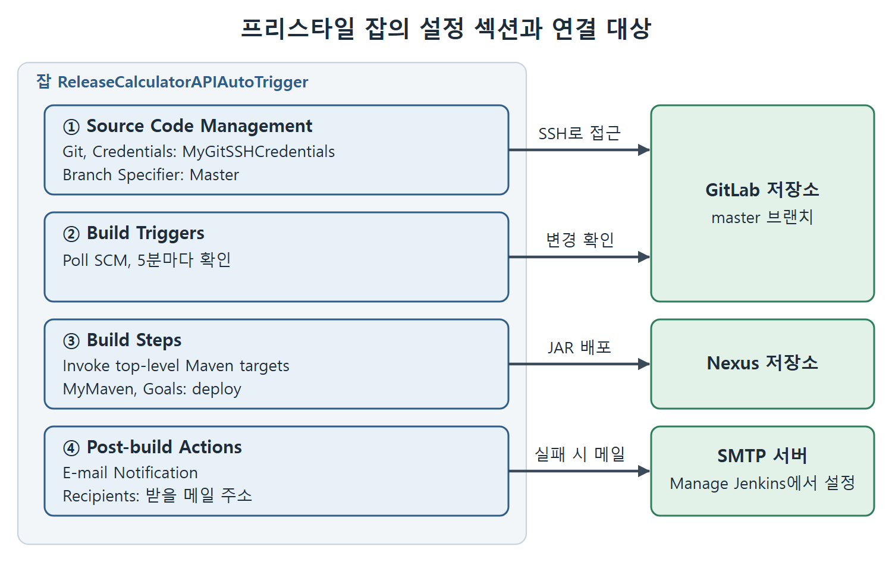

# 자동 트리거 프리스타일 잡 만들기

이 문서는 장의 중심 실습이다. 누군가 master 브랜치에 코드를 합치면 Jenkins가 스스로 알아채고 빌드를 돌려서 새 버전의 JAR를 Nexus에 배포하는 프리스타일 잡(free-style job)을 만든다. 사람이 "빌드 시작" 버튼을 누를 필요가 없다는 점이 핵심이다.

비유하면 우편함에 새 편지가 들어왔는지 5분마다 가서 확인하고, 있으면 곧바로 처리하는 비서를 두는 것과 같다. 이 비서가 확인하는 우편함이 GitLab의 master 브랜치이고, 확인 방식이 Poll SCM이다. 잡 이름은 원서를 따라 ReleaseCalculatorAPIAutoTrigger로 한다.

---

## 1. 잡 만들기와 소스 코드 관리 설정

1. Jenkins 대시보드에서 New Item 링크를 누른다.
2. Enter an item name 입력란에 잡 이름을 쓴다. 원서는 `ReleaseCalculatorAPIAutoTrigger`를 썼다.
3. Freestyle project 항목을 선택하고 OK 버튼을 누른다.
4. 설정 화면의 Source Code Management 섹션에서 Git 라디오 버튼을 고른다.
5. Repository URL 입력란에 Git 저장소의 SSH 주소를 넣는다.

여기까지만 하면 Repository URL 아래에 "Permission denied" 오류가 나타난다. SSH로 인증해 줄 개인 키를 아직 알려 주지 않았기 때문이다. 이제 Jenkins에 SSH 자격 증명(credential)을 만들어 주어야 한다.

## 2. SSH 자격 증명 항목 만들기

지난 장에서는 사용자 이름과 비밀번호 방식의 자격 증명을 만들었다. 이번에는 개인 키를 담는 자격 증명을 만든다.

1. Credentials 입력란 옆의 Add 버튼을 누르고 Jenkins를 선택한다. Jenkins Credentials Provider: Jenkins 화면이 열린다.
2. Domain은 Global credentials (unrestricted)를 그대로 둔다.
3. Kind 드롭다운에서 SSH Username with private key를 고른다.
4. ID 입력란에 이 항목의 이름을 쓴다. 원서는 `MyGitSSHCredentials`라고 썼다.
5. Private Key 섹션에서 Enter directly 라디오 버튼을 고르고 Add 버튼을 누른다.
6. 개인 키 파일의 내용을 복사해서 입력란에 붙여 넣는다.
7. Passphrase 입력란에 키를 만들 때 정한 암호를 입력한다.
8. Add 버튼을 눌러 저장한다.

| 입력란 | 원서에서 넣은 값 | 의미 |
| --- | --- | --- |
| Domain | Global credentials (unrestricted) | 모든 곳에서 쓸 수 있는 범위 |
| Kind | SSH Username with private key | 개인 키로 인증하는 종류 |
| ID | MyGitSSHCredentials | 나중에 고를 때 쓰는 이름 |
| Private Key | Enter directly로 개인 키 붙여 넣기 | 파일 내용 전체 |
| Passphrase | 키를 만들 때 정한 암호 | 키 사용 시 요구되는 비밀번호 |

여기서 주의할 점이 하나 있다. 이번에 붙여 넣는 것은 GitLab에 등록한 공개 키가 아니라 개인 키이다. Jenkins가 사람 대신 "이 컴퓨터가 등록된 그 개발자의 컴퓨터다"라고 GitLab에 증명해야 하기 때문이다.

## 3. 자격 증명 선택과 브랜치 지정

1. Credentials 드롭다운에서 방금 만든 SSH 자격 증명을 선택한다.
2. Apply 버튼을 누르면 Repository URL 아래의 "Permission denied" 오류가 사라진다.
3. Branch Specifier 입력란에 브랜치 이름을 쓴다. 원서는 main이 아니라 master를 주 브랜치로 쓰므로 `Master`라고 입력했다.

원서 본문은 `Master`로 대문자를 쓰는데, 브랜치 이름은 대소문자를 구분하는 경우가 많으니 실제 브랜치 이름과 같게 적어야 한다.

## 4. 빌드 트리거 설정, Poll SCM

페이지를 아래로 내려 Build Triggers 섹션으로 간다.

1. Poll SCM 체크박스를 선택한다.
2. 원서는 폴링 주기로 "After every 5 minutes, every hour, every Day Of Month, every Month, every Day Of Week"를 골랐다. 원서는 이 설정이 5분마다 확인하는 것이라고 설명한다.

이렇게 설정하면 Jenkins가 5분마다 저장소의 master 브랜치를 살펴보고, 변경을 발견하면 빌드를 시작한다. 변경이 없으면 빌드는 일어나지 않는다.

| 방식 | 누가 먼저 움직이나 | 원서의 설정 |
| --- | --- | --- |
| Poll SCM | Jenkins가 주기적으로 저장소를 확인 | 5분마다, master 브랜치 |
| 수동 빌드 | 사람이 버튼을 누름 | 지난 장 방식 |

Poll SCM은 저장소가 Jenkins에게 알려 주는 방식(웹훅, webhook)과 달리 Jenkins가 먼저 가서 묻는 방식이다. 이 비교는 이해를 돕기 위한 것이며, 원서는 이 장에서 웹훅을 다루지 않는다.

## 5. 빌드 스텝 설정, Maven deploy

1. 페이지를 더 내려 Add build step 드롭다운을 연다.
2. Invoke top-level Maven targets를 선택한다.
3. Maven Version 드롭다운에서 MyMaven을 선택한다. MyMaven은 Jenkins에 미리 등록해 둔 Maven 설정의 이름으로 보인다.
4. Goals 입력란에 `deploy`를 입력한다.

Maven의 deploy는 앞 단계인 컴파일, 테스트, 패키지를 모두 거친 뒤 마지막에 JAR를 원격 저장소(Nexus)에 올리는 목표이다. 그래서 한 번의 deploy로 테스트까지 돌고, 테스트가 실패하면 배포는 일어나지 않는다. 이 성질은 실패 알림 실습에서 그대로 드러난다.

## 6. 빌드 후 조치, 이메일 알림

1. Add post-build action 버튼을 누르고 E-mail Notification을 선택한다.
2. Recipients 입력란에 알림을 받을 이메일 주소를 쓴다.
3. Send e-mail for every unstable build 체크박스를 체크된 상태로 둔다. 빌드가 실패하면 이메일을 받기 위해서이다.
4. Save 버튼을 눌러 잡을 저장한다.

| 설정 | 값 | 효과 |
| --- | --- | --- |
| Send e-mail for every unstable build | 체크 | 불안정한 빌드마다 메일 발송 |
| Recipients | 받을 메일 주소 | 알림이 도착하는 곳 |

잡 자체는 여기서 완성이다. 그런데 메일을 실제로 보내려면 Jenkins 자체의 메일 서버 설정이 필요하다. 이어지는 문서에서 다룬다.

## 7. 설정 한눈에 보기

| 섹션 | 항목 | 값 |
| --- | --- | --- |
| Source Code Management | Git, Repository URL | 저장소 SSH 주소 |
| Source Code Management | Credentials | MyGitSSHCredentials |
| Source Code Management | Branch Specifier | Master |
| Build Triggers | Poll SCM | 5분마다 |
| Build Steps | Invoke top-level Maven targets | MyMaven, Goals는 deploy |
| Post-build Actions | E-mail Notification | 받을 메일 주소 |

그림은 잡 설정의 네 섹션이 각각 GitLab 저장소, Nexus 저장소, SMTP 서버와 어떻게 이어지는지 한눈에 보여 준다.

 
 
 

[CICD Pipeline Using Jenkins Unleashed](../)
