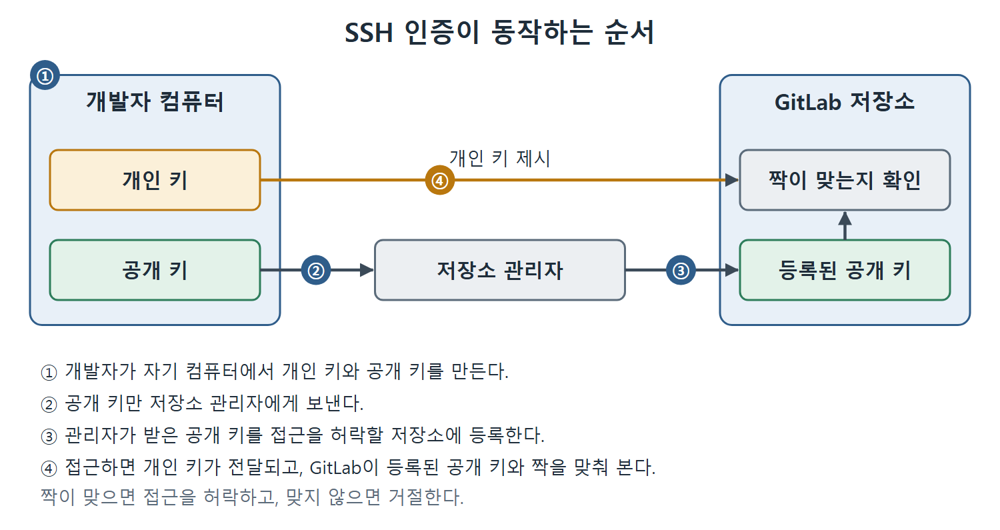

# 협업자 초대와 SSH 인증 원리

회사에서 하나의 애플리케이션을 혼자 만드는 경우는 드물다. 이 장은 지난 장에서 만든 JenkinsBookCalculatorAPI 저장소에 새 개발자를 불러들이는 일에서 출발한다. 지금까지는 저장소를 만든 사람의 GitLab 계정 하나로 모든 작업을 했는데, 이제 다른 개발자가 같은 저장소에 코드를 올릴 수 있게 만들어야 한다.

이 문서는 저장소 관리자가 새 팀원을 협업자(contributor)로 초대하는 과정을 다룬다. 집에 비유하면 집주인이 가족이나 손님에게 현관 열쇠를 나눠 주되, 누구에게는 거실까지만, 누구에게는 모든 방을 열어 주는 것과 같다. GitLab에서는 이 "어디까지 열어 줄지"를 역할(role)로 정한다.

---

## 1. 왜 협업자를 따로 초대하는가

지난 장에서 우리는 저장소를 만든 GitLab 사용자의 자격 증명(credential, 로그인 정보)으로 코드를 올렸다. 저장소를 만든 사람은 그 저장소의 관리자(administrator) 권한을 가진다. 개발팀 안에는 이 관리자 말고도 여러 사람이 있다.

팀원마다 하는 일이 다르다. 어떤 사람은 애플리케이션의 버그만 보고하고, 어떤 사람은 직접 코드를 고친다. 그래서 관리자는 사람마다 기여 방식에 맞는 역할을 붙여서 저장소에 추가한다. 역할에 따라 쓸 수 있는 권한의 크기가 달라진다.

| 역할 | 원문이 설명한 쓰임새 | 권한 수준 |
| --- | --- | --- |
| Reporter(보고자) | 애플리케이션의 버그만 보고하는 팀원 | 상대적으로 적다 |
| Developer(개발자) | 개발자로 일하며 코드를 직접 다루는 팀원 | Reporter보다 많다 |

표처럼 원서는 Reporter와 Developer 두 역할만 예로 든다. GitLab에는 다른 역할도 있겠지만 원문이 다루지 않았으므로 여기서는 이 둘만 정리한다. 핵심은 "일에 필요한 만큼만 권한을 준다"는 점이다.

## 2. 초대할 수 있는 사람과 조건

초대에는 두 가지 전제가 있다.

- 저장소의 관리자만 새 팀원을 초대할 수 있다.
- 초대받을 사람은 이미 유효한 GitLab 계정을 갖고 있어야 한다.

두 번째 조건 때문에, 새 개발자가 GitLab 계정이 없다면 먼저 가입하게 해야 한다.

## 3. 초대 절차

원서는 저장소를 만든 사용자(dpranoday@gmail.com)로 로그인해서 Pranoday Dingare(@Pranodayd)를 Developer로 초대한다. 순서는 다음과 같다.

1. 저장소를 만든 관리자의 자격 증명으로 GitLab에 로그인한다. 로그인하면 GitLab 대시보드(첫 화면)가 열린다.
2. 대시보드에서 JenkinsBookCalculatorAPI 저장소를 찾아 링크를 눌러 저장소 메인 페이지로 들어간다.
3. 화면 왼쪽 메뉴에서 Project information → Members를 선택한다. 그러면 Project Members 페이지가 열린다.
4. Invite member 탭에서 GitLab Member or Email Address 입력란에 초대할 사람의 GitLab 사용자 ID를 입력한다.
5. 아래에 나타나는 드롭다운 목록에서 초대할 사람을 고른다. 원서에서는 Pranoday Dingare(@Pranodayd)를 눌렀다.
6. Select a role 입력란을 눌러 역할 목록을 열고 맡길 역할을 고른다. 원서는 Developer를 골랐다.
7. Invite 버튼을 누른다.

초대가 끝나면 초대받은 사람의 GitLab 계정 이메일 주소로 초대 메일이 간다. 이제 이 팀원은 Java API 코드 저장소에 자기 변경 사항을 올릴 수 있다.

| 단계 | 화면의 위치 | 하는 일 |
| --- | --- | --- |
| 로그인 | GitLab 로그인 화면 | 저장소를 만든 관리자 계정으로 접속 |
| 저장소 선택 | 대시보드 | JenkinsBookCalculatorAPI 링크 클릭 |
| 멤버 페이지 | Project information → Members | Project Members 페이지로 이동 |
| 사용자 지정 | GitLab Member or Email Address 입력란 | 사용자 ID 입력 후 드롭다운에서 선택 |
| 역할 지정 | Select a role 입력란 | Developer 선택 |
| 초대 | Invite 버튼 | 초대 메일 발송 |

이 표는 7단계 절차를 화면 위치 기준으로 다시 묶은 것이다. 가장 자주 헷갈리는 곳은 사용자를 입력만 하고 드롭다운에서 고르지 않는 경우라서, 반드시 목록에서 항목을 눌러 선택해야 한다.

## 4. 이 단계에서 기억할 점

- 초대는 코드 접근 권한을 주는 일이다. 코드를 실제로 내려받고 올리려면 다음 문서에서 다루는 인증 방식(SSH)까지 준비되어야 한다.
- 이 장의 이후 실습은 "초대받은 새 개발자"의 입장에서 진행된다. 새 개발자가 자기 컴퓨터에서 저장소를 복제하고, 곱셈 기능을 추가하고, 브랜치를 올린다.
- 역할을 잘못 주면 필요 이상의 권한이 생기므로, 버그만 보고할 사람에게는 Reporter를 준다는 원칙을 지키는 편이 안전하다.

## 5. 인증 방식은 여러 가지다

초대를 마쳐도 끝이 아니다. 저장소에 접근하는 사람이 정말 그 사람인지 확인하는 인증(authentication) 방식을 정해야 한다. GitLab 저장소에는 기본 인증(basic authentication), SSH 인증, API 키 같은 여러 방식을 쓸 수 있다.

| 방식 | 확인하는 방법 | 이 책에서 나온 곳 |
| --- | --- | --- |
| 기본 인증 | GitLab 사용자 이름과 비밀번호 | 지난 장(Jenkins 자격 증명도 이 방식) |
| SSH 인증 | 공개 키와 개인 키 한 쌍 | 이 장 |
| API 키 | 원문은 이름만 언급 | 다루지 않음 |

지난 장에서는 코드를 GitLab에 올릴 때도, Jenkins가 저장소에 접근할 때도 사용자 이름과 비밀번호로 자격 증명 항목을 만들었다. 이 장에서는 두 번째 방식인 SSH 인증으로 바꿔 본다.

## 6. 왜 SSH 인증이 필요한가

기본 인증에서는 사용자 이름과 비밀번호만 맞으면 어느 컴퓨터에서든 저장소에 접근한다. 개인 노트북이든 카페의 PC든 상관이 없다. 회사 입장에서는 코드가 밖으로 새어 나갈 수 있는 구멍이다.

만약 사무실 작업용 컴퓨터에서만 저장소에 접근하게 막고 싶다면 SSH 인증을 쓴다. 비유하자면 비밀번호는 "열쇠 모양을 아는 사람이면 누구나 열 수 있는 문"이고, SSH 키는 "특정 기계에만 들어 있는 전용 열쇠로 여는 문"이다.

## 7. SSH 인증이 동작하는 순서

SSH 인증은 공개 키(public key)와 개인 키(private key)라는 한 쌍의 키를 쓴다. GitLab과 함께 쓰는 흐름은 세 단계다.

1. 저장소에 접근하려는 개발자가 자기 컴퓨터에서 개인 키와 공개 키를 만든다. 그리고 공개 키를 GitLab 저장소 관리자에게 보낸다.
2. 관리자는 받은 공개 키를 접근을 허락할 저장소에 등록한다.
3. 개발자가 저장소에 접근하면, 자기 컴퓨터에 저장된 개인 키가 GitLab으로 전달된다. GitLab은 그 개인 키와 짝이 맞는 공개 키가 등록되어 있는지 확인한다. 짝이 맞으면 접근을 허락하고, 맞지 않으면 거절한다.

| 구분 | 어디에 두는가 | 역할 |
| --- | --- | --- |
| 개인 키 | 개발자 컴퓨터 안 | 접근할 때 GitLab에 보여 주는 쪽 |
| 공개 키 | GitLab에 등록 | 개인 키와 짝이 맞는지 확인하는 쪽 |

그림은 개발자 컴퓨터에서 만든 공개 키가 관리자를 거쳐 GitLab에 등록되고, 접근할 때 보여 주는 개인 키와 짝이 맞는지 확인하는 흐름을 번호 순서로 보여 준다.

관리자에게 건네는 것은 공개 키뿐이다. 다음 문서에서는 이 키 쌍을 만들고 GitLab에 등록하는 과정을 실제로 따라 한다.

 
 
 

[CICD Pipeline Using Jenkins Unleashed](../)
