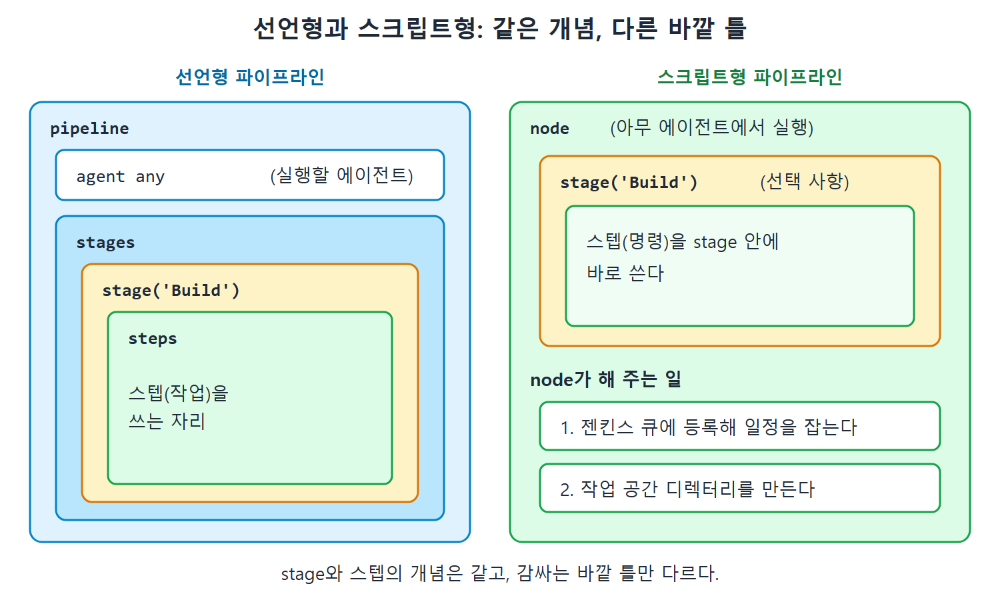

# 선언형과 스크립트형 문법

젠킨스는 파이프라인을 쓰는 방법으로 선언형 파이프라인(declarative pipeline)과 스크립트형 파이프라인(scripted pipeline) 두 가지를 지원한다. 선언형은 정해진 틀에 내용을 채워 넣는 양식 같고, 스크립트형은 빈 종이에 직접 순서를 적어 나가는 메모 같다. 이 문서는 두 방식의 뼈대 코드를 따로 보고, 어디가 같고 어디가 다른지 표로 비교한다.

원서는 두 뼈대 모두 빌드, 테스트, 배포 세 스테이지를 두고 각 줄에 번호를 달아 설명한다. 아래 코드는 그 구조를 보여 주되 스테이지 하나만 남겨 짧게 줄였다. 나머지 Test와 Deploy 스테이지는 Build와 똑같은 모양으로 이어 붙이면 된다.

---

## 1. 선언형 파이프라인의 기본 구조

선언형 파이프라인은 전체 빌드 과정을 pipeline 블록 하나로 감싼다.

```groovy
pipeline
{
    agent any
    stages
    {
        stage('Build')
        {
            steps
            {
                //
            }
        }
    }
}
```

원서 번호 설명을 풀어 쓰면 다음과 같다.

| 번호 | 원서 코드 위치 | 의미 |
|---|---|---|
| 1 | agent any | 사용할 수 있는 아무 에이전트(노드, 즉 머신)에서 이 파이프라인을 실행하라는 지시 |
| 2 | stage('Build') | 빌드 스테이지를 정의하는 블록 |
| 3 | Build의 steps 안 | 빌드 스테이지에 속한 개별 스텝(작업)을 쓰는 자리 |
| 4 | stage('Test') | 테스트 스테이지 정의 |
| 5 | Test의 steps 안 | 테스트 스테이지의 스텝을 쓰는 자리 |
| 6 | stage('Deploy') | 배포 스테이지 정의 |
| 7 | Deploy의 steps 안 | 배포 스테이지의 스텝을 쓰는 자리 |

표처럼 홀수 번호는 스텝 자리이고 짝수 번호는 스테이지 선언이다. 원서의 완전한 코드는 stages 안에 Build, Test, Deploy 스테이지가 차례로 들어 있고, 끝에 stages 블록과 pipeline 블록을 닫는 중괄호가 있다.

선언형 구조에서 눈여겨볼 점은 계층이 정해져 있다는 것이다. pipeline 안에 agent와 stages가 오고, stages 안에 stage가 오고, stage 안에 steps가 온다. 이 순서를 지켜야 문법이 맞으므로, 처음 쓰는 사람도 틀에 맞춰 채우면 된다.

---

## 2. 스크립트형 파이프라인의 기본 구조

스크립트형 파이프라인은 전체 빌드 과정을 node 블록 안에 정의한다.

```groovy
node
{
    stage('Build')
    {
        //
    }
}
```

원서는 node 블록으로 감싸는 것이 의무는 아니라고 말한다. 다만 감싸면 젠킨스가 두 가지를 해 준다.

1. node 블록 안의 스텝들을 젠킨스 큐(queue, 대기열)에 항목으로 추가해서 실행 일정을 잡는다. 노드의 실행기(executor, 빌드를 실제로 돌리는 슬롯)가 비는 순간 스텝이 실행된다.
2. 작업 공간(workspace) 디렉터리를 만든다. 여기에 소스 관리 시스템(SCM, Source Control Management)에서 받은 파일을 내려받아 작업한다.

스크립트형의 번호 설명은 선언형과 거의 같다. 1번이 node 블록이고(사용 가능한 아무 에이전트에서 실행한다는 뜻), 2, 4, 6번이 각각 Build, Test, Deploy 스테이지 블록이며, 3, 5, 7번이 해당 스테이지의 스텝 자리다.

원서가 덧붙이는 점은 스테이지 블록이 스크립트형에서는 선택 사항이라는 것이다. 그래도 쓰면 젠킨스 화면에서 각 스테이지의 작업과 진행을 훨씬 알아보기 쉽게 보여 준다.



그림은 선언형이 pipeline, agent, stages, stage, steps의 계층을 따르고, 스크립트형은 node 안에 stage와 스텝을 바로 쓰며 node가 큐 등록과 작업 공간 생성을 해 주는 모습을 나란히 보여 준다.

---

## 3. 두 방식 비교

원서는 표로 비교하지 않지만, 두 절의 설명을 모아 정리하면 다음과 같다.

| 항목 | 선언형 파이프라인 | 스크립트형 파이프라인 |
|---|---|---|
| 최상위 블록 | pipeline | node |
| 실행 위치 지정 | agent any | node 블록 자체 |
| 스테이지 묶음 | stages 블록 안에 stage를 나열 | node 안에 stage를 직접 나열 |
| 스텝 위치 | stage 안의 steps 블록 | stage 블록 안에 바로 작성 |
| stage 블록 | 구조에 포함됨 | 선택 사항(쓰면 화면 시각화가 좋아짐) |
| node 블록 효과 | 원서에 따로 설명 없음 | 큐 등록과 작업 공간 생성 |

표를 읽는 방법은 이렇다. 선언형은 pipeline, agent, stages, steps라는 정해진 단어가 계층을 이루고, 스크립트형은 node 하나에 stage와 코드를 바로 적는다. 그래서 같은 일을 해도 스크립트형이 줄 수가 더 적다.

이 장 뒤쪽 실습에서는 스크립트형 템플릿을 시작점으로 쓰고, 첫 실습의 Hello World 예제는 선언형으로 쓴다. 두 문법이 모두 등장하므로 위 뼈대를 기억해 두면 코드를 읽기 쉽다.

---

## 4. 각 용어가 코드에서 만나는 지점

앞 문서에서 정의한 네 가지 개념이 두 문법에서 어디에 대응하는지 정리한다.

| 개념 | 선언형 | 스크립트형 |
|---|---|---|
| 파이프라인 | pipeline 블록 | node 블록 안에 쓴 전체 코드 |
| 노드(에이전트) | agent any | node |
| 스테이지 | stage('이름') | stage('이름') |
| 스텝 | steps 안의 명령 | stage 안의 명령 |

두 문법 모두 stage와 스텝 개념은 같다. 달라지는 것은 감싸는 바깥 틀뿐이다. 이 점을 알면 선언형 예제를 스크립트형으로, 또는 그 반대로 바꿔 읽는 것이 어렵지 않다.

<br>
<br>
<br>

[CICD Pipeline Using Jenkins Unleashed](../)
