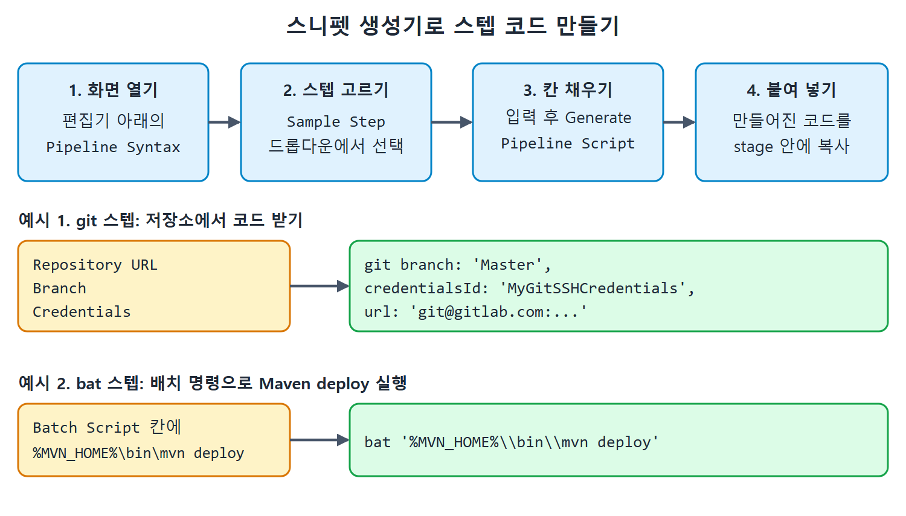
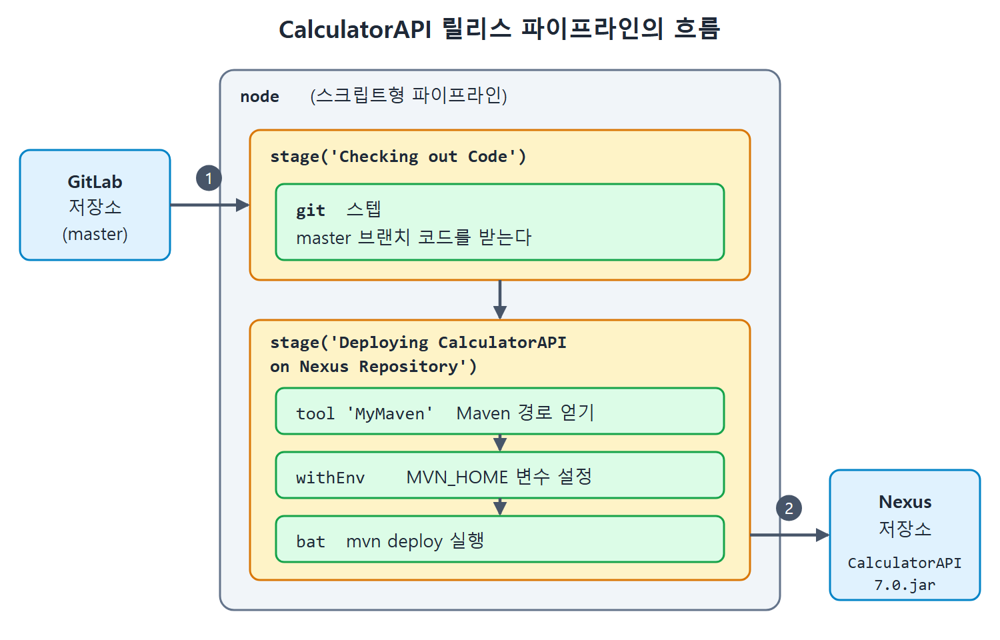

# 스니펫 생성기로 API 릴리스 파이프라인 만들기

앞서 프리스타일 잡으로 만들었던 CalculatorAPI JAR 릴리스를 이번에는 파이프라인 잡으로 다시 만든다. 하는 일은 같다. GitLab 저장소의 master 브랜치 코드를 받고, Maven deploy 골(goal, Maven이 실행하는 작업 단위)로 새 버전의 CalculatorAPI.jar를 Nexus 저장소에 올린다.

파이프라인 문법을 외우지 않아도 되도록 젠킨스는 스니펫 생성기(Snippet Generator)를 제공한다. 음식점 주문 키오스크처럼 메뉴에서 항목을 고르고 빈칸을 채우면 해당 코드 한 줄을 만들어 준다. 이 문서는 그 사용법과 완성된 스크립트, 실행과 확인까지 이어서 정리한다.

---

## 1. 스크립트형 템플릿으로 시작하기

1. 젠킨스 대시보드로 이동한다.
2. New Item 링크를 눌러 잡 이름을 정하고 Pipeline 옵션을 고른다.
3. OK 버튼을 누른다.
4. 설정 페이지를 내려 Pipeline 섹션을 찾는다.
5. 편집기 쪽의 Try Sample Pipeline 드롭다운에서 Scripted Pipeline 옵션을 누른다. 그러면 기본 스크립트형 파이프라인 템플릿이 편집기에 채워진다.

템플릿 코드는 지우고 직접 쓸 것이다. 그렇다고 스텝마다 문법을 손으로 쓸 필요는 없다. 편집기 아래의 Pipeline Syntax 링크를 누르면 Pipeline Syntax: Snippet Generator 화면이 열린다.

---

## 2. 스니펫 생성기 사용법

Sample Step 드롭다운을 열면 파이프라인에서 쓸 수 있는 스텝 목록이 나온다. 필요한 스텝을 고르고 입력란을 채운 뒤 Generate Pipeline Script 버튼을 누르면 해당 스텝의 코드 한 줄이 만들어진다. 만들어진 줄을 복사해 파이프라인 잡의 코드에 붙여 넣는다.



그림은 스니펫 생성기에서 스텝을 고르고 값을 채워 코드를 만든 뒤 stage 안에 붙여 넣는 네 단계와, 그 결과로 나오는 git과 bat 스텝 코드를 보여 준다.

### 첫 번째 스텝: Git으로 코드 받기

먼저 GitLab 저장소의 master 브랜치를 내려받아야 하므로 목록에서 git: Git 스텝을 고른다. 선택하면 저장소 정보를 넣는 칸이 나타난다.

| 입력 칸 | 저자가 넣은 값 |
|---|---|
| Repository URL | Git 저장소의 SSH URL |
| Branch | master 브랜치 |
| Credentials | SSH 자격 증명(credential) 항목 |

세 칸을 채우고 Generate Pipeline Script를 누르면 다음 문장이 나온다.

```groovy
git branch: 'Master', credentialsId: 'MyGitSSHCredentials', url: 'git@gitlab.com:Pranoday/jenkinsbookcalculatorapi.git'
```

원서에는 이 문장이 줄바꿈으로 나뉘어 인쇄되어 있으나 한 줄 문장이다.

이 git 스텝은 인자가 세 개다.

| 인자 | 의미 |
|---|---|
| branch | 체크아웃할 브랜치 이름 |
| credentialsId | 앞서 만든 자격 증명 항목의 ID |
| url | Git 저장소 주소 |

원서 코드의 브랜치 이름은 대문자로 시작하는 'Master'다. 저장소의 실제 브랜치 이름에 맞춰야 하므로, 따라 할 때는 자신의 브랜치 이름(보통 소문자 master)을 확인해야 한다.

### 스테이지에 넣고 주석 달기

저자는 템플릿에서 필요 없는 코드를 지우고, Checking out Code라는 이름의 스테이지를 추가한 뒤 그 안에 방금 만든 Git 스텝을 붙여 넣었다. 코드가 무엇을 하는지 적어 두려고 한 줄 주석은 이중 슬래시(//)로 달았다. 여러 줄 주석은 /* */로 감싸야 한다. 이 파이프라인의 첫 스테이지는 저장소의 master 브랜치 코드를 가져오는 일이다.

### 두 번째 스텝: bat으로 Maven deploy 실행하기

다음으로 Deploying the CalculatorAPI on the Nexus Repository 스테이지를 추가한다. 이 스테이지에서는 배치 명령으로 Maven deploy 골을 실행한다.

1. 스니펫 생성기로 돌아가 Sample Step 목록에서 bat 스텝을 고른다.
2. Batch Script 입력란에 `%MVN_HOME%\bin\mvn deploy`를 쓴다.
3. Generate Pipeline Script 버튼을 눌러 스텝 코드를 만든다.
4. 만들어진 줄을 복사해 새 스테이지 안에 붙여 넣는다.
5. 파이프라인에 몇 줄을 더 보태 완성한다.

---

## 3. 완성된 파이프라인 코드

원서의 Listing 14-1이다.

```groovy
node
{
    def mvnHome
    stage('Checking out Code') {
        git branch: 'Master', credentialsId: 'MyGitSSHCredentials', url: 'git@gitlab.com:Pranoday/jenkinsbookcalculatorapi.git'
    }
    stage('Deploying CalculatorAPI on Nexus Repository')
    {
        mvnHome = tool 'MyMaven'
        withEnv(["MVN_HOME=$mvnHome"])
        {
            bat '%MVN_HOME%\\bin\\mvn deploy'
        }
    }
}
```

원서 코드에는 `// for display purposes`와 `// Get code from a GitLab repository` 같은 영어 주석이 더 붙어 있으나 위에서는 생략했다. 각 줄의 의미는 다음과 같다.

| 코드 | 의미 |
|---|---|
| node | 스크립트형 파이프라인의 바깥 블록 |
| def mvnHome | mvnHome이라는 변수를 정의한다 |
| stage('Checking out Code') | 이 스테이지의 Git 스텝이 저장소에서 코드를 가져온다 |
| mvnHome = tool 'MyMaven' | Global Tool Configuration에 MyMaven이라는 이름으로 등록한 Maven 설치 경로를 mvnHome에 담는다 |
| withEnv(["MVN_HOME=$mvnHome"]) | mvnHome 값을 시스템 변수 MVN_HOME으로 설정한다 |
| bat '%MVN_HOME%\\bin\\mvn deploy' | withEnv 블록 안에서 그 환경 변수로 Maven 설치의 bin 폴더에 있는 mvn 명령을 찾아 deploy 골을 실행한다 |

여기서 MyMaven은 원서 Figure 14-12처럼 Global Tools Configuration에 만들어 둔 Maven 설정이다. 저자의 환경에서 mvnHome은 D:\MavenInstallation\apache-maven-3.8.1이 된다.



그림은 GitLab 저장소의 master 코드를 받는 첫 스테이지와, tool, withEnv, bat 스텝으로 Maven deploy를 실행해 Nexus 저장소에 CalculatorAPI 7.0.jar를 올리는 둘째 스테이지의 흐름을 보여 준다.

코드가 이런 두 단계(경로를 얻고, 환경 변수로 넘겨 쓴다)를 거치는 이유는 Maven 실행 파일의 위치를 코드에 직접 박아 넣지 않기 위해서다. 설치 경로가 바뀌어도 젠킨스 도구 설정만 고치면 된다. 이 이유는 코드 구조에서 읽어 낸 해석이다.

bat 문자열 안의 역슬래시가 두 번(\\) 쓰인 점도 보자. Groovy 문자열에서 역슬래시는 특수 문자 표시에 쓰이므로 한 개의 경로 구분자를 표현하려고 두 개를 쓴 것이다. 이 설명도 일반적인 문법에 따른 풀이다. 코드를 다 쓰면 Save 버튼으로 저장한다.

---

## 4. 파이프라인 잡 실행하고 릴리스 확인하기

잡을 만들었으니 실행해서 CalculatorAPI의 새 버전을 릴리스한다. 코드에 새 기능을 넣지는 않고, 앞 장에서 잡 실패를 보여 주려고 일부러 틀린 값으로 바꿨던 테스트를 바로잡는다.

### 테스트 케이스 수정

TestAdditionWithPositiveNumbers() 테스트의 기댓값을 올바른 값으로 되돌린 코드는 다음과 같다(Listing 14-2).

```java
@Test(priority=1)
public void TestAdditionWithPositiveNumbers()
{
      System.out.println("I am in 1st TestCase");
      Result=Obj.Addition(10,20);
      Assert.assertEquals(Result,30,"Addition does not work with positive numbers");
}
```

10과 20을 더한 결과가 30인지 확인하는 테스트다. 기댓값이 틀리면 deploy 이전 단계인 테스트에서 빌드가 실패하므로, 릴리스를 하려면 이 값이 맞아야 한다.

### 버전 올리기

pom.xml의 API 버전을 7.0으로 바꾼다(Listing 14-3).

```xml
<groupId>Pranodayd</groupId>
<artifactId>CalculatorAPI</artifactId>
<version>7.0</version>
```

버전이 바뀌어야 Nexus에 CalculatorAPI 7.0.jar라는 새 이름으로 올라간다. 저자는 이 변경을 새 로컬 브랜치에 커밋하고, 그 브랜치를 원격 저장소에 푸시한 다음 master 브랜치에 병합했다.

### 실행과 확인

| 순서 | 작업 | 확인할 곳 |
|---|---|---|
| 1 | PipelineJobToReleaseCalculatorAPI를 시계 모양 아이콘으로 수동 실행 | 페이지 왼쪽 Build Execution Status 섹션에서 진행 상황 확인 |
| 2 | 콘솔 출력을 아래로 스크롤 | CalculatorAPI 7.0.jar의 성공적 릴리스 메시지 |
| 3 | Nexus 저장소에 접속 | CalculatorAPI 7.0.jar가 올라와 있는지 확인(Figure 14-13) |

순서대로 확인하면 파이프라인이 코드 받기부터 deploy까지 정상 동작했는지 한눈에 알 수 있다. 저자는 Nexus에서 JAR 파일이 올라간 것을 직접 확인하고 성공했다고 적었다.

이 파이프라인은 프리스타일 잡이 하던 일을 코드 몇 줄로 대신한 것이다. Maven deploy 골은 컴파일, 단위 테스트, 패키징을 거쳐 배포까지 Maven 빌드 라이프사이클(lifecycle)의 앞 단계를 포함하므로, 별도 스텝 없이 deploy 하나로 모든 단계가 실행된다. 이 설명은 Maven의 일반 동작에 따른 해석이며 원서의 요약 문장이 "모든 빌드 라이프사이클 단계를 실행하는 파이프라인"이라고 말하는 것과도 맞는다.

<br>
<br>
<br>

[CICD Pipeline Using Jenkins Unleashed](../)
