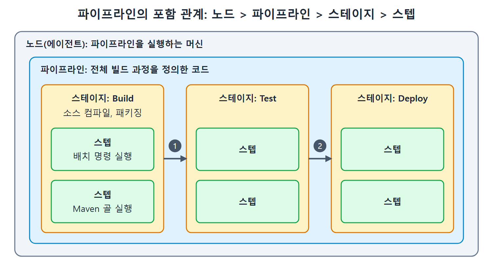

# 파이프라인이란 무엇인가

13장까지는 프리스타일 잡(free-style job, 화면에서 옵션을 골라 만드는 기본 잡)으로 Java Calculator API 릴리스를 자동화했다. 잡은 master 브랜치의 최신 코드를 받아 컴파일, 단위 테스트, 패키징, 아티팩트 저장소(빌드 결과물을 보관하는 곳) 배포까지 차례로 실행했다. 이 문서는 그 흐름을 코드로 쓰는 방식인 젠킨스 파이프라인(pipeline)의 정의, 장점, 기본 용어를 정리한다.

파이프라인은 공장의 조립 라인과 비슷하다. 부품이 들어와서 조립, 검사, 포장을 거쳐 나가듯이, 소스 코드가 빌드, 테스트, 배포를 거쳐 사용자에게 도달한다. 조립 라인의 순서를 설계도로 그려 두면 누가 와도 같은 제품이 나오는데, 파이프라인은 그 설계도를 코드로 적어 둔 것이다.

---

## 1. 젠킨스 파이프라인의 정의

젠킨스 파이프라인은 여러 젠킨스 플러그인(plugin, 기능을 덧붙이는 확장 모듈)을 묶어서, 지속적 전달(CD) 파이프라인을 젠킨스에 구현하고 연결할 수 있게 해 주는 스크립트 모음이다.

여기서 지속적 전달 파이프라인은 애플리케이션 코드가 버전 관리 시스템에서 출발해 고객과 사용자에게 닿기까지의 과정을 코드 문장으로 적어 자동 실행하게 만든 것이다. 코드를 한 줄만 고쳐도 릴리스되기까지 꽤 복잡한 빌드 과정을 거치므로, 이 과정을 사람이 손으로 반복하지 않고 코드로 자동화하는 것이 핵심이다.

### 왜 스크립트 문법이 필요한가

원서는 API 개념으로 이 점을 설명한다. 코드를 쓸 때는 호출할 수 있는 함수 모음인 API(Application Programming Interface)가 필요하다. 예를 들어 Java로 Excel 파일을 읽으려면 Excel과 상호작용하는 함수 모음이 있어야 한다.

같은 이치로, 코드에서 젠킨스 플러그인을 다루려면 스크립트 참조(문법)가 필요하다. 이 참조를 사용해 플러그인에 "이 작업을 해라"라고 지시하는 코드가 곧 파이프라인이다. 즉 파이프라인은 전체 빌드 과정 안에서 각 플러그인이 맡을 일을 코드로 지시하는 방법이다.

| 비교 대상 | 역할 |
|---|---|
| Excel API | Java 코드에서 Excel 파일을 읽고 쓰는 함수 모음 |
| 파이프라인 문법 | 코드에서 젠킨스 플러그인에 작업을 지시하는 스크립트 참조 |

표의 두 줄은 같은 구조다. 어떤 프로그램의 기능을 코드로 부르려면 그 프로그램이 정해 둔 호출 규칙이 필요하고, 젠킨스에서는 그 규칙이 파이프라인 문법이다.

---

## 2. 잡 대신 파이프라인을 쓰는 이유

원서는 CI/CD 과정을 젠킨스 잡(job, 젠킨스가 실행하는 작업 단위)이 아니라 파이프라인으로 자동화할 때의 장점을 다섯 가지로 든다.

| 특징 | 의미 | 쉬운 풀이 |
|---|---|---|
| Code (코드) | CI/CD 과정을 코드로 쓰고 애플리케이션 소스와 함께 저장소에 올린다 | 빌드 절차가 소스와 함께 관리되어 팀이 공유한다 |
| Durable (내구성) | 컨트롤러가 계획된 재시작이든 예기치 않은 재시작이든 살아남는다 | 젠킨스가 꺼졌다 켜져도 진행하던 파이프라인이 이어진다 |
| Pausable (일시정지) | 사람의 입력이나 승인을 기다렸다가 이어서 실행할 수 있다 | 배포 직전에 담당자 승인을 받는 식으로 쓴다 |
| Versatile (다재다능) | 분기(forking), 반복(looping), 병렬 실행 같은 복잡한 요구를 지원한다 | 단순한 순차 실행을 넘어 복잡한 흐름도 표현한다 |
| Extensible (확장성) | 다른 플러그인과 연동하는 여러 방법을 지원한다 | 필요한 도구를 플러그인으로 붙여 쓴다 |

이 표에서 가장 먼저 눈여겨볼 항목은 Code다. 빌드 과정이 코드로 중앙 저장소에 있으면 팀원 모두가 같은 내용을 보고 쓸 수 있다. 예를 들어 어떤 개발자가 애플리케이션 코드를 바꾸다가 빌드 절차도 바꿔야 한다면, 파이프라인이 코드이므로 그 개발자가 직접 같은 변경 묶음에 빌드 절차 수정까지 넣을 수 있다.

참고로 Durable이 말하는 재시작은 젠킨스 컨트롤러(controller, 마스터라고도 부르는 젠킨스 본체 서버)의 재시작이다. 이 내구성을 얼마나 강하게 가져갈지는 잡 설정의 Speed/Durability 옵션으로 조절하며, 자세한 내용은 「파이프라인 잡 만들기와 문자열 보간」 문서에서 다룬다.

---

## 3. 파이프라인의 기본 개념 네 가지

파이프라인 코드를 읽으려면 먼저 네 가지 용어를 알아야 한다. 이 용어들은 다음 문서의 문법 설명에서 계속 나온다.

| 용어 | 정의 | 예 |
|---|---|---|
| Pipeline (파이프라인) | 빌드, 테스트, 전달 같은 여러 단계를 포함한 전체 빌드 과정을 정의하는 코드 | 이 장에서 만드는 전체 스크립트 |
| Node (노드) | 파이프라인을 실행할 수 있는 머신 | 빌드를 실행하는 서버 |
| Stage (스테이지, 단계) | 빌드, 테스트, 배포 같은 소프트웨어 진행 단계. stage 블록은 그 단계에서 할 작업을 모아 둔다 | Build 스테이지에서 소스 컴파일, 라이브러리 패키징 |
| Step (스텝) | 특정 스테이지 안에서 파이프라인이 하는 단일 작업. stage 블록은 여러 스텝의 모음일 뿐이다 | 배치 명령 실행, 특정 Maven 골 실행 |

네 개념은 포함 관계로 이해하면 쉽다. 파이프라인이라는 큰 틀 안에 스테이지가 여러 개 있고, 스테이지 안에 스텝이 들어 있으며, 이 전체가 노드라는 머신 위에서 돈다. 요리에 빗대면 파이프라인은 코스 요리 전체, 스테이지는 전채나 메인 같은 코스, 스텝은 "양파를 썬다" 같은 개별 동작이다. 노드는 요리가 만들어지는 주방이다.

그림은 노드 안에 파이프라인이 있고, 파이프라인 안에 스테이지가 차례로 이어지며, 각 스테이지 안에 스텝이 들어 있는 구조를 보여 준다.

원서의 스테이지 예시는 두 가지다. Build 스테이지는 소스 컴파일과 라이브러리 패키징 같은 작업을 담고, 스텝은 배치 명령 실행이나 특정 Maven 골(goal, Maven이 실행하는 작업 이름) 실행 같은 한 가지 일이다.

용어 정리를 한 줄로 요약하면 다음과 같다.

- 파이프라인은 전체 빌드 과정을 코드로 정의한 것이다.
- 노드는 그 코드를 실제로 돌리는 머신이다.
- 스테이지는 큰 단계, 스텝은 그 안의 한 가지 작업이다.

다음 문서에서는 이 개념을 파이프라인 코드로 쓰는 두 가지 문법, 선언형과 스크립트형의 뼈대를 비교한다.

 
 
 

[CICD Pipeline Using Jenkins Unleashed](../)
