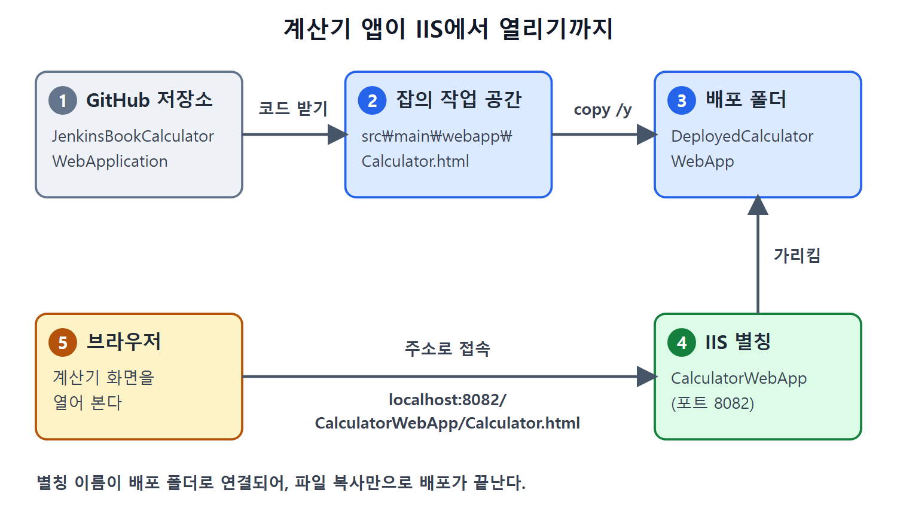

# 계산기 웹 앱과 IIS 배포

이 장에서 젠킨스로 관리할 대상은 HTML 파일 하나로 이루어진 계산기 웹 애플리케이션이다. 앞 장의 자바 API 프로젝트는 컴파일, 단위 테스트, 패키징, Nexus 배포까지 거쳤지만, 이번 예제는 일부러 가장 단순한 형태를 골랐다. 애플리케이션 자체가 단순해야 독자가 젠킨스 기능에만 집중할 수 있기 때문이다.

이 문서는 계산기 앱의 구성, 빌드가 사실상 필요 없는 이유, IIS(Internet Information Services, 윈도우용 웹 서버)에 배포하는 방법, 접속 주소를 정리한다. 이후 문서의 잡들이 모두 이 앱을 배포하고 테스트하는 일을 한다.

---

## 1. 계산기 앱은 어떻게 생겼나

계산기는 덧셈, 뺄셈, 곱셈, 나눗셈을 하는 간단한 화면이다. 사용자가 버튼을 누르면 입력 칸에 숫자와 연산자가 쌓이고, `=` 버튼을 누르면 결과가 같은 입력 칸에 나온다. 화면 위쪽에는 "JenkinsBook Calculator Application"이라는 제목이 초록색 글씨로 뜬다.

프로젝트는 Maven 프로젝트 형태이고, 소스는 `Calculator.html` 한 파일에 모두 들어 있다. 화면 모양은 HTML과 CSS로, 동작은 그 파일 안에 포함된 JavaScript로 만든다.

| 구성 요소 | 하는 일 |
| --- | --- |
| HTML 표(table) | 입력 칸과 숫자, 연산자 버튼을 격자로 배치한다 |
| CSS(style 블록) | 제목, 버튼, 입력 칸의 색과 테두리, 너비를 정한다 |
| JavaScript 함수 | 버튼을 눌렀을 때의 동작을 처리한다 |

별도의 서버 코드가 없으므로 브라우저가 이 파일 하나만 받으면 앱이 완성된다. 그래서 배포는 파일 복사로 끝난다.

## 2. 자바스크립트 함수 세 개

화면의 동작은 함수 세 개가 전부다. 아래는 원서 Listing 15-1에서 핵심만 줄인 것이다.

```html
<script>
  function dis(val) {
    document.getElementById("result").value += val
  }
  function solve() {
    let X = document.getElementById("result").value
    let z = eval(X)
    document.getElementById("result").value = z
  }
  function clr() {
    document.getElementById("result").value = ""
  }
</script>
```

함수마다 맡은 일이 다르다.

| 함수 | 호출되는 버튼 | 동작 |
| --- | --- | --- |
| `dis(val)` | 숫자, 연산자, 소수점 | 누른 값을 입력 칸(`result`)의 끝에 이어 붙인다 |
| `solve()` | `=` | 입력 칸의 문자열을 `eval`로 계산해 결과로 바꾼다 |
| `clr()` | `c` | 입력 칸을 빈 문자열로 만든다 |

`eval`은 문자열을 코드처럼 실행해 주는 JavaScript 함수다. 계산기 예제라서 간단히 쓴 것이고, 실제 서비스에서는 보안 때문에 피하는 편이다. 원서는 이 점을 따로 다루지 않으므로 여기서는 참고로만 적는다.

버튼 배치는 4열 표다. 첫 줄은 입력 칸(3칸 합침)과 `c` 버튼이고, 그 아래로 `1 2 3 /`, `4 5 6 -`, `7 8 9 +`, `. 0 = *` 순서로 놓인다. 각 버튼은 `onclick`으로 위 함수 중 하나를 부른다. 예를 들어 `1` 버튼은 `dis('1')`, `=` 버튼은 `solve()`를 부른다. 입력 칸의 id가 `result`라는 점은 뒤에서 셀레니움 테스트가 이 칸을 찾을 때 중요해진다.

## 3. 빌드 단계가 필요 없는 이유

자바 프로젝트는 소스를 컴파일해서 JAR 같은 결과물을 만들어야 한다. 반면 이 앱은 HTML 파일 하나라서 컴파일도 패키징도 없다. 원서도 이 점을 밝히면서, 일부러 예제를 단순하게 잡았다고 설명한다.

따라서 이 장의 "빌드 앤 디플로이" 잡이 실제로 하는 일은 두 가지다. 저장소에서 최신 코드를 받아 오고, 그 HTML 파일을 웹 서버 폴더에 복사한다.

## 4. IIS에 별칭 만들기

배포 위치는 IIS의 웹 별칭(alias)이 가리키는 폴더다. 별칭은 웹 주소의 한 구간을 실제 폴더에 연결해 주는 이름표라고 보면 된다. 도서관에서 "컴퓨터 자료실"이라는 팻말이 3층 특정 방을 가리키는 것과 비슷하다.

원서 저자의 설정은 아래와 같다.

| 항목 | 값 |
| --- | --- |
| 별칭 이름 | `CalculatorWebApp` |
| 별칭이 가리키는 폴더 | `D:\JenkinsBookExamples\DeployedCalculatorWebApp` |
| 설정 위치 | IIS의 Edit Virtual Directory 창 |
| 기본 웹 사이트 포트 | 8082 |

이 값들은 저자의 환경이다. 독자의 폴더와 포트가 다르면 그에 맞게 바꿔야 한다.

배포 절차는 한 단계다. 프로젝트의 `webapp` 디렉터리에 있는 `Calculator.html`을 `D:\JenkinsBookExamples\DeployedCalculatorWebApp`으로 복사하면, 별칭을 통해 웹으로 접근할 수 있게 된다.

## 5. 접속 주소

기본 웹 사이트가 8082 포트에서 돌고 있다면 아래 주소로 앱을 열 수 있다.

```text
http://localhost:8082/CalculatorWebApp/Calculator.html
```

주소는 `호스트:포트/별칭/파일 이름` 구조다. 별칭 `CalculatorWebApp`이 배포 폴더로 연결되고, 그 안의 `Calculator.html`이 열린다. 이 주소가 이후 셀레니움 테스트가 접속하는 대상이기도 하다.



저장소의 코드가 작업 공간을 거쳐 배포 폴더로 복사되고, IIS 별칭이 그 폴더를 가리켜 브라우저가 주소로 접속하는 흐름을 보여 준다. 컴파일 없이 복사만으로 배포가 끝나는 구조다.

## 6. 정리

| 단계 | 내용 |
| --- | --- |
| 소스 | `Calculator.html` 한 개(HTML, CSS, JavaScript) |
| 빌드 | 필요 없음(컴파일, 패키징 없음) |
| 배포 | 파일을 IIS 별칭 폴더로 복사 |
| 확인 | `http://localhost:8082/CalculatorWebApp/Calculator.html` |

다음 문서에서는 이 앱을 사람 대신 브라우저로 눌러 보는 UI 자동화 테스트를 다룬다.

<br>
<br>
<br>

[CICD Pipeline Using Jenkins Unleashed](../)
