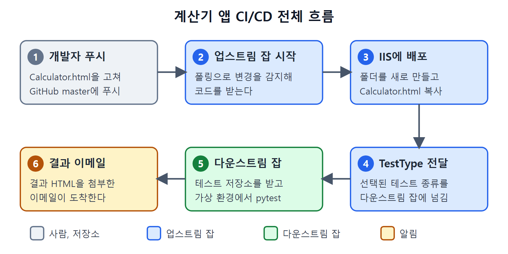

# 요약과 핵심 개념

이 문서는 15장 전체를 한 번에 되짚는다. 이 장의 목표는 HTML 파일 하나짜리 계산기 웹 앱을 대상으로, 코드 받기부터 배포, UI 자동화 테스트, 이메일 보고까지 한 흐름을 젠킨스로 자동화하는 것이었다. 같은 흐름을 프리스타일 잡과 파이프라인 잡으로 두 번 구현했다.

원서의 Summary는 셀레니움 설정, 업스트림과 다운스트림 잡, 파라미터 전달, 수동과 자동 실행, 파이프라인 구현, 사용자 지정 이메일 알림을 장의 성과로 꼽는다. 다음 장은 코드로서의 파이프라인(pipeline as code)을 다룬다.

---

## 1. 장의 전체 흐름

| 단계 | 한 일 | 문서 |
| --- | --- | --- |
| 대상 이해 | 계산기 앱, IIS 별칭, 접속 주소 | 계산기 웹 앱과 IIS 배포 |
| 테스트 준비 | Selenium과 Python 프로젝트, pytest 실행 | 셀레니움 UI 자동화 테스트 |
| 저장소 준비 | GitHub 비공개 저장소 두 개, SSH 연결 | GitHub 저장소와 SSH 연결 |
| 프리스타일 구현 | 업스트림, 다운스트림 잡과 파라미터 | 파라미터 프리스타일 잡 두 개 연결 |
| 알림 | Email Extension 플러그인 | 확장 이메일 알림 설정 |
| 파이프라인 구현 | 같은 흐름을 스크립트로 | 파이프라인 잡으로 다시 만들기 |

## 2. 핵심 개념 정리

| 개념 | 한 줄 설명 |
| --- | --- |
| E-E 테스트 | 사용자 입장에서 업무 흐름 전체를 확인하는 테스트 |
| UI 자동화 | 도구가 화면 요소를 찾아 입력과 클릭을 대신 하는 테스트 |
| Selenium WebDriver | 여러 언어 라이브러리를 가진 오픈 소스 UI 자동화 도구 |
| Chrome Driver | Selenium 호출을 Chrome 자동화 호출로 바꿔 주는 구현체 |
| pytest, pytest-html | 테스트 실행 프레임워크와 HTML 보고서 생성기 |
| virtualenv | 프로젝트 전용 파이썬 환경 |
| 스모크 테스트 | 새 빌드가 본격 테스트를 받을 최소 조건을 갖췄는지 보는 테스트 |
| 회귀 테스트 | 변경이 기존 기능을 망가뜨리지 않았는지 보는 테스트 |
| 업스트림, 다운스트림 잡 | 먼저 실행되어 다른 잡을 호출하는 잡과, 호출을 받는 잡 |
| Parameterized Trigger | 잡 사이에 파라미터 값을 넘기게 해 주는 플러그인 |
| Email Extension | 사용자 지정 메시지와 첨부가 가능한 메일 플러그인 |

## 3. 기억할 규칙

| 영역 | 규칙 |
| --- | --- |
| 파라미터 이름 | 업스트림이 보내는 이름과 다운스트림이 받는 이름이 같아야 한다 |
| 폴링 | 다운스트림 잡은 Poll SCM을 켜지 않는다 |
| 배치 안 파라미터 | `%이름%`으로 감싼다 |
| 파이프라인 파라미터 | `params.이름`으로 읽는다 |
| 큰따옴표 문자열 | `${...}`로 보간한다 |
| 작은따옴표 문자열 | `+`로 이어 붙이거나 중괄호 없는 `$`를 쓴다 |
| 전역 이메일 설정 | 잡이나 앱에 한정된 내용은 넣지 않는다 |
| 이메일 수신자 | 잡의 Project Recipient List가 전역 기본값을 덮어쓴다 |
| 실패 대비 | 파이프라인은 `try`/`finally`, 프리스타일은 Always 트리거 |
| SSH 오류 | Permission denied면 `.gitconfig`의 `sshCommand` 줄을 확인한다 |

## 4. 흐름 한 장 요약

1. 개발자가 `Calculator.html`을 고쳐 GitHub master에 푸시한다.
2. 업스트림 잡이 폴링으로 변경을 감지해 코드를 받는다.
3. 폴더를 새로 만들고 `Calculator.html`을 IIS 배포 폴더에 복사한다.
4. 선택된 테스트 종류(`TestType`)를 다운스트림 잡에 넘긴다.
5. 다운스트림 잡이 테스트 저장소를 받고 가상 환경을 만들어 pytest를 실행한다.
6. 결과 HTML을 첨부한 이메일이 도착한다.

푸시에서 결과 이메일까지의 여섯 단계를 업스트림 잡(파랑)과 다운스트림 잡(초록)으로 나누어 보여 준다. 4번의 `TestType` 전달이 두 잡을 잇는 고리다.

## 5. 이 장에서 확인한 한계

| 항목 | 내용 |
| --- | --- |
| 추출 텍스트 | 일부 코드가 그림에만 있고, 기호와 철자가 깨진 곳이 있다 |
| 이름 불일치 | 원서에서 파라미터와 저장소 이름이 자리마다 조금씩 다르게 적혀 있다 |
| 환경 의존 | 폴더, 포트, 경로는 저자 환경이므로 독자 환경에 맞게 고쳐야 한다 |

 
 
 

[CICD Pipeline Using Jenkins Unleashed](../)
