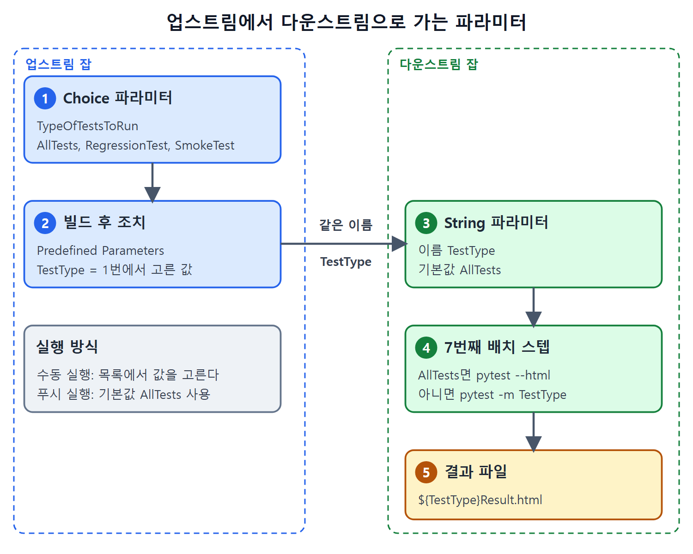

# 파라미터 프리스타일 잡 두 개 연결

이 문서는 프리스타일 잡(화면에서 옵션을 채워 만드는 가장 기본적인 잡) 두 개를 만들어 하나의 흐름으로 잇는다. 앞 잡이 웹 앱을 배포하면 뒤 잡이 셀레니움 테스트를 돌리는 구조다. 이때 앞 잡이 "어떤 테스트를 돌릴지"를 뒤 잡에 값으로 넘겨 주려고 파라미터(잡을 실행할 때 받는 입력값)를 쓴다.

두 잡의 이름과 역할, 플러그인 설치, 파라미터 만들기, 빌드 스텝 설정, 수동 실행과 자동 실행까지 순서대로 정리한다. 테스트 결과를 이메일로 보내는 설정은 다음 문서에서 이어진다.

---

## 1. 두 잡의 역할

앞에서 실행되는 잡을 업스트림(upstream, 상위) 잡, 그 잡이 호출하는 잡을 다운스트림(downstream, 하위) 잡이라고 한다. 강 위쪽에서 아래쪽으로 물이 흐르는 것과 같은 방향이다.

| 구분 | 잡 이름 | 하는 일 |
| --- | --- | --- |
| 업스트림 | `BuildAndDeployCalculatorWebApplication` | 계산기 저장소의 master에 변경이 푸시되면 실행된다. 최신 코드를 받아 `Calculator.html`을 IIS 폴더에 복사하고, 다운스트림 잡을 호출하며 실행할 테스트 종류를 넘긴다 |
| 다운스트림 | `TestCalculatorWebApplication` | 업스트림 잡이 호출한다. 테스트 저장소의 최신 코드를 받아 전달받은 값에 맞는 셀레니움 테스트를 돌리고, 결과 HTML을 이메일로 보낸다 |

정리하면, 업스트림은 폴링으로 자동 시작되고 다운스트림은 업스트림에 의해서만 시작된다. 배포가 끝난 뒤에야 테스트가 의미 있기 때문이다.

## 2. 플러그인 설치

잡 사이에 파라미터 값을 넘기려면 Parameterized Trigger 플러그인이 필요하다. 이 플러그인은 Maven Integration 플러그인에 의존하므로, Maven Integration을 먼저 설치한다. 플러그인 설치 방법은 5장에서 다뤘다.

## 3. 업스트림 잡 만들기

### 3-1. 기본 설정과 파라미터

1. 대시보드에서 잡 이름 `BuildAndDeployCalculatorWebApplication`을 넣고 프리스타일 프로젝트로 만든 뒤 OK를 누른다.
2. This project is Parameterized 체크박스를 켠다.
3. Add Parameter 버튼에서 String Parameter를 골라 아래처럼 채운다.
4. 같은 방식으로 Choice Parameter를 추가한다.

| 파라미터 | 종류 | 값 |
| --- | --- | --- |
| `CalculatorWebApplicationDeploymentDirectory` | String | 기본값 `D:\JenkinsBookExamples\DeployedCalculatorWebApp` |
| `TypeOfTestsToRun` | Choice | `AllTests`(첫 줄, 기본값), `RegressionTest`, `SmokeTest` |

폴더 경로를 스텝에 직접 쓰지 않고 파라미터로 뺀 이유는, 나중에 배포 폴더가 바뀌어도 빌드 스텝을 고치지 않고 기본값만 바꾸면 되기 때문이다. Choice 파라미터는 맨 첫 줄 값이 기본값이 되므로 `AllTests`를 가장 위에 적는다. `RegressionTest`나 `SmokeTest`만 돌리고 싶으면 실행할 때 그 값을 고른다.

### 3-2. 소스 코드 관리와 폴링

1. 아래로 내려 Git 라디오 버튼을 고르고 `JenkinsBookCalculatorWebApplication` 저장소의 SSH URL을 넣는다.
2. Credentials 드롭다운에서 GitHub용으로 만든 SSH 자격 증명(credential)을 고른다.
3. Branch 칸은 `master`를 그대로 둔다.
4. Poll SCM 체크박스를 켜고 스케줄에 `H/5 * * * *`를 넣는다.

폴링은 젠킨스가 정해진 주기로 저장소를 들여다보고 새 커밋이 있으면 잡을 시작하는 방식이다. `H/5 * * * *`는 5분 간격마다 확인하라는 표기다(H는 시각을 분산시키는 젠킨스의 해시 기호). 이 표기의 해석은 원서에 풀이가 없어 일반적인 크론 문법을 따른 설명이다.

### 3-3. 빌드 스텝

Add Build Step 버튼에서 Execute Windows Batch Command를 고르고, 아래 세 명령을 입력한다. 원서에서는 이 명령이 화면 캡처(Figure 15-12)로만 나오고 글로는 설명만 있다. 아래 코드는 그 설명과 뒤의 파이프라인 예제를 바탕으로 복원한 것이라 실제 옵션은 다를 수 있다.

```text
RMDIR /S /Q %CalculatorWebApplicationDeploymentDirectory%
MKDIR %CalculatorWebApplicationDeploymentDirectory%
copy /y src\main\webapp\Calculator.html %CalculatorWebApplicationDeploymentDirectory%
```

| 순서 | 동작 |
| --- | --- |
| 1 | 기존 배포 디렉터리를 지운다 |
| 2 | 새 배포 디렉터리를 만든다 |
| 3 | `src\main\webapp`의 `Calculator.html`을 새 디렉터리로 복사한다 |

세 번째 명령에서 소스를 상대 경로로 쓸 수 있는 이유는 작업 공간(워크스페이스) 때문이다. 앞 장에서 보았듯 SCM이 설정된 잡을 실행하면 원격 저장소가 워크스페이스에 복제되고, 이 폴더가 잡의 작업 디렉터리가 된다. 또 파라미터 값을 배치 명령에서 읽으려면 세 명령 모두 `%이름%`처럼 퍼센트 기호로 감싸야 한다.

### 3-4. 빌드 후 조치로 다운스트림 호출

1. Add Post-Build Action 버튼에서 Trigger Parameterized Build On Other Projects를 고른다.
2. Projects to Build 칸에 `TestCalculatorWebApplication`을 적는다. 아직 이 잡이 없어서 칸 옆에 오류가 보이지만 지금은 무시한다.
3. Trigger When Build Is 값을 Stable or Unstable But Not Failed로 고른다. 빌드가 성공이기만 하면 안정성과 무관하게 테스트를 돌리겠다는 뜻이다.
4. Add Parameters 버튼에서 Predefined Parameters를 고른다.
5. 나타난 칸에 `TestType=$(TypeOfTestsToRun)`을 적는다.

원서 본문은 괄호를 `$(...)` 모양으로 적었지만, 젠킨스에서 값을 참조하는 일반 표기는 `${TypeOfTestsToRun}`이다. 추출 과정에서 바뀐 것인지 확실하지 않다. 핵심은 Choice 파라미터에서 고른 값을 `TestType`이라는 이름으로 넘긴다는 점이다.

## 4. 다운스트림 잡 만들기

1. 대시보드에서 `TestCalculatorWebApplication` 이름으로 프리스타일 잡을 만들고 OK를 누른다.
2. This Project Is Parameterized를 켠다.
3. Add Parameter에서 String Parameter를 골라 이름을 `TestType`, 기본값을 `AllTests`로 한다. 이름은 업스트림이 넘기는 이름과 같아야 한다.
4. Git 라디오 버튼에서 테스트 저장소의 SSH URL, GitHub용 자격 증명, 브랜치 `master`를 설정한다.
5. Poll SCM은 켜지 않는다.
6. Execute Windows Batch Command 스텝을 여러 번 추가한다.

Poll SCM을 켜지 않는 이유는 이 잡을 master 변경으로 시작하고 싶지 않기 때문이다. 이 잡은 업스트림 잡만 호출한다.

배치 스텝은 일곱 개로 나뉜다. 원서는 처음 여섯 개를 그림으로만 보여 주므로 아래 명령은 설명에서 복원한 것이다.

| 번호 | 하는 일 | 명령(복원) |
| --- | --- | --- |
| 1 | virtualenv 패키지 설치 | `pip install virtualenv` |
| 2 | 가상 환경 `TestCalculatorWebApplication` 생성 | `virtualenv TestCalculatorWebApplication` |
| 3 | 가상 환경 활성화 | `TestCalculatorWebApplication\Scripts\activate` |
| 4 | Selenium Python 라이브러리 설치 | `pip install selenium` |
| 5 | Pytest 설치 | `pip install pytest` |
| 6 | pytest-html 설치 | `pip install pytest-html` |
| 7 | `TestType` 값에 따라 테스트 실행 | 아래 참고 |

각 스텝이 별도의 배치 실행이므로 활성화가 다음 스텝에 이어지는지는 원서가 따로 설명하지 않는다. 원서 구성 그대로 옮겼다.

일곱 번째 스텝은 `TestType` 값을 검사한다. `AllTests`면 전체 테스트를 돌려 `AllTests.html`에 보고서를 저장한다. 다른 값이면 `pytest -m`으로 해당 그룹만 돌리고 그 이름으로 결과 파일을 저장한다. 원서에서는 코드가 그림(Figure 15-15)이라서, 아래 코드는 설명과 파이프라인 예제를 바탕으로 복원한 형태다.

```text
if "%TestType%"=="AllTests" (
  pytest --html=%TestType%Result.html
) else (
  pytest -m %TestType% --html=%TestType%Result.html
)
```

이메일 설정에서 첨부할 파일이 `${TestType}Result.html`이므로 결과 파일 이름은 `AllTestsResult.html`, `RegressionTestResult.html` 같은 형태일 것이다.

원서가 강조한 배치 문법 주의점은 다음과 같다.

| 규칙 | 내용 |
| --- | --- |
| 여는 괄호 위치 | `if`와 `else` 뒤의 `(`는 같은 줄에 둔다 |
| 공백 | 조건문과 `(` 사이에 공백 한 칸이 반드시 있어야 한다 |
| `else` 부분 | `else`라는 단어와 앞의 `)` 사이에 공백을 넣지 않는다는 취지다(원서 표현이 모호해 보인다) |

모두 입력했으면 Save 버튼을 누른다.

## 5. 수동으로 실행하기

대시보드에서 `BuildAndDeployCalculatorWebApplication`의 시계 모양 아이콘을 누른다. 원서가 말하는 "시계 표시"는 Build with Parameters 아이콘으로 보인다. 파라미터를 고르는 화면이 열리면 `TypeOfTestsToRun`에서 RegressionTest를 선택하고 Build 버튼을 누른다.

업스트림 잡이 끝나면 다운스트림 잡이 자동으로 실행되어 UI 테스트를 돌리고, 마지막에 이메일 알림이 온다. 메일을 열면 `RegressionTestResult.html`이 첨부되어 있다.

## 6. 푸시로 자동 실행하기

실제 CI답게 푸시 한 번으로 전체 흐름이 돌게 해 본다.

1. `Calculator.html`에서 제목 색을 초록에서 빨강으로 바꾼다.
2. 버튼 배경색도 초록에서 빨강으로 바꾼다.
3. 로컬 저장소 master에 커밋하고 GitHub master로 푸시한다.
4. 푸시 후 업스트림 잡이 기본 파라미터 값으로 자동 실행된다.
5. 업스트림이 끝나면 다운스트림 잡이 실행된다.

셀레니움이 연 브라우저에서 제목과 버튼 배경이 빨갛게 보이면 최신 앱이 배포되어 테스트되었다는 증거가 된다. 완료 후 `AllTestsResult.html`이 첨부된 이메일이 도착한다. 기본값이 `AllTests`이므로 푸시로 시작된 실행은 전체 테스트를 돌린다.

## 7. 한눈에 보는 파라미터 흐름

| 위치 | 이름 | 값의 출처 |
| --- | --- | --- |
| 업스트림 Choice 파라미터 | `TypeOfTestsToRun` | 사용자가 고르거나 기본값 `AllTests` |
| 업스트림 Predefined Parameters | `TestType` | `TypeOfTestsToRun`의 값 |
| 다운스트림 String 파라미터 | `TestType` | 업스트림이 넘긴 값 |

업스트림이 보내는 이름과 다운스트림이 받는 이름이 일치해야 값이 전달된다는 점이 핵심이다.



업스트림의 Choice 파라미터 값이 `TestType`이라는 같은 이름으로 다운스트림에 전달되고, 그 값에 따라 pytest 실행 방식과 결과 파일 이름이 정해지는 과정을 보여 준다.

<br>
<br>
<br>

[CICD Pipeline Using Jenkins Unleashed](../)
