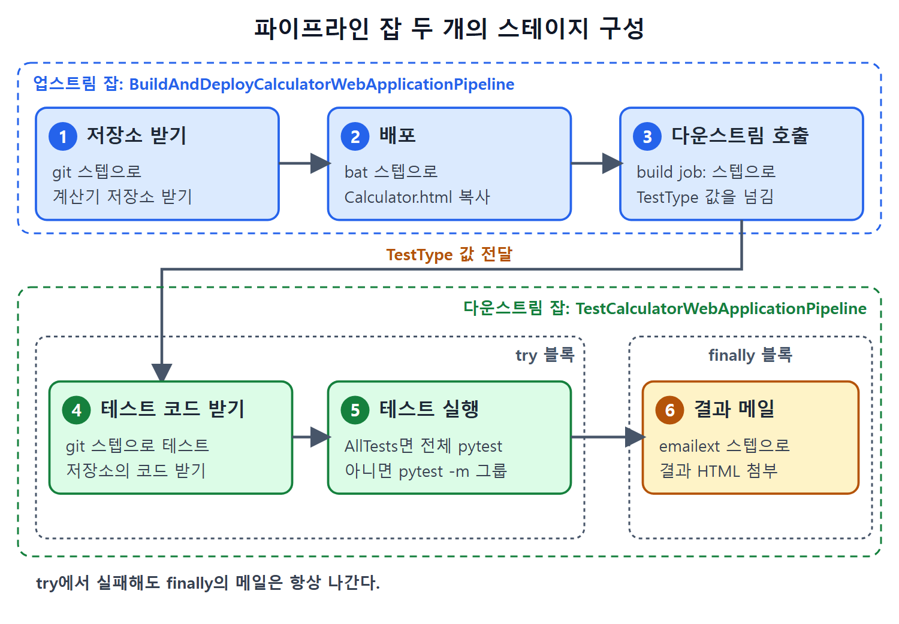

# 파이프라인 잡으로 다시 만들기

앞 문서에서 프리스타일 잡 두 개로 만든 흐름을 이번에는 파이프라인 잡 두 개로 똑같이 만든다. 화면의 체크박스와 버튼 대신 스크립트로 같은 일을 적는다는 점이 다르다. 스크립트는 코드이므로 저장소에 넣어 관리하기 쉽고, 어떤 일을 하는지 한눈에 읽힌다.

이 문서는 두 파이프라인 잡의 역할, 업스트림 스크립트의 세 스테이지, 다운스트림 스크립트와 `try`/`finally` 구조, 문자열에서 변수를 쓰는 규칙, 실행 방법을 정리한다. 원서의 스크립트에는 추출 때문인지 원문 오타 때문인지 어색한 부분이 있어서, 아래 코드는 문맥으로 바로잡았고 바로잡은 곳은 본문에서 밝혔다.

---

## 1. 두 잡의 역할

| 구분 | 잡 이름 | 하는 일 |
| --- | --- | --- |
| 업스트림 | `BuildAndDeployCalculatorWebApplicationPipeline` | 계산기 저장소 master에 푸시되면 실행된다. 코드를 받아 `Calculator.html`을 IIS 폴더에 복사하고, 다운스트림 잡을 호출하며 테스트 종류를 인자로 넘긴다 |
| 다운스트림 | `TestCalculatorWebApplicationPipeline` | 테스트 저장소 master에서 자동화 코드를 받아 넘겨받은 값에 따라 셀레니움 테스트를 돌리고, 결과 HTML을 이메일로 보낸다 |

구조는 프리스타일 때와 같고, 이름 끝에 `Pipeline`이 붙은 것만 다르다.

## 2. 업스트림 잡 만들기

1. 대시보드에서 New Item을 누른다.
2. 이름에 `BuildAndDeployCalculatorWebApplicationPipeline`을 넣고 Pipeline을 고른 뒤 OK를 누른다.
3. This Project Is Parameterized를 켜고 파라미터 두 개를 만든다. 배포 폴더 경로를 담는 String 파라미터와, 배포 후 돌릴 셀레니움 테스트 그룹을 정하는 Choice 파라미터다.
4. Poll SCM을 켜고 프리스타일 때처럼 스케줄을 설정한다.
5. Pipeline 편집기에서 Snippet Generator(스니펫 생성기, 화면에서 옵션을 고르면 스텝 코드를 만들어 주는 도구)의 도움을 받아 스크립트를 쓴다.

원서는 파라미터 이름을 자리마다 다르게 적었다. 프리스타일에서는 `CalculatorWebApplicationDeploymentDirectory`와 `TypeOfTestsToRun`, 파이프라인 본문에는 `PathOfCalculatorAppDeploymentDirectory`와 `params.TypeOfTests`가 나온다. 이 노트는 코드에서 파이프라인 파라미터를 `PathOfCalculatorAppDeploymentDirectory`와 `TypeOfTests`로 맞춰 쓴다. 파라미터를 만들 때 쓴 이름과 스크립트의 이름이 같기만 하면 된다.

## 3. 스테이지 1: 저장소 받기

Snippet Generator로 만든 git 스텝을 첫 스테이지에 넣는다. 원서 Listing 15-3의 내용이다.

```groovy
node {
  def mvnHome
  stage('Checking out Calculator Web Application repository.') {
    git credentialsId: 'MyGithubCredentials',
        url: 'git@github.com:dpranoday/JenkinsBookCalculatorWebApplication.git'
  }
}
```

`credentialsId`는 앞서 등록한 GitHub SSH 자격 증명의 ID다. 원서 코드에서 저장소 이름이 `JenkinsBookCapculatorWebApplication`으로 보이는데, 오타로 판단해 바로잡았다. `def mvnHome`은 이 예제에서 쓰이지 않는다.

## 4. 스테이지 2: 배포

코드를 받은 뒤에는 워크스페이스의 `src\main\webapp\Calculator.html`을 배포 폴더 파라미터가 가리키는 위치로 복사한다. Snippet Generator에서 Windows batch 스텝을 만들어 스테이지 안에 넣는다. 원서 Listing 15-4의 내용이다.

```groovy
stage('Deploying Web Application') {
  bat """
    RMDIR %PathOfCalculatorAppDeploymentDirectory%
    MKDIR %PathOfCalculatorAppDeploymentDirectory%
    copy /y src\\main\\webapp\\Calculator.html %PathOfCalculatorAppDeploymentDirectory%
  """
}
```

배포 폴더는 하드코딩하지 않고 파라미터 `%PathOfCalculatorAppDeploymentDirectory%`로 바꿨다. 원서 코드는 따옴표 모양이 깨져 있고 복사 경로가 `src\webapp\Calculator.html`로 보이는데, 앞의 프리스타일 잡과 본문 설명(`src\main\webapp`)에 맞춰 고쳤다. Groovy 문자열에서는 역슬래시를 두 번 써야 해서 `\\`로 적었다. 여러 줄 명령을 한 문자열로 묶으려고 큰따옴표 세 개(`"""`)를 썼는데, 원서의 따옴표 모양은 깨져 있어 정확한 원형은 확인하기 어렵다.

## 5. 스테이지 3: 다운스트림 호출

Snippet Generator에서 build: Build a job 스텝을 만들어 세 번째 스테이지에 넣고 parameters 인자를 붙인다. 다운스트림 잡을 아직 만들지 않았다면 Project to Build 칸 아래에 오류가 보이는데, 잡을 만든 뒤에는 사라진다. 원서 Listing 15-5의 내용이다.

```groovy
stage('Testing Calculator Web Application') {
  build job: 'TestCalculatorWebApplicationPipeline',
        parameters: [[$class: 'StringParameterValue',
                      name: 'TestType',
                      value: params.TypeOfTests]]
}
```

| 인자 | 의미 |
| --- | --- |
| `job` | 호출할 다운스트림 잡 이름 |
| `$class: 'StringParameterValue'` | 문자열 파라미터라는 종류 |
| `name: 'TestType'` | 다운스트림 잡이 받을 파라미터 이름 |
| `value: params.TypeOfTests` | 업스트림에서 선택된 Choice 파라미터의 값 |

`params.이름`은 파이프라인 파라미터의 값을 읽는 방법이다. 값을 평가해서 넘기기 때문에, 사용자가 고른 `SmokeTest` 같은 실제 값이 전달된다. 원서 코드에서는 `parameters:[` 뒤의 대괄호 형태가 단순화되어 보이는데, 일반 문법인 목록 안의 맵 형태로 적었다. Save를 눌러 저장한다.

## 6. 다운스트림 잡 만들기

1. New Item에서 `TestCalculatorWebApplicationPipeline` 이름으로 Pipeline 잡을 만든다.
2. This Project Is Parameterized를 켠다.
3. String 파라미터를 `TestType`이라는 이름으로 만든다.

이름이 `TestType`이어야 하는 이유는 업스트림의 build 스텝이 보내는 이름과 같아야 하기 때문이다. 업스트림이 `name: 'TestType'`으로 보낸다.

## 7. 다운스트림 스크립트

원서 Listing 15-6은 두 스테이지를 `try` 안에 두고, 이메일 발송은 `finally`에 둔다. 아래는 핵심 줄을 정리한 것이다. 원서의 `gitcredentialsId`는 공백이 빠진 것으로 보고 `git credentialsId`로 고쳤다.

```groovy
try {
  stage('Pulling Test automation code') {
    git credentialsId: 'MyGithubCredentials',
        url: 'git@github.com:dpranoday/TestWebApplicationWithSeleniumPythonTests.git'
  }
  stage('Running tests') {
    if (params.TestType.equals("AllTests")) {
      bat "pytest --html ${params.TestType}Result.html"
    } else {
      bat "pytest -m ${params.TestType} --html ${params.TestType}Result.html"
    }
  }
}
```

이 `try` 블록 뒤에 아래 `finally` 블록이 이어진다.

```groovy
finally {
  emailext attachmentsPattern: '**/' + params.TestType + 'Result.html',
    body: 'Please find E-E Selenium scripts report file:' + params.TestType + 'Result.html attached with this email',
    subject: 'Calculator Web Application details:$DEFAULT_SUBJECT',
    to: 'pranoday.dingare@gmail.com'
}
```

원서 코드에서는 `emailext` 스텝 이름이 `emailextattachmentsPattern`처럼 붙어 보이는데, 이름과 첫 인자 사이의 공백이 추출에서 빠진 것으로 판단했다. 원서 설명도 "이메일 텍스트 스텝"이라고만 적었다.

### 7-1. 블록별 해설

| 블록 | 하는 일 |
| --- | --- |
| `try` | 스테이지들을 감싼다. 어느 스테이지가 실패해 예외가 나도 메일은 나가게 하려는 목적이다 |
| `stage('Pulling Test automation code')` | GitHub의 테스트 저장소에서 master 브랜치를 받아 온다 |
| `stage('Running tests')` | `TestType`이 `AllTests`면 전체 pytest, 아니면 `-m`으로 해당 그룹(RegressionTest, SmokeTest 등)만 실행한다 |
| `finally` | 성공이든 실패든 `emailext` 스텝으로 결과 메일을 보낸다 |

`try`/`finally`는 "식사 후에는 결과가 어떻든 설거지는 한다"와 같다. 앞의 일이 실패해도 마지막 블록은 반드시 실행된다.



업스트림 파이프라인의 세 스테이지와 다운스트림 파이프라인의 `try`와 `finally` 구조를 한눈에 보여 준다. 다운스트림의 테스트가 실패해도 `finally`의 결과 메일은 항상 발송된다.

### 7-2. 파라미터를 문자열에 넣는 두 방법

스크립트 안에서 같은 파라미터를 두 가지 방식으로 쓴다. 원서가 짚은 차이는 아래와 같다.

| 방식 | 예 | 쓰는 곳 |
| --- | --- | --- |
| 보간(interpolation) | `"pytest --html ${params.TestType}Result.html"` | 큰따옴표 문자열 안 `bat` 명령. 변수를 `${}`로 감싸 값으로 바꾼다 |
| 연결(concatenation) | `'**/' + params.TestType + 'Result.html'` | 작은따옴표 인자. 변수 값을 `+`로 이어 붙인다. 중괄호를 쓰지 않는다 |

`bat` 스텝에서는 명령 전체를 큰따옴표로 감싸고 그 안에서 `${params.TestType}`을 보간한다. `emailext`의 첨부 패턴과 본문은 작은따옴표 문자열이므로 `+`로 이어 붙인다. 다만 제목의 `$DEFAULT_SUBJECT`는 중괄호 없이 `$`만 쓴다. 원서는 환경 변수든 파이프라인 파라미터든, 작은따옴표 문자열에서 값을 끼워 넣으려면 중괄호 없는 `$`를 써야 한다고 설명한다. 이 변수는 젠킨스가 전역 설정의 기본 제목으로 바꿔 준다는 맥락이다.

## 8. 실행해 보기

### 8-1. 수동 실행

1. 대시보드에서 `BuildAndDeployCalculatorWebApplicationPipeline`의 시계 모양 아이콘을 누른다.
2. 드롭다운에서 SmokeTest를 고르고 Build를 누른다.
3. 업스트림 파이프라인이 앱을 배포하고 다운스트림 파이프라인을 호출한다.
4. 다운스트림이 테스트를 돌리고, 보고서가 첨부된 이메일이 온다.

### 8-2. 푸시로 자동 실행

1. `Calculator.html`에서 제목 색과 버튼 배경색을 초록으로 바꾼다.
2. 로컬 master에 커밋하고 GitHub로 푸시한다.
3. 업스트림 파이프라인이 기본 파라미터 값으로 실행된다.
4. 다운스트림이 테스트를 돌린다. 초록으로 바뀐 앱에서 테스트가 실행되고 결과가 메일로 온다.

## 9. 프리스타일과 파이프라인 비교

| 항목 | 프리스타일 | 파이프라인 |
| --- | --- | --- |
| 스텝 구성 | 화면에서 빌드 스텝 추가 | 스크립트 스테이지 |
| 다운스트림 호출 | Trigger Parameterized Build 빌드 후 조치 | `build job:` 스텝 |
| 값 전달 | Predefined Parameters(`TestType=...`) | `parameters` 인자 |
| 파라미터 읽기 | `%이름%`(배치 안), `${이름}` | `params.이름` |
| 실패해도 메일 | 트리거 Always | `try`/`finally` |
| 이메일 | Editable Email Notification | `emailext` 스텝 |

같은 결과를 내는 두 방법이며, 파이프라인은 스크립트라서 흐름이 코드로 보이고 조건 분기도 코드로 쓴다.

<br>
<br>
<br>

[CICD Pipeline Using Jenkins Unleashed](../)
