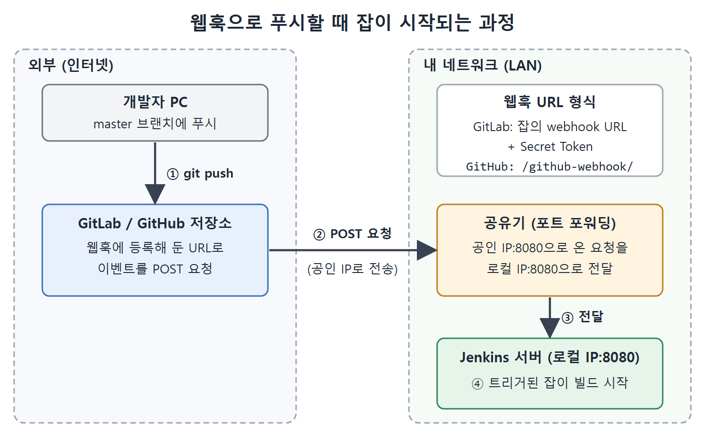

# 웹훅으로 잡 트리거하기

이 문서는 GitLab과 GitHub에서 푸시 같은 이벤트가 일어났을 때 Jenkins 잡이 자동으로 실행되게 만드는 방법을 정리한다. 앞서 배운 Cron 표현식이나 SCM 폴링과 다른 새로운 트리거(실행 조건) 방식이다.

택배에 비유해 보자. SCM 폴링은 내가 틈날 때마다 우편함을 열어 보는 방식이고, 웹훅은 택배가 오면 초인종이 울리는 방식이다. 정확한 정의는 이렇다. 웹훅(Webhook)은 어떤 이벤트가 일어났을 때 지정한 URL로 POST 요청을 보내도록 해 두는 설정이다. Jenkins 잡의 URL을 웹훅에 등록하면, 저장소에서 일어난 이벤트로 빌드를 시작할 수 있다.

---

## 1. 폴링과 웹훅의 차이

SCM 폴링으로 설정한 잡은 Jenkins가 해당 Git 저장소에 새 변경이 있는지 확인하고, 있으면 빌드한다. 즉 트리거가 Jenkins 쪽에서 나가고, 원격 저장소에 새 변경이 푸시되었을 때만 신호가 생긴다.

반면 Git 원격 저장소에서는 코멘트 추가, 브랜치 푸시, 이슈 열기와 닫기처럼 여러 이벤트가 일어난다. 이런 이벤트로 잡을 실행하고 싶으면 웹훅을 쓴다.

| 구분 | SCM 폴링 | 웹훅 |
|---|---|---|
| 신호가 나오는 곳 | Jenkins | Git 저장소(GitLab, GitHub) |
| 기준 | 새 변경이 푸시되었는지 확인 | 저장소에서 일어난 이벤트 |
| 필요한 설정 | 잡의 폴링 설정 | 저장소의 웹훅 + Jenkins 잡의 트리거 |

웹훅은 이벤트 종류를 고를 수 있고 이벤트가 생기는 즉시 알려 준다는 점이 폴링과 다르다.

## 2. 웹훅을 쓰기 전에 알아야 할 두 가지

gitlab.com은 우리 집 내부 네트워크(LAN) 안에 있지 않다. 그래서 외부에서 우리 Jenkins 컴퓨터에 요청을 보내려면 공인 IP와 포트 포워딩이 필요하다.

### 2-1. 공인 IP

네트워크에 연결된 컴퓨터는 두 종류의 IP를 가진다. 로컬 IP는 로컬 네트워크(LAN) 안에서 그 컴퓨터와 통신할 때 쓴다. 공인 IP(Public IP)는 로컬 네트워크 밖의 컴퓨터가 그 컴퓨터와 통신할 때 쓴다. GitLab이 잡을 트리거하려면 Jenkins가 설치된 컴퓨터의 공인 IP가 필요하다.

공인 IP는 whatismyip.com 사이트의 what-is-my-public-ip-address 페이지에서 확인할 수 있다. 반드시 Jenkins 서버가 있는 컴퓨터에서 접속해야 한다. 여기서 확인한 IPv4 주소를 GitLab 웹훅 URL을 설정할 때 쓴다.

### 2-2. 포트 포워딩

Jenkins는 로컬(LAN) IP 주소에서 8080 포트로 떠 있다. 그런데 gitlab.com은 우리 컴퓨터의 공인 IP가 들어간 URL로 요청을 보낸다. 이 요청을 Jenkins가 실행 중인 로컬 IP로 넘겨 줘야 한다. 공인 IP로 온 요청을 LAN의 IP 주소로 전달하는 것을 포트 포워딩(port forwarding) 또는 포트 열기라고 한다. 건물 관리실에서 외부 방문객이 대표 번호로 걸어 온 전화를 특정 사무실로 돌려 주는 것과 비슷하다.

책은 D-Link 공유기를 예로 든다. 공유기마다 메뉴 위치는 다르지만 개념은 같다고 밝힌다.

1. 브라우저에서 공유기 설정 페이지 http://192.168.0.1 을 연다.
2. 사용자 이름과 비밀번호에 admin을 넣고 OK를 누른다. D-Link 설정 페이지가 열린다.
3. Advanced 버튼을 누른다.
4. 위쪽 가로 막대의 FIREWALL 버튼을 누른다.
5. 왼쪽의 PORT FORWARDING 링크를 누른다.
6. 아래 표의 값을 채우고 Save & Apply 버튼으로 저장한다.

| 입력 칸 | 값과 설명 |
|---|---|
| Local IP Address | 내 컴퓨터의 로컬 IP. ipconfig 명령으로 확인한다. 책의 값은 192.168.0.100 |
| Local Port Range | Jenkins를 띄운 포트. 8080~8090 범위도 가능하다. 책은 8080을 양쪽 칸에 입력 |
| Protocol | Both를 그대로 둔다 |
| Remote IP Address | whatismyip.com에서 확인한 공인 IPv4 주소. 책의 값은 1.23.253.174 |
| Remote Port Range | 포트 범위도 넣을 수 있다. 책은 8080을 양쪽 칸에 입력 |

로컬 쪽은 Jenkins가 실제로 도는 곳이고 원격 쪽은 밖에서 보이는 주소라고 생각하면 헷갈리지 않는다.



저장소에 푸시하면 웹훅이 공인 IP로 POST 요청을 보내고, 공유기의 포트 포워딩이 그 요청을 LAN 안의 Jenkins로 넘겨 잡이 빌드를 시작한다.

## 3. GitLab 웹훅으로 파이프라인 잡 트리거하기

앞 문서에서 만든 DeployCalculatorAPIUsingPipelineAsACode 잡을 GitLab 푸시로 실행되게 한다.

1. Jenkins 서버를 로컬 IP 주소로 시작한다.
2. Jenkins 설정에서 Jenkins URL을 지정한다. Manage Jenkins(Jenkins 관리)의 Configure System에서 Jenkins URL 칸에 컴퓨터의 공인 URL을 넣고 Save를 누른다.
3. Jenkins에 GitLab 플러그인을 설치한다. 설치 절차는 5장을 참고한다.
4. GitLab 저장소에서 웹훅을 만들기 전에 잡이 GitLab 트리거를 받도록 설정한다.
   1. 잡 설정의 Build Triggers 영역으로 스크롤한다. GitLab 플러그인을 설치하면 Build when a change is pushed to GitLab 옵션이 보인다.
   2. 이 옵션 옆에 표시된 GitLab webhook URL을 복사한다.
   3. 해당 체크박스를 선택한다.
   4. Push Events 체크박스만 선택하고 나머지는 해제한다. 저장소에 푸시할 때만 한 번 트리거되게 하려는 것이다.
   5. Advanced 버튼을 눌러 아래로 스크롤하면 Secret Token 칸이 있다. Generate 버튼을 누르면 이 잡에 대한 비밀 토큰이 만들어진다. GitLab이 잡을 트리거할 때 접근을 인증하는 값이다.
   6. 토큰을 복사해서 파일에 붙여 넣은 뒤 Save를 누른다. 저장 전에 복사해 둬야 한다.
5. GitLab 저장소에서 웹훅을 만든다.
   1. JenkinsBookCalculatorAPI 저장소로 가서 Menu, Settings, Webhooks 순으로 들어가 Webhooks 페이지를 연다.
   2. URL 칸에 앞에서 복사한 프로젝트(웹훅) URL을, Secret token 칸에 복사해 둔 비밀 토큰을 넣는다.
   3. master 브랜치에 푸시할 때 실행하려면 Trigger 영역의 Push Events 체크박스를 선택하고, 그 아래 입력 칸에 master를 넣는다.
   4. 아래로 스크롤해 Add Webhook 버튼을 눌러 저장한다.
6. CalculatorAPI 프로젝트의 pom.xml 버전을 바꾸고 푸시한다. 책에서는 9.0으로 바꿨다.

```xml
<groupId>Pranodayd</groupId>
<artifactId>CalculatorAPI</artifactId>
<version>9.0</version>
```

git add, git commit을 한 뒤 git push로 master 브랜치에 올리면 빌드가 트리거된 것을 볼 수 있다.

| 위치 | 하는 일 | 주고받는 값 |
|---|---|---|
| Jenkins 잡 | Build when a change is pushed to GitLab 선택, Push Events 선택, Secret Token 생성 | webhook URL, Secret Token을 복사해 둔다 |
| GitLab 저장소 | Webhooks에서 URL과 Secret token 입력, Push Events에 master 지정 | 위에서 복사한 두 값을 입력 |

양쪽 설정이 같은 URL과 같은 토큰으로 맞물려야 트리거가 동작한다.

## 4. GitHub 웹훅으로 파이프라인 잡 트리거하기

GitHub도 같은 원리로 웹훅을 만든다. 다만 설정 항목이 조금 다르다.

### 4-1. 준비

1. GitHub에 JenkinsBookCalculatorAPI라는 비공개 저장소를 만들고 CalculatorAPI 프로젝트를 푸시한다. 책 전체에서 쓰던 같은 프로젝트다.
2. 앞 절에서 만든 Jenkinsfile.txt를 프로젝트에 두고 GitLab에 푸시했었다. GitHub에 올리기 전에 하나만 바꿨다. 파이프라인 스크립트 파일을 프로젝트 루트의 Jenkinsfile.txt로 두지 않고, 이름을 BuildCalculatorAPI.txt로 바꿔 BuildScript 디렉터리 안으로 옮겼다.
3. Jenkins에 GitHub 플러그인을 설치한다. 잡 설정에 GitHub 관련 옵션이 생기도록 하는 것이다. 설치 방법은 5장을 참고한다.

### 4-2. Jenkins 쪽 설정

1. Manage Jenkins의 Configure System으로 가서 GitHub 영역의 Advanced 버튼을 누른다.
2. Specify another hook URL for GitHub configuration 체크박스를 선택하고 컴퓨터의 공인 IP를 넣는다. Save를 누른다.
3. New Item으로 파이프라인 잡을 만든다. 책에서는 DeployCalculatorAPIUsingPipelineAsACodeFromGitHub라고 이름 붙이고 Pipeline 옵션을 선택했다.
4. Build Triggers 영역에서 GitHub hook trigger for GITScm polling을 선택한다. 이 옵션은 GitHub 플러그인이 설치된 경우에만 나타난다.
5. Pipeline 영역에서 Definition을 Pipeline script from SCM으로, SCM을 Git으로 고른다.
6. Repository URL에 방금 만든 GitHub 저장소의 HTTP URL을 넣는다. Credentials는 GitHub API 토큰으로 만든 Username with Password 종류의 새 항목을 고른다. Branch Specifier에는 master를 넣는다.
7. Script Path에는 BuildScript/BuildCalculatorAPI.txt를 넣는다. 파이프라인이 프로젝트 루트의 BuildScript 폴더 안 BuildCalculatorAPI.txt에 있기 때문이다. Save를 누른다.

### 4-3. GitHub 쪽 웹훅 만들기

1. JenkinsBookCalculatorAPI 저장소 페이지에서 Settings 탭을 누른다.
2. 왼쪽의 Webhooks 메뉴를 눌러 Webhooks 페이지를 연다.
3. Add webhook 버튼을 누르고 Payload URL 칸에 아래 형식으로 URL을 넣는다.

```
http://<Public IP of Jenkins server machine>:<port>/github-webhook/
```

책의 Jenkins는 공인 IP 1.23.253.174의 8080 포트에서 떠 있어서 `http://1.23.253.174:8080/github-webhook/`를 입력했다.

4. Just the push event 라디오 버튼을 선택하고 Add webhook 버튼을 누른다.

### 4-4. 푸시해서 트리거하기

pom.xml의 버전을 10.0으로 바꾼다. 원서 Listing 16-9는 캡션에 10.0이라고 쓰였지만 코드의 version 줄은 9.0으로 인쇄되어 있어 서로 맞지 않는다. 의도는 10.0으로 보인다.

```xml
<groupId>Pranodayd</groupId>
<artifactId>CalculatorAPI</artifactId>
<version>10.0</version>
```

git add와 git commit으로 로컬 저장소에 커밋하고, git push로 GitHub 저장소의 master 브랜치에 올린다. GitHub 웹훅이 push 이벤트를 Jenkins로 보내 빌드가 시작된다.

## 5. GitLab과 GitHub 설정 비교

| 항목 | GitLab | GitHub |
|---|---|---|
| Jenkins 플러그인 | GitLab 플러그인 | GitHub 플러그인 |
| 잡의 트리거 옵션 | Build when a change is pushed to GitLab | GitHub hook trigger for GITScm polling |
| Jenkins 전역 설정 | Jenkins URL에 공인 URL 입력 | GitHub 영역 Advanced에서 Specify another hook URL 선택 후 공인 IP 입력 |
| 인증 | Secret Token(Jenkins에서 생성해 GitLab에 입력) | 이 장에서는 별도 토큰 입력 없음 |
| 웹훅 메뉴 | Menu, Settings, Webhooks | Settings 탭의 Webhooks |
| 웹훅 URL 입력 칸 | URL | Payload URL(`/github-webhook/` 경로) |
| 이벤트 선택 | Push Events 체크 후 브랜치(master) 지정 | Just the push event 선택 |

GitHub 쪽 설정은 원서에서 비밀 토큰을 다루지 않았고, URL 형식이 `/github-webhook/`로 정해져 있다는 점이 가장 큰 차이다.

## 6. 핵심 정리

- 웹훅은 저장소의 이벤트를 URL로 알려 주는 방식이라, Jenkins 쪽 폴링 없이 푸시 즉시 빌드를 시작할 수 있다.
- 외부 서비스가 내 컴퓨터의 Jenkins를 부르려면 공인 IP와 포트 포워딩이 필요하다.
- GitLab은 Jenkins 잡의 webhook URL과 Secret Token을 저장소 웹훅에 넣고, GitHub는 `http://공인IP:포트/github-webhook/` 형식의 URL을 넣는다.
- 두 경우 모두 Push Events만 선택해 푸시할 때만 트리거되게 했다.

<br>
<br>
<br>

[CICD Pipeline Using Jenkins Unleashed](../)
