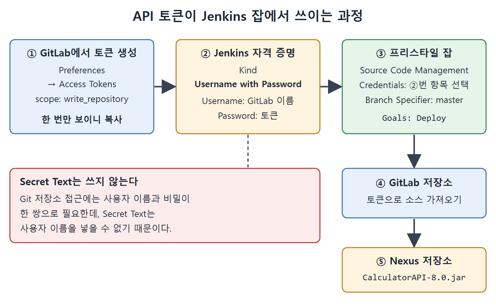

# 젠킨스에서 API 토큰으로 프리스타일 잡 실행

앞 문서에서 만든 API 토큰을 이번에는 Jenkins 안에서 쓴다. GitLab의 JenkinsBookCalculatorAPI 저장소를 가져와 CalculatorAPI.jar를 Nexus 저장소에 릴리스하는 프리스타일 잡(Free-style project)을 만들고, 토큰을 자격 증명(credentials)으로 등록하는 과정을 정리한다.

핵심은 자격 증명의 종류를 고르는 부분이다. 토큰이라고 해서 Secret Text를 고르면 안 되고, Username with Password를 골라야 한다. 이유는 아래에서 설명한다.

---

## 1. 준비 단계

잡을 만들기 전에 Maven이 Jenkins에 설정되어 있어야 한다. 6장의 전역 도구 설정(Global Tool Configuration) 절을 참고하면 된다. 책을 처음부터 따라왔고 이미 Maven을 설정했다면 건너뛰어도 된다. 책에서는 Maven의 이름을 MyMaven으로 설정해 두었다.

## 2. 프리스타일 잡 만들기

1. Jenkins 대시보드에서 New Item 링크를 누른다.
2. Enter an Item Name 칸에 잡 이름을 넣고 Free-style project를 선택한다. 책에서는 ReleaseCalculatorAPI_APIToken이라고 이름을 붙였다. OK 버튼을 누르면 설정 페이지가 열린다.
3. Source Code Management 영역에서 Git 라디오 버튼을 선택하고 Repository URL 칸에 저장소의 HTTPS URL을 넣는다. 이 절차는 12장의 GitLab 중앙 저장소 푸시 절을 참고한다.
4. Credentials 칸의 Add 버튼을 누르고 Jenkins 옵션을 고른다. Jenkins Credentials Provider: Jenkins 창이 열린다.
5. Kind 드롭다운에서 Username with Password를 선택한다.
6. Username 칸에 GitLab 사용자 이름을, Password 칸에 GitLab API 토큰을 넣는다.
7. ID 칸에는 이 자격 증명 항목을 구분할 고유한 문자열을 넣는다.
8. Add 버튼으로 항목을 추가한 뒤, Credentials 드롭다운에서 방금 만든 항목을 고른다.
9. Branch Specifier 칸에 master를 넣는다. 이 저장소의 주 브랜치가 master이기 때문이다.
10. 아래로 스크롤해 Add build step 드롭다운에서 Invoke top-level Maven targets를 고른다.
11. Maven Version 드롭다운에서 MyMaven을 고르고, Goals 칸에 Deploy를 넣은 뒤 Save 버튼을 누른다.

### 왜 Secret Text가 아니라 Username with Password인가

원서의 설명을 풀어 쓰면 이렇다. Secret Text는 사용자 이름이 필요 없는 비밀값을 저장할 때 쓴다. 그런데 GitLab과 GitHub 저장소에 접근하려면 사용자 이름을 같이 보내야 한다. API 토큰은 로그인 비밀번호 자리를 대신하는 값이므로 사용자 이름은 그대로 두고 비밀번호 칸에 토큰을 넣어야 한다. 따라서 종류는 Username with Password다.

| Kind | 저장하는 값 | 이 경우 쓸 수 있는가 |
|---|---|---|
| Username with Password | 사용자 이름 + 비밀번호(여기서는 토큰) | 쓴다 |
| Secret Text | 비밀 문자열 하나 | 쓰지 않는다. 사용자 이름을 못 넣는다 |

표의 요점은 Git 저장소 접근에는 이름과 비밀이 한 쌍으로 필요하다는 것이다.



GitLab에서 만든 토큰을 Username with Password 자격 증명의 Password에 넣어 잡에 연결하면, 잡이 저장소에서 소스를 가져와 Maven deploy로 Nexus에 jar를 릴리스한다.

## 3. 소스 설정 화면 요약

Source Code Management와 빌드 설정에 넣는 값을 한눈에 정리하면 다음과 같다.

| 설정 항목 | 넣는 값 |
|---|---|
| Repository URL | GitLab 저장소의 HTTPS URL |
| Credentials | Username with Password로 만든 항목(토큰 사용) |
| Branch Specifier | master |
| Add build step | Invoke top-level Maven targets |
| Maven Version | MyMaven(전역 도구 설정에서 정한 이름) |
| Goals | Deploy |

원서의 Goals 칸에는 대문자로 Deploy라고 적혀 있다. Maven 명령은 보통 소문자 deploy를 쓰므로, 따라 하다 막히면 이 점을 확인한다. 다만 이 부분은 원문 표현을 그대로 옮긴 것이다.

## 4. pom.xml 버전 바꾸고 푸시하기

Nexus에 새 버전으로 올리려면 프로젝트의 pom.xml 버전을 바꿔야 한다. 책에서는 8.0으로 바꿨다.

```xml
<groupId>Pranodayd</groupId>
<artifactId>CalculatorAPI</artifactId>
<version>8.0</version>
```

그다음 명령 프롬프트에서 프로젝트 디렉터리로 들어가 변경을 올린다.

1. 변경을 스테이징 영역에 올린다.
2. master 브랜치에 커밋한다.
3. 중앙 GitLab 저장소로 푸시한다.

```
git add .
git commit -m "Changing version in pom.xml"
git push https://gitlab.com/Pranoday/jenkinsbookcalculatorapi.git master
```

## 5. 잡 실행과 결과

토큰으로 저장소에 접근하는 잡이라고 해서 실행 방법이 달라지지는 않는다. 대시보드에서 시계 모양 아이콘(Build 아이콘)을 누르면 빌드가 시작되고 콘솔 출력이 나온다. 원서의 그림 16-5는 콘솔 출력에서 CalculatorAPI-8.0.jar가 Nexus 저장소에 릴리스된 것을 보여 준다.

## 6. 핵심 정리

- Jenkins에서 GitHub/GitLab 토큰을 쓰려면 Username with Password 종류의 자격 증명을 만든다.
- Username에는 계정 이름을, Password에는 토큰을 넣는다.
- 잡의 나머지 설정(브랜치, Maven 목표)과 실행 방법은 기존 프리스타일 잡과 같다.
- Nexus에 새 버전을 올리려면 pom.xml의 version을 먼저 바꿔 커밋하고 푸시한다.

<br>
<br>
<br>

[CICD Pipeline Using Jenkins Unleashed](../)
