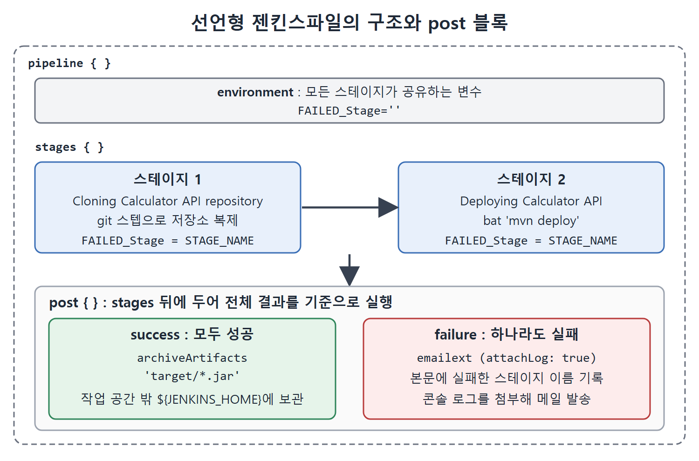
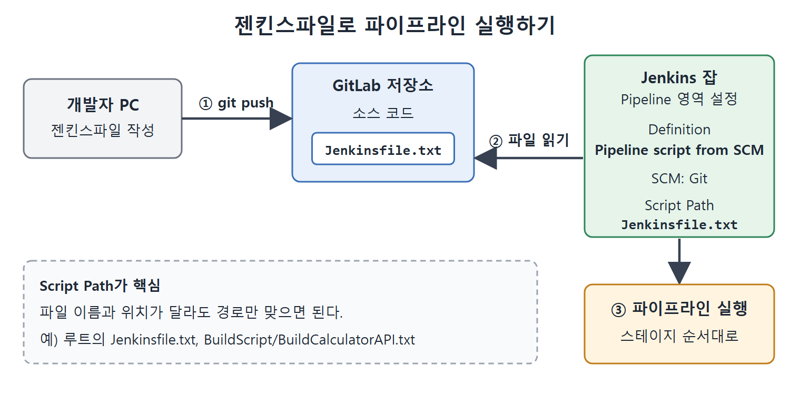

# 파이프라인 애즈 코드와 젠킨스파일

지금까지는 Jenkins 화면의 스크립트 입력창에 파이프라인을 적었다. 이번에는 파이프라인을 화면 밖의 파일에 적어 애플리케이션 소스와 같은 저장소에 넣는 방법을 배운다. 이것을 파이프라인 애즈 코드(Pipeline as Code, 파이프라인을 코드로 관리하기)라고 하고, 그 파일을 젠킨스파일(Jenkinsfile)이라고 부른다.

요리에 비유하면 화면에 직접 적은 파이프라인은 주방 벽에 적어 둔 메모이고, 젠킨스파일은 레시피 책에 실어 재료(소스 코드)와 같은 서랍에 넣어 둔 레시피다. 누가 언제 레시피를 고쳤는지 기록이 남고, 다른 사람이 검토할 수도 있다.

---

## 1. 젠킨스파일이란

젠킨스파일은 파이프라인 스크립트 코드가 들어 있는 텍스트 파일이다. 애플리케이션의 소스 저장소에 소스 코드와 함께 체크인(커밋)한다. 작성 문법은 스크립트형(Groovy 스크립트)과 선언형(DSL) 두 가지다.

### 파이프라인 애즈 코드의 장점

- 젠킨스파일 하나로 모든 브랜치의 파이프라인을 만들고 풀 리퀘스트도 실행할 수 있다.
- 애플리케이션 코드를 리뷰하듯 파이프라인 코드도 리뷰할 수 있다.
- SVN, Git 같은 버전 관리 시스템에 넣으므로 빌드 과정이 시간에 따라 어떻게 바뀌었는지 추적할 수 있다.
- 파이프라인 코드의 단일 출처가 되어 여러 개발자가 공유한다.
- 애플리케이션 코드를 바꾸면서 빌드 과정도 바꿔야 할 때, 같은 개발자가 젠킨스파일을 함께 고칠 수 있다.

## 2. 스크립트형과 선언형 비교

앞 장들에서는 스크립트형으로 파이프라인을 썼고, 이 장의 젠킨스파일은 선언형으로 작성한다. 구조는 14장에서 다뤘다.

| 비교 항목 | 스크립트형 파이프라인 | 선언형 파이프라인 |
|---|---|---|
| 등장 시기 | 전통적인 방식 | 비교적 새로운 기능 |
| 문법 | 더 엄격한 Groovy 기반 | 더 단순하고 선택지가 많은 Groovy 문법 |
| 최상위 블록 | node | pipeline |

선언형은 "무엇을 할지"를 정해진 틀에 채워 넣는 방식이라 처음 배우는 사람이 읽기 쉽다.

## 3. 파이프라인 잡 만들기

CalculatorAPI의 빌드 과정을 파이프라인 잡으로 만든다. 이전 잡들과 다른 점은 파이프라인을 선언형으로 쓰고, Jenkins 화면이 아닌 젠킨스파일에 둔다는 것이다. Pipeline 플러그인이 설치되어 있어야 한다.

1. 대시보드에서 New Item을 눌러 이름을 넣는다. 책에서는 DeployCalculatorAPIUsingPipelineAsACode라고 했다.
2. Pipeline 옵션을 선택하고 OK를 누른다.
3. 아래로 스크롤해 Pipeline 영역을 찾는다. 스크립트 편집기에서 먼저 작성한 뒤 젠킨스파일로 복사할 수 있다.
4. Git과 Maven을 쓰는 파이프라인이므로 드롭다운에서 GitHub+Maven 템플릿을 고른다. 선언형 스크립트 틀이 채워지고, 이것을 요구에 맞게 고친다.

## 4. 파이프라인 작성하기

### 4-1. environment 블록

environment 블록은 파이프라인의 모든 스테이지에서 함께 쓸 변수를 정의한다. 책에서는 실패한 스테이지의 이름을 담을 FAILED_Stage 변수를 정의했다.

```groovy
pipeline
{
      environment
      {
            FAILED_Stage=''
      }
}
```

원서 목록(Listing 16-4)에는 값의 따옴표가 한 개만 있는 것처럼 인쇄되어 있다. 추출 과정에서 깨진 것으로 보이며, 뒤쪽 전체 코드(Listing 16-7)의 `FAILED_Stage=''`를 기준으로 복원했다.

### 4-2. 저장소를 복제하는 스테이지

첫 스테이지는 CalculatorAPI 저장소를 가져온다. Git 스텝은 14장에서 배운 스니펫 생성기(Snippet Generator)로 만들어 붙였다. 이 스테이지의 script 블록은 환경 변수 FAILED_Stage에 현재 스테이지 이름을 넣는다. 현재 스테이지 이름은 Jenkins 환경 변수 STAGE_NAME이 돌려준다.

```groovy
stage('Cloning Calculator API repository')
{
      steps
      {
            script
            {
                  FAILED_Stage=env.STAGE_NAME
            }
            git branch: 'Master', credentialsId: 'MyGitlabAPIToken',
url: 'https://gitlab.com/Pranoday/jenkinsbookcalculatorapi.git'
      }
}
```

script 블록은 선언형 파이프라인 안에서 Groovy 코드를 직접 실행할 때 쓰는 자리다. credentialsId에는 앞 문서에서 토큰으로 만든 자격 증명의 ID가 들어간다.

### 4-3. 배포 스테이지

두 번째 스테이지는 이름이 Deploying CalculatorAPI이고, 윈도우 배치 명령 `mvn deploy`를 실행한다. 이 스테이지도 자기 이름을 FAILED_Stage에 저장한다.

```groovy
stage('Deploying CalculatorAPI')
{
      steps
      {
            script
            {
                  FAILED_Stage=env.STAGE_NAME
            }
            bat 'mvn deploy'
      }
}
```

원서 본문 목록(Listing 16-5, 16-6)에는 stage가 대문자 Stage로 인쇄되어 있다. 선언형 문법의 키워드는 소문자 stage이고, 뒤의 전체 코드(Listing 16-7)도 소문자다. 그래서 소문자로 옮겼다.

이 스테이지가 끝나면 스테이지 이름이 저장되므로, 어느 스테이지에서 멈췄는지 알려면 마지막으로 기록된 이름을 보면 된다. 스테이지가 실패하면 그 뒤 스테이지는 실행되지 않으니 FAILED_Stage에는 실패한 스테이지의 이름이 남는다.

## 5. post 블록 이해하기

요구 사항은 두 가지다. 파이프라인이 실패하면 이메일로 알리고, 성공하면 결과물인 아티팩트를 보관한다. 이럴 때 선언형 파이프라인의 post 블록을 쓴다.

post 블록은 모든 스테이지가 끝난 뒤, 또는 특정 스테이지가 끝난 뒤에 할 스텝을 담는다. 어디에 쓰느냐에 따라 적용 범위가 달라진다. 안에는 success, failure, always 같은 조건 블록을 둘 수 있고, 전체 파이프라인이나 해당 스테이지의 완료 상태에 따라 해당하는 조건 블록의 스텝만 실행된다.

| 조건 블록 | 실행되는 때 |
|---|---|
| success | 성공으로 끝났을 때 |
| failure | 실패로 끝났을 때 |
| always | 성공이든 실패든 항상 |

### 5-1. 스테이지 바로 뒤에 둔 post

스테이지 블록 뒤에 post를 두면 그 스테이지의 결과에 따라 실행된다. 원서의 예는 콘솔에 Hi를 찍는 스테이지 다음에 post를 두었다.

```groovy
stage('Display message on console')
{
      bat 'echo Hi'
}
post
{
     success { bat 'echo Display message stage is successful' }
     failure { bat 'echo Display message stage is successful' }
}
```

오류 없이 끝나면 success 블록이, 오류가 나면 failure 블록이 실행된다. 원서의 failure 블록 메시지도 "successful"로 인쇄되어 있는데 오타로 보인다. 설명을 위해 한 줄로 줄여 옮겼다.

### 5-2. stages 블록 뒤에 둔 post

스테이지가 두 개 있고 post를 stages 블록 뒤에 두면, 마지막 스테이지가 끝난 뒤 한 번 실행된다. 두 스테이지가 모두 성공하면 success 블록이, 하나라도 실패하면 failure 블록이 실행된다.

```groovy
stages { stage('Display welcome message on console') { bat 'echo Hi' }
         stage('Display good bye message on console') { bat 'echo Good Bye' } }
post
{
      success { bat 'echo Both stages are successful' }
      failure { bat 'echo some stage is not successful' }
}
```

### 5-3. always 블록

always를 쓰면 스테이지의 완료 상태와 관계없이 항상 실행된다.

```groovy
post
{
      always
      {
            bat 'echo It will always get executed'
      }
}
```

## 6. 이 장의 post 블록: 아티팩트 보관과 실패 메일

두 스테이지가 모두 성공하면 아티팩트를 보관하고, 실패하면 실패한 스테이지 이름과 콘솔 로그를 첨부한 이메일을 보낸다. 이 post 블록은 stages 블록 뒤에 두어서 Deploying Calculator API 스테이지가 끝난 뒤 실행되게 했다.

```groovy
post
{
    success { archiveArtifacts 'target/*.jar' }
    failure
    {
        emailext attachLog: true, subject: 'CalculatorAPI details:$DEFAULT_SUBJECT',
            to: '<받는 사람 주소>',
            body: 'Stage: '+FAILED_Stage+' from Build : $BUILD_NUMBER of $JOB_NAME failed.'
    }
}
```

원서의 body 문구는 훨씬 길다. 실패한 스테이지 이름, 빌드 번호, 잡 이름을 알리고, Nexus 저장소에 새 빌드를 릴리스하지 못했으며 자세한 콘솔 로그를 첨부했다는 내용이다. 받는 사람 주소는 책에서 저자의 이메일을 썼는데 여기서는 자리 표시로 바꿨다. 위 코드는 지면 때문에 줄인 것이다.

핵심 포인트는 세 가지다.

- emailext의 `attachLog: true`는 콘솔 로그를 메일에 첨부하라는 뜻이다. 나머지 매개변수는 앞 장에서 이미 쓴 것들이다.
- body에 파이프라인 환경 변수 FAILED_Stage를 이어 붙여서 실패한 스테이지 이름이 메일 본문에 들어가게 했다.
- failure 블록은 스테이지 중 하나라도 끝까지 가지 못했을 때 실행된다.



선언형 파이프라인은 environment 변수를 두 스테이지가 공유하고, 두 스테이지가 모두 끝난 뒤 post 블록이 결과에 따라 아티팩트 보관 또는 실패 메일 발송 중 하나를 실행하는 구조다.

### archiveArtifacts 스텝

빌드 아티팩트(빌드 결과물)는 보통 작업 공간(워크스페이스) 안에 만들어진다. 이후 빌드를 실행하면 작업 공간의 내용이 지워질 수 있다. 결과물을 남기려면 작업 공간 밖으로 복사해 두어야 한다. archiveArtifacts 스텝은 아티팩트를 ${JENKINS_HOME} 디렉터리에 저장한다. 두 번째 스테이지의 mvn deploy가 만드는 .jar 파일을 작업 공간 밖에 보존하려는 목적이다.

## 7. 젠킨스파일로 저장하고 연결하기

지금까지 Jenkins 화면에서 만든 스크립트를 저장소의 일부로 옮긴다.

1. 저장소를 복제해 둔 디렉터리에 젠킨스파일을 만든다. 책에서는 Jenkinsfile.txt라는 이름의 파일을 만들었다.
2. 화면에서 만든 파이프라인 스크립트 전체를 붙여 넣는다(원서 Listing 16-7). 전체 구조는 다음과 같다.

```groovy
pipeline
{
    environment { FAILED_Stage='' }
    agent any
    stages
    {
        stage('Cloning Calculator API repository') { ... }
        stage('Deploying Calculator API') { ... }
    }
    post { ... }
}
```

중괄호 안의 줄임표 자리에는 4절에서 만든 두 스테이지 본문과 6절의 post 블록이 그대로 들어간다. 원서 전체 코드에서는 맨 앞 단어가 대문자 Pipeline으로 인쇄되어 있는데 선언형의 키워드는 소문자 pipeline이다. 인쇄 오류로 보고 소문자로 적었다. 두 스테이지의 이름도 화면에서 만든 것과 원서 전체 코드 사이에 Calculator API와 CalculatorAPI 띄어쓰기 차이가 있다. 스테이지 이름은 서로 일치할 필요가 없고 표시용 문자열이다.

3. 파일을 커밋하고 GitLab 저장소로 푸시한다.

```
git add .
git commit -m "Adding Jenkinsfile"
git push https://gitlab.com/Pranoday/jenkinsbookcalculatorapi.git
```

푸시하면 GitLab 저장소 안에 Jenkinsfile.txt가 보인다.

4. Jenkins 잡의 Configure 링크로 들어가 Pipeline 영역으로 스크롤한다.
5. Definition 드롭다운에서 Pipeline script from SCM을 고른다.
6. SCM 드롭다운에서 Git을 고른다.
7. Repository URL에 JenkinsBookCalculatorAPI 저장소 URL을 넣고, Credentials 드롭다운에서 자격 증명을 고르고, Branch Specifier에 master를 넣는다.
8. Script Path 칸에는 저장소 루트 기준의 상대 경로로 파이프라인 파일을 적는다. 이 경우 파일이 루트 폴더에 Jenkinsfile.txt로 있으므로 Jenkinsfile.txt만 쓴다. Save 버튼을 누른다.

| Pipeline 영역 설정 | 넣는 값 |
|---|---|
| Definition | Pipeline script from SCM |
| SCM | Git |
| Repository URL | JenkinsBookCalculatorAPI 저장소 URL |
| Credentials | 토큰으로 만든 자격 증명 항목 |
| Branch Specifier | master |
| Script Path | Jenkinsfile.txt(저장소 루트 기준 상대 경로) |



개발자가 젠킨스파일을 저장소에 푸시하면, Pipeline script from SCM으로 설정한 Jenkins 잡이 Script Path의 경로로 그 파일을 읽어 와 파이프라인을 실행한다.

Script Path는 젠킨스파일의 이름과 위치가 달라도 그 경로만 맞게 적으면 된다는 점이 중요하다. 파일 이름이 꼭 Jenkinsfile일 필요는 없고, 책에서는 Jenkinsfile.txt를 썼다. 이제 잡을 실행하면 Jenkins가 SCM에서 파이프라인 파일을 읽어 와 실행한다.

## 8. 핵심 정리

- 젠킨스파일은 소스 저장소에 함께 넣는 파이프라인 코드 파일이다. 변경 이력, 코드 리뷰, 공유가 가능해지는 것이 장점이다.
- 선언형은 pipeline 블록, 스크립트형은 node 블록으로 시작한다.
- environment 블록의 변수는 모든 스테이지에서 공유하고, 환경 변수 STAGE_NAME으로 현재 스테이지 이름을 얻는다.
- post 블록은 success, failure, always 조건으로 스테이지 또는 파이프라인 종료 후 할 일을 정한다.
- archiveArtifacts는 결과물을 작업 공간 밖의 ${JENKINS_HOME}에 보존한다.
- 잡에서는 Definition을 Pipeline script from SCM으로 바꾸고 Script Path로 젠킨스파일 위치를 알려 준다.

<br>
<br>
<br>

[CICD Pipeline Using Jenkins Unleashed](../)
