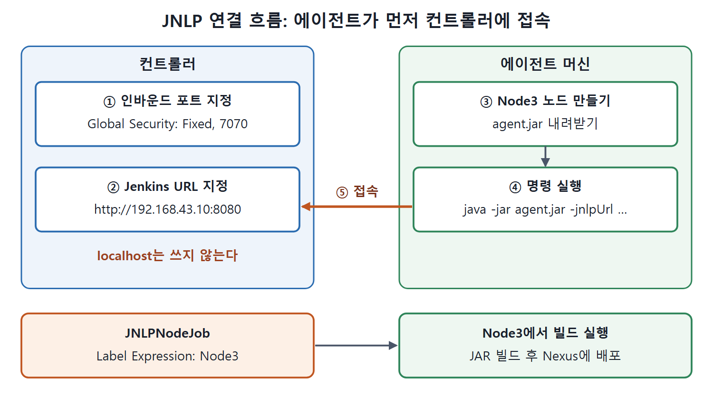

# JNLP로 에이전트 연결하기

컨트롤러가 에이전트에 접근할 수 없을 때는 에이전트가 먼저 컨트롤러를 찾아오는 JNLP(Java Network Launch Protocol) 방식을 쓴다. 이 문서는 컨트롤러가 JNLP 접속을 받도록 설정하고, 에이전트 머신에서 노드를 만들어 `agent.jar`로 연결한 뒤, 그 노드에서 돌아가는 잡을 만드는 과정을 따라 한다. SSH 방식과 달리 열쇠 교환이 없고, 에이전트가 명령 한 줄을 실행하는 것으로 연결이 시작된다.

전화에 비유하면 SSH 방식은 컨트롤러가 에이전트에게 전화를 거는 것이고, JNLP 방식은 에이전트가 컨트롤러에게 전화를 거는 것이다. 받는 쪽은 전화번호(IP와 포트)를 공개해 두어야 한다.

---

## 1. 전체 절차 한눈에 보기

| 단계 | 작업 | 수행 위치 |
|---|---|---|
| 1 | JNLP 에이전트 접속 요청을 받도록 컨트롤러 설정 | 컨트롤러 |
| 2 | Jenkins URL 지정 | 컨트롤러 |
| 3 | 에이전트에서 노드 항목 만들고 agent.jar로 연결 | 에이전트 |
| 이후 | JNLP 노드에서 실행할 잡 생성 | 컨트롤러 |



컨트롤러에서 포트와 Jenkins URL을 정해 두면 에이전트가 `agent.jar` 명령으로 먼저 접속한다. 연결된 Node3에는 Label Expression으로 지정한 잡이 실행된다.

## 2. 단계 1. 컨트롤러에서 JNLP 접속 허용

1. 컨트롤러에서 Manage Jenkins를 누른다.
2. 화면을 내려 Configure Global Security 메뉴를 누른다.
3. 다시 내려 Agents 영역에서 TCP Port for Inbound Agents 옵션의 Fixed 라디오 버튼을 고르고 포트 번호로 `7070`을 입력한다.
4. 아래로 내려 Agent → Controller Security 영역에 있는 접근 제어 관련 체크박스(원서 표기는 Enable Agent → Control Access Agent)를 체크한다.
5. Save를 누른다.

포트는 사용 가능한 번호면 아무거나 된다. 원서는 자기 머신에서 비어 있어서 7070을 골랐다. 4번 체크박스의 이름은 원문 텍스트가 깨져 있어 정확한 표기를 확신하기 어렵다. 화면의 Agent → Controller Security 영역을 보고 찾으면 된다.

## 3. 단계 2. Jenkins URL 지정

1. Manage Jenkins → Configure System으로 간다.
2. 화면을 내려 Jenkins Location 영역을 찾는다.
3. Jenkins URL에 `http://<컨트롤러 IP:포트>` 형태로 입력한다. 원서에서 컨트롤러는 IP 192.168.43.10, 포트 8080에서 시작하므로 `http://192.168.43.10:8080`을 넣었다.
4. Save를 누른다.

원서의 주의 사항이 있다. 여기에 `http://localhost`를 쓰면 안 된다. localhost는 "내 자신"을 뜻하므로, 에이전트 머신에서 보면 에이전트 자신을 가리키게 되어 컨트롤러에 접근할 수 없다.

## 4. 단계 3. 에이전트에서 노드 만들고 연결

### 4.1 노드 항목 만들기

에이전트(슬레이브) 머신에서 컨트롤러 URL로 Jenkins를 열고 작업한다.

1. Manage Jenkins → Manage Nodes and Clouds로 간다.
2. 왼쪽의 New Node를 누르고, Node Name에 `Node3`을 입력한 뒤 OK를 누른다.
3. 아래 표의 값을 채운다.

| 필드 | 값 |
|---|---|
| Name | Node3 |
| Number of executors | 1 |
| Remote root directory | C:\JNLPNode |
| Labels | JNLPNode |
| Usage | Use this node as much as possible |
| Launch method | Launch agent by connecting to master |

4. Launch method는 Launch agent by connecting to master를 그대로 둔다. 노드 속성은 SSH 실습의 Node Properties 설정(그림 17-2)과 같은 영역이다.
5. Save를 누른다.

저장하고 나면 노드 화면에 agent.jar 링크가 보인다(그림 17-5). 이 링크를 눌러 `agent.jar` 파일을 내려받는다.

### 4.2 agent.jar 실행

내려받은 `agent.jar`는 원하는 위치에 둔다. 원서는 `D:\Agentjar` 폴더에 두었다. 그다음 노드 화면의 Run from Agent Command Line 영역에 나온 명령을 복사한다. 원서의 명령 형식은 다음과 같다(시크릿 값은 노드마다 다르므로 자리표시자로 바꿨다).

```bash
java -jar agent.jar -jnlpUrl http://192.168.43.10:8080/computer/node3/jenkins-agent.jnlp -secret <노드마다 다른 값> -workdir "C:\JNLPNode"
```

이 명령은 컨트롤러의 `jenkins-agent.jnlp` 주소로 접속해 Node3로 연결한다. 이어서 `agent.jar`의 경로를 실제 위치에 맞게 고친다.

```bash
java -jar D:\AgentJar\agent.jar -jnlpUrl http://192.168.43.10:8080/computer/node3/jenkins-agent.jnlp -secret <노드마다 다른 값> -workdir "C:\JNLPNode"
```

수정한 명령을 명령 프롬프트에서 실행하면 에이전트가 컨트롤러에 붙는다. 원서의 명령은 첫 단어가 `Java`로 대문자인데, 이 노트는 `java`로 적었다.

| 명령 옵션 | 의미 |
|---|---|
| `-jar agent.jar` | 내려받은 에이전트 프로그램을 실행한다. 경로를 실제 위치로 고친다 |
| `-jnlpUrl` | 컨트롤러에서 이 노드의 JNLP 정보를 가져올 주소다 |
| `-secret` | 노드 화면의 명령에 들어 있는 값이다. 노드마다 다르다 |
| `-workdir` | 작업 디렉터리다. 노드를 설정할 때 넣은 Remote root directory 값을 쓴다 |

## 5. JNLP 노드에서 실행할 잡 만들기

원서는 `JNLPNodeJob`이라는 잡을 만든다. CalculatorAPI 저장소에서 코드를 받아 JAR 파일을 빌드하고 Nexus에 배포한다. SSH 실습에서 만든 잡과 같은 내용이고 차이는 하나뿐이다. Label Expression 칸에 `Node3` 값을 넣는다.

대시보드에서 시계 모양 아이콘을 눌러 잡을 실행하면, 이 잡이 Node3에서 실행되는 것을 볼 수 있다.

## 6. SSH 방식과 JNLP 방식의 실습 차이

| 항목 | SSH 방식 (Node1) | JNLP 방식 (Node3) |
|---|---|---|
| 컨트롤러 설정 | 플러그인 설치, 자격 증명 추가 | Global Security 포트(7070), Jenkins URL 지정 |
| 노드 생성 위치 | 컨트롤러 | 에이전트 머신의 브라우저 |
| Launch method | Launch agents via SSH | Launch agent by connecting to master |
| 연결 시작 | 컨트롤러에서 Relaunch Agent | 에이전트에서 `agent.jar` 명령 실행 |
| Remote root directory | C:\JenkinsJobExecution | C:\JNLPNode |
| 라벨과 Label Expression | CalculatorAPI_Node 라벨 / 잡에는 Node1 | JNLPNode 라벨 / 잡에는 Node3 |

두 방식 모두 마지막에는 잡의 Label Expression으로 실행할 노드를 지정해 같은 CalculatorAPI 배포 잡을 돌린다. 연결 방법만 다르고 잡을 노드에 붙이는 방법은 같다.

<br>
<br>
<br>

[CICD Pipeline Using Jenkins Unleashed](../)
