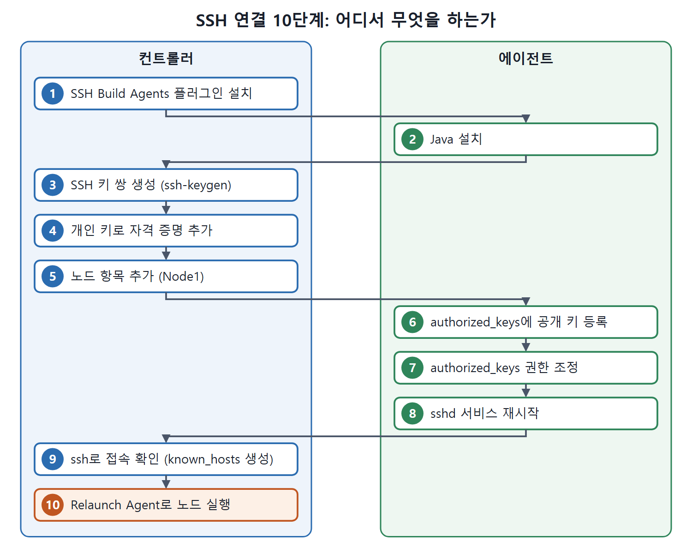

# SSH로 에이전트 연결하기

컨트롤러가 에이전트 머신에 SSH로 접속해서 에이전트를 띄우는 구성을 처음부터 끝까지 따라 해 본다. 원서는 Windows 머신 두 대로 실습하며, 컨트롤러에는 Jenkins 전체가 깔려 있고 에이전트에는 JDK만 있으면 된다. 단계는 열 개이고, 컨트롤러에서 하는 일과 에이전트에서 하는 일이 번갈아 나온다. 마지막에는 이 에이전트에서 실행될 프리스타일 잡(free-style job)까지 만든다.

SSH 키 쌍은 자물쇠와 열쇠로 생각하면 쉽다. 컨트롤러가 개인 키(열쇠)를 갖고, 에이전트가 공개 키(자물쇠)를 갖는다. 열쇠가 자물쇠에 맞으면 비밀번호 없이 들여보내 준다.

---

## 1. 실습 환경

| 역할 | IP 주소 | 준비 상태 |
|---|---|---|
| 컨트롤러(마스터) | 192.168.43.10 | Jenkins가 완전히 설치되어 있다 |
| 에이전트(슬레이브) | 192.168.43.185 | Jenkins 설치는 필요 없고 JDK11이 설치되어 있다 |

## 2. 단계별 절차 한눈에 보기

| 단계 | 작업 | 수행 위치 |
|---|---|---|
| 1 | SSH Build Agents 플러그인 설치 | 컨트롤러 |
| 2 | 에이전트에 Java 설치 | 에이전트 |
| 3 | SSH 공개 키와 개인 키 쌍 생성 | 컨트롤러 |
| 4 | 개인 키를 담은 자격 증명 항목 추가 | 컨트롤러 |
| 5 | 노드 항목 추가 | 컨트롤러 |
| 6 | authorized_keys 파일에 공개 키 등록 | 에이전트 |
| 7 | authorized_keys 파일 권한 조정 | 에이전트 |
| 8 | sshd 서비스 재시작 | 에이전트 |
| 9 | 컨트롤러에서 에이전트로 접속 확인 | 컨트롤러 |
| 10 | 컨트롤러에서 새 노드 실행 | 컨트롤러 |

순서가 중요하다. 노드 항목(5단계)은 먼저 만들어 두지만, 실제 연결은 에이전트 쪽 준비(6~8단계)와 접속 확인(9단계)을 마친 뒤 10단계에서 이뤄진다.



열 단계를 수행 위치별로 나눠 그렸다. 컨트롤러와 에이전트를 오가며 진행하고, 마지막 10단계의 Relaunch Agent에서 실제 연결이 이뤄진다.

## 3. 컨트롤러 준비 (1~5단계)

### 3.1 단계 1. SSH Build Agents 플러그인 설치

컨트롤러의 Jenkins에 로그인해 플러그인 매니저(Plugin Manager)에서 SSH Build Agents 플러그인을 설치한다.

### 3.2 단계 2. 에이전트에 Java 설치

에이전트 머신에 Java가 없으면 설치한다. 설치 방법은 원서의 범위 밖이라 설명하지 않는다.

### 3.3 단계 3. SSH 키 쌍 만들기

컨트롤러에서 `ssh-keygen` 명령으로 공개 키와 개인 키 한 쌍을 만든다. 원서는 기본 경로인 `${CURRENT_USER}\.ssh`에 만들고 패스프레이즈(passphrase, 키를 보호하는 암호)는 지정하지 않았다. 다른 위치에 만들거나 패스프레이즈를 줄 수도 있다.

```bash
ssh-keygen
```

이 명령은 질문에 따라 경로와 패스프레이즈를 정하면 `id_rsa`(개인 키)와 그 짝인 공개 키 파일을 만든다. 파일 이름 `id_rsa`는 4단계에서 원서가 개인 키를 복사하는 파일로 직접 언급한다.

### 3.4 단계 4. 개인 키로 자격 증명 추가

1. 컨트롤러 대시보드에서 Manage Jenkins → Manage Credentials(자격 증명 관리)로 간다. Credentials 화면이 열린다.
2. Stores Scoped to Jenkins 영역의 Jenkins 링크를 눌러 System 화면을 연다.
3. Global Credentials (Unrestricted) 링크를 눌러 해당 화면을 연 뒤, 왼쪽의 Add Credentials를 누른다.
4. Kind 드롭다운에서 SSH Username with Private Key를 고른다.
5. Username에 에이전트 머신의 인증된 사용자 이름을 넣는다. 컨트롤러는 이 이름으로 에이전트에 접속한다. 원서는 `ADMIN`을 넣었고, 이후 단계에서 다시 쓰므로 기억해 두라고 한다. ID와 Description은 아무 값이나 괜찮다.
6. Private Key 항목에서 Enter directly 라디오 버튼을 누르고 Add 버튼을 눌러, `${CURRENT_USER}\.ssh\id_rsa` 파일에서 복사한 개인 키 값을 붙여 넣는다.
7. 키를 만들 때 패스프레이즈를 안 정했다면 Passphrase는 비워 둔다. 정했다면 여기에도 입력한다.
8. OK를 누른다.

핵심은 Username이 에이전트 머신에 실제로 있는 사용자여야 한다는 점이다. 컨트롤러는 이 사용자로 로그인을 시도한다.

### 3.5 단계 5. 노드 항목 추가

1. Manage Jenkins → Manage Nodes and Clouds로 간다.
2. 왼쪽의 New Node를 누른다.
3. Node Name에 `Node1`을 입력하고 Permanent Agent를 선택한 뒤 OK를 누른다.
4. 열린 화면에서 아래 표처럼 값을 채운다.

| 필드 | 원서에서 넣은 값 | 이유 |
|---|---|---|
| Name | Node1 | 노드 이름 |
| Number of executors | 1 | 한 에이전트에서 빌드를 둘 이상 돌리고 싶지 않아서 |
| Remote Root Directory | C:\JenkinsJobExecution | 이 안에 잡의 작업 공간이 만들어진다 |
| Labels | CalculatorAPI_Node | 이 에이전트를 가리키는 라벨 |
| Usage | Use This Node As Much As Possible | 기본값 유지 |
| Launch method | Launch Agents via SSH | SSH로 시작 |
| Host | 192.168.43.185 | 에이전트의 IPv4 주소 |
| Credentials | 4단계에서 만든 항목 | 접속 인증에 사용 |
| Host Key Verification Strategy | Known Hosts File Verification Strategy | known_hosts 파일로 호스트 확인 |

원서는 Remote Root Directory를 C: 드라이브 아래로 잡은 이유를 이렇게 설명한다. C:가 시스템 루트(SystemRoot)이고, 컨트롤러가 접속하면 SystemRoot를 기준으로 사용자 디렉터리에 들어가기 때문이다. D:\ 같은 다른 드라이브의 디렉터리를 쓰면 잡을 실행할 때 Jenkins가 오류를 낸다고 한다.

5. Node Properties 영역에서 Environment Variables 체크박스를 켜고 변수를 하나 만든다. Name은 `JAVA_HOME`, Value는 에이전트 머신의 JDK 경로다. 이 에이전트에서 돌릴 잡이 `mvn` 명령을 실행하고, Maven은 JDK를 가리키는 `JAVA_HOME` 환경 변수를 필요로 하기 때문이다. 원서의 그림 17-2는 이 변수가 Node Properties에 들어간 화면이다.
6. Save를 눌러 노드 설정을 저장한다.

여기까지가 컨트롤러 쪽 작업이다. 이제 에이전트 머신으로 옮겨 간다.

## 4. 에이전트 준비 (6~8단계)

### 4.1 단계 6. authorized_keys에 공개 키 등록

1. 에이전트 머신의 `{CURRENT_USER}` 디렉터리로 간다. 원서에서는 `C:\Users\ADMIN`이다.
2. 그 안에 `.ssh` 디렉터리를 만든다.
3. 폴더에서 우클릭 메뉴의 Git Bash Here를 눌러 Git Bash 창을 연다.
4. 아래 명령으로 `authorized_keys` 파일을 만든다.

```bash
touch authorized_keys
```

이 명령은 `.ssh` 폴더 안에 빈 `authorized_keys` 파일을 만든다.

5. 파일을 열어, 컨트롤러에서 만든 키 쌍 중 공개 키 내용을 붙여 넣는다.

`authorized_keys`는 "이 열쇠로 들어오는 사람은 들여보내도 좋다"고 적어 두는 명단이다.

### 4.2 단계 7. authorized_keys 권한 조정

원서는 Windows 속성 창에서 이 파일에 접근할 수 있는 사용자를 현재 사용자와 시스템으로 좁힌다. 이유는 원서가 따로 설명하지 않는다. 절차는 다음과 같다.

1. authorized_keys 파일을 우클릭하고 Properties를 연다.
2. Security 탭에서 Advanced 버튼을 눌러 Advanced Security Settings for authorized_keys 창을 연다(그림 17-3).
3. Disable Inheritance 버튼을 누르고, 첫 번째 옵션인 Convert Inherited Permissions into Explicit Permissions on this Object를 고른다.
4. 목록에서 시스템(SYSTEM)과 현재 사용자만 남기고 나머지 사용자는 해당 항목을 선택한 뒤 Remove로 지운다. 원서 그림 17-4에는 현재 사용자 ADMIN과 SYSTEM 두 항목만 남아 있다. ADMIN은 4단계에서 자격 증명을 만든 바로 그 사용자다.
5. 이 창과 속성 창에서 각각 OK를 누른다.

### 4.3 단계 8. sshd 서비스 재시작

서비스 창에서 OpenSSH SSH Server 서비스를 재시작한다.

## 5. 접속 확인과 실행 (9~10단계)

### 5.1 단계 9. 컨트롤러에서 접속 확인

컨트롤러에서 명령 프롬프트를 열고 `ssh 사용자이름@에이전트IP` 형식으로 접속해 본다. 원서의 실제 명령은 다음과 같다.

```bash
ssh ADMIN@192.168.43.185
```

Enter를 치면 `Are you sure you want to continue connecting(yes/no/[fingerprint])?` 질문이 나온다. `yes`를 입력하고 Enter를 누르면 SSH 연결이 성공한다. 이때 `${CurrentUser}\.ssh` 폴더에 `known_hosts` 파일이 생기고, 열어 보면 에이전트 머신의 키 항목이 추가되어 있다. 5단계에서 선택한 Known hosts 검증 전략은 known_hosts 파일을 확인하는 방식이므로, 이 접속 확인이 그 파일을 만들어 주는 역할을 한다.

### 5.2 단계 10. 새 노드 실행

컨트롤러에서 Manage Jenkins → Manage Nodes and Clouds로 간다. Node1 항목을 누르고 Relaunch Agent 버튼을 누르면 컨트롤러가 에이전트에 성공적으로 연결된다. 연결하는 동안 컨트롤러는 `remoting.jar`를 에이전트 머신의 Remote Root Directory 폴더 안에 복사한다.

## 6. 에이전트에서 돌릴 프리스타일 잡 만들기

SSH 구성이 끝나면 그 노드에서 실행할 잡을 만든다. 원서는 CalculatorAPI JAR를 Nexus 저장소에 배포하는 프리스타일 잡을 만들었다.

| 설정 위치 | 값 |
|---|---|
| Restrict where this project can be run | 체크 |
| Label Expression | Node1 |
| Source Code Management | Git URL 지정 |
| 빌드 스텝 | `mvn deploy` |

Restrict Where This Project Can Be Run 체크박스와 Label Expression 칸이 잡을 특정 노드에서만 돌리는 역할을 한다. 값은 노드 이름이나 라벨을 쓸 수 있는데, 원서는 `Node1`을 입력했다. 설정을 마치고 Save를 누른다.

실행하기 전에 SSH로 연결하는 에이전트는 이미 만들어 둔 노드를 먼저 실행(Launch) 상태로 만들어야 한다. 그다음 잡을 실행하면 에이전트 머신에서 빌드가 돌아간다.

<br>
<br>
<br>

[CICD Pipeline Using Jenkins Unleashed](../)
