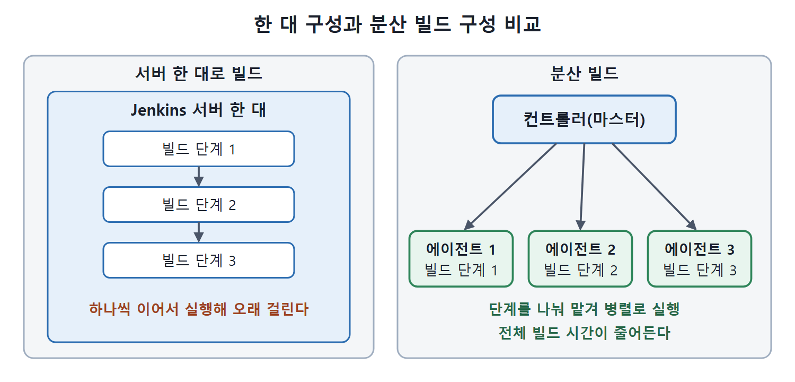
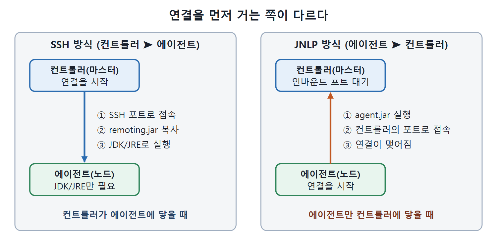

# 분산 빌드의 필요성과 구조

지금까지 만든 잡(작업)은 모두 Jenkins가 설치된 서버 한 대에서 돌았다. 작은 프로젝트라면 이걸로 충분하지만, 빌드 단계가 많고 오래 걸리는 큰 애플리케이션에서는 한 대짜리 구성이 금방 한계에 부딪힌다. 이 문서는 한 대 구성의 문제가 무엇인지, 그 해법인 분산 빌드(distributed build, 빌드 작업을 여러 서버에 나눠 맡기는 방식)가 어떤 구조인지, 컨트롤러와 에이전트를 어떤 방식으로 이어 주는지 정리한다.

식당 주방으로 생각하면 쉽다. 요리사 한 명이 주문을 순서대로 다 만들면 손님이 몰릴 때 음식이 늦게 나온다. 주문을 받아 업무를 나눠 주는 총괄 한 명과, 각자 맡은 요리를 만드는 요리사 여러 명으로 나누면 훨씬 빠르다. Jenkins에서는 총괄이 컨트롤러(마스터), 요리사가 에이전트(노드)다.

---

## 1. 서버 한 대로 빌드할 때의 문제

원서는 한 대의 Jenkins 머신으로 모든 잡을 실행하는 구성이 큰 애플리케이션에 맞지 않는 이유를 다음처럼 짚는다.

| 문제 | 왜 곤란한가 |
|---|---|
| 순차 실행으로 인한 지연 | 시간이 오래 걸리는 빌드 단계를 하나씩 이어서 돌리면 전체 시간이 길어지고 릴리스가 늦어진다 |
| 잦은 릴리스의 어려움 | 오래 걸리는 빌드는 자주 실행하고 관리하기가 어렵다 |
| 소프트웨어 설치 부담 | 필요한 소프트웨어를 한 머신에 모두 깔아야 하는데, 하드웨어 제약 때문에 불가능할 수 있다 |
| 장애 시 복구 부담 | 빌드 머신이 고장 나면 설치한 모든 것을 새 서버에 다시 재현해야 하는데 이 일이 매우 크다 |
| 다양한 환경 테스트 불가 | 요즘 애플리케이션은 여러 하드웨어와 소프트웨어 조합에서 테스트해야 하는데, 머신이 한 대면 불가능하다 |

표를 보면 문제가 속도, 설치 환경, 장애 대응, 테스트 환경 폭이라는 네 갈래로 모인다. 분산 빌드는 이 문제를 한꺼번에 풀기 위해 Jenkins가 기본으로 제공하는 기능이다.

## 2. 컨트롤러와 에이전트의 역할

Jenkins는 마스터-슬레이브 구조로 분산 빌드를 관리한다. 이 노트는 용어 규칙에 따라 마스터를 컨트롤러(마스터), 슬레이브를 에이전트(노드, 빌드를 실행하는 서버)라고 부른다. 원서는 슬레이브라는 옛 이름을 그대로 쓰고, 화면과 문서에서 에이전트라는 이름을 병행한다.

| 구분 | 설명 | 하는 일 |
|---|---|---|
| 컨트롤러(마스터) | Jenkins가 설치된 머신 | 빌드의 각 단계를 여러 머신에 나눠 실행시킨다 |
| 에이전트(슬레이브) | 컨트롤러에 네트워크로 접근할 수 있고 Jenkins 에이전트가 설치된 다른 머신 | 컨트롤러가 맡긴 빌드 단계를 실행한다. 한 대 이상이 여러 단계를 병렬로 맡아 전체 빌드를 끝낸다 |

원서는 컨트롤러가 단계를 나눠 줄 때 각 단계가 필요로 하는 하드웨어와 소프트웨어 조건을 기준으로 삼는다고 설명한다. 다만 원문 표현이 "seldom"(좀처럼 아니다)이라고 되어 있어 문맥상 의도와 어긋나 보인다. 이 노트는 조건에 맞는 에이전트로 보낸다는 취지로 이해했다. 이 부분은 원문 오류일 가능성이 있다.

원서의 그림 17-1은 컨트롤러 한 대가 여러 에이전트와 선으로 이어진 구조를 보여 준다. 글로 옮기면 다음과 같다.

```text
        [ 컨트롤러(마스터) ]
          /       |       \
   [에이전트1] [에이전트2] [에이전트3]
```



왼쪽은 서버 한 대가 빌드 단계를 하나씩 이어서 실행하는 구성이고, 오른쪽은 컨트롤러가 단계를 여러 에이전트에 나눠 맡겨 병렬로 실행하는 구성이다.

## 3. 컨트롤러와 에이전트를 잇는 두 가지 방법

분산 빌드를 하려면 컨트롤러와 에이전트가 서로 연결되어야 한다. 누가 먼저 연결을 거느냐에 따라 두 방식이 있다.

### 3.1 컨트롤러가 에이전트에 접속하는 방식 (Master to agent)

에이전트가 컨트롤러의 접속 요청을 받도록 설정하는 방식이다. 에이전트 쪽 준비물은 JDK나 JRE(자바 실행 환경)뿐이라 설정이 가장 가볍다. 컨트롤러는 SSH 포트로 에이전트 머신에 접속해 `remoting.jar`를 복사하고, 그 머신에 있는 JDK/JRE로 실행한다. 잡은 이 `remoting.jar` 에이전트를 통해 돈다. 따라서 컨트롤러가 에이전트 머신으로 요청을 보낼 수 있어야 한다.

### 3.2 에이전트가 컨트롤러에 접속하는 방식 (Agent to master)

컨트롤러가 에이전트 머신에 접근할 수 없으면 에이전트 프로세스를 시작시킬 수 없다. 이럴 때는 JNLP(Java Network Launch Protocol, 에이전트가 먼저 컨트롤러에 붙는 자바 실행 프로토콜)라는 다른 방식을 쓴다. 방화벽 밖에 있는 에이전트가 대표적인 경우다.

JNLP를 쓰려면 컨트롤러의 Manage Jenkins → Global Security 화면에서 TCP Port for Inbound Agents 옵션을 Fixed 또는 Random으로 정한다. Fixed를 고르면 포트 번호를 입력해야 하고, 원서는 7070을 쓴다. 이 포트가 에이전트가 JNLP로 컨트롤러에 붙는 통로다. 저장한 뒤에는 에이전트 머신의 브라우저에서 에이전트 페이지를 열어 JNLP Launch 아이콘을 누르면 에이전트가 설치되고 시작된다. 설치가 끝나면 Windows 서비스로 등록해 두어, 매번 직접 켜지 않아도 되게 할 수 있다.



SSH 방식은 컨트롤러가 에이전트로 접속해 `remoting.jar`를 복사하고 실행하며, JNLP 방식은 에이전트가 컨트롤러의 포트로 먼저 접속한다.

### 3.3 두 방식 비교

| 비교 항목 | 컨트롤러 → 에이전트 (SSH) | 에이전트 → 컨트롤러 (JNLP) |
|---|---|---|
| 연결을 시작하는 쪽 | 컨트롤러 | 에이전트 |
| 에이전트 쪽 요구 사항 | JDK/JRE만 있으면 됨 | agent.jar 실행 등 에이전트 쪽 작업이 필요 |
| 필수 네트워크 조건 | 컨트롤러가 에이전트에 도달할 수 있어야 함 | 에이전트가 컨트롤러에 도달할 수 있어야 함 |
| 컨트롤러 쪽 추가 설정 | 없음(SSH 자격 증명과 노드 등록) | Global Security에서 인바운드 에이전트 포트 지정 |
| 알맞은 상황 | 컨트롤러가 에이전트에 접근 가능할 때 | 에이전트가 방화벽 밖처럼 컨트롤러가 접근할 수 없을 때 |

핵심은 "어느 쪽이 상대에게 닿을 수 있는가"다. 컨트롤러가 닿으면 SSH, 에이전트만 닿으면 JNLP를 고른다. 이어지는 문서에서 두 방식의 실습 절차를 따로 다룬다.

<br>
<br>
<br>

[CICD Pipeline Using Jenkins Unleashed](../)
