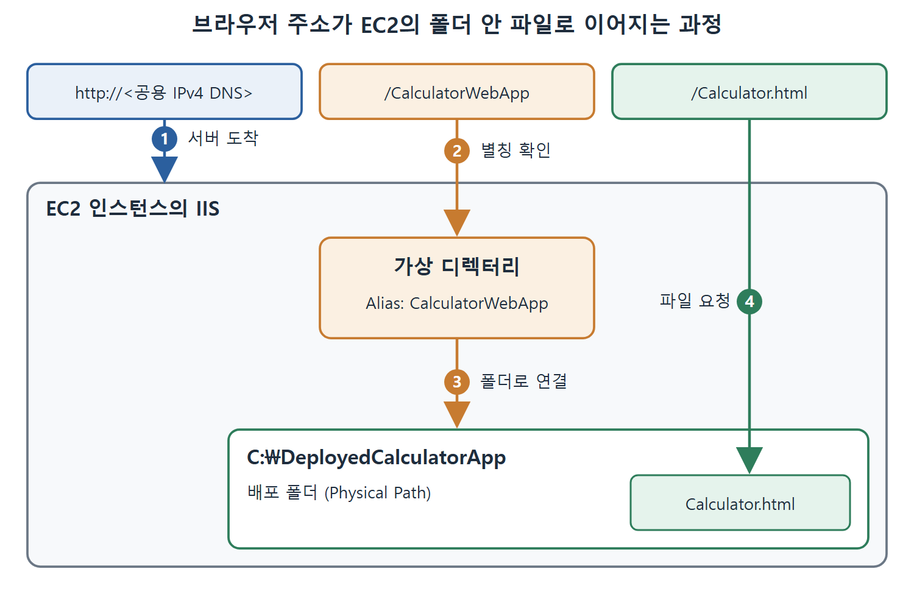

# IIS 웹 서버 설치와 설정

EC2 인스턴스를 만들었다면 이제 그 안에서 웹 애플리케이션을 서비스할 준비를 해야 한다. 이 장에서 배포할 Calculator 웹 애플리케이션은 Calculator.html이라는 HTML 파일이 중심이다. 그 파일을 사람들이 브라우저로 볼 수 있게 하려면 웹 서버가 필요하다. 이 문서는 Windows 서버용 웹 서버인 IIS(Internet Information Services)를 설치하고, 배포 폴더를 웹 주소와 연결하는 과정을 정리한다.

---

## 1. IIS 설치하기

IIS는 Windows 서버에서 웹 사이트를 띄워 주는 웹 서버다. 서버용 Windows에서는 Server Manager의 역할 추가 마법사로 설치한다. 아래 작업은 모두 EC2 인스턴스에 원격 데스크톱으로 접속한 상태에서 한다.

1. Windows 키를 눌러 검색창에 Server Manager를 입력하고 실행해 Server Manager Dashboard를 연다.
2. Add Roles and Features 링크를 누르고 Next를 누른다.
3. Role-Based or Feature-Based Installation 라디오 버튼은 선택된 상태로 두고 Next를 누른다. Select Destination Server 창이 열리면 다시 Next를 누른다.
4. Web Server (IIS) 체크박스를 선택한다. Add Features That Are Required for Web Server (IIS) 창이 뜨면 Add Features를 누른다. 그러면 Select Server Roles 창으로 돌아온다.
5. Next를 눌러 Select Features 창을 열고, 다시 Next를 눌러 Web Server Role (IIS) 창을 연다.
6. Next를 눌러 Select Role Services 창을 열고, 마지막으로 Next를 눌러 Confirm Installation Selections 창을 연다.
7. Install을 누르고 설치가 끝날 때까지 기다린 뒤 Close를 누른다.

중간 창들은 모두 기본값으로 지나가면 된다. 직접 바꾸는 부분은 Web Server (IIS) 체크박스 하나뿐이다.

## 2. 배포 폴더와 가상 디렉터리 만들기

IIS를 설치했으면 두 가지를 준비한다. 하나는 파일이 실제로 놓일 폴더이고, 다른 하나는 그 폴더를 웹 주소로 연결하는 별칭이다. 비유하면 폴더는 창고이고, 가상 디렉터리(virtual directory)는 창고 앞에 붙인 안내 간판이다. 손님은 간판 이름(alias)만 알면 창고 안 물건을 찾을 수 있다.

1. 인스턴스의 C:\ 아래에 DeployedCalculatorApp이라는 빈 폴더를 만든다.
2. Windows 메뉴에서 Internet Information Services (IIS) Manager를 열어 IIS 관리 창을 띄운다.
3. 왼쪽 트리를 펼쳐 Default Web Site를 오른쪽 클릭한다(원서 Figure 18-2).
4. Add Virtual Directory 메뉴를 고른다.
5. Alias 입력란에 CalculatorWebApp, Physical Path 입력란에 C:\DeployedCalculatorApp를 입력한다(원서 Figure 18-3).
6. OK를 눌러 Default Web Site 안에 가상 디렉터리를 만든다.

| 입력란 | 입력 값 | 의미 |
| --- | --- | --- |
| Alias | CalculatorWebApp | 브라우저 주소에 나타나는 이름 |
| Physical Path | C:\DeployedCalculatorApp | 파일이 실제로 저장되는 폴더 |

이 설정 덕분에 C:\DeployedCalculatorApp에 Calculator.html을 넣으면 나중에 `/CalculatorWebApp/Calculator.html` 주소로 열린다. 이 주소는 뒤의 접속 확인 문서에서 다시 쓴다.

그림은 주소의 CalculatorWebApp 부분이 가상 디렉터리의 Alias와 맞물려 C:\DeployedCalculatorApp 폴더로 연결되고, 그 안의 Calculator.html이 요청되는 과정을 보여 준다.

## 3. 이 설정이 필요한 이유

젠킨스 배포 잡은 결국 파일을 이 폴더에 복사하는 일을 한다. 폴더와 웹 주소가 미리 연결되어 있으면 복사만으로 배포가 끝난다. 즉 IIS 설정은 한 번만 하는 사전 준비이고, 배포할 때마다 반복하는 작업은 파일 복사뿐이다. 이 점은 원문이 직접 설명한 문장이 아니라 실습 흐름에서 읽어 낸 해석이다.

다음 문서에서는 로컬 컴퓨터에서 이 폴더로 파일을 보내기 위한 SSH 연결을 설정한다.

 
 
 

[CICD Pipeline Using Jenkins Unleashed](../)
