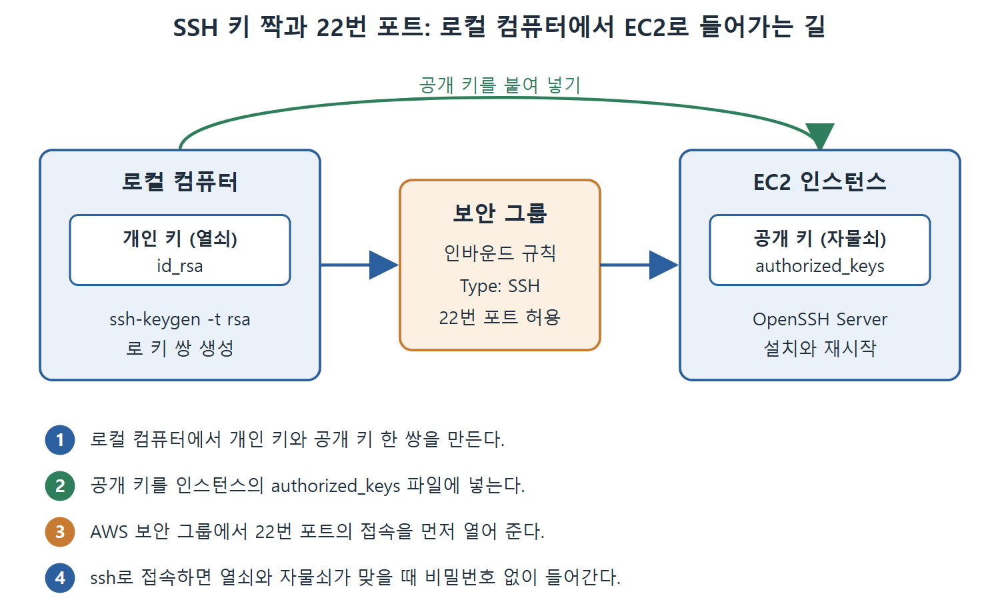

# SSH 연결 설정과 파일 복사

Calculator 웹 애플리케이션을 배포한다는 것은 로컬 컴퓨터에 있는 Calculator.html을 EC2 인스턴스의 C:\DeployedCalculatorApp 폴더로 옮기는 일이다. 이 복사를 안전하게 하려면 로컬 컴퓨터와 인스턴스 사이에 SSH(Secure Shell, 암호화된 원격 접속 방식) 연결이 필요하다. 이 문서는 SSH 키 설정, AWS 보안 그룹 규칙 추가, 접속 테스트, scp 복사, 브라우저 확인까지를 순서대로 정리한다.

---

## 1. 전체 흐름

SSH 설정은 단계가 많아 보이지만, 크게 네 덩어리다. 원문은 1번부터 35번까지 번호를 이어 붙여 설명했는데, 이 노트는 의미 단위로 묶었다.

| 덩어리 | 작업 장소 | 목적 |
| --- | --- | --- |
| 키 쌍 만들기 | 로컬 컴퓨터 | 공개 키와 개인 키 생성 |
| OpenSSH 서버 설치와 키 등록 | EC2 인스턴스 | 인스턴스가 SSH 접속을 받도록 준비하고 공개 키를 등록 |
| 인바운드 규칙 추가 | AWS 콘솔 | 22번 포트 접속을 허용 |
| 접속 테스트 | 로컬 컴퓨터 | 실제로 접속되는지 확인 |

열쇠 비유로 풀면 이렇다. 로컬 컴퓨터가 개인 키(열쇠)를 들고 있고, 인스턴스에는 공개 키(자물쇠)를 달아 둔다. 열쇠와 자물쇠가 짝이 맞으면 비밀번호 없이 들어갈 수 있다.



그림은 로컬 컴퓨터의 개인 키와 인스턴스의 공개 키가 짝을 이루고, 그 사이의 보안 그룹이 22번 포트를 열어 주어야 접속이 이루어진다는 관계를 보여 준다.

## 2. 로컬 컴퓨터에서 SSH 키 쌍 만들기

로컬 컴퓨터에서 다음 명령으로 공개 키와 개인 키를 만든다.

```
ssh-keygen -t rsa
```

생성된 키 파일은 로컬 컴퓨터의 `${CURRENT_USER}\.ssh` 폴더에 저장된다. 뒤에서 쓰는 개인 키 경로 `C:\Users\magicuser\.ssh\id_rsa`가 바로 이 파일이다.

## 3. EC2 인스턴스에 OpenSSH 서버 설치하기

인스턴스에 접속해서 다음 순서로 설치한다.

1. Windows 시작 메뉴에서 Settings를 연다.
2. Apps를 눌러 Apps & Features 창을 연다.
3. Manage Optional Features 링크를 누른다.
4. Add a Feature 버튼을 누른다.
5. 목록에서 OpenSSH Server를 찾는다.
6. Install 버튼을 누른다.

## 4. authorized_keys 파일 만들고 공개 키 붙여 넣기

authorized_keys는 이 서버에 들어와도 좋은 공개 키를 모아 두는 파일이다. 이 파일에 로컬 컴퓨터에서 만든 공개 키를 넣는다.

1. 인스턴스에서 명령 프롬프트를 C:\users\administrator 위치로 열고 `mkdir .ssh`로 .ssh 폴더를 만든다.
2. cd 명령으로 .ssh 폴더에 들어가 빈 파일을 만든다.

```
fsutil file createnew authorized_keys 0
```

3. 이 파일을 열어 로컬 컴퓨터에서 만든 공개 키를 붙여 넣고 저장한다.

### 파일 권한 바꾸기

authorized_keys 파일의 권한을 Administrator 사용자 기준으로 정리한다. 다음 순서로 한다.

1. authorized_keys 파일을 오른쪽 클릭해 Properties를 연다.
2. Security 탭을 누른다.
3. Advanced 버튼을 누른다.
4. Disable Inheritance 버튼을 누른다.
5. Convert Inherited Permissions Into Explicit Permissions on this Object 옵션을 고른다.
6. OK를 누르고, Properties 창에서도 OK를 누른다.

상속받던 권한을 끊고, 상속된 권한을 이 파일에 직접 붙는 권한으로 바꾸는 작업이다.

### sshd_config 수정하기

1. C:\ProgramData\ssh 폴더로 간다. ProgramData 폴더가 보이지 않으면 탐색기 View 메뉴에서 숨김 파일과 폴더를 표시하도록 바꾼다.
2. sshd_config 파일을 열어 아래로 내려가, 마지막 두 줄 맨 앞에 #를 붙여 주석 처리한다(원서 Figure 18-4).
3. 파일을 저장하고, Windows 시작 메뉴의 Services 창에서 OpenSSH Server 서비스를 재시작한다.

원문은 마지막 두 줄이 정확히 무엇인지 글로 적지 않고 그림으로만 보여 준다. 그래서 이 노트도 내용은 적지 않는다. 같은 환경을 따라 할 때는 원서 Figure 18-4를 확인해야 한다.

## 5. 보안 그룹에 SSH 인바운드 규칙 추가하기

인스턴스 안에서 SSH 서버를 켜도, AWS 쪽 방화벽 규칙이 막고 있으면 밖에서 들어올 수 없다. 이 방화벽 역할을 하는 것이 인스턴스에 붙은 보안 그룹(Security group)이고, 들어오는 접속을 허용하는 규칙이 인바운드 규칙(inbound rule)이다.

1. AWS 콘솔 왼쪽 Instances 영역의 Instances 링크를 눌러 Instances 페이지를 연다.
2. 실행 중인 인스턴스의 체크박스를 선택한다.
3. Security 탭을 누른다.
4. 탭 안의 security groups 라벨 아래에 있는 링크를 누른다.
5. Edit Inbound Rules 버튼을 누르면 Edit Inbound Rules 페이지가 나온다.
6. Add Rule 버튼을 누른다.
7. 새 항목의 Type 드롭다운에서 SSH를 고른다.
8. Source 열에 0.0.0.0/0을 입력한다.
9. Save Rules를 누른다.

새 규칙은 기존 규칙에 추가된다. 이 규칙으로 SSH의 기본 포트인 22번 포트를 통한 접속이 허용된다. 0.0.0.0/0은 모든 주소를 뜻하는 표기다.

## 6. SSH 접속 테스트

설정이 끝났으니 로컬 컴퓨터에서 접속해 본다. 형식은 다음과 같다.

```
ssh <UserName>@<EC2Instance_PublicIPV4DNS>
```

책이 실제로 쓴 명령은 다음과 같다.

```
ssh Administrator@ec2-3-141-17-90.us-east-2.compute.amazonaws.com
```

공용 IPv4 DNS는 인스턴스의 Details 페이지에서 확인한다. 명령을 실행하면 Are You Sure You Want to Continue Connecting (Yes/No/[Fingerprint])? 질문이 나온다. Yes를 입력하고 Enter를 누르면 접속된다. 처음 접속하는 서버의 신원을 확인하는 질문이다.

## 7. scp로 Calculator.html 복사하기

젠킨스 잡을 만들기 전에, 복사 명령이 단독으로 되는지 먼저 확인한다. 파일 복사에는 scp(SSH 위에서 파일을 복사하는 명령)를 쓴다. 일반 형식은 다음과 같다.

```
scp -i /directory/to/privatekey /your/local/file/to/copy user@ec2-xx-xx-xxx-xxx.compute-1.amazonaws.com:path/to/file
```

| 부분 | 뜻 |
| --- | --- |
| -i 뒤의 경로 | 개인 키 파일 |
| 그다음 경로 | 로컬에서 복사할 파일 |
| user@호스트:경로 | 인스턴스의 사용자, 주소, 받을 폴더 |

책은 로컬의 D:\JenkinsBookExamples\CalcualtorWebApplication\src\main\webapp 폴더에 있는 Calculator.html을 인스턴스의 C:\DeployedCalculatorApp로 복사했다. 원서의 폴더명 철자(CalcualtorWebApplication)가 그렇게 적혀 있다. 이 명령은 명령 프롬프트에서 실행하고, 성공하면 인스턴스의 C:\DeployedCalculatorApp 안에 파일이 생긴다.

원문에 인쇄된 명령에는 -i가 대문자 -I로 적혀 있고 경로가 줄바꿈에서 끊겨 있다. 추출 문제이거나 오타로 보이며, 올바른 옵션은 소문자 -i다.

## 8. 브라우저로 접속해 확인하기

복사가 됐으면 로컬 브라우저로 접속해 본다. HTTP 접속을 받으려면 SSH 때와 같은 방식으로 인바운드 규칙을 하나 더 추가한다. 달라지는 것은 Type 드롭다운에서 HTTP를 고르는 것뿐이다.

1. 인스턴스의 Windows 시작 메뉴에서 Services를 열어 World Wide Web Publishing 서비스를 재시작한다.
2. 로컬 컴퓨터의 브라우저에서 다음 형식의 주소를 연다.

```
http://<EC2InstancePublicIP4DNS>/CalculatorWebApp/Calculator.html
```

책이 쓴 주소는 `http://ec2-3-141-17-90.us-east-2.compute.amazonaws.com/CalculatorWebApp/Calculator.html`이다. 주소의 CalculatorWebApp은 IIS에서 만든 가상 디렉터리 별칭이다.

| 규칙 Type | 포트 | 용도 |
| --- | --- | --- |
| SSH | 22 | 파일 복사와 원격 접속 |
| HTTP | 원문에 명시 없음 | 브라우저로 웹 페이지 접근 |

HTTP의 포트 번호는 원문에 적혀 있지 않아 비워 두었다.

<br>
<br>
<br>

[CICD Pipeline Using Jenkins Unleashed](../)
