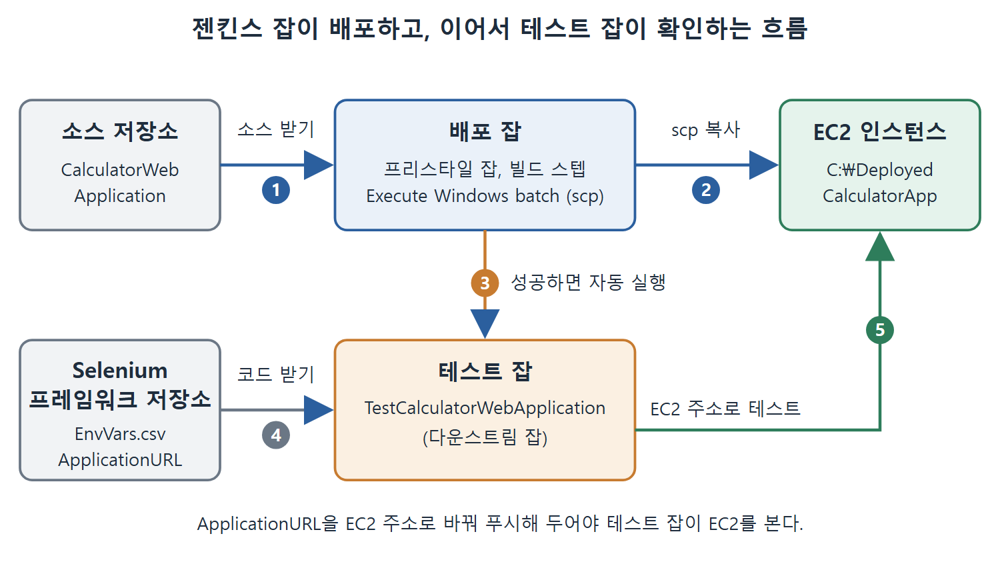

# 젠킨스 잡으로 EC2에 배포하기

지금까지는 EC2 인스턴스를 만들고, 웹 서버를 설치하고, 손으로 파일을 복사해 보았다. 이제 그 수작업을 젠킨스 잡(작업)에 맡긴다. 이 문서는 배포 잡을 만드는 방법, 배포 뒤에 테스트 잡이 이어지도록 연결하는 방법, Selenium 테스트가 EC2의 주소를 보도록 바꾸는 방법, 그리고 실행 결과를 확인하는 방법을 정리한다.

---

## 1. 배포 잡 만들기

책은 프리스타일 잡(화면에서 옵션을 채워 만드는 가장 기본적인 잡)을 하나 만들고 이름을 BuildAndDeployCalculatorWebApplicationOnEC2Instance로 붙였다. 이 잡에는 Execute Windows batch command(Windows 배치 명령 실행) 빌드 스텝이 하나 있고, 거기에 앞에서 연습한 scp 명령이 들어 있다.

```
scp -i C:\Users\magicuser\.ssh\id_rsa src\main\webapp\Calculator.html Administrator@ec2-3-141-17-90.us-east-2.compute.amazonaws.com:C:\DeployedCalculatorApp
```

앞 문서의 수동 명령과 다른 점은 복사할 파일 경로가 상대 경로라는 것이다. 이 잡은 CalculatorWebApplication 소스 저장소(SCM)에서 변경 사항을 받아 오고, 그 내용이 작업 공간(워크스페이스)에 놓인다. 그래서 `src\main\webapp\Calculator.html`처럼 작업 공간 기준 경로만 적으면 된다. scp는 이 파일을 Amazon EC2 인스턴스의 C:\DeployedCalculatorApp 폴더로 복사한다.

한 가지 짚을 점이 있다. 이 잡이 돌아가는 컴퓨터에 개인 키 파일 C:\Users\magicuser\.ssh\id_rsa가 있어야 한다. 원문은 이 전제를 따로 설명하지 않지만, 명령이 그 경로를 직접 가리키므로 젠킨스를 실행하는 같은 컴퓨터의 계정 폴더로 이해했다.

| 설정 | 값 |
| --- | --- |
| 잡 종류 | 프리스타일 잡 |
| 잡 이름 | BuildAndDeployCalculatorWebApplicationOnEC2Instance |
| 소스 | CalculatorWebApplication 저장소 |
| 빌드 스텝 | Execute Windows batch command, scp 명령 |
| 빌드 후 조치 | Projects to Build에 TestCalculatorWebApplication 지정 |

## 2. 다운스트림 테스트 잡 연결하기

배포가 끝난 뒤 곧바로 테스트가 돌아야 배포가 잘 됐는지 알 수 있다. 그래서 이 잡의 Post-Build Actions(빌드 후 조치) 섹션에서 Projects to Build 입력란에 TestCalculatorWebApplication을 적어 두었다. 이 잡이 다운스트림 잡(downstream job, 뒤따라 실행되는 잡)이 된다. 설정을 마치고 Save를 누른다.

결과적으로 흐름은 이렇다. 배포 잡이 파일을 EC2로 복사하고, 성공으로 끝나면 TestCalculatorWebApplication 잡이 시작되어 Selenium 테스트를 실행한다. 배포 잡은 테스트 잡의 업스트림(upstream, 앞선) 잡이다.



그림은 배포 잡이 소스를 받아 scp로 EC2에 복사한 뒤 테스트 잡을 자동으로 실행하고, 테스트 잡이 Selenium 프레임워크 저장소의 코드로 EC2 주소를 테스트하는 순서를 보여 준다.

## 3. Selenium이 보는 주소를 EC2로 바꾸기

기존 Selenium 프레임워크는 로컬 컴퓨터에 있는 Calculator.html을 열어 테스트했다. 이제 EC2에 배포된 파일을 테스트해야 하므로, 대상 주소를 바꾼다.

1. Selenium 프레임워크의 EnvVars.csv 파일을 연다.
2. 환경 변수 ApplicationURL의 값을 EC2 인스턴스의 Calculator.html 주소로 바꾼다.
3. 변경을 커밋하고 Selenium 프레임워크 저장소에 푸시한다.

책은 변경을 gitlab.com/Pranoday/JenkinsBookSeleniumPythonFramework.git 저장소에 푸시했다. 테스트 잡은 이 저장소에서 프레임워크와 테스트를 받아 실행한다. 따라서 푸시를 하지 않으면 테스트 잡은 옛 주소를 계속 쓴다. 원문은 새 주소의 구체적인 형태를 이 부분에서 다시 적지 않았지만, 앞 문서의 브라우저 접속 주소와 같은 형태다.

## 4. 잡 실행하고 확인하기

1. 젠킨스 대시보드에서 BuildAndDeployCalculatorWebApplicationOnEC2Instance 잡 오른쪽의 시계 모양 아이콘을 누른다.
2. Build 버튼을 눌러 실행한다.
3. 빌드의 콘솔 로그(Console Output)에서 진행 상황을 본다.
4. 이 잡이 작업을 끝내면 TestCalculatorWebApplication 잡이 자동으로 시작된다.

테스트 잡은 업스트림 잡이 EC2 인스턴스에 배포해 둔 Calculator 웹 애플리케이션을 대상으로 테스트를 수행한다.

## 5. 수동 단계와 자동 단계 비교

| 구분 | 수동으로 할 때 | 잡으로 할 때 |
| --- | --- | --- |
| 파일 복사 | 명령 프롬프트에서 scp 직접 실행 | 빌드 스텝이 scp 실행 |
| 파일 위치 | 로컬 폴더의 전체 경로 | 작업 공간 기준 상대 경로 |
| 테스트 시작 | 사람이 따로 실행 | 다운스트림 잡이 자동 실행 |

표처럼 같은 scp 명령이 사람 손에서 잡으로 옮겨 간 것이 이 장의 핵심 변화다. 한 번 만들어 두면 소스가 바뀔 때마다 같은 배포를 반복할 수 있다.

<br>
<br>
<br>

[CICD Pipeline Using Jenkins Unleashed](../)
