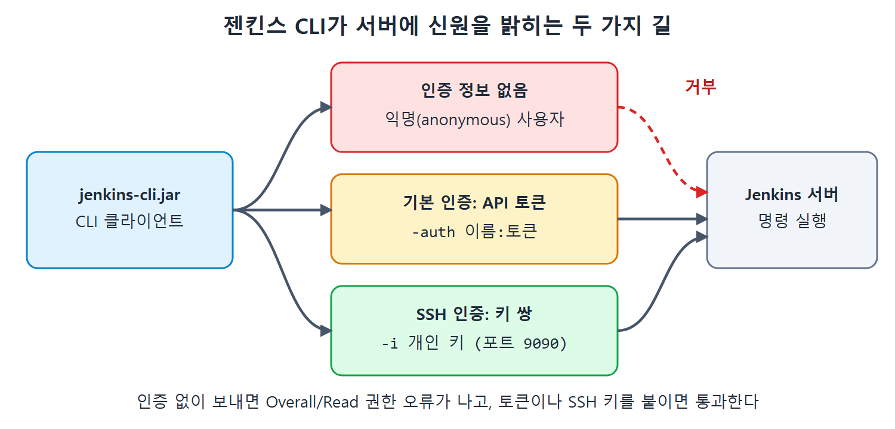

# API 토큰으로 인증하기

젠킨스 CLI를 쓰려면 "누구 이름으로 실행하는지"를 -auth 옵션으로 알려 줘야 한다. 이 문서는 그중 기본 인증(Basic Authentication) 방식, 특히 API 토큰을 만들어 쓰는 방법을 다룬다. 앞 문서에서 익명 사용자 오류로 막혔던 create-job 명령이 여기서 성공한다.

API 토큰은 비밀번호 대신 쓰는 전용 열쇠에 가깝다. 집 열쇠(비밀번호)를 맡기는 대신, 특정 방 하나만 열리는 복제 열쇠를 만들어 주는 셈이다. 유출되어도 토큰만 폐기하면 되고 원래 비밀번호는 안전하다.

---

## 1. 인증 방식의 종류

CLI에서 쓸 수 있는 인증은 크게 두 가지다.

| 방식 | 보내는 정보 | 이 장에서 다루는 위치 |
| --- | --- | --- |
| 기본 인증 | 사용자 이름과 비밀번호, 또는 사용자 이름과 API 토큰 | 이 문서 |
| SSH 인증 | 개인 키와 공개 키 쌍 | 다음 문서들 |

기본 인증에서는 이름과 비밀번호를 보내는 방법도 있지만, 원서는 API 토큰을 보내는 쪽을 권장한다. 더 안전한 선택이기 때문이다. 비밀번호를 스크립트에 그대로 적어 두면 파일이 노출되는 순간 계정 전체가 위험해진다.


인증 정보 없이 보낸 요청은 익명 사용자로 처리되어 거부되고, API 토큰(-auth)이나 SSH 키(-i)를 붙인 요청만 젠킨스 서버에서 실행되는 흐름을 보여 준다.

## 2. API 토큰 만들기

권한이 있는 사용자로 로그인한 뒤 토큰 생성 화면으로 간다. 원서는 젠킨스 관리자 계정으로 로그인해 실습했다.

1. 로그인 창에서 권한이 있는 사용자의 자격 증명으로 로그인한다.
2. 대시보드 오른쪽 위에 보이는 사용자 이름을 누른다.
3. Configure 링크를 눌러 사용자 설정 페이지로 간다. 여기에 API 토큰 설정이 있다.
4. API Token 섹션의 Add New Token 버튼으로 새 토큰을 만든다.
5. 토큰 이름을 입력하고 Generate 버튼을 누른다.
6. Copy This Token 버튼으로 토큰을 복사해 파일에 보관해 둔다.
7. Save 버튼을 누른다.

원서는 생성된 토큰을 복사해 파일에 붙여 두고 나중에 쓰라고 안내한다. 그러니 이 단계에서 따로 저장해 두는 습관을 들인다. 원서에는 실제 토큰 값이 예시로 실려 있지만, 이 노트에서는 `${API_TOKEN}`이라는 자리 표시로만 쓴다.

## 3. 토큰으로 잡 다시 만들기

인증을 붙인 명령의 기본 형태는 다음과 같다.

```bat
java -jar ${Jenkins-cli.jar 경로} -s ${JENKINS_URL} -auth ${UserName}:${API_TOKEN} -webSocket create-job ${JOB_NAME} < ${Configuration.xml}
```

앞 문서의 명령에 `-auth 사용자이름:토큰` 한 덩어리가 들어간 것이 전부다. 이름과 토큰 사이에 콜론(:)을 쓰며 공백은 없다.

값을 채운 형태는 다음과 같다. 토큰 자리는 자리 표시로 바꿨다.

```bat
java -jar D:\JenkinsBookExamples\jenkins-cli.jar -s http://192.168.43.10:8080/ -auth Pranodayd:${API_TOKEN} -webSocket create-job CLIJob1 < D:\JenkinsBookExamples\Demo.xml
```

Pranodayd는 원서 저자의 젠킨스 사용자 이름이다. 독자는 자기 사용자 이름을 쓴다.

## 4. 결과 확인

1. 명령 프롬프트에서 위 명령을 실행한다.
2. 젠킨스 대시보드를 새로 고친다.
3. CLIJob1이라는 새 잡이 생긴 것을 확인한다.
4. CLIJob1 안으로 들어가 빌드 스텝을 본다. Execute Batch command 스텝에 `echo Hi`가 들어 있고, Demo 잡과 똑같다.

새 잡의 설정이 Demo와 같은 것은 Demo의 XML을 템플릿으로 썼기 때문이다. 이 방식은 비슷한 잡을 여러 개 만들 때 쓸모가 있다.

## 5. 기억할 점

| 항목 | 내용 |
| --- | --- |
| 권장 방식 | 비밀번호보다 API 토큰 |
| 토큰 위치 | 사용자 이름 클릭, Configure, API Token 섹션 |
| 옵션 형식 | -auth 사용자이름:토큰 |
| 이전 오류 | anonymous 권한 오류가 사라진다 |
| 잡 이름 중복 | 이미 있으면 Job Already Exists 오류 |

CLIJob1을 이미 만들었다면 같은 명령을 다시 실행할 때 중복 오류가 난다. 이 경우는 인증 문제가 아니라 이름 문제이니 헷갈리지 않아야 한다.

토큰도 결국 열쇠이므로 스크립트나 저장소에 그대로 올리지 않도록 조심한다. 원서의 뒤쪽 배치 예제는 사용자 이름과 비밀번호 형태 값을 코드에 직접 적어 두었는데, 이 노트에서는 모두 자리 표시로 바꿔 옮긴다.

<br>
<br>
<br>

[CICD Pipeline Using Jenkins Unleashed](../)
