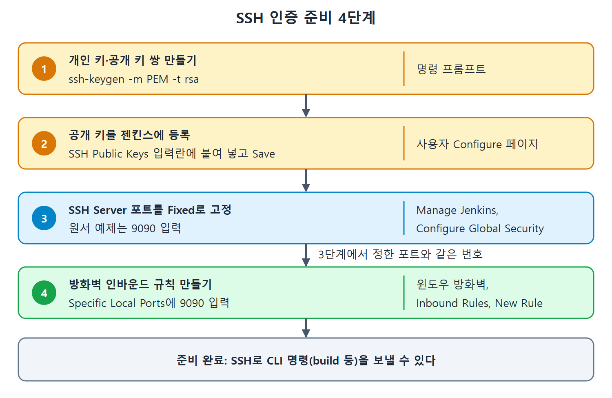

# SSH 인증 준비

API 토큰 말고도 젠킨스 CLI는 SSH 인증으로 접속할 수 있다. 이 문서는 SSH 인증을 쓰기 위해 미리 해 둘 일을 순서대로 정리한다. 키 쌍을 만들고, 공개 키를 젠킨스 사용자에게 등록하고, 젠킨스에서 SSH 서버를 켜고 포트를 정하고, 방화벽에서 그 포트를 열어 주는 것까지다.

SSH 인증은 자물쇠와 열쇠로 비유할 수 있다. 공개 키는 서버 문에 달아 두는 자물쇠이고, 개인 키는 내 주머니에만 있는 열쇠다. 자물쇠는 남에게 보여 줘도 되지만 열쇠는 절대 넘기지 않는다.

---

## 1. 준비 단계 한눈에 보기

| 순서 | 할 일 | 어디서 |
| --- | --- | --- |
| 1 | 개인 키와 공개 키 쌍 만들기 | 명령 프롬프트 |
| 2 | 공개 키를 사용자 설정에 붙여 넣기 | 젠킨스 사용자 Configure 페이지 |
| 3 | SSH 서버 포트 정하기 | Manage Jenkins, Configure Global Security |
| 4 | 그 포트로 들어오는 연결 허용하기 | 윈도우 방화벽 인바운드 규칙 |

네 단계를 모두 마쳐야 SSH로 CLI 명령을 보낼 수 있다.


키 쌍 만들기, 공개 키 등록, SSH Server 포트 고정, 방화벽 인바운드 규칙 허용이 순서대로 이어지며, 3단계에서 정한 포트 번호를 4단계 방화벽 규칙에 그대로 쓴다는 점을 보여 준다.

## 2. 키 쌍 만들기

다음 명령으로 새 키 쌍을 만든다.

```bash
ssh-keygen -m PEM -t rsa
```

여기서 -m PEM 옵션이 중요하다. 이 옵션을 주면 개인 키가 RSA 형식으로 만들어지고, 빼면 OpenSSH 형식으로 만들어진다. 젠킨스 CLI 클라이언트는 RSA 형식 개인 키를 지원하므로 -m 인자를 빠뜨리지 말라고 원서는 강조한다.

| 명령 | 개인 키 형식 | 젠킨스 CLI 클라이언트 |
| --- | --- | --- |
| ssh-keygen -m PEM -t rsa | RSA 형식 | 지원 |
| ssh-keygen (-m 없이) | OpenSSH 형식 | 원서가 지원한다고 밝히지 않았다 |

원서 문장은 "RSA 형식을 지원한다"까지만 밝히므로, OpenSSH 형식이 정확히 어떤 오류를 내는지는 원서에 나오지 않는다. 키를 만들 때는 처음부터 -m PEM을 붙이는 것이 안전하다.

## 3. 공개 키를 젠킨스에 등록

1. 대시보드 오른쪽 위의 사용자 이름을 누르고 Configure 링크를 누른다. API 토큰, 공개 키 같은 사용자 설정을 한 화면에서 다루는 페이지가 열린다.
2. 아래로 내려 SSH Public Keys 섹션을 찾는다. 앞에서 만든 공개 키를 SSH Public Keys 입력란에 붙여 넣는다.
3. Save 버튼을 누른다.

공개 키 파일은 보통 확장자가 .pub이다. 원서는 파일 이름을 따로 말하지 않으므로, 이 부분은 SSH 일반 관례에 따른 설명이다.

## 4. 젠킨스에서 SSH 서버 설정

SSH로 접속하려면 젠킨스가 SSH 연결을 받아 줄 서버 기능을 설정해야 한다.

1. Manage Jenkins, Configure Global Security 메뉴로 들어간다.
2. 페이지 아래쪽 끝 부근에서 SSH Server 섹션을 찾는다.
3. 포트를 정한다. 선택지는 Fixed와 Random이다.
4. Save 버튼을 누른다.

| 선택지 | 동작 | 방화벽 관점 |
| --- | --- | --- |
| Random | 젠킨스가 임의의 포트를 골라 SSH 연결을 받는다 | 포트가 매번 달라질 수 있어 인바운드 규칙을 만들기 어렵다 |
| Fixed | 내가 정한 포트 번호로 연결을 받는다 | 포트가 고정이라 인바운드 규칙을 만들기 쉽다 |

방화벽이 켜진 서버에서는 특정 포트로 들어오는 연결을 따로 허용해야 하는데, 포트가 매번 바뀌면 그 규칙을 쓸 수 없다. 그래서 원서는 Fixed를 골라 9090을 입력했다. 이후 예제의 포트 9090이 모두 여기서 나온다.

## 5. 방화벽 인바운드 규칙 만들기

머신에 방화벽이 있으면 특정 포트나 특정 프로그램에서 들어오는 연결을 허용하는 인바운드 규칙(inbound rule, 들어오는 연결 허용 규칙)이 필요하다. 원서는 SSH 서버 포트 9090을 열어 주는 예를 든다. 윈도우 기준 절차는 다음과 같다.

1. 윈도우 시작 메뉴에서 Windows Defender Firewall with Advanced Security를 연다.
2. 왼쪽의 Inbound Rules를 누른다.
3. 오른쪽의 New Rule 링크를 누르면 Rule Type 창이 열린다.
4. Port 라디오 버튼을 고른다.
5. Next를 누른다.
6. Specific Local Ports 라디오 버튼을 고르고 9090을 입력한다.
7. Next를 누르면 Action 창이 나온다.
8. Next를 누르면 Profile 창이 나온다.
9. Next를 누르면 Name 창이 나온다.
10. 규칙 이름을 넣고 Finish 버튼을 누른다.

중간의 Action, Profile 창은 원서가 기본값 그대로 Next만 누르는 것으로 설명한다. 따로 값을 바꾸라는 안내는 없다.

| 창 이름 | 하는 일 |
| --- | --- |
| Rule Type | 규칙 종류로 Port를 고른다 |
| (Port 선택 다음 창) | Specific Local Ports를 고르고 9090을 입력한다. 원서는 이 창의 이름을 적지 않았다 |
| Action | 기본값으로 넘어간다 |
| Profile | 기본값으로 넘어간다 |
| Name | 규칙 이름을 정하고 Finish |

여기까지 하면 SSH 인증으로 CLI를 쓸 준비가 끝난다. 실제 사용은 다음 문서에서 다룬다.

<br>
<br>
<br>

[CICD Pipeline Using Jenkins Unleashed](../)
