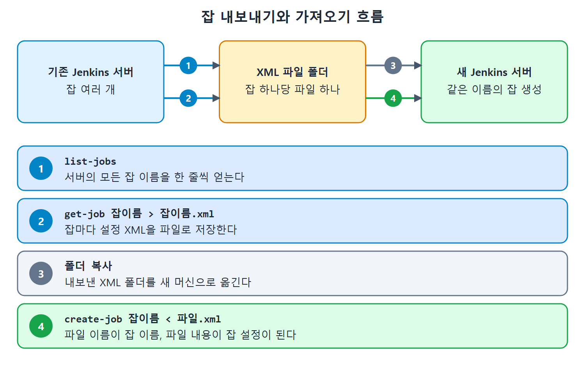

# 잡 내보내기와 가져오기

젠킨스 서버를 다른 컴퓨터로 옮길 때는 기존 서버의 잡을 모두 꺼내 새 서버에 넣어야 한다. 잡이 수십 개라면 화면에서 하나씩 하기 어렵다. 이 문서는 CLI의 list-jobs, get-job, create-job 명령을 윈도우 배치 파일 반복문으로 엮어 잡을 한 번에 내보내고 가져오는 방법을 정리한다.

이사에 비유하면 내보내기는 짐을 상자에 담는 일이고, 가져오기는 새 집에서 상자를 푸는 일이다. 잡 하나가 상자 하나이고, 상자의 내용물이 설정 XML 파일이다.

---

## 1. 전체 흐름

| 단계 | 사용하는 CLI 명령 | 하는 일 |
| --- | --- | --- |
| 목록 얻기 | list-jobs | 서버의 모든 잡 이름을 한 줄씩 출력 |
| 설정 내보내기 | get-job | 잡 하나의 설정 XML을 출력 |
| 파일로 저장 | 리다이렉션 > | 출력을 잡이름.xml 파일에 저장 |
| 새 서버로 복사 | (파일 복사) | 내보낸 폴더를 새 머신으로 옮김 |
| 가져오기 | create-job | XML을 입력으로 넘겨 잡 생성 |

내보낼 때는 list-jobs로 이름을 얻고 get-job으로 내용을 얻으며, 가져올 때는 앞 문서에서 쓴 create-job을 반복하는 것이 전부다.


기존 서버에서 list-jobs와 get-job으로 잡마다 XML 파일을 만들고, 그 폴더를 새 서버로 옮겨 create-job으로 같은 이름의 잡을 만드는 네 단계를 보여 준다.

## 2. 모든 잡 내보내기

원서의 Listing 19-1이다. 원서는 사용자 이름과 비밀번호 형태의 값을 코드에 적었지만, 여기서는 `${USER}:${API_TOKEN}` 자리 표시로 바꿨다. 이름 자리의 값은 실제로 쓸 인증 정보로 교체한다.

```bat
set JenkinsCLIJarLocation=D:\JenkinsBookExamples\jenkins-cli.jar
set JenkinsURL=http://192.168.43.10:8080
FOR /F "tokens=*" %%g IN ('java -jar %JenkinsCLIJarLocation% -s %JenkinsURL% -auth ${USER}:${API_TOKEN} list-jobs') do (java -jar %JenkinsCLIJarLocation% -s %JenkinsURL% -auth ${USER}:${API_TOKEN} get-job %%g > %%g.xml)
```

원문은 줄이 PDF 폭에 맞춰 여러 줄로 꺾여 있다. 위는 FOR 문 한 줄로 이어 붙인 형태다.

### 한 줄씩 뜯어 보기

| 부분 | 역할 |
| --- | --- |
| set JenkinsCLIJarLocation=... | jenkins-cli.jar 위치를 변수에 담는다 |
| set JenkinsURL=... | 젠킨스 URL을 변수에 담는다 |
| FOR /F "tokens=*" %%g IN ('...') | 괄호 안 명령의 출력을 한 줄씩 읽어 %%g에 담는 반복문 |
| list-jobs | 모든 잡 이름을 돌려주는 명령 (반복 대상) |
| get-job %%g | 현재 잡 이름 %%g의 설정을 출력하는 명령 |
| > %%g.xml | 출력을 잡이름.xml 파일에 저장 |

반복문의 안쪽 명령이 한 번 돌 때마다 잡 하나의 설정이 XML 파일로 저장된다. 잡이 5개면 파일 5개가 생긴다. 파일은 명령을 실행한 폴더에 만들어진다. 이 부분은 리다이렉션의 일반 동작으로 이해한 것이고 원서가 따로 설명하지는 않는다.

## 3. 모든 잡 가져오기

내보낸 XML이 담긴 폴더를 새 젠킨스 서버 머신으로 복사한 뒤 Listing 19-2의 배치 코드를 실행한다. 이번에도 인증 부분은 자리 표시로 바꿨다.

```bat
set JenkinsCLIJarLocation=D:\JenkinsBookExamples\jenkins-cli.jar
set JenkinsURL=http://192.168.43.10:8080
set JobsExportLocation=D:\PD
FOR /F "delims=*" %%a IN ('dir /s /b %JobsExportLocation%\*.xml') do java -jar %JenkinsCLIJarLocation% -s %JenkinsURL% -auth ${USER}:${API_TOKEN} create-job %%~na< %%a
```

### 한 줄씩 뜯어 보기

| 부분 | 역할 |
| --- | --- |
| JenkinsCLIJarLocation | 새 머신에 있는 jenkins-cli.jar 위치 |
| JenkinsURL | 새 머신의 젠킨스 URL (내보낼 때와 달리 새 서버 주소) |
| JobsExportLocation | 내보낸 XML 파일들이 있는 폴더 경로 (원서는 D:\PD) |
| dir /s /b %JobsExportLocation%\*.xml | 폴더 안의 모든 XML 파일을 전체 경로로 한 줄씩 나열 |
| %%a | 현재 XML 파일의 전체 경로 |
| %%~na | 전체 경로에서 확장자를 뺀 파일 이름. 곧 잡 이름 |
| create-job %%~na < %%a | 잡 이름으로 새 잡을 만들되 설정은 해당 XML에서 읽는다 |

`dir /s /b`는 하위 폴더까지(/s) 경로만 간단히(/b) 보여 달라는 옵션이다. 반복문은 이 경로를 변수 a에 한 줄씩 넣는다.

핵심은 `%%~na`다. get-job으로 내보낼 때 파일 이름을 잡 이름으로 지었으므로, 확장자를 떼면 원래 잡 이름이 그대로 나온다. 이름은 `%%~na`에서, 설정은 `%%a`에서 얻어 create-job에 넘기는 구조다.

## 4. 사용할 때 알아 둘 점

| 상황 | 내용 |
| --- | --- |
| 이름 규칙 | 내보낸 파일 이름이 잡 이름이 되므로 파일 이름을 바꾸면 새 서버의 잡 이름도 달라진다 |
| 중복 | 새 서버에 같은 이름의 잡이 있으면 create-job이 Job Already Exists 오류를 낸다 |
| XML 오류 | 파일에 문법 문제가 있으면 앞서 본 엉뚱한 오류 메시지가 나올 수 있다 |
| 인증 | 두 배치 모두 -auth가 필요하다. 코드에 비밀번호를 직접 적지 말고 API 토큰을 쓴다 |

이름 규칙과 중복은 서버 이전 때 실제로 부딪히는 문제다. 새 서버가 빈 상태가 아니면 이름 충돌이 날 수 있으니 미리 확인한다.

또한 원서의 가져오기 설명은 잡 설정 XML만 다룬다. 플러그인이나 자격 증명 같은 다른 설정은 이 방법으로 옮겨지지 않는다는 말은 원서에 없으나, 두 배치가 잡 XML만 다루는 것은 코드에서 분명하다. 이전 후에는 잡이 필요로 하는 플러그인과 설정이 새 서버에 있는지도 따로 점검하는 편이 좋다.

<br>
<br>
<br>

[CICD Pipeline Using Jenkins Unleashed](../)
