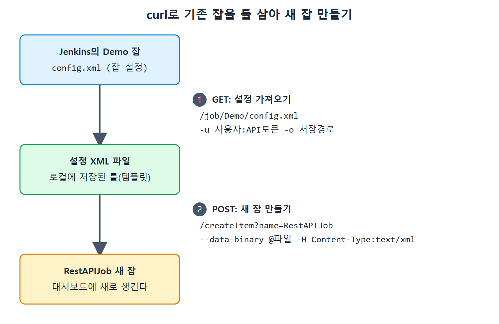

# curl로 잡 제어하기

이 문서는 curl로 Jenkins 원격 API를 호출해 네 가지 일을 해 본다. 기존 잡의 설정 가져오기, 새 잡 만들기, 파라미터가 있는 잡 실행, 파라미터가 없는 잡 실행이다. 예시 서버는 `http://192.168.43.10:8080`이고, 인증 정보의 토큰은 `<API토큰>`으로 표기한다.

네 호출 모두 구조가 비슷하다. 어떤 메서드로, 어느 주소에, 누구 이름으로, 무엇을 담아 보낼지만 달라진다. 이 틀을 먼저 잡고 보면 쉽다.

---

## 1. 기존 잡의 설정 가져오기

기존 Demo 잡의 설정 파일을 받아 로컬에 저장한다.

```
curl -X GET http://192.168.43.10:8080/job/Demo/config.xml -u Pranodayd:<API토큰> -o D:\PD\mylocalconfig.xml
```

책에서는 한 줄이 길어 줄바꿈이 들어갔지만 실제로는 한 줄 명령이다.

| 부분 | 의미 |
|---|---|
| `-X GET` | 요청 메서드. 서버에 이미 있는 자원을 조회하므로 GET이다 |
| `http://192.168.43.10:8080/job/Demo/config.xml` | 가져올 Demo 잡의 config.xml 주소 |
| `-u Pranodayd:<API토큰>` | `사용자이름:API토큰` 형태의 인증 정보 |
| `-o D:\PD\mylocalconfig.xml` | 응답으로 받은 내용을 이 경로의 파일로 저장 |

주소에 쓰인 config.xml은 잡 설정이 저장되는 바로 그 파일이다. 명령을 실행하고 `D:\PD` 폴더를 열면 `mylocalconfig.xml`이 생겨 있다.

---

## 2. 새 잡 만들기

설정 XML을 틀(템플릿)로 삼아 새 잡을 만든다. 필요한 재료는 새 잡의 이름과 설정 XML 파일이다.

```
curl -X POST http://192.168.43.10:8080/createItem?name=RestAPIJob -u Pranodayd:<API토큰> --data-binary @D:\PD\Demo.xml -H "Content-Type:text/xml"
```

| 부분 | 의미 |
|---|---|
| `-X POST` | 새 자원을 만드니 POST |
| `.../createItem?name=RestAPIJob` | 잡을 만드는 엔드포인트. `?` 뒤 쿼리 파라미터 `name`이 새 잡의 이름 |
| `-u Pranodayd:<API토큰>` | 인증 정보 |
| `--data-binary @D:\PD\Demo.xml` | 틀로 쓸 잡 설정 XML 파일. 내용이 요청 본문으로 전송된다 |
| `-H "Content-Type:text/xml"` | 본문의 종류가 XML이라고 알리는 헤더 |

`@`를 파일 경로 앞에 붙이면 curl이 그 파일의 내용을 읽어 보낸다. 실행 후 Jenkins 대시보드(Dashboard)에 가면 RestAPIJob이라는 잡이 생겨 있다.

1번에서 받은 설정 파일을 틀로 쓰면 기존 잡을 복제하는 셈이 된다. 책의 예시에서는 `D:\PD\Demo.xml`을 틀로 썼다.



GET으로 Demo 잡의 설정 XML을 받아 두고, 그 파일을 POST로 `createItem`에 보내 RestAPIJob이라는 새 잡을 만드는 두 단계를 보여 준다.

---

## 3. 파라미터가 있는 잡 실행

BuildAndDeployCalculatorWebApplication 잡은 두 개의 파라미터를 받는다.

- `CalculatorWebApplicationDeploymentDirectory`
- `TypeOfTestsToRun`

```
curl -X POST http://192.168.43.10:8080/job/BuildAndDeployCalculatorWebApplication/buildWithParameters -u Pranodayd:<API토큰> -d "CalculatorWebApplicationDeploymentDirectory=D:\JenkinsBookExamples\DeployedCalculatorWebApp\&TypeOfTestsToRun=AllTests"
```

| 부분 | 의미 |
|---|---|
| `-X POST` | 빌드를 시작시키는 요청이라 POST |
| `${JENKINS_URL}/job/${JOB_NAME}/buildWithParameters` | 파라미터 있는 잡의 빌드 엔드포인트 형식 |
| `-u Pranodayd:<API토큰>` | 인증 정보 |
| `-d "이름=값..."` | 잡 파라미터를 `변수이름=변수값` 형태로 전달 |

주의할 점이 있다. 원문 추출본에서는 이 명령의 뒷부분이 잘려 있어서 두 번째 파라미터를 잇는 방식과 값이 보이지 않는다. 위 명령의 `&TypeOfTestsToRun=AllTests`는 curl `-d`의 일반적인 이음 방식과 뒤에 나오는 파이썬 예제(값 `AllTests`)를 근거로 복원한 것이다.

명령을 실행하면 대시보드에서 해당 잡의 빌드가 시작된 것을 볼 수 있다. 책에 따르면 이 빌드 과정에서 웹 애플리케이션을 파이썬 Selenium 테스트로 검증한다.

---

## 4. 파라미터가 없는 일반 잡 실행

파라미터가 없는 잡은 훨씬 간단하다. ReleaseCalculatorAPI 잡을 실행한다.

```
curl -X POST http://192.168.43.10:8080/job/ReleaseCalculatorAPI/build -u Pranodayd:<API토큰>
```

엔드포인트 형식은 `${JENKINS_URL}/job/${JOB_NAME}/build`이다. 파라미터 있는 잡과 달리 끝이 `build`다. 실행하면 대시보드에서 ReleaseCalculatorAPI의 새 빌드가 시작된 것을 볼 수 있다.

---

## 5. 네 호출 한눈에 비교

| 하려는 일 | 메서드 | 엔드포인트 | 담아 보내는 것 |
|---|---|---|---|
| 잡 설정 조회 | GET | `/job/<잡>/config.xml` | 없음(`-o`로 저장 경로만 지정) |
| 새 잡 생성 | POST | `/createItem?name=<새 잡>` | 설정 XML 파일과 Content-Type 헤더 |
| 파라미터 잡 실행 | POST | `/job/<잡>/buildWithParameters` | `-d`로 파라미터 이름=값 |
| 일반 잡 실행 | POST | `/job/<잡>/build` | 없음 |

읽는 법은 간단하다. 잡에 파라미터가 있느냐 없느냐에 따라 `build`와 `buildWithParameters` 중 하나를 고른다. 어느 호출이든 인증 정보(`-u`)는 꼭 붙는다.

---

## 6. 자주 하는 실수

- 명령은 한 줄로 이어서 입력해야 한다. 책의 줄바꿈은 지면 때문이다.
- 인증 정보를 빼면 권한 문제로 실패한다. 호출하는 사용자는 해당 작업을 할 권한이 있어야 한다.
- 파라미터 이름은 잡에 정의된 이름과 철자까지 같아야 한다.
- 위 curl 명령에서 토큰을 그대로 노출하면 위험하다. 실제로 쓸 때는 환경 변수 등으로 감추는 것이 좋다. 이 마지막 항목은 보안 일반 상식이며 책이 설명하는 내용은 아니다.

<br>
<br>
<br>

[CICD Pipeline Using Jenkins Unleashed](../)
