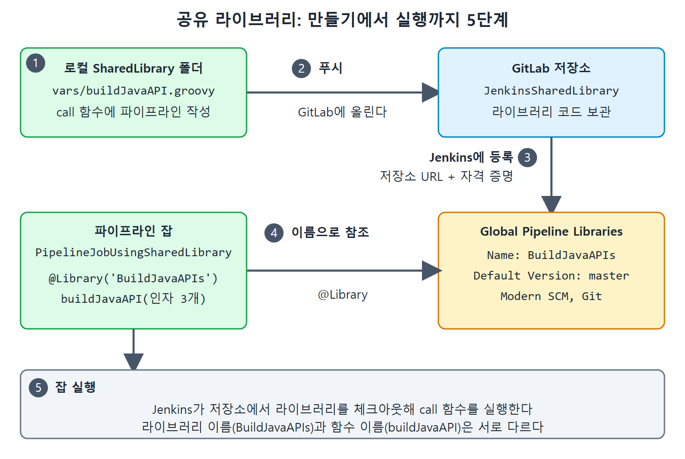

# 공유 라이브러리 만들고 쓰기

여러 잡의 파이프라인에는 같은 빌드 단계가 반복되는 일이 많다. 이 단계를 잡마다 복사해 두면 고칠 때 모든 곳을 손봐야 한다. 공유 라이브러리(Shared Library)는 공통 단계를 Groovy 파일 하나에 모아 두고 여러 잡이 불러 쓰게 하는 기능이다. 요리책에 자주 쓰는 소스 레시피를 한 장만 두고, 여러 요리에서 "소스 레시피 참고"라고 적는 것과 비슷하다.

이 문서는 책의 예제에 따라 공유 라이브러리를 만들고, GitLab에 올리고, Jenkins에 등록하고, 파이프라인 잡에서 호출하는 다섯 단계를 정리한다.

---

## 1. 왜 공유 라이브러리를 쓰는가

앞서 CalculatorAPI.jar를 배포하는 파이프라인을 만들었다. Git 저장소에서 코드를 받아 컴파일, 테스트, 패키징, 배포를 차례로 실행하는 파이프라인이다. 이제 다른 자바 API의 JAR 파일도 같은 단계로 빌드해야 한다고 해 보자. 같은 스크립트를 잡 두 개에 복사하는 것은 좋은 방법이 아니다.

대신 공통 단계를 Groovy 파일 하나에 넣고 두 잡이 라이브러리로 쓰게 한다. 프로젝트마다 달라지는 값(Git URL, 자격 증명 등)은 인자로 넘긴다. 이렇게 하면 코드 중복이 줄고 유지 보수가 쉬워진다.

---

## 2. 1단계: Groovy 파일로 라이브러리 만들기

로컬에 빈 폴더 `SharedLibrary`를 만들고 그 안에 `vars` 폴더를 만든다. 그 안에 확장자가 `.groovy`인 `buildJavaAPI` 파일을 만든다.

책이 강조하는 규칙은 다음과 같다.

| 규칙 | 내용 |
|---|---|
| 파일 위치 | `.groovy` 스크립트는 `src` 또는 `vars` 디렉터리 안에 있어야 한다. 다른 곳에 두면 동작하지 않는다 |
| 파일 이름 | 카멜 케이스(buildJavaAPI처럼 단어 첫 글자를 대문자로 이은 표기)가 필수 |
| 함수 이름 | 재사용할 코드는 `call`이라는 이름의 함수 안에 작성한다 |

Jenkins 잡이 공유 라이브러리를 참조하면 Jenkins는 그 Groovy 파일의 `call` 함수를 실행한다. 자바의 main 함수 같은 진입점으로 이해하면 된다.

파일 내용(Listing 20-10)의 핵심은 다음과 같다. 코드가 길어 앞쪽 두 스테이지와 닫는 부분을 중심으로 보인다.

```groovy
def call(String RepoUrl, String Branch, String Credentials) {
  pipeline {
    agent any
    stages {
      stage("Checkout Code") {
        steps { git branch: "${Branch}", credentialsId: "${Credentials}", url: "${RepoUrl}" }
      }
      stage("Cleaning workspace") {
        steps { bat 'mvn clean' }
      }
      // 이하 같은 모양의 스테이지가 이어진다
    }
  }
}
```

책 원문에는 두 번째 파라미터가 `StringBranch`로 붙어 있는데, 문맥상 `String Branch`의 오타로 보여 이 노트에서는 바로잡았다. 인자 세 개는 Git URL, 브랜치, 자격 증명 이름이다. 파라미터는 이 세 개뿐이며 프로젝트마다 달라지는 정보를 받는다.

이 파이프라인이 가진 스테이지는 다섯 개다.

| 스테이지 | 실행하는 것 | 역할 |
|---|---|---|
| Checkout Code | `git branch: ..., credentialsId: ..., url: ...` | 저장소에서 코드를 가져온다 |
| Cleaning workspace | `bat 'mvn clean'` | 이전 빌드 산출물 정리 |
| Running Testcase | `bat 'mvn test'` | 테스트 실행 |
| Packing Application | `bat 'mvn package -DskipTests'` | 패키징. 테스트는 건너뜀 |
| Deploying Application | `bat 'mvn deploy -DskipTests'` | 배포. 테스트는 건너뜀 |

`bat`은 Windows 배치 명령을 실행하는 스텝이다. 이미 앞 스테이지에서 테스트를 돌렸기 때문에 package와 deploy에는 `-DskipTests`를 붙여 중복 실행을 피한다. 이 줄이 원문의 의도인지 이유까지는 책이 설명하지 않았으므로 해석에 해당한다.

---

## 3. 2단계: GitLab 저장소에 올리기

새 GitLab 저장소를 만들고 `.groovy` 파일을 푸시한다. 책에서는 JenkinsSharedLibrary라는 비공개(private) 저장소를 만들어 올렸다.

## 4. 3단계: Jenkins에 라이브러리 등록

1. Jenkins UI에서 Manage Jenkins(젠킨스 관리) → Configure System(시스템 설정)으로 간다.
2. 아래로 스크롤해 Global Pipeline Libraries 섹션을 찾는다.
3. Add 버튼을 누르면 입력란이 늘어난다.
4. Name에 파이프라인의 `@Library`에서 쓸 이름을 넣는다. 책은 BuildJavaAPIs를 썼다.
5. Default Version에 라이브러리를 푸시한 Git 브랜치 이름을 넣는다. 책은 master 브랜치에 올렸으므로 master라고 썼다.
6. Retrieval Method에서 Modern SCM을 고르고, Source Code Management에서 Git을 고른다.
7. Project Repository에 라이브러리의 Git 저장소 URL을 넣고 Credentials 드롭다운에서 알맞은 자격 증명 항목을 고른다.
8. Save를 누른다.

| 입력란 | 책의 값 | 뜻 |
|---|---|---|
| Name | BuildJavaAPIs | 잡에서 `@Library`로 참조할 이름 |
| Default Version | master | 라이브러리를 가져올 브랜치 |
| Retrieval Method | Modern SCM, Git | 소스 관리에서 가져오는 방식 |
| Project Repository | 라이브러리 저장소 URL | 코드가 있는 곳 |
| Credentials | 해당 항목 선택 | 저장소 접근용 자격 증명 |

---

## 5. 4단계: 라이브러리를 쓰는 파이프라인 잡 만들기

PipelineJobUsingSharedLibrary라는 새 파이프라인 잡을 만들고, Pipeline 섹션까지 내려가 스크립트를 쓴다(Listing 20-11).

```groovy
@Library('BuildJavaAPIs')
buildJavaAPI('https://gitlab.com/Pranoday/jenkinsbookcalculatorapi.git', 'Master', 'MyGitC...')
```

원문 추출본에는 `@Liabrary`로 철자가 틀려 있는데 `@Library`의 오타로 보인다. 세 번째 인자 자격 증명 이름도 추출본에서 잘려 있어(`MyGitC`까지만 보임) 위 코드에서 말줄임표로 표시했다. 자신의 자격 증명 항목 이름을 넣으면 된다. 브랜치가 `'Master'`로 적혀 있는데 앞의 등록 단계에서는 master를 썼다. 원문 표기를 그대로 옮겼으며 실제 저장소의 브랜치 이름 대소문자에 맞춰야 한다.

| 줄 | 하는 일 |
|---|---|
| 1줄 `@Library` | 공유 라이브러리를 잡으로 가져온다. 이름은 Manage Jenkins에서 등록한 BuildJavaAPIs와 같아야 한다 |
| 2줄 `buildJavaAPI(...)` | 공유 라이브러리 파일 이름으로 `call`을 호출한다. 인자는 Calculator API의 GitLab URL, 최신 소스가 있는 브랜치, GitLab 인증 정보를 담은 Jenkins 자격 증명 이름 |

작성 후 Save를 누른다.

---

## 6. 5단계: 잡 실행

1. Jenkins 대시보드에서 PipelineJobUsingSharedLibrary 옆의 시계 아이콘을 눌러 빌드를 실행한다.
2. 콘솔 출력(Console Output)을 확인한다.

콘솔에서는 Jenkins가 공유 라이브러리를 SCM(소스 관리 저장소)에서 체크아웃하고, 그 안의 파이프라인 코드를 받은 인자 값으로 실행하는 모습을 볼 수 있다.

같은 라이브러리는 다른 자바 API 프로젝트에도 쓸 수 있다. 프로젝트별 정보만 인자로 바꿔 넘기면 된다.

---

## 7. 전체 흐름 정리



Groovy 파일을 GitLab에 올리고 Jenkins에 등록한 뒤, 파이프라인 잡이 `@Library` 이름으로 불러 실행하는 다섯 단계를 보여 준다.

| 단계 | 할 일 | 결과 |
|---|---|---|
| 1 | `vars/buildJavaAPI.groovy`에 `call` 함수 작성 | 재사용할 파이프라인 완성 |
| 2 | GitLab 저장소에 푸시 | 라이브러리가 Git에 보관됨 |
| 3 | Global Pipeline Libraries에 등록 | `BuildJavaAPIs` 이름으로 참조 가능 |
| 4 | 파이프라인 잡에서 `@Library`와 호출 작성 | 잡이 라이브러리를 사용 |
| 5 | 잡 실행, 콘솔 확인 | 체크아웃부터 배포까지 실행 |

핵심은 두 이름의 구분이다. 라이브러리 이름(BuildJavaAPIs)은 Jenkins에 등록한 이름이고, 호출하는 함수 이름(buildJavaAPI)은 `.groovy` 파일 이름이다. 둘은 서로 다른 값이다.

<br>
<br>
<br>

[CICD Pipeline Using Jenkins Unleashed](../)
