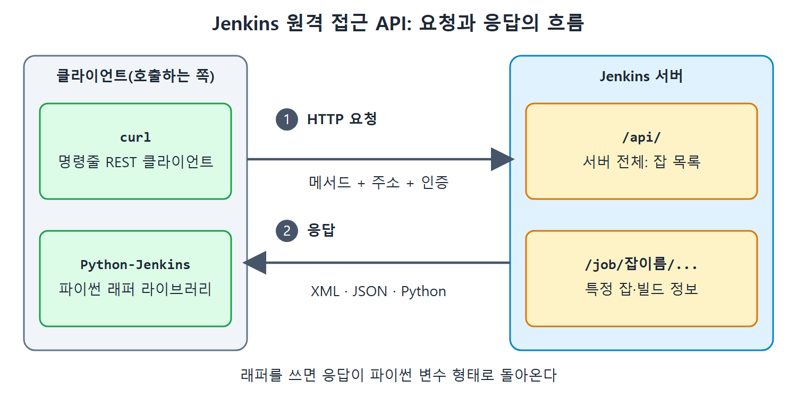

# 원격 접근 API 기초

앞 장에서는 jenkins-cli.jar로 명령줄에서 Jenkins 서버를 다뤘다. 그런데 CLI만으로는 모자랄 때가 있다. 자바나 파이썬 같은 프로그래밍 언어로 Jenkins를 직접 제어하고 싶다면 HTTP로 호출하는 REST API(웹 주소로 요청을 보내 기능을 쓰는 방식)를 써야 한다.

이 문서는 Jenkins가 제공하는 원격 접근 API가 무엇인지, REST API를 쓸 때 알아야 할 기본 개념, 그리고 API를 호출할 도구인 curl을 준비하는 방법을 정리한다. 실제 호출 실습은 다음 문서에서 이어 간다.

---

## 1. 원격 접근 API란

식당에 비유하면 이렇다. 화면(UI)으로 Jenkins를 쓰는 것은 홀에 앉아 직접 주문하는 것이고, 원격 접근 API는 전화나 배달 앱으로 같은 주문을 넣는 것이다. 사람이 클릭하던 일을 프로그램이 대신 요청할 수 있게 된다.

Jenkins는 자기 기능을 원격으로 쓸 수 있는 API를 제공하고, 응답 형식은 세 가지다.

| 형식 | 설명 |
|---|---|
| XML | 태그로 구조를 표현하는 형식 |
| JSON | 키와 값으로 구조를 표현하는 형식 |
| Python | 파이썬이 바로 읽을 수 있는 형식 |

이 API는 REST 비슷한 방식(REST-like style)으로 제공된다. REST API는 가벼운 웹 서비스로, HTTP 프로토콜로 호출한다. 브라우저 주소창에 URL을 넣어 웹 페이지를 받아 오는 것과 같은 통로를 쓴다고 보면 된다.

curl이나 Python-Jenkins 같은 클라이언트가 메서드, 주소, 인증 정보를 담아 HTTP 요청을 보내면 Jenkins 서버가 XML, JSON, Python 형식으로 응답하는 흐름을 보여 준다.

### API 주소 규칙

Jenkins API는 `.../api/` 형태의 주소로 열린다. 앞의 `...` 부분은 API가 다룰 대상을 가리킨다. 책의 예시 서버는 `http://192.168.43.10:8080`이다.

| 주소 | 보여 주는 것 |
|---|---|
| `http://192.168.43.10:8080/api/` | 최상위 API 기능. 주로 설정된 모든 잡의 목록 |
| `http://192.168.43.10:8080/job/Demo/lastSuccessfulBuild` | Demo 잡의 마지막 성공한 빌드 정보 |

위 표에서 보듯 `/job/잡이름/...`처럼 대상을 주소에 이어 붙이면 그 대상에 대한 정보를 얻는다. 첫 번째 주소는 서버 전체, 두 번째 주소는 특정 잡의 특정 빌드를 가리킨다.

---

## 2. REST API의 기본 개념

Jenkins 원격 API로 무엇을 할 수 있는지 보기 전에 REST API의 기초를 짚는다.

### HTTP 메서드

REST API는 요청의 성격에 따라 GET, POST, PUT, DELETE 같은 메서드(요청 종류)를 구분한다. 이 장에서 쓰는 것은 두 가지다.

| 메서드 | 용도 | 이 장의 예 |
|---|---|---|
| GET | 서버의 자원 정보를 가져온다 | 잡의 config.xml 받기 |
| POST | 서버에 새 자원을 만들거나 동작을 시킨다 | 새 잡 만들기, 빌드 실행 |

책은 GET은 조회, POST는 새 자원 생성(예: Jenkins 잡)에 쓴다고 설명한다. 뒤의 실습에서는 빌드를 실행할 때도 POST를 쓴다.

### 파라미터를 보내는 세 가지 방법

REST API에 값을 넘기는 방법은 세 가지다.

| 종류 | 위치 | 예 |
|---|---|---|
| 쿼리 파라미터(Query parameter) | URL 뒤 `?` 다음에 `키=값` 형태 | `https://example.com/articles?sort=ASC&page=2` |
| 경로 파라미터(Path parameter) | URL 엔드포인트의 일부. 보통 `{}` 안에 표기 | `/job/{잡이름}/build` 같은 자리 |
| 헤더 파라미터(Header parameter) | 요청 헤더 | 사용자 이름과 비밀번호, API 토큰 같은 인증 정보 |

쿼리 파라미터 예시를 풀어 보면, `sort`는 값이 `ASC`이고 `page`는 값이 `2`인 파라미터 두 개가 전달된다. 여러 개를 이을 때는 `&`를 쓴다.

인증 정보는 보통 헤더 방식으로 보낸다는 점을 기억해 두자. 뒤의 curl 예시에서 `-u` 옵션이 이 역할을 한다.

---

## 3. REST 클라이언트 curl 준비

웹 브라우저는 서버의 HTML 파일을 받아 보여 주는 클라이언트다. 마찬가지로 REST API로 서버 자원을 쓰려면 REST 클라이언트 역할을 해 줄 도구가 필요하다. 책은 널리 쓰이는 curl을 고른다. curl은 명령 프롬프트 같은 명령줄에서 REST API를 호출하게 해 준다.

Windows에서 준비하는 순서는 다음과 같다.

1. `https://curl.se/windows/`에서 내려받는다. ZIP 파일이 받아진다.
2. 원하는 위치에 압축을 푼다.
3. 압축을 푼 곳의 `bin` 폴더 경로를 `PATH` 환경 변수에 추가한다.

3번을 하는 이유는 어느 폴더에서 명령 프롬프트를 열어도 `curl.exe`를 바로 실행하기 위해서다.

---

## 4. 실습 전에 알아 둘 점

- 모든 호출에는 해당 작업 권한이 있는 사용자의 인증 정보가 필요하다. 인증 정보는 `사용자이름:API토큰` 형태이고, 앞 장에서 만든 API 토큰을 그대로 쓴다.
- 책의 예시에는 실제 토큰 값이 그대로 적혀 있지만 이 노트에서는 `<API토큰>`으로 바꿔 쓴다. 토큰은 비밀번호와 같으므로 문서나 저장소에 노출하면 안 된다.
- 잡 하나의 설정은 `${JENKINS_HOME}\Jobs\${JOB_NAME}` 폴더의 `config.xml`에 저장된다. 다음 문서의 설정 조회와 잡 생성 실습이 이 파일을 다룬다.

다음 문서에서 curl로 설정 조회, 잡 생성, 빌드 실행을 해 본다.

 
 
 

[CICD Pipeline Using Jenkins Unleashed](../)
