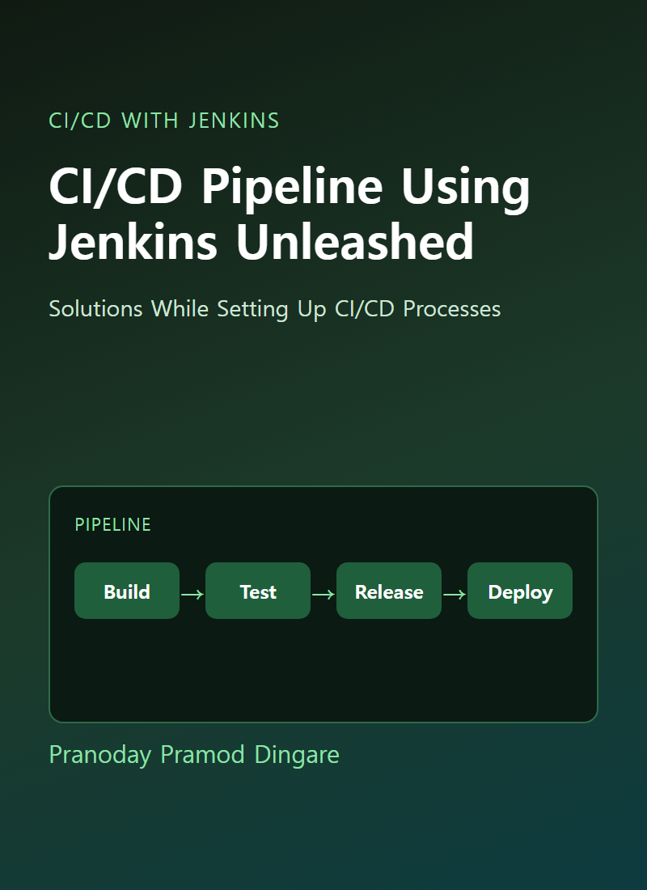
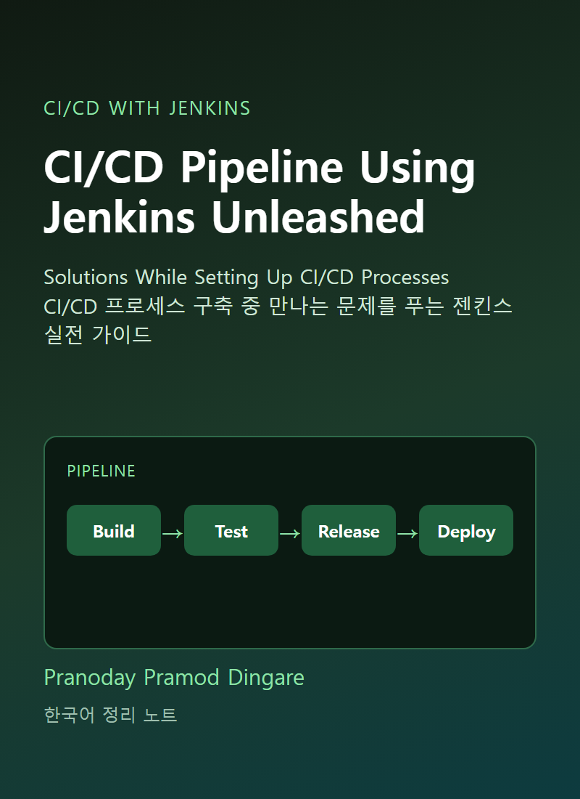
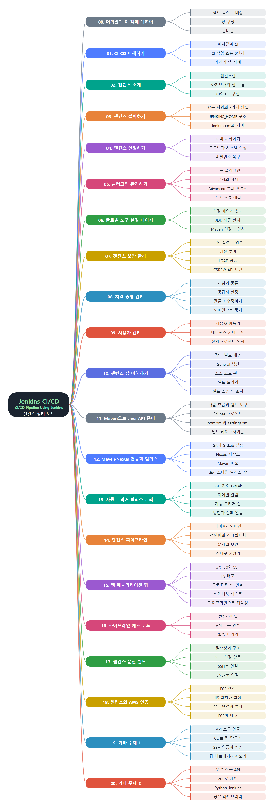

# **CI/CD Pipeline Using Jenkins Unleashed**
(CI/CD Pipeline Using Jenkins Unleashed: CI/CD 프로세스 구축 중 만나는 문제를 푸는 젠킨스 실전 가이드)
 

&nbsp;&nbsp;&nbsp;

영어 표지(왼쪽) · 한국어 표지(오른쪽)

 
 

이 문서는 Pranoday Pramod Dingare가 쓴 『CI/CD Pipeline Using Jenkins Unleashed』(Apress, 2022)를 장별로 정리한 한국어 학습 노트입니다. 원문을 그대로 번역한 것이 아니라 내용을 풀어서 다시 설명했고, 처음 쓰는 용어는 쉬운 말로 풀이를 붙였습니다. 이해를 돕도록 장마다 비교표와 개념 그림을 넣었습니다. 책은 CI/CD가 무엇인지 설명하는 1장과 젠킨스를 소개하고 설치하고 설정하는 2~4장에서 시작합니다. 이어서 플러그인, 글로벌 도구 설정, 보안, 자격 증명, 사용자 관리 같은 관리 기능을 다룹니다. 그다음 잡의 개념을 익힌 뒤 Maven과 Nexus로 Java API를 빌드하고 릴리스하는 실습, 자동 트리거 잡, 파이프라인, 웹 애플리케이션 배포, 파이프라인 애즈 코드, 분산 빌드, AWS 연동까지 단계적으로 따라가고, 마지막에 CLI·API·공유 라이브러리 같은 부가 주제로 마무리합니다. 책에 나온 도구의 화면과 버전은 이후 바뀌었을 수 있으니 최신 내용은 공식 문서로 확인해야 합니다.
 
 
 

---

- [00. 머리말과 이 책에 대하여](00.%20%EB%A8%B8%EB%A6%AC%EB%A7%90%EA%B3%BC%20%EC%9D%B4%20%EC%B1%85%EC%97%90%20%EB%8C%80%ED%95%98%EC%97%AC/Readme.md)
- [01. CI-CD 이해하기](01.%20CI-CD%20%EC%9D%B4%ED%95%B4%ED%95%98%EA%B8%B0/Readme.md)
  - [애자일과 CI가 필요한 이유](01.%20CI-CD%20%EC%9D%B4%ED%95%B4%ED%95%98%EA%B8%B0/%EC%95%A0%EC%9E%90%EC%9D%BC%EA%B3%BC%20CI%EA%B0%80%20%ED%95%84%EC%9A%94%ED%95%9C%20%EC%9D%B4%EC%9C%A0.md)
  - [CI 작업 흐름 여섯 단계](01.%20CI-CD%20%EC%9D%B4%ED%95%B4%ED%95%98%EA%B8%B0/CI%20%EC%9E%91%EC%97%85%20%ED%9D%90%EB%A6%84%20%EC%97%AC%EC%84%AF%20%EB%8B%A8%EA%B3%84.md)
  - [계산기 앱으로 보는 CI-CD 사례](01.%20CI-CD%20%EC%9D%B4%ED%95%B4%ED%95%98%EA%B8%B0/%EA%B3%84%EC%82%B0%EA%B8%B0%20%EC%95%B1%EC%9C%BC%EB%A1%9C%20%EB%B3%B4%EB%8A%94%20CI-CD%20%EC%82%AC%EB%A1%80.md)
  - [요약과 핵심 개념](01.%20CI-CD%20%EC%9D%B4%ED%95%B4%ED%95%98%EA%B8%B0/%EC%9A%94%EC%95%BD%EA%B3%BC%20%ED%95%B5%EC%8B%AC%20%EA%B0%9C%EB%85%90.md)
- [02. 젠킨스 소개](02.%20%EC%A0%A0%ED%82%A8%EC%8A%A4%20%EC%86%8C%EA%B0%9C/Readme.md)
  - [젠킨스란 무엇인가](02.%20%EC%A0%A0%ED%82%A8%EC%8A%A4%20%EC%86%8C%EA%B0%9C/%EC%A0%A0%ED%82%A8%EC%8A%A4%EB%9E%80%20%EB%AC%B4%EC%97%87%EC%9D%B8%EA%B0%80.md)
  - [젠킨스로 CI/CD 구현하기](02.%20%EC%A0%A0%ED%82%A8%EC%8A%A4%20%EC%86%8C%EA%B0%9C/%EC%A0%A0%ED%82%A8%EC%8A%A4%EB%A1%9C%20CI%EC%99%80%20CD%20%EA%B5%AC%ED%98%84%ED%95%98%EA%B8%B0.md)
  - [젠킨스 아키텍처와 잡의 흐름](02.%20%EC%A0%A0%ED%82%A8%EC%8A%A4%20%EC%86%8C%EA%B0%9C/%EC%A0%A0%ED%82%A8%EC%8A%A4%20%EC%95%84%ED%82%A4%ED%85%8D%EC%B2%98%EC%99%80%20%EC%9E%A1%EC%9D%98%20%ED%9D%90%EB%A6%84.md)
  - [요약과 핵심 개념](02.%20%EC%A0%A0%ED%82%A8%EC%8A%A4%20%EC%86%8C%EA%B0%9C/%EC%9A%94%EC%95%BD%EA%B3%BC%20%ED%95%B5%EC%8B%AC%20%EA%B0%9C%EB%85%90.md)
- [03. 젠킨스 설치하기](03.%20%EC%A0%A0%ED%82%A8%EC%8A%A4%20%EC%84%A4%EC%B9%98%ED%95%98%EA%B8%B0/Readme.md)
  - [JENKINS_HOME 디렉터리 구조](03.%20%EC%A0%A0%ED%82%A8%EC%8A%A4%20%EC%84%A4%EC%B9%98%ED%95%98%EA%B8%B0/JENKINS_HOME%20%EB%94%94%EB%A0%89%ED%84%B0%EB%A6%AC%20%EA%B5%AC%EC%A1%B0.md)
  - [Jenkins.xml과 자바 지정](03.%20%EC%A0%A0%ED%82%A8%EC%8A%A4%20%EC%84%A4%EC%B9%98%ED%95%98%EA%B8%B0/Jenkins.xml%EA%B3%BC%20%EC%9E%90%EB%B0%94%20%EC%A7%80%EC%A0%95.md)
  - [설치 요구 사항과 세 가지 방법](03.%20%EC%A0%A0%ED%82%A8%EC%8A%A4%20%EC%84%A4%EC%B9%98%ED%95%98%EA%B8%B0/%EC%84%A4%EC%B9%98%20%EC%9A%94%EA%B5%AC%20%EC%82%AC%ED%95%AD%EA%B3%BC%20%EC%84%B8%20%EA%B0%80%EC%A7%80%20%EB%B0%A9%EB%B2%95.md)
  - [요약과 핵심 개념](03.%20%EC%A0%A0%ED%82%A8%EC%8A%A4%20%EC%84%A4%EC%B9%98%ED%95%98%EA%B8%B0/%EC%9A%94%EC%95%BD%EA%B3%BC%20%ED%95%B5%EC%8B%AC%20%EA%B0%9C%EB%85%90.md)
- [04. 젠킨스 설정하기](04.%20%EC%A0%A0%ED%82%A8%EC%8A%A4%20%EC%84%A4%EC%A0%95%ED%95%98%EA%B8%B0/Readme.md)
  - [젠킨스 서버 시작하기](04.%20%EC%A0%A0%ED%82%A8%EC%8A%A4%20%EC%84%A4%EC%A0%95%ED%95%98%EA%B8%B0/%EC%A0%A0%ED%82%A8%EC%8A%A4%20%EC%84%9C%EB%B2%84%20%EC%8B%9C%EC%9E%91%ED%95%98%EA%B8%B0.md)
  - [로그인과 시스템 설정 페이지](04.%20%EC%A0%A0%ED%82%A8%EC%8A%A4%20%EC%84%A4%EC%A0%95%ED%95%98%EA%B8%B0/%EB%A1%9C%EA%B7%B8%EC%9D%B8%EA%B3%BC%20%EC%8B%9C%EC%8A%A4%ED%85%9C%20%EC%84%A4%EC%A0%95%20%ED%8E%98%EC%9D%B4%EC%A7%80.md)
  - [비밀번호 복구와 사용자 추가](04.%20%EC%A0%A0%ED%82%A8%EC%8A%A4%20%EC%84%A4%EC%A0%95%ED%95%98%EA%B8%B0/%EB%B9%84%EB%B0%80%EB%B2%88%ED%98%B8%20%EB%B3%B5%EA%B5%AC%EC%99%80%20%EC%82%AC%EC%9A%A9%EC%9E%90%20%EC%B6%94%EA%B0%80.md)
  - [요약과 핵심 개념](04.%20%EC%A0%A0%ED%82%A8%EC%8A%A4%20%EC%84%A4%EC%A0%95%ED%95%98%EA%B8%B0/%EC%9A%94%EC%95%BD%EA%B3%BC%20%ED%95%B5%EC%8B%AC%20%EA%B0%9C%EB%85%90.md)
- [05. 플러그인 관리하기](05.%20%ED%94%8C%EB%9F%AC%EA%B7%B8%EC%9D%B8%20%EA%B4%80%EB%A6%AC%ED%95%98%EA%B8%B0/Readme.md)
  - [플러그인이란과 대표 플러그인](05.%20%ED%94%8C%EB%9F%AC%EA%B7%B8%EC%9D%B8%20%EA%B4%80%EB%A6%AC%ED%95%98%EA%B8%B0/%ED%94%8C%EB%9F%AC%EA%B7%B8%EC%9D%B8%EC%9D%B4%EB%9E%80%EA%B3%BC%20%EB%8C%80%ED%91%9C%20%ED%94%8C%EB%9F%AC%EA%B7%B8%EC%9D%B8.md)
  - [Plugin Manager 탭으로 설치와 삭제](05.%20%ED%94%8C%EB%9F%AC%EA%B7%B8%EC%9D%B8%20%EA%B4%80%EB%A6%AC%ED%95%98%EA%B8%B0/Plugin%20Manager%20%ED%83%AD%EC%9C%BC%EB%A1%9C%20%EC%84%A4%EC%B9%98%EC%99%80%20%EC%82%AD%EC%A0%9C.md)
  - [Advanced 탭과 프록시 설정](05.%20%ED%94%8C%EB%9F%AC%EA%B7%B8%EC%9D%B8%20%EA%B4%80%EB%A6%AC%ED%95%98%EA%B8%B0/Advanced%20%ED%83%AD%EA%B3%BC%20%ED%94%84%EB%A1%9D%EC%8B%9C%20%EC%84%A4%EC%A0%95.md)
  - [설치 오류와 해결 방법](05.%20%ED%94%8C%EB%9F%AC%EA%B7%B8%EC%9D%B8%20%EA%B4%80%EB%A6%AC%ED%95%98%EA%B8%B0/%EC%84%A4%EC%B9%98%20%EC%98%A4%EB%A5%98%EC%99%80%20%ED%95%B4%EA%B2%B0%20%EB%B0%A9%EB%B2%95.md)
  - [요약과 핵심 개념](05.%20%ED%94%8C%EB%9F%AC%EA%B7%B8%EC%9D%B8%20%EA%B4%80%EB%A6%AC%ED%95%98%EA%B8%B0/%EC%9A%94%EC%95%BD%EA%B3%BC%20%ED%95%B5%EC%8B%AC%20%EA%B0%9C%EB%85%90.md)
- [06. 글로벌 도구 설정 페이지 이해하기](06.%20%EA%B8%80%EB%A1%9C%EB%B2%8C%20%EB%8F%84%EA%B5%AC%20%EC%84%A4%EC%A0%95%20%ED%8E%98%EC%9D%B4%EC%A7%80%20%EC%9D%B4%ED%95%B4%ED%95%98%EA%B8%B0/Readme.md)
  - [글로벌 도구 설정 페이지 찾아가기](06.%20%EA%B8%80%EB%A1%9C%EB%B2%8C%20%EB%8F%84%EA%B5%AC%20%EC%84%A4%EC%A0%95%20%ED%8E%98%EC%9D%B4%EC%A7%80%20%EC%9D%B4%ED%95%B4%ED%95%98%EA%B8%B0/%EA%B8%80%EB%A1%9C%EB%B2%8C%20%EB%8F%84%EA%B5%AC%20%EC%84%A4%EC%A0%95%20%ED%8E%98%EC%9D%B4%EC%A7%80%20%EC%B0%BE%EC%95%84%EA%B0%80%EA%B8%B0.md)
  - [Maven 설정 파일과 설치 구성](06.%20%EA%B8%80%EB%A1%9C%EB%B2%8C%20%EB%8F%84%EA%B5%AC%20%EC%84%A4%EC%A0%95%20%ED%8E%98%EC%9D%B4%EC%A7%80%20%EC%9D%B4%ED%95%B4%ED%95%98%EA%B8%B0/Maven%20%EC%84%A4%EC%A0%95%20%ED%8C%8C%EC%9D%BC%EA%B3%BC%20%EC%84%A4%EC%B9%98%20%EA%B5%AC%EC%84%B1.md)
  - [JDK 설정과 자동 설치](06.%20%EA%B8%80%EB%A1%9C%EB%B2%8C%20%EB%8F%84%EA%B5%AC%20%EC%84%A4%EC%A0%95%20%ED%8E%98%EC%9D%B4%EC%A7%80%20%EC%9D%B4%ED%95%B4%ED%95%98%EA%B8%B0/JDK%20%EC%84%A4%EC%A0%95%EA%B3%BC%20%EC%9E%90%EB%8F%99%20%EC%84%A4%EC%B9%98.md)
  - [요약과 핵심 개념](06.%20%EA%B8%80%EB%A1%9C%EB%B2%8C%20%EB%8F%84%EA%B5%AC%20%EC%84%A4%EC%A0%95%20%ED%8E%98%EC%9D%B4%EC%A7%80%20%EC%9D%B4%ED%95%B4%ED%95%98%EA%B8%B0/%EC%9A%94%EC%95%BD%EA%B3%BC%20%ED%95%B5%EC%8B%AC%20%EA%B0%9C%EB%85%90.md)
- [07. 젠킨스 보안 관리](07.%20%EC%A0%A0%ED%82%A8%EC%8A%A4%20%EB%B3%B4%EC%95%88%20%EA%B4%80%EB%A6%AC/Readme.md)
  - [보안 설정 화면과 인증](07.%20%EC%A0%A0%ED%82%A8%EC%8A%A4%20%EB%B3%B4%EC%95%88%20%EA%B4%80%EB%A6%AC/%EB%B3%B4%EC%95%88%20%EC%84%A4%EC%A0%95%20%ED%99%94%EB%A9%B4%EA%B3%BC%20%EC%9D%B8%EC%A6%9D.md)
  - [권한 부여 설정](07.%20%EC%A0%A0%ED%82%A8%EC%8A%A4%20%EB%B3%B4%EC%95%88%20%EA%B4%80%EB%A6%AC/%EA%B6%8C%ED%95%9C%20%EB%B6%80%EC%97%AC%20%EC%84%A4%EC%A0%95.md)
  - [에이전트 포트와 CSRF와 API 토큰](07.%20%EC%A0%A0%ED%82%A8%EC%8A%A4%20%EB%B3%B4%EC%95%88%20%EA%B4%80%EB%A6%AC/%EC%97%90%EC%9D%B4%EC%A0%84%ED%8A%B8%20%ED%8F%AC%ED%8A%B8%EC%99%80%20CSRF%EC%99%80%20API%20%ED%86%A0%ED%81%B0.md)
  - [LDAP 연동](07.%20%EC%A0%A0%ED%82%A8%EC%8A%A4%20%EB%B3%B4%EC%95%88%20%EA%B4%80%EB%A6%AC/LDAP%20%EC%97%B0%EB%8F%99.md)
  - [요약과 핵심 개념](07.%20%EC%A0%A0%ED%82%A8%EC%8A%A4%20%EB%B3%B4%EC%95%88%20%EA%B4%80%EB%A6%AC/%EC%9A%94%EC%95%BD%EA%B3%BC%20%ED%95%B5%EC%8B%AC%20%EA%B0%9C%EB%85%90.md)
- [08. 자격 증명 관리](08.%20%EC%9E%90%EA%B2%A9%20%EC%A6%9D%EB%AA%85%20%EA%B4%80%EB%A6%AC/Readme.md)
  - [자격 증명의 개념과 종류](08.%20%EC%9E%90%EA%B2%A9%20%EC%A6%9D%EB%AA%85%20%EA%B4%80%EB%A6%AC/%EC%9E%90%EA%B2%A9%20%EC%A6%9D%EB%AA%85%EC%9D%98%20%EA%B0%9C%EB%85%90%EA%B3%BC%20%EC%A2%85%EB%A5%98.md)
  - [자격 증명 만들고 수정하기](08.%20%EC%9E%90%EA%B2%A9%20%EC%A6%9D%EB%AA%85%20%EA%B4%80%EB%A6%AC/%EC%9E%90%EA%B2%A9%20%EC%A6%9D%EB%AA%85%20%EB%A7%8C%EB%93%A4%EA%B3%A0%20%EC%88%98%EC%A0%95%ED%95%98%EA%B8%B0.md)
  - [도메인으로 자격 증명 묶기](08.%20%EC%9E%90%EA%B2%A9%20%EC%A6%9D%EB%AA%85%20%EA%B4%80%EB%A6%AC/%EB%8F%84%EB%A9%94%EC%9D%B8%EC%9C%BC%EB%A1%9C%20%EC%9E%90%EA%B2%A9%20%EC%A6%9D%EB%AA%85%20%EB%AC%B6%EA%B8%B0.md)
  - [자격 증명 공급자 설정](08.%20%EC%9E%90%EA%B2%A9%20%EC%A6%9D%EB%AA%85%20%EA%B4%80%EB%A6%AC/%EC%9E%90%EA%B2%A9%20%EC%A6%9D%EB%AA%85%20%EA%B3%B5%EA%B8%89%EC%9E%90%20%EC%84%A4%EC%A0%95.md)
  - [요약과 핵심 개념](08.%20%EC%9E%90%EA%B2%A9%20%EC%A6%9D%EB%AA%85%20%EA%B4%80%EB%A6%AC/%EC%9A%94%EC%95%BD%EA%B3%BC%20%ED%95%B5%EC%8B%AC%20%EA%B0%9C%EB%85%90.md)
- [09. 사용자 관리](09.%20%EC%82%AC%EC%9A%A9%EC%9E%90%20%EA%B4%80%EB%A6%AC/Readme.md)
  - [사용자 만들기와 플러그인 준비](09.%20%EC%82%AC%EC%9A%A9%EC%9E%90%20%EA%B4%80%EB%A6%AC/%EC%82%AC%EC%9A%A9%EC%9E%90%20%EB%A7%8C%EB%93%A4%EA%B8%B0%EC%99%80%20%ED%94%8C%EB%9F%AC%EA%B7%B8%EC%9D%B8%20%EC%A4%80%EB%B9%84.md)
  - [전역 역할과 프로젝트 역할](09.%20%EC%82%AC%EC%9A%A9%EC%9E%90%20%EA%B4%80%EB%A6%AC/%EC%A0%84%EC%97%AD%20%EC%97%AD%ED%95%A0%EA%B3%BC%20%ED%94%84%EB%A1%9C%EC%A0%9D%ED%8A%B8%20%EC%97%AD%ED%95%A0.md)
  - [매트릭스 기반 보안](09.%20%EC%82%AC%EC%9A%A9%EC%9E%90%20%EA%B4%80%EB%A6%AC/%EB%A7%A4%ED%8A%B8%EB%A6%AD%EC%8A%A4%20%EA%B8%B0%EB%B0%98%20%EB%B3%B4%EC%95%88.md)
  - [요약과 핵심 개념](09.%20%EC%82%AC%EC%9A%A9%EC%9E%90%20%EA%B4%80%EB%A6%AC/%EC%9A%94%EC%95%BD%EA%B3%BC%20%ED%95%B5%EC%8B%AC%20%EA%B0%9C%EB%85%90.md)
- [10. 젠킨스 잡 이해하기](10.%20%EC%A0%A0%ED%82%A8%EC%8A%A4%20%EC%9E%A1%20%EC%9D%B4%ED%95%B4%ED%95%98%EA%B8%B0/Readme.md)
  - [잡과 빌드의 기본 개념](10.%20%EC%A0%A0%ED%82%A8%EC%8A%A4%20%EC%9E%A1%20%EC%9D%B4%ED%95%B4%ED%95%98%EA%B8%B0/%EC%9E%A1%EA%B3%BC%20%EB%B9%8C%EB%93%9C%EC%9D%98%20%EA%B8%B0%EB%B3%B8%20%EA%B0%9C%EB%85%90.md)
  - [General 섹션 설정](10.%20%EC%A0%A0%ED%82%A8%EC%8A%A4%20%EC%9E%A1%20%EC%9D%B4%ED%95%B4%ED%95%98%EA%B8%B0/General%20%EC%84%B9%EC%85%98%20%EC%84%A4%EC%A0%95.md)
  - [소스 코드 관리와 자격 증명](10.%20%EC%A0%A0%ED%82%A8%EC%8A%A4%20%EC%9E%A1%20%EC%9D%B4%ED%95%B4%ED%95%98%EA%B8%B0/%EC%86%8C%EC%8A%A4%20%EC%BD%94%EB%93%9C%20%EA%B4%80%EB%A6%AC%EC%99%80%20%EC%9E%90%EA%B2%A9%20%EC%A6%9D%EB%AA%85.md)
  - [빌드 트리거 설정](10.%20%EC%A0%A0%ED%82%A8%EC%8A%A4%20%EC%9E%A1%20%EC%9D%B4%ED%95%B4%ED%95%98%EA%B8%B0/%EB%B9%8C%EB%93%9C%20%ED%8A%B8%EB%A6%AC%EA%B1%B0%20%EC%84%A4%EC%A0%95.md)
  - [빌드 스텝과 빌드 후 조치](10.%20%EC%A0%A0%ED%82%A8%EC%8A%A4%20%EC%9E%A1%20%EC%9D%B4%ED%95%B4%ED%95%98%EA%B8%B0/%EB%B9%8C%EB%93%9C%20%EC%8A%A4%ED%85%9D%EA%B3%BC%20%EB%B9%8C%EB%93%9C%20%ED%9B%84%20%EC%A1%B0%EC%B9%98.md)
  - [잡 실행과 관리](10.%20%EC%A0%A0%ED%82%A8%EC%8A%A4%20%EC%9E%A1%20%EC%9D%B4%ED%95%B4%ED%95%98%EA%B8%B0/%EC%9E%A1%20%EC%8B%A4%ED%96%89%EA%B3%BC%20%EA%B4%80%EB%A6%AC.md)
  - [요약과 핵심 개념](10.%20%EC%A0%A0%ED%82%A8%EC%8A%A4%20%EC%9E%A1%20%EC%9D%B4%ED%95%B4%ED%95%98%EA%B8%B0/%EC%9A%94%EC%95%BD%EA%B3%BC%20%ED%95%B5%EC%8B%AC%20%EA%B0%9C%EB%85%90.md)
- [11. Maven으로 Java API 프로젝트 준비하기](11.%20Maven%EC%9C%BC%EB%A1%9C%20Java%20API%20%ED%94%84%EB%A1%9C%EC%A0%9D%ED%8A%B8%20%EC%A4%80%EB%B9%84%ED%95%98%EA%B8%B0/Readme.md)
  - [자바 API 개발 흐름과 빌드 도구](11.%20Maven%EC%9C%BC%EB%A1%9C%20Java%20API%20%ED%94%84%EB%A1%9C%EC%A0%9D%ED%8A%B8%20%EC%A4%80%EB%B9%84%ED%95%98%EA%B8%B0/%EC%9E%90%EB%B0%94%20API%20%EA%B0%9C%EB%B0%9C%20%ED%9D%90%EB%A6%84%EA%B3%BC%20%EB%B9%8C%EB%93%9C%20%EB%8F%84%EA%B5%AC.md)
  - [Eclipse에서 Maven 프로젝트 만들기](11.%20Maven%EC%9C%BC%EB%A1%9C%20Java%20API%20%ED%94%84%EB%A1%9C%EC%A0%9D%ED%8A%B8%20%EC%A4%80%EB%B9%84%ED%95%98%EA%B8%B0/Eclipse%EC%97%90%EC%84%9C%20Maven%20%ED%94%84%EB%A1%9C%EC%A0%9D%ED%8A%B8%20%EB%A7%8C%EB%93%A4%EA%B8%B0.md)
  - [프로젝트 구조와 pom.xml](11.%20Maven%EC%9C%BC%EB%A1%9C%20Java%20API%20%ED%94%84%EB%A1%9C%EC%A0%9D%ED%8A%B8%20%EC%A4%80%EB%B9%84%ED%95%98%EA%B8%B0/%ED%94%84%EB%A1%9C%EC%A0%9D%ED%8A%B8%20%EA%B5%AC%EC%A1%B0%EC%99%80%20pom.xml.md)
  - [빌드 라이프사이클 단계](11.%20Maven%EC%9C%BC%EB%A1%9C%20Java%20API%20%ED%94%84%EB%A1%9C%EC%A0%9D%ED%8A%B8%20%EC%A4%80%EB%B9%84%ED%95%98%EA%B8%B0/%EB%B9%8C%EB%93%9C%20%EB%9D%BC%EC%9D%B4%ED%94%84%EC%82%AC%EC%9D%B4%ED%81%B4%20%EB%8B%A8%EA%B3%84.md)
  - [명령줄에서 Maven 쓰기](11.%20Maven%EC%9C%BC%EB%A1%9C%20Java%20API%20%ED%94%84%EB%A1%9C%EC%A0%9D%ED%8A%B8%20%EC%A4%80%EB%B9%84%ED%95%98%EA%B8%B0/%EB%AA%85%EB%A0%B9%EC%A4%84%EC%97%90%EC%84%9C%20Maven%20%EC%93%B0%EA%B8%B0.md)
  - [settings.xml 설정](11.%20Maven%EC%9C%BC%EB%A1%9C%20Java%20API%20%ED%94%84%EB%A1%9C%EC%A0%9D%ED%8A%B8%20%EC%A4%80%EB%B9%84%ED%95%98%EA%B8%B0/settings.xml%20%EC%84%A4%EC%A0%95.md)
  - [요약과 핵심 개념](11.%20Maven%EC%9C%BC%EB%A1%9C%20Java%20API%20%ED%94%84%EB%A1%9C%EC%A0%9D%ED%8A%B8%20%EC%A4%80%EB%B9%84%ED%95%98%EA%B8%B0/%EC%9A%94%EC%95%BD%EA%B3%BC%20%ED%95%B5%EC%8B%AC%20%EA%B0%9C%EB%85%90.md)
- [12. Maven과 Nexus 연동 및 프리스타일 잡으로 릴리스하기](12.%20Maven%EA%B3%BC%20Nexus%20%EC%97%B0%EB%8F%99%20%EB%B0%8F%20%ED%94%84%EB%A6%AC%EC%8A%A4%ED%83%80%EC%9D%BC%20%EC%9E%A1%EC%9C%BC%EB%A1%9C%20%EB%A6%B4%EB%A6%AC%EC%8A%A4%ED%95%98%EA%B8%B0/Readme.md)
  - [버전 관리와 Git 이해하기](12.%20Maven%EA%B3%BC%20Nexus%20%EC%97%B0%EB%8F%99%20%EB%B0%8F%20%ED%94%84%EB%A6%AC%EC%8A%A4%ED%83%80%EC%9D%BC%20%EC%9E%A1%EC%9C%BC%EB%A1%9C%20%EB%A6%B4%EB%A6%AC%EC%8A%A4%ED%95%98%EA%B8%B0/%EB%B2%84%EC%A0%84%20%EA%B4%80%EB%A6%AC%EC%99%80%20Git%20%EC%9D%B4%ED%95%B4%ED%95%98%EA%B8%B0.md)
  - [Git 로컬 저장소와 GitLab 저장소 실습](12.%20Maven%EA%B3%BC%20Nexus%20%EC%97%B0%EB%8F%99%20%EB%B0%8F%20%ED%94%84%EB%A6%AC%EC%8A%A4%ED%83%80%EC%9D%BC%20%EC%9E%A1%EC%9C%BC%EB%A1%9C%20%EB%A6%B4%EB%A6%AC%EC%8A%A4%ED%95%98%EA%B8%B0/Git%20%EB%A1%9C%EC%BB%AC%20%EC%A0%80%EC%9E%A5%EC%86%8C%EC%99%80%20GitLab%20%EC%A0%80%EC%9E%A5%EC%86%8C%20%EC%8B%A4%EC%8A%B5.md)
  - [Nexus 저장소 설치와 호스티드 저장소](12.%20Maven%EA%B3%BC%20Nexus%20%EC%97%B0%EB%8F%99%20%EB%B0%8F%20%ED%94%84%EB%A6%AC%EC%8A%A4%ED%83%80%EC%9D%BC%20%EC%9E%A1%EC%9C%BC%EB%A1%9C%20%EB%A6%B4%EB%A6%AC%EC%8A%A4%ED%95%98%EA%B8%B0/Nexus%20%EC%A0%80%EC%9E%A5%EC%86%8C%20%EC%84%A4%EC%B9%98%EC%99%80%20%ED%98%B8%EC%8A%A4%ED%8B%B0%EB%93%9C%20%EC%A0%80%EC%9E%A5%EC%86%8C.md)
  - [Maven과 Nexus 연동하고 배포하기](12.%20Maven%EA%B3%BC%20Nexus%20%EC%97%B0%EB%8F%99%20%EB%B0%8F%20%ED%94%84%EB%A6%AC%EC%8A%A4%ED%83%80%EC%9D%BC%20%EC%9E%A1%EC%9C%BC%EB%A1%9C%20%EB%A6%B4%EB%A6%AC%EC%8A%A4%ED%95%98%EA%B8%B0/Maven%EA%B3%BC%20Nexus%20%EC%97%B0%EB%8F%99%ED%95%98%EA%B3%A0%20%EB%B0%B0%ED%8F%AC%ED%95%98%EA%B8%B0.md)
  - [프리스타일 잡으로 릴리스하기](12.%20Maven%EA%B3%BC%20Nexus%20%EC%97%B0%EB%8F%99%20%EB%B0%8F%20%ED%94%84%EB%A6%AC%EC%8A%A4%ED%83%80%EC%9D%BC%20%EC%9E%A1%EC%9C%BC%EB%A1%9C%20%EB%A6%B4%EB%A6%AC%EC%8A%A4%ED%95%98%EA%B8%B0/%ED%94%84%EB%A6%AC%EC%8A%A4%ED%83%80%EC%9D%BC%20%EC%9E%A1%EC%9C%BC%EB%A1%9C%20%EB%A6%B4%EB%A6%AC%EC%8A%A4%ED%95%98%EA%B8%B0.md)
  - [요약과 핵심 개념](12.%20Maven%EA%B3%BC%20Nexus%20%EC%97%B0%EB%8F%99%20%EB%B0%8F%20%ED%94%84%EB%A6%AC%EC%8A%A4%ED%83%80%EC%9D%BC%20%EC%9E%A1%EC%9C%BC%EB%A1%9C%20%EB%A6%B4%EB%A6%AC%EC%8A%A4%ED%95%98%EA%B8%B0/%EC%9A%94%EC%95%BD%EA%B3%BC%20%ED%95%B5%EC%8B%AC%20%EA%B0%9C%EB%85%90.md)
- [13. 자동 트리거 프리스타일 잡으로 릴리스 관리하기](13.%20%EC%9E%90%EB%8F%99%20%ED%8A%B8%EB%A6%AC%EA%B1%B0%20%ED%94%84%EB%A6%AC%EC%8A%A4%ED%83%80%EC%9D%BC%20%EC%9E%A1%EC%9C%BC%EB%A1%9C%20%EB%A6%B4%EB%A6%AC%EC%8A%A4%20%EA%B4%80%EB%A6%AC%ED%95%98%EA%B8%B0/Readme.md)
  - [협업자 초대와 SSH 인증 원리](13.%20%EC%9E%90%EB%8F%99%20%ED%8A%B8%EB%A6%AC%EA%B1%B0%20%ED%94%84%EB%A6%AC%EC%8A%A4%ED%83%80%EC%9D%BC%20%EC%9E%A1%EC%9C%BC%EB%A1%9C%20%EB%A6%B4%EB%A6%AC%EC%8A%A4%20%EA%B4%80%EB%A6%AC%ED%95%98%EA%B8%B0/%ED%98%91%EC%97%85%EC%9E%90%20%EC%B4%88%EB%8C%80%EC%99%80%20SSH%20%EC%9D%B8%EC%A6%9D%20%EC%9B%90%EB%A6%AC.md)
  - [SSH 키 만들기와 GitLab 등록](13.%20%EC%9E%90%EB%8F%99%20%ED%8A%B8%EB%A6%AC%EA%B1%B0%20%ED%94%84%EB%A6%AC%EC%8A%A4%ED%83%80%EC%9D%BC%20%EC%9E%A1%EC%9C%BC%EB%A1%9C%20%EB%A6%B4%EB%A6%AC%EC%8A%A4%20%EA%B4%80%EB%A6%AC%ED%95%98%EA%B8%B0/SSH%20%ED%82%A4%20%EB%A7%8C%EB%93%A4%EA%B8%B0%EC%99%80%20GitLab%20%EB%93%B1%EB%A1%9D.md)
  - [SSH로 복제하고 곱셈 기능 올리기](13.%20%EC%9E%90%EB%8F%99%20%ED%8A%B8%EB%A6%AC%EA%B1%B0%20%ED%94%84%EB%A6%AC%EC%8A%A4%ED%83%80%EC%9D%BC%20%EC%9E%A1%EC%9C%BC%EB%A1%9C%20%EB%A6%B4%EB%A6%AC%EC%8A%A4%20%EA%B4%80%EB%A6%AC%ED%95%98%EA%B8%B0/SSH%EB%A1%9C%20%EB%B3%B5%EC%A0%9C%ED%95%98%EA%B3%A0%20%EA%B3%B1%EC%85%88%20%EA%B8%B0%EB%8A%A5%20%EC%98%AC%EB%A6%AC%EA%B8%B0.md)
  - [자동 트리거 프리스타일 잡 만들기](13.%20%EC%9E%90%EB%8F%99%20%ED%8A%B8%EB%A6%AC%EA%B1%B0%20%ED%94%84%EB%A6%AC%EC%8A%A4%ED%83%80%EC%9D%BC%20%EC%9E%A1%EC%9C%BC%EB%A1%9C%20%EB%A6%B4%EB%A6%AC%EC%8A%A4%20%EA%B4%80%EB%A6%AC%ED%95%98%EA%B8%B0/%EC%9E%90%EB%8F%99%20%ED%8A%B8%EB%A6%AC%EA%B1%B0%20%ED%94%84%EB%A6%AC%EC%8A%A4%ED%83%80%EC%9D%BC%20%EC%9E%A1%20%EB%A7%8C%EB%93%A4%EA%B8%B0.md)
  - [Jenkins 이메일 알림 설정](13.%20%EC%9E%90%EB%8F%99%20%ED%8A%B8%EB%A6%AC%EA%B1%B0%20%ED%94%84%EB%A6%AC%EC%8A%A4%ED%83%80%EC%9D%BC%20%EC%9E%A1%EC%9C%BC%EB%A1%9C%20%EB%A6%B4%EB%A6%AC%EC%8A%A4%20%EA%B4%80%EB%A6%AC%ED%95%98%EA%B8%B0/Jenkins%20%EC%9D%B4%EB%A9%94%EC%9D%BC%20%EC%95%8C%EB%A6%BC%20%EC%84%A4%EC%A0%95.md)
  - [병합으로 빌드 트리거하고 실패 알림 보기](13.%20%EC%9E%90%EB%8F%99%20%ED%8A%B8%EB%A6%AC%EA%B1%B0%20%ED%94%84%EB%A6%AC%EC%8A%A4%ED%83%80%EC%9D%BC%20%EC%9E%A1%EC%9C%BC%EB%A1%9C%20%EB%A6%B4%EB%A6%AC%EC%8A%A4%20%EA%B4%80%EB%A6%AC%ED%95%98%EA%B8%B0/%EB%B3%91%ED%95%A9%EC%9C%BC%EB%A1%9C%20%EB%B9%8C%EB%93%9C%20%ED%8A%B8%EB%A6%AC%EA%B1%B0%ED%95%98%EA%B3%A0%20%EC%8B%A4%ED%8C%A8%20%EC%95%8C%EB%A6%BC%20%EB%B3%B4%EA%B8%B0.md)
  - [요약과 핵심 개념](13.%20%EC%9E%90%EB%8F%99%20%ED%8A%B8%EB%A6%AC%EA%B1%B0%20%ED%94%84%EB%A6%AC%EC%8A%A4%ED%83%80%EC%9D%BC%20%EC%9E%A1%EC%9C%BC%EB%A1%9C%20%EB%A6%B4%EB%A6%AC%EC%8A%A4%20%EA%B4%80%EB%A6%AC%ED%95%98%EA%B8%B0/%EC%9A%94%EC%95%BD%EA%B3%BC%20%ED%95%B5%EC%8B%AC%20%EA%B0%9C%EB%85%90.md)
- [14. 젠킨스 파이프라인 이해하기](14.%20%EC%A0%A0%ED%82%A8%EC%8A%A4%20%ED%8C%8C%EC%9D%B4%ED%94%84%EB%9D%BC%EC%9D%B8%20%EC%9D%B4%ED%95%B4%ED%95%98%EA%B8%B0/Readme.md)
  - [파이프라인이란 무엇인가](14.%20%EC%A0%A0%ED%82%A8%EC%8A%A4%20%ED%8C%8C%EC%9D%B4%ED%94%84%EB%9D%BC%EC%9D%B8%20%EC%9D%B4%ED%95%B4%ED%95%98%EA%B8%B0/%ED%8C%8C%EC%9D%B4%ED%94%84%EB%9D%BC%EC%9D%B8%EC%9D%B4%EB%9E%80%20%EB%AC%B4%EC%97%87%EC%9D%B8%EA%B0%80.md)
  - [선언형과 스크립트형 문법](14.%20%EC%A0%A0%ED%82%A8%EC%8A%A4%20%ED%8C%8C%EC%9D%B4%ED%94%84%EB%9D%BC%EC%9D%B8%20%EC%9D%B4%ED%95%B4%ED%95%98%EA%B8%B0/%EC%84%A0%EC%96%B8%ED%98%95%EA%B3%BC%20%EC%8A%A4%ED%81%AC%EB%A6%BD%ED%8A%B8%ED%98%95%20%EB%AC%B8%EB%B2%95.md)
  - [파이프라인 잡 만들기와 문자열 보간](14.%20%EC%A0%A0%ED%82%A8%EC%8A%A4%20%ED%8C%8C%EC%9D%B4%ED%94%84%EB%9D%BC%EC%9D%B8%20%EC%9D%B4%ED%95%B4%ED%95%98%EA%B8%B0/%ED%8C%8C%EC%9D%B4%ED%94%84%EB%9D%BC%EC%9D%B8%20%EC%9E%A1%20%EB%A7%8C%EB%93%A4%EA%B8%B0%EC%99%80%20%EB%AC%B8%EC%9E%90%EC%97%B4%20%EB%B3%B4%EA%B0%84.md)
  - [스니펫 생성기로 API 릴리스 파이프라인 만들기](14.%20%EC%A0%A0%ED%82%A8%EC%8A%A4%20%ED%8C%8C%EC%9D%B4%ED%94%84%EB%9D%BC%EC%9D%B8%20%EC%9D%B4%ED%95%B4%ED%95%98%EA%B8%B0/%EC%8A%A4%EB%8B%88%ED%8E%AB%20%EC%83%9D%EC%84%B1%EA%B8%B0%EB%A1%9C%20API%20%EB%A6%B4%EB%A6%AC%EC%8A%A4%20%ED%8C%8C%EC%9D%B4%ED%94%84%EB%9D%BC%EC%9D%B8%20%EB%A7%8C%EB%93%A4%EA%B8%B0.md)
  - [요약과 핵심 개념](14.%20%EC%A0%A0%ED%82%A8%EC%8A%A4%20%ED%8C%8C%EC%9D%B4%ED%94%84%EB%9D%BC%EC%9D%B8%20%EC%9D%B4%ED%95%B4%ED%95%98%EA%B8%B0/%EC%9A%94%EC%95%BD%EA%B3%BC%20%ED%95%B5%EC%8B%AC%20%EA%B0%9C%EB%85%90.md)
- [15. 웹 애플리케이션 프로젝트를 위한 젠킨스 잡 만들기](15.%20%EC%9B%B9%20%EC%95%A0%ED%94%8C%EB%A6%AC%EC%BC%80%EC%9D%B4%EC%85%98%20%ED%94%84%EB%A1%9C%EC%A0%9D%ED%8A%B8%EB%A5%BC%20%EC%9C%84%ED%95%9C%20%EC%A0%A0%ED%82%A8%EC%8A%A4%20%EC%9E%A1%20%EB%A7%8C%EB%93%A4%EA%B8%B0/Readme.md)
  - [계산기 웹 앱과 IIS 배포](15.%20%EC%9B%B9%20%EC%95%A0%ED%94%8C%EB%A6%AC%EC%BC%80%EC%9D%B4%EC%85%98%20%ED%94%84%EB%A1%9C%EC%A0%9D%ED%8A%B8%EB%A5%BC%20%EC%9C%84%ED%95%9C%20%EC%A0%A0%ED%82%A8%EC%8A%A4%20%EC%9E%A1%20%EB%A7%8C%EB%93%A4%EA%B8%B0/%EA%B3%84%EC%82%B0%EA%B8%B0%20%EC%9B%B9%20%EC%95%B1%EA%B3%BC%20IIS%20%EB%B0%B0%ED%8F%AC.md)
  - [셀레니움 UI 자동화 테스트](15.%20%EC%9B%B9%20%EC%95%A0%ED%94%8C%EB%A6%AC%EC%BC%80%EC%9D%B4%EC%85%98%20%ED%94%84%EB%A1%9C%EC%A0%9D%ED%8A%B8%EB%A5%BC%20%EC%9C%84%ED%95%9C%20%EC%A0%A0%ED%82%A8%EC%8A%A4%20%EC%9E%A1%20%EB%A7%8C%EB%93%A4%EA%B8%B0/%EC%85%80%EB%A0%88%EB%8B%88%EC%9B%80%20UI%20%EC%9E%90%EB%8F%99%ED%99%94%20%ED%85%8C%EC%8A%A4%ED%8A%B8.md)
  - [GitHub 저장소와 SSH 연결](15.%20%EC%9B%B9%20%EC%95%A0%ED%94%8C%EB%A6%AC%EC%BC%80%EC%9D%B4%EC%85%98%20%ED%94%84%EB%A1%9C%EC%A0%9D%ED%8A%B8%EB%A5%BC%20%EC%9C%84%ED%95%9C%20%EC%A0%A0%ED%82%A8%EC%8A%A4%20%EC%9E%A1%20%EB%A7%8C%EB%93%A4%EA%B8%B0/GitHub%20%EC%A0%80%EC%9E%A5%EC%86%8C%EC%99%80%20SSH%20%EC%97%B0%EA%B2%B0.md)
  - [파라미터 프리스타일 잡 두 개 연결](15.%20%EC%9B%B9%20%EC%95%A0%ED%94%8C%EB%A6%AC%EC%BC%80%EC%9D%B4%EC%85%98%20%ED%94%84%EB%A1%9C%EC%A0%9D%ED%8A%B8%EB%A5%BC%20%EC%9C%84%ED%95%9C%20%EC%A0%A0%ED%82%A8%EC%8A%A4%20%EC%9E%A1%20%EB%A7%8C%EB%93%A4%EA%B8%B0/%ED%8C%8C%EB%9D%BC%EB%AF%B8%ED%84%B0%20%ED%94%84%EB%A6%AC%EC%8A%A4%ED%83%80%EC%9D%BC%20%EC%9E%A1%20%EB%91%90%20%EA%B0%9C%20%EC%97%B0%EA%B2%B0.md)
  - [확장 이메일 알림 설정](15.%20%EC%9B%B9%20%EC%95%A0%ED%94%8C%EB%A6%AC%EC%BC%80%EC%9D%B4%EC%85%98%20%ED%94%84%EB%A1%9C%EC%A0%9D%ED%8A%B8%EB%A5%BC%20%EC%9C%84%ED%95%9C%20%EC%A0%A0%ED%82%A8%EC%8A%A4%20%EC%9E%A1%20%EB%A7%8C%EB%93%A4%EA%B8%B0/%ED%99%95%EC%9E%A5%20%EC%9D%B4%EB%A9%94%EC%9D%BC%20%EC%95%8C%EB%A6%BC%20%EC%84%A4%EC%A0%95.md)
  - [파이프라인 잡으로 다시 만들기](15.%20%EC%9B%B9%20%EC%95%A0%ED%94%8C%EB%A6%AC%EC%BC%80%EC%9D%B4%EC%85%98%20%ED%94%84%EB%A1%9C%EC%A0%9D%ED%8A%B8%EB%A5%BC%20%EC%9C%84%ED%95%9C%20%EC%A0%A0%ED%82%A8%EC%8A%A4%20%EC%9E%A1%20%EB%A7%8C%EB%93%A4%EA%B8%B0/%ED%8C%8C%EC%9D%B4%ED%94%84%EB%9D%BC%EC%9D%B8%20%EC%9E%A1%EC%9C%BC%EB%A1%9C%20%EB%8B%A4%EC%8B%9C%20%EB%A7%8C%EB%93%A4%EA%B8%B0.md)
  - [요약과 핵심 개념](15.%20%EC%9B%B9%20%EC%95%A0%ED%94%8C%EB%A6%AC%EC%BC%80%EC%9D%B4%EC%85%98%20%ED%94%84%EB%A1%9C%EC%A0%9D%ED%8A%B8%EB%A5%BC%20%EC%9C%84%ED%95%9C%20%EC%A0%A0%ED%82%A8%EC%8A%A4%20%EC%9E%A1%20%EB%A7%8C%EB%93%A4%EA%B8%B0/%EC%9A%94%EC%95%BD%EA%B3%BC%20%ED%95%B5%EC%8B%AC%20%EA%B0%9C%EB%85%90.md)
- [16. 파이프라인 애즈 코드 이해하기](16.%20%ED%8C%8C%EC%9D%B4%ED%94%84%EB%9D%BC%EC%9D%B8%20%EC%95%A0%EC%A6%88%20%EC%BD%94%EB%93%9C%20%EC%9D%B4%ED%95%B4%ED%95%98%EA%B8%B0/Readme.md)
  - [API 토큰 인증과 저장소 접근](16.%20%ED%8C%8C%EC%9D%B4%ED%94%84%EB%9D%BC%EC%9D%B8%20%EC%95%A0%EC%A6%88%20%EC%BD%94%EB%93%9C%20%EC%9D%B4%ED%95%B4%ED%95%98%EA%B8%B0/API%20%ED%86%A0%ED%81%B0%20%EC%9D%B8%EC%A6%9D%EA%B3%BC%20%EC%A0%80%EC%9E%A5%EC%86%8C%20%EC%A0%91%EA%B7%BC.md)
  - [젠킨스에서 API 토큰으로 프리스타일 잡 실행](16.%20%ED%8C%8C%EC%9D%B4%ED%94%84%EB%9D%BC%EC%9D%B8%20%EC%95%A0%EC%A6%88%20%EC%BD%94%EB%93%9C%20%EC%9D%B4%ED%95%B4%ED%95%98%EA%B8%B0/%EC%A0%A0%ED%82%A8%EC%8A%A4%EC%97%90%EC%84%9C%20API%20%ED%86%A0%ED%81%B0%EC%9C%BC%EB%A1%9C%20%ED%94%84%EB%A6%AC%EC%8A%A4%ED%83%80%EC%9D%BC%20%EC%9E%A1%20%EC%8B%A4%ED%96%89.md)
  - [파이프라인 애즈 코드와 젠킨스파일](16.%20%ED%8C%8C%EC%9D%B4%ED%94%84%EB%9D%BC%EC%9D%B8%20%EC%95%A0%EC%A6%88%20%EC%BD%94%EB%93%9C%20%EC%9D%B4%ED%95%B4%ED%95%98%EA%B8%B0/%ED%8C%8C%EC%9D%B4%ED%94%84%EB%9D%BC%EC%9D%B8%20%EC%95%A0%EC%A6%88%20%EC%BD%94%EB%93%9C%EC%99%80%20%EC%A0%A0%ED%82%A8%EC%8A%A4%ED%8C%8C%EC%9D%BC.md)
  - [웹훅으로 잡 트리거하기](16.%20%ED%8C%8C%EC%9D%B4%ED%94%84%EB%9D%BC%EC%9D%B8%20%EC%95%A0%EC%A6%88%20%EC%BD%94%EB%93%9C%20%EC%9D%B4%ED%95%B4%ED%95%98%EA%B8%B0/%EC%9B%B9%ED%9B%85%EC%9C%BC%EB%A1%9C%20%EC%9E%A1%20%ED%8A%B8%EB%A6%AC%EA%B1%B0%ED%95%98%EA%B8%B0.md)
  - [요약과 핵심 개념](16.%20%ED%8C%8C%EC%9D%B4%ED%94%84%EB%9D%BC%EC%9D%B8%20%EC%95%A0%EC%A6%88%20%EC%BD%94%EB%93%9C%20%EC%9D%B4%ED%95%B4%ED%95%98%EA%B8%B0/%EC%9A%94%EC%95%BD%EA%B3%BC%20%ED%95%B5%EC%8B%AC%20%EA%B0%9C%EB%85%90.md)
- [17. 젠킨스 분산 빌드](17.%20%EC%A0%A0%ED%82%A8%EC%8A%A4%20%EB%B6%84%EC%82%B0%20%EB%B9%8C%EB%93%9C/Readme.md)
  - [분산 빌드의 필요성과 구조](17.%20%EC%A0%A0%ED%82%A8%EC%8A%A4%20%EB%B6%84%EC%82%B0%20%EB%B9%8C%EB%93%9C/%EB%B6%84%EC%82%B0%20%EB%B9%8C%EB%93%9C%EC%9D%98%20%ED%95%84%EC%9A%94%EC%84%B1%EA%B3%BC%20%EA%B5%AC%EC%A1%B0.md)
  - [노드 설정 항목 이해](17.%20%EC%A0%A0%ED%82%A8%EC%8A%A4%20%EB%B6%84%EC%82%B0%20%EB%B9%8C%EB%93%9C/%EB%85%B8%EB%93%9C%20%EC%84%A4%EC%A0%95%20%ED%95%AD%EB%AA%A9%20%EC%9D%B4%ED%95%B4.md)
  - [SSH로 에이전트 연결하기](17.%20%EC%A0%A0%ED%82%A8%EC%8A%A4%20%EB%B6%84%EC%82%B0%20%EB%B9%8C%EB%93%9C/SSH%EB%A1%9C%20%EC%97%90%EC%9D%B4%EC%A0%84%ED%8A%B8%20%EC%97%B0%EA%B2%B0%ED%95%98%EA%B8%B0.md)
  - [JNLP로 에이전트 연결하기](17.%20%EC%A0%A0%ED%82%A8%EC%8A%A4%20%EB%B6%84%EC%82%B0%20%EB%B9%8C%EB%93%9C/JNLP%EB%A1%9C%20%EC%97%90%EC%9D%B4%EC%A0%84%ED%8A%B8%20%EC%97%B0%EA%B2%B0%ED%95%98%EA%B8%B0.md)
  - [요약과 핵심 개념](17.%20%EC%A0%A0%ED%82%A8%EC%8A%A4%20%EB%B6%84%EC%82%B0%20%EB%B9%8C%EB%93%9C/%EC%9A%94%EC%95%BD%EA%B3%BC%20%ED%95%B5%EC%8B%AC%20%EA%B0%9C%EB%85%90.md)
- [18. 젠킨스와 AWS 연동하기](18.%20%EC%A0%A0%ED%82%A8%EC%8A%A4%EC%99%80%20AWS%20%EC%97%B0%EB%8F%99%ED%95%98%EA%B8%B0/Readme.md)
  - [EC2 인스턴스 이해와 생성](18.%20%EC%A0%A0%ED%82%A8%EC%8A%A4%EC%99%80%20AWS%20%EC%97%B0%EB%8F%99%ED%95%98%EA%B8%B0/EC2%20%EC%9D%B8%EC%8A%A4%ED%84%B4%EC%8A%A4%20%EC%9D%B4%ED%95%B4%EC%99%80%20%EC%83%9D%EC%84%B1.md)
  - [IIS 웹 서버 설치와 설정](18.%20%EC%A0%A0%ED%82%A8%EC%8A%A4%EC%99%80%20AWS%20%EC%97%B0%EB%8F%99%ED%95%98%EA%B8%B0/IIS%20%EC%9B%B9%20%EC%84%9C%EB%B2%84%20%EC%84%A4%EC%B9%98%EC%99%80%20%EC%84%A4%EC%A0%95.md)
  - [SSH 연결 설정과 파일 복사](18.%20%EC%A0%A0%ED%82%A8%EC%8A%A4%EC%99%80%20AWS%20%EC%97%B0%EB%8F%99%ED%95%98%EA%B8%B0/SSH%20%EC%97%B0%EA%B2%B0%20%EC%84%A4%EC%A0%95%EA%B3%BC%20%ED%8C%8C%EC%9D%BC%20%EB%B3%B5%EC%82%AC.md)
  - [젠킨스 잡으로 EC2에 배포하기](18.%20%EC%A0%A0%ED%82%A8%EC%8A%A4%EC%99%80%20AWS%20%EC%97%B0%EB%8F%99%ED%95%98%EA%B8%B0/%EC%A0%A0%ED%82%A8%EC%8A%A4%20%EC%9E%A1%EC%9C%BC%EB%A1%9C%20EC2%EC%97%90%20%EB%B0%B0%ED%8F%AC%ED%95%98%EA%B8%B0.md)
  - [요약과 핵심 개념](18.%20%EC%A0%A0%ED%82%A8%EC%8A%A4%EC%99%80%20AWS%20%EC%97%B0%EB%8F%99%ED%95%98%EA%B8%B0/%EC%9A%94%EC%95%BD%EA%B3%BC%20%ED%95%B5%EC%8B%AC%20%EA%B0%9C%EB%85%90.md)
- [19. 기타 주제 1](19.%20%EA%B8%B0%ED%83%80%20%EC%A3%BC%EC%A0%9C%201/Readme.md)
  - [CLI 시작과 잡 만들기](19.%20%EA%B8%B0%ED%83%80%20%EC%A3%BC%EC%A0%9C%201/CLI%20%EC%8B%9C%EC%9E%91%EA%B3%BC%20%EC%9E%A1%20%EB%A7%8C%EB%93%A4%EA%B8%B0.md)
  - [API 토큰으로 인증하기](19.%20%EA%B8%B0%ED%83%80%20%EC%A3%BC%EC%A0%9C%201/API%20%ED%86%A0%ED%81%B0%EC%9C%BC%EB%A1%9C%20%EC%9D%B8%EC%A6%9D%ED%95%98%EA%B8%B0.md)
  - [SSH 인증 준비](19.%20%EA%B8%B0%ED%83%80%20%EC%A3%BC%EC%A0%9C%201/SSH%20%EC%9D%B8%EC%A6%9D%20%EC%A4%80%EB%B9%84.md)
  - [SSH로 빌드 실행하기](19.%20%EA%B8%B0%ED%83%80%20%EC%A3%BC%EC%A0%9C%201/SSH%EB%A1%9C%20%EB%B9%8C%EB%93%9C%20%EC%8B%A4%ED%96%89%ED%95%98%EA%B8%B0.md)
  - [잡 내보내기와 가져오기](19.%20%EA%B8%B0%ED%83%80%20%EC%A3%BC%EC%A0%9C%201/%EC%9E%A1%20%EB%82%B4%EB%B3%B4%EB%82%B4%EA%B8%B0%EC%99%80%20%EA%B0%80%EC%A0%B8%EC%98%A4%EA%B8%B0.md)
  - [요약과 핵심 개념](19.%20%EA%B8%B0%ED%83%80%20%EC%A3%BC%EC%A0%9C%201/%EC%9A%94%EC%95%BD%EA%B3%BC%20%ED%95%B5%EC%8B%AC%20%EA%B0%9C%EB%85%90.md)
- [20. 기타 주제 2](20.%20%EA%B8%B0%ED%83%80%20%EC%A3%BC%EC%A0%9C%202/Readme.md)
  - [원격 접근 API 기초](20.%20%EA%B8%B0%ED%83%80%20%EC%A3%BC%EC%A0%9C%202/%EC%9B%90%EA%B2%A9%20%EC%A0%91%EA%B7%BC%20API%20%EA%B8%B0%EC%B4%88.md)
  - [curl로 잡 제어하기](20.%20%EA%B8%B0%ED%83%80%20%EC%A3%BC%EC%A0%9C%202/curl%EB%A1%9C%20%EC%9E%A1%20%EC%A0%9C%EC%96%B4%ED%95%98%EA%B8%B0.md)
  - [Python-Jenkins로 제어하기](20.%20%EA%B8%B0%ED%83%80%20%EC%A3%BC%EC%A0%9C%202/Python-Jenkins%EB%A1%9C%20%EC%A0%9C%EC%96%B4%ED%95%98%EA%B8%B0.md)
  - [공유 라이브러리 만들고 쓰기](20.%20%EA%B8%B0%ED%83%80%20%EC%A3%BC%EC%A0%9C%202/%EA%B3%B5%EC%9C%A0%20%EB%9D%BC%EC%9D%B4%EB%B8%8C%EB%9F%AC%EB%A6%AC%20%EB%A7%8C%EB%93%A4%EA%B3%A0%20%EC%93%B0%EA%B8%B0.md)
  - [요약과 핵심 개념](20.%20%EA%B8%B0%ED%83%80%20%EC%A3%BC%EC%A0%9C%202/%EC%9A%94%EC%95%BD%EA%B3%BC%20%ED%95%B5%EC%8B%AC%20%EA%B0%9C%EB%85%90.md)
