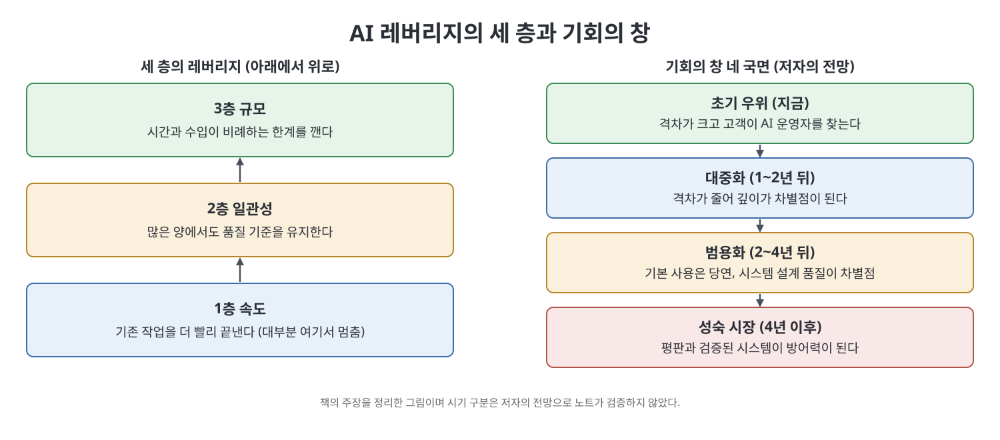

# 1장 새로운 레버리지 인지 자본과 AI 승수 (The New Leverage: Cognitive Capital and the AI Multiplier)

1장은 왜 지금 Claude로 시스템을 짓는 일이 경제적으로 의미 있는가를 설명하는 장이다. 책은 경제사를 레버리지(leverage, 적은 힘으로 큰 결과를 내는 지렛대 효과)의 변화로 읽는다. 땅, 기계, 유통에 이어 이제 생각과 분석과 창작을 확장하는 네 번째 레버리지가 왔다는 것이 논지다. 이를 인지 자본(cognitive capital)과 승수(multiplier)라는 말로 정리하고, 사고방식과 흔한 실수까지 다룬다.

> **쉽게 말하면**
> 예전에는 사람을 더 뽑아야 일이 늘었다. 이제는 일하는 방식을 시스템으로 바꾸면 한 사람이 팀처럼 일할 수 있다고 책은 말한다. 단, 시스템을 잘 만들었을 때의 이야기다.

> **참고(노트 작성자)** 이 장의 수익, 시간, 사례 수치는 책의 주장이며 노트 작성자가 검증하지 않았다. 수익과 시간은 책의 사례일 뿐 결과는 개인과 시장에 따라 크게 다르다.

## 이 장의 흐름

1. 네 번째 레버리지, 인지적 레버리지
2. AI 레버리지의 세 층
3. 지금이 구조적으로 다른 이유와 기회의 창
4. 사례: 컨설턴트의 보고서 자동화
5. 사고방식 설계와 흔한 실수

## 1. 네 번째 레버리지

책은 시대마다 지배적인 레버리지가 달랐다고 정리한다. 농업 시대는 땅을 가진 사람의 수확이, 산업 시대는 기계를 가진 사람의 생산이, 정보 시대는 유통을 쥔 사람의 도달 범위가 노동을 곱해 주었다. 이제 등장한 것은 인지적 레버리지, 곧 값비싼 팀 없이도 생각과 분석과 창작의 규모를 키우는 능력이다.

책이 드는 그림은 이렇다. 컨설턴트 한 명이 다섯 명 팀의 분석량을 내고, 콘텐츠 제작자 한 명이 편집부 규모로 발행하며, 개발자 한 명이 연구 조직의 지원을 받는 설계자처럼 일한다. 저자는 이를 과장이 아니라, 잘 설계한 Claude 시스템과 일할 때의 현실이라고 주장한다.

## 2. AI 레버리지의 세 층

책은 이 레버리지가 아래 층에서 위 층으로 쌓이는 세 층으로 작동한다고 본다. 어느 층에 설계 노력을 쏟을지 결정하는 기준이 된다.

| 층 | 하는 일 | 가치 수준(책의 평가) |
|----|---------|----------------------|
| 1층 속도 | 기존 작업을 더 빨리 끝낸다 | 보통 |
| 2층 일관성 | 많은 양에서도 품질 기준을 유지한다 | 높음 |
| 3층 규모 | 시간과 수입이 비례하는 한계를 깬다 | 변혁적 |

대부분의 사람은 1층에서 멈춘다. Claude가 자기보다 빨리 쓴다는 것을 알고 개별 작업의 시간을 아끼는 데 쓴다. 책은 이것이 가장 가치가 낮은 층이라고 말한다. 본격적인 기회는 품질을 대량으로 유지하는 시스템을 설계하는 2층에서 시작되고, 사업 모델 자체를 규모에 맞게 다시 짜는 3층에서 정점에 이른다.

## 3. 지금이 구조적으로 다른 이유

이전의 생산성 도구인 스프레드시트, 문서 편집기, 프로젝트 관리 도구는 각각 한 종류의 업무만 키웠다. 책은 Claude가 언어, 추론, 구조화된 정보와 관련된 모든 일을 키우므로 고부가가치 지식 노동 대부분을 포괄한다고 본다. 또 AI를 잘 쓰는 운영자와 그렇지 못한 쪽의 격차가 현재는 크지만 시간이 지나며 좁혀질 것이라 전망한다.

책은 AI 도입 곡선을 네 국면으로 나눈 "기회의 창" 틀을 제시한다.

| 국면 | 책이 설명하는 상태 |
|------|--------------------|
| 초기 우위(지금) | 격차가 크고 고객이 유능한 AI 운영자를 찾는다 |
| 대중화(1~2년 뒤) | 격차가 줄어 깊이가 차별점이 된다 |
| 범용화(2~4년 뒤) | 기본적인 AI 사용은 당연해지고 시스템 설계 품질이 차별점 |
| 성숙 시장(4년 이후) | 평판과 검증된 시스템이 방어력이 된다 |

저자는 독자가 초기 우위 국면에 있다고 보고, 창이 좁아지기 전에 움직이는 것이 가장 중요한 결정이라고 말한다. 이 시기 구분은 저자의 전망이며 노트가 검증한 것이 아니다.

## 4. 사례: 컨설턴트의 보고서

책은 B2B SaaS 회사를 상대로 시장 분석과 포지셔닝 보고서를 써 주던 프리랜서 컨설턴트 마커스를 소개한다. 보고서 한 건에 약 여덟 시간이 걸려 한 달 작업량이 정해져 있었고, 주 후반에 만든 보고서는 품질이 떨어졌다고 한다. 그가 만든 것은 복잡한 도구가 아니라 다섯 단계의 프롬프트 체인(prompt chain, 앞 단계 결과를 다음 단계의 입력으로 잇는 구조)이었다. 경쟁 구도 파악, 고객군 분석, 포지셔닝 공백 찾기, 메시지 틀 만들기, 요약 정리의 순서다.

책은 시스템 구축에 열두 시간 정도를 투자했고 이후 보고서당 시간이 크게 줄어 처리량과 매출이 늘었다고 서술한다. 구체적 수치는 책의 예이므로 여기서는 구조만 정리한다.

| 비교 항목 | 도입 전 | 도입 후(책의 서술) |
|-----------|---------|--------------------|
| 건당 작업 시간 | 길고 후반에 품질 저하 | 대폭 단축 |
| 월 처리량 | 몇 건에 묶임 | 몇 배로 확대 |
| 품질 일관성 | 변동 큼 | 안정적 |
| 운영자 부담 | 한계 상태 | 지속 가능 |

사례의 요점은 숫자보다 구조에 있다. 한 번 잘 설계한 체인이 반복 투자 없이 매달 이득을 낸다는 것이다.

## 5. 사고방식 설계와 흔한 실수

책은 다섯 가지 마음가짐을 권한다. 같은 일을 두 번 이상 하면 시스템으로 만들 수 있는지 묻기, 평균이 아니라 범위(예외 입력까지)를 기준으로 설계하기, 들인 노력이 아니라 낸 성과의 가치를 재기, 프롬프트 기반 시설에 투자하기, 완벽을 기다리지 말고 반복하며 개선하기다.

초보자가 자주 하는 실수로는 다섯 가지를 꼽는다.

- 일회성 작업에만 쓰다가 시스템이 쌓이지 않는다.
- 첫 시도에 완벽한 프롬프트를 찾으려 한다.
- AI를 쓴 뒤 가격을 낮춘다. 책은 효율의 이득이 할인 재원이 아니라 마진이라고 주장한다.
- 엉뚱한 작업을 시스템화한다. 빈도 높고 구조화된 일부터 자동화하고 창의적 판단은 사람이 가진다.
- 출력 검토를 건너뛴다. 사람 검토 없이 내보내면 평판이 빨리 상한다.

## 핵심 정리

- 책은 땅, 기계, 유통에 이은 네 번째 레버리지로 인지적 레버리지를 제시한다.
- AI 레버리지는 속도, 일관성, 규모의 세 층이며 대부분은 가장 낮은 속도 층에서 멈춘다.
- 저자는 현재를 AI 운영자 사이의 격차가 큰 초기 우위 국면으로 보며, 이는 저자의 전망이다.
- 컨설턴트 사례의 핵심은 다섯 단계 프롬프트 체인이라는 구조이며, 수치는 책의 주장이다.
- 같은 일을 반복하면 시스템으로 만들고, 높은 빈도의 구조화된 일부터 자동화하며, 출력은 반드시 검토한다.

 
 
 

이전: [머리말](%EB%A8%B8%EB%A6%AC%EB%A7%90.md) | 다음: [2장 시스템 아키텍처로서의 Claude 이해](02%EC%9E%A5%20%EC%8B%9C%EC%8A%A4%ED%85%9C%20%EC%95%84%ED%82%A4%ED%85%8D%EC%B2%98%EB%A1%9C%EC%84%9C%EC%9D%98%20Claude%20%EC%9D%B4%ED%95%B4.md)

 

[Claude AI Automation and Monetization](../)
