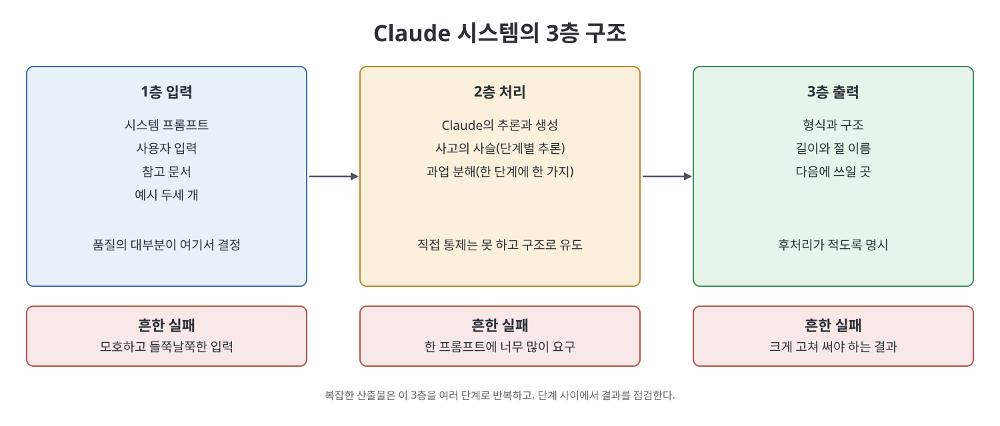

# 2장 시스템 아키텍처로서의 Claude 이해 (Understanding Claude as a System Architecture)

2장은 Claude를 쓰는 사람과 Claude로 시스템을 설계하는 사람의 차이를 구체적인 구조로 보여 준다. 책은 운전자와 자동차 엔지니어의 비유를 든다. 같은 차를 다루지만 엔지니어는 왜 작동하는지, 어디서 실패하는지, 문제가 생기면 어떻게 진단하는지를 안다. 신경망의 수학은 몰라도 되지만 행동 패턴은 알아야 한다는 것이 출발점이다. 이 장은 3층 워크플로 모델, 시스템 프롬프트 설계, 단일 턴과 다단계 시스템의 선택을 다룬다.

> **쉽게 말하면**
> Claude 시스템은 "무엇을 넣고, 어떻게 생각하게 하고, 무엇으로 받을까" 세 칸으로 나눠 설계한다. 대부분의 품질은 맨 앞칸인 입력에서 결정된다.

> **참고(노트 작성자)** 이 장의 사례에 나오는 가격, 소요 기간, 매출 변화는 책의 주장이며 노트 작성자가 검증하지 않았다. 수익과 시간은 책의 사례이며 결과는 개인과 시장에 따라 크게 다르다.

## 이 장의 흐름

1. 3층 AI 워크플로 모델
2. 입력 층의 다섯 가지 구성 요소
3. 처리 층과 출력 층 설계
4. 단일 턴과 다단계 시스템
5. 사례: 리서치 회사의 일곱 단계 시스템
6. 시스템 프롬프트 설계와 흔한 실수

## 1. 3층 AI 워크플로 모델

책에 따르면 가장 단순한 한 번짜리 도구부터 복잡한 다단계 파이프라인까지 모든 Claude 시스템은 같은 세 층으로 움직인다. 저자는 이 모델이 책 전체에서 가장 중요한 개념적 투자라고 말한다.

| 층 | 구성 | 설계자의 책임 | 흔한 실패 |
|----|------|---------------|-----------|
| 1층 입력 | 시스템 프롬프트, 사용자 입력, 참고 문서, 예시 | Claude가 받는 것을 정확히 정의 | 모호하고 들쭉날쭉한 입력이 변덕스러운 출력을 낳음 |
| 2층 처리 | Claude의 추론과 생성 | 과업과 사고 방식을 구조화 | 한 프롬프트에 너무 많이 요구, 단계별 사고 생략 |
| 3층 출력 | 형식, 전달, 후속 사용 | 형식, 길이, 구조를 명시 | 쓰기 전에 크게 고쳐야 하는 결과 |

## 2. 입력 층: 품질이 결정되는 곳

책은 입력이 시스템 품질의 압도적 부분을 좌우한다고 본다. 약한 입력은 모델이 아무리 좋아도 약한 출력이 된다는 것이다. 좋은 입력 층은 다섯 가지 요소를 의식적으로 다룬다. 이 노트에서는 책이 직접 풀어 설명한 세 가지를 중심으로 정리한다.

- **시스템 프롬프트(system prompt)**: 세션 내내 유지되는 상시 지침이다. 책은 이것을 시스템의 운영체제에 비유하며 역할, 행동 제약, 출력 형식, 항상 깔고 갈 맥락을 담으라고 한다.
- **참고 문서(context documents)**: 고객 브리프, 스타일 가이드, 과거 사례 같은 배경 자료다. 막연한 설명으로 Claude가 짐작하게 하는 것보다 자료를 직접 넣는 편이 훨씬 안정적이다.
- **예시(few-shot examples, 소수 예시)**: 원하는 결과를 두세 개 직접 보여 주는 방식이다. 책은 가장 덜 쓰이는데 효과는 가장 큰 구성 요소라고 평가한다. 글로 쓴 지침이 잘 전하지 못하는 기준을 예시가 정밀하게 가르친다는 설명이다.

## 3. 처리 층과 출력 층

처리 과정을 직접 통제할 수는 없지만 프롬프트 구조로 품질에 영향을 줄 수 있다. 가장 중요한 선택은 결론 전에 추론하게 할 것인가다. 책은 문제를 단계별로 풀게 하는 사고의 사슬(chain-of-thought, 최종 답 전에 풀이 과정을 쓰게 하는 기법)이 복잡한 분석 과제에서 꾸준히 더 나은 결과를 낸다고 주장한다. 또 과업 분해(task decomposition)도 중요하다. 종합 마케팅 전략을 한 번에 요구하면 얕고 평범한 결과가 나오지만, 구성 요소별로 나눠 순서대로 요구하면 깊이 있는 조각을 합칠 수 있다.

출력은 흔히 뒷전이 되지만 실제 활용도를 정한다. 책은 모든 출력에 대해 세 질문을 던지라고 한다. 어떤 형식이어야 하는가, 다음에 어디로 가는가, 무엇이 쓸모없게 만드는가.

| 용도 | 권하는 형식 | 흔한 실수 |
|------|-------------|-----------|
| 고객 보고서 | 제목이 있는 구조화된 절 | 구조 없이 "보고서 써 줘"라고만 요청 |
| SNS 글 | 플랫폼별 글자 수 제한 반영 | 일반 문장을 받아 직접 손봄 |
| 데이터 추출 | 구분자나 JSON, 필드명 명시 | 구조화가 필요한데 줄글을 받음 |
| 이메일 초안 | 제목과 본문을 라벨로 분리 | 한 덩어리로 받아 수작업 분리 |

## 4. 단일 턴과 다단계

시스템을 한 번의 주고받음으로 끝낼지, 여러 단계로 나눌지는 가장 결과가 큰 설계 결정 중 하나다. 책은 두 방식을 이렇게 비교한다.

| 구분 | 단일 턴 | 다단계 |
|------|---------|--------|
| 적합한 일 | 범위가 분명한 개별 과업 | 여러 구성 요소가 있는 복합 산출물 |
| 구축 시간 | 몇 시간 | 며칠에서 몇 주 |
| 신뢰도 | 보통에서 높음 | 높음에서 매우 높음 |
| 디버깅 | 쉬움(점검할 곳이 하나) | 단계별로 분리해 점검 |
| 예 | 상품 설명, 이메일 초안 | 시장 조사 보고서, 콘텐츠 전략 전체 |

## 5. 사례: 리서치 회사의 일곱 단계

사모펀드 고객을 상대로 기업 분석 보고서를 만들던 소규모 리서치 회사 사례를 책이 소개한다. 병목은 지능이나 인맥이 아니라 자료를 모으고 정리하고 초안을 쓰는 기계적 작업이었다. 책이 설명하는 시스템은 일곱 단계다. 기업 프로필 추출, 시장 지위 분석, 경영진 평가, 재무 흐름 해석, 위험 식별, 인수 논거 작성, 요약 종합 순이다. 각 단계가 앞 단계의 구조화된 결과를 받아 다음 단계로 넘기고, 분석가의 시간은 초안 작성에서 입력 선별과 출력 검증으로 옮겨 갔다고 한다. 책은 제작 기간이 크게 줄고 월 생산량과 매출이 늘었다고 서술하나 수치는 책의 주장이다.

이 사례의 프롬프트는 두 부분이 대비된다. 시스템 프롬프트는 "시니어 시장 정보 분석가" 같은 구체적 역할, 근거 없는 주장 금지, 정보 공백 명시, 절별 분량 같은 제약을 정한다. 단계 프롬프트(경영진 평가)는 다섯 가지 항목을 평가하고 각각 등급과 짧은 근거를 요구한 뒤 종합 점수와 요약으로 끝낸다. 책의 문구를 옮기는 대신 구성만 새 예시로 보이면 다음과 같다.

```
역할: 인수 검토용 경영진 평가 담당 분석가
입력: 아래 임원 약력 문서
할 일: 경력의 질, 분야 적합도, 팀 완성도를 각각 상/중/하와 두 문장 근거로 평가
끝: 종합 등급과 세 문장 요약. 자료에 없는 내용은 "정보 없음"으로 표시
```

## 6. 시스템 프롬프트와 흔한 실수

책은 시스템 프롬프트를 AI 구성 요소의 표준 운영 절차로 본다. 잘 쓰면 뒤의 모든 것이 이득을 보고, 잘못 쓰면 사용자 턴의 요령으로도 다 만회하지 못한다.

| 구성 요소 | 담을 내용 | 이유 |
|-----------|-----------|------|
| 역할 정의 | "작가"가 아니라 "B2B 카피라이터"처럼 구체적으로 | 어휘와 추론 방식, 기준이 정해짐 |
| 독자 | 결과를 누가 보고 무엇이 필요한지 | 깊이, 어조, 형식이 맞춰짐 |
| 제약 | 넣을 것, 뺄 것, 절대 지킬 것 | 흔한 실패를 막음 |
| 출력 형식 | 정확한 구조, 절 이름, 길이 | 후처리 시간 제거 |
| 품질 하한 | 합격선의 최소 기준 | 자기 평가의 계기 |
| 예시 | 훌륭한 결과 두세 개 | 가장 효과 큰 품질 장치 |

흔한 실수는 다섯 가지다. 역할만 적고 할 일을 쓰지 않는다. 한 프롬프트에 복잡한 일을 몰아넣는다(한 단계에 한 가지 일). 이상적인 입력만 가정하고 누락 정보를 다루지 않는다. 좋다는 것이 무엇인지 Claude가 알아서 추론하리라 기대한다. 처음 만든 뒤 시스템 프롬프트를 고치지 않는다. 책은 사용 환경이 변하면 시스템도 낡으므로 최소 분기마다 점검하라고 권한다.



## 핵심 정리

- 모든 Claude 시스템은 입력, 처리, 출력의 3층 구조이며 품질은 대부분 입력 층에서 결정된다고 책은 본다.
- 시스템 프롬프트는 시스템의 운영체제 역할을 하며 역할, 독자, 제약, 형식, 품질 하한, 예시를 담는다.
- 예시 두세 개와 단계별 사고(chain-of-thought)는 비용 대비 효과가 큰 장치로 소개된다.
- 단일 턴은 범위가 분명한 일에, 다단계는 복합 산출물에 적합하며 단계별로 점검하고 개선할 수 있다.
- 한 단계에 한 가지 일만 시키고, 누락된 입력을 우아하게 다루며, 시스템 프롬프트는 주기적으로 고친다.

<br>
<br>
<br>

이전: [1장 새로운 레버리지 인지 자본과 AI 승수](01%EC%9E%A5%20%EC%83%88%EB%A1%9C%EC%9A%B4%20%EB%A0%88%EB%B2%84%EB%A6%AC%EC%A7%80%20%EC%9D%B8%EC%A7%80%20%EC%9E%90%EB%B3%B8%EA%B3%BC%20AI%20%EC%8A%B9%EC%88%98.md) | 다음: [3장 고급 프롬프트 시스템 설계](03%EC%9E%A5%20%EA%B3%A0%EA%B8%89%20%ED%94%84%EB%A1%AC%ED%94%84%ED%8A%B8%20%EC%8B%9C%EC%8A%A4%ED%85%9C%20%EC%84%A4%EA%B3%84.md)

<br>

[Claude AI Automation and Monetization](../)
