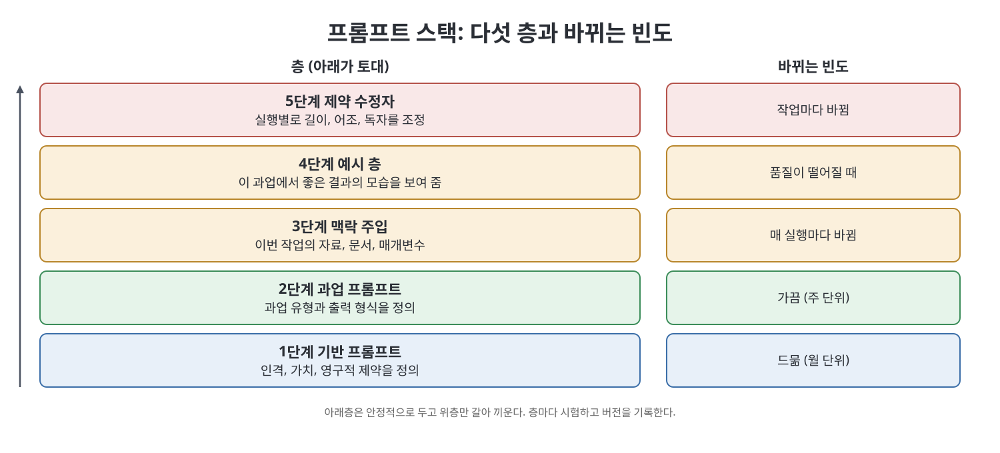

# 3장 고급 프롬프트 시스템 설계 (Advanced Prompt Systems Architecture)

3장은 프롬프트를 "글솜씨"가 아니라 "엔지니어링"으로 다루는 장이다. 책은 단어를 바꾸고 문장을 다듬는 접근이 미미한 개선에 그친다고 보고, 프롬프트 기반 시설을 소프트웨어 코드처럼 모듈화하고, 유지보수하고, 버전을 관리하고, 알려진 입력 범위 전반에서 성능을 내도록 설계하라고 말한다. 데모에서만 되는 아마추어 구성과 실전 수준의 구성을 가르는 기법이 이 장의 주제다.

> **쉽게 말하면**
> 프롬프트를 한 덩어리 글이 아니라 레고 블록처럼 쌓는다. 오래 바뀌지 않는 블록은 아래에, 매번 바뀌는 블록은 위에 둔다.

> **참고(노트 작성자)** 이 장의 효과 수치(시간 단축, 품질 개선 비율)는 책의 주장이며 노트 작성자가 검증하지 않았다. 효과는 과업과 사용자에 따라 크게 다르다.

## 이 장의 흐름

1. 프롬프트 스택 모델
2. 사고의 사슬 심화
3. 메타 프롬프트 기법
4. 프롬프트 버전 관리와 품질 관리
5. CRAFT 프레임워크
6. 자기 검토 구조와 흔한 실수

## 1. 프롬프트 스택 모델

프롬프트 스택(prompt stack)은 아래 층 위에 더 구체적인 제약을 얹는 계층 구조다. 이 모델로 설계하면 층을 골라 섞을 수 있어 시스템이 커져도 유지보수 부담이 크게 줄어든다는 것이 책의 설명이다. 책은 다섯 단계를 나누고, 각 단계의 변경 빈도가 다르다는 점을 강조한다.

| 단계 | 이름 | 목적 | 바뀌는 빈도 |
|------|------|------|-------------|
| 1 | 기반 프롬프트 | 인격, 가치, 영구적 제약 정의 | 드묾(월 단위) |
| 2 | 과업 프롬프트 | 과업 유형과 출력 형식 정의 | 가끔(주 단위) |
| 3 | 맥락 주입 | 이번 작업의 자료, 문서, 매개변수 | 매 실행 |
| 4 | 예시 층 | 이 과업에서 좋은 결과의 모습 | 품질이 떨어질 때 |
| 5 | 제약 수정자 | 실행별 길이, 어조, 독자 조정 | 작업마다 |

1단계는 계속 유지하고, 2단계는 다른 종류의 일을 할 때 바꾸며, 3단계는 입력마다 바뀐다. 한 덩어리로 쓴 프롬프트는 일부만 고쳐도 전체를 다시 시험해야 하지만, 스택은 바뀐 층만 점검하면 된다.



## 2. 사고의 사슬 심화

책은 사고의 사슬(chain-of-thought)을 복잡한 분석, 창작 결과의 품질을 높이는 가장 영향력 큰 기법으로 꼽는다. 결론으로 바로 뛰지 말고 단계별로 추론한 뒤 결론에 이르라고 지시하는 것이다. 좋은 점은 최종 답만이 아니다. 풀이 과정 자체가 산출물이 되어 가정을 드러내고, 논리가 튼튼한 곳과 사람이 고칠 곳을 쉽게 알려 준다.

예를 들어 "이 회사가 유럽에 진출해야 하나?"라고만 묻는 대신, 현재 위치와 자금 여력, 수요, 위험 세 가지, 기회 세 가지, 운영 준비도를 차례로 보게 하고, 모든 단계가 끝난 뒤에만 신뢰도를 붙인 권고를 내라고 요구한다. 책의 예시를 옮기지 않고 요지만 새로 쓰면 이렇다.

```
[회사명]이 새 시장에 진출해야 하는지 판단해 줘.
순서: 1) 현재 위치와 자금 여력 2) 시장 수요 3) 위험 3가지
4) 기회 3가지 5) 팀과 인프라 준비도
다섯 단계를 단계 이름과 함께 쓴 뒤에만 결론과 확신 정도를 말해 줘.
```

## 3. 메타 프롬프트 기법

메타 프롬프트(meta-prompt)는 Claude에게 Claude용 프롬프트를 만들어 달라고 하는 방법이다. 프롬프트 문구를 직접 고민하는 대신, 과업, 결과를 쓸 독자, 필요한 형식, 품질 기준, 자주 생기는 실패를 설명하고, 최적의 시스템 프롬프트와 사용자 프롬프트, 예시 입력 두 개, 점검해야 할 경계 사례 세 가지까지 만들게 한다.

책은 이 기법이 숙련자의 프롬프트 개발 시간을 크게 줄인다고 주장하며, 여러 번 쓰다 보면 자기 분야에 맞게 다듬은 메타 프롬프트가 생긴다고 말한다. 중요한 점은 경계 사례(edge case, 평범하지 않은 입력)를 함께 뽑게 한다는 것이다. 만든 프롬프트를 바로 믿지 않고 시험할 항목을 얻는다.

## 4. 프롬프트 버전 관리와 품질 관리

책은 진지한 AI 시스템에서는 프롬프트가 곧 코드이므로 버전, 문서, 관리가 필요하다고 한다. 번거로운 관료주의가 아니라 시스템이 조용히 나빠지지 않고 점점 나아지게 하는 장치다.

| 기록 항목 | 담을 내용 | 이유 |
|-----------|-----------|------|
| 버전 번호 | 순번과 날짜 | 변경 후 나빠지면 되돌림 |
| 변경 설명 | 무엇을 왜 바꿨나 | 효과 있던 방법에 대한 지식 보존 |
| 시험 결과 | 표준 시험 세트에서의 성능 | 개선 증명, 퇴보 방지 |
| 알려진 경계 사례 | 결과가 아쉬운 입력 | 다음 개선 우선순위 |
| 배포 상태 | 사용 중, 폐기, 시험 중 | 낡은 버전의 실수 사용 방지 |

## 5. CRAFT 프레임워크

일관되게 전문가급 결과가 필요한 프롬프트를 위해 책은 CRAFT라는 점검표를 제안한다. 다섯 글자가 다섯 질문이다.

| 글자 | 뜻 | 묻는 것 |
|------|----|---------|
| C 맥락(Context) | 상황, 배경, 목적 | 시작 전에 Claude가 알아야 할 것은? |
| R 역할(Role) | 맡을 인물 | 어떤 전문성, 가치, 관점인가? |
| A 행동(Action) | 구체적 과업 | "그 일을 한다"가 정확히 무엇인가? |
| F 형식(Format) | 결과의 모양 | 구조, 길이, 절, 특수 서식은? |
| T 어조(Tone) | 말투 | 구체적 형용사로 문체를 정하면? |

책은 HR 담당자를 겨냥한 B2B 소프트웨어 후속 이메일에 이 틀을 적용한 예를 든다. 웨비나에 관심을 보인 인사 책임자에게 보내는 글이라는 맥락, 인사 기술 전문 시니어 카피라이터라는 역할, 20분 맞춤 시연을 제안하는 행동, 제목 길이와 문단 구성을 정한 형식, 전문적이되 따뜻하고 강요하지 않는 어조를 각각 채운다. 이 노트에서는 문장을 옮기지 않고 구성만 정리했다.

## 6. 자기 검토 구조와 흔한 실수

자기 검토(self-review)는 Claude에게 자기 결과를 체크리스트로 점검한 뒤 최종본을 내라고 하는 두 단계 방식이다. 책은 한 번에 생성할 때 놓치는 품질 문제를 상당 부분 잡아낸다고 주장한다. 구성은 간단하다. 먼저 결과를 만들게 한 뒤, 길이 요건, 형식, 핵심 목적 달성 여부, 더 구체화할 주장, 일반론처럼 읽히는 절을 차례로 점검하게 하고, 아니오로 답한 항목만 고쳐서 수정본만 출력하라고 한다.

책이 꼽는 흔한 실수는 다음과 같다.

- 구조 없이 자연어 줄글로만 프롬프트를 쓴다. 문서처럼 라벨을 붙이라는 조언이다.
- 정의 없는 형용사를 쓴다. "매력적인 이메일"보다 "구체적인 고민으로 시작하는 이메일"이 실행 가능하다.
- 경계 사례 시험을 건너뛴다. 시스템을 깨는 입력이 잘 처리되는 입력보다 많은 것을 가르친다.
- 프롬프트 스택 대신 거대한 한 덩어리 프롬프트를 만든다.
- 자기 검토 단계를 쓰지 않는다.

## 핵심 정리

- 책은 프롬프트를 코드처럼 모듈화하고 버전 관리하는 엔지니어링 대상으로 본다.
- 프롬프트 스택은 기반, 과업, 맥락 주입, 예시, 제약 수정자의 다섯 층이며 층마다 바뀌는 빈도가 다르다.
- 사고의 사슬은 풀이 과정을 산출물로 남겨 사람이 논리를 점검하게 해 준다.
- 메타 프롬프트로 프롬프트와 시험용 경계 사례까지 만들게 하고, CRAFT로 구성 요소를 점검한다.
- 버전, 변경 이유, 시험 결과를 기록하고, 복잡한 결과에는 자기 검토 단계를 둔다.

<br>
<br>
<br>

이전: [2장 시스템 아키텍처로서의 Claude 이해](02%EC%9E%A5%20%EC%8B%9C%EC%8A%A4%ED%85%9C%20%EC%95%84%ED%82%A4%ED%85%8D%EC%B2%98%EB%A1%9C%EC%84%9C%EC%9D%98%20Claude%20%EC%9D%B4%ED%95%B4.md) | 다음: [4장 프로덕션에서 버티는 AI 워크플로 설계](04%EC%9E%A5%20%ED%94%84%EB%A1%9C%EB%8D%95%EC%85%98%EC%97%90%EC%84%9C%20%EB%B2%84%ED%8B%B0%EB%8A%94%20AI%20%EC%9B%8C%ED%81%AC%ED%94%8C%EB%A1%9C%20%EC%84%A4%EA%B3%84.md)

<br>

[Claude AI Automation and Monetization](../)
