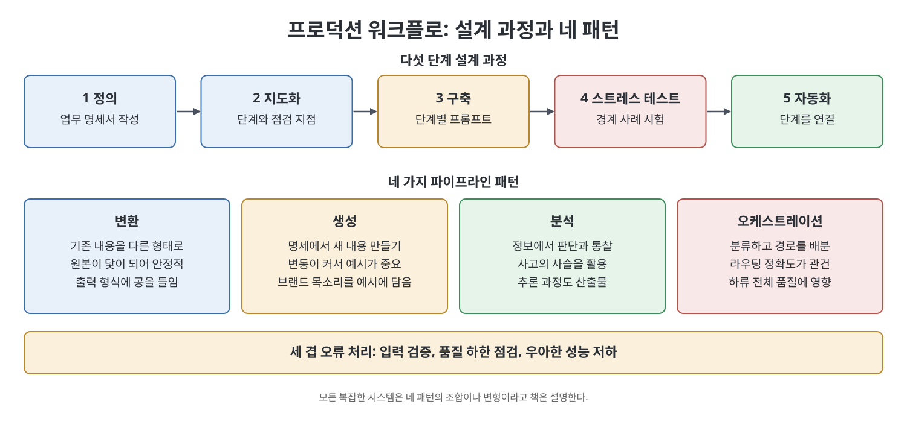

# 4장 프로덕션에서 버티는 AI 워크플로 설계 (Designing AI Workflows That Hold Up in Production)

4장은 시험 환경에서만 잘 돌아가는 워크플로(workflow, 일의 단계별 흐름)는 완성품이 아니라 시제품이라는 선언으로 시작한다. 시제품은 이상적인 입력을 기준으로 설계하지만, 프로덕션(production, 실제 고객과 업무에 쓰이는 운영 환경)은 지저분하고 불완전하고 특이한 입력까지 포함한 현실의 범위를 기준으로 설계해야 한다. 이 장은 처음부터 실전 수준으로 설계하는 다섯 단계 과정, 네 가지 파이프라인 패턴, 오류 처리를 다룬다.

> **쉽게 말하면**
> 맑은 날 시운전만 해 본 차를 비 오는 고속도로에 내보내면 안 된다. 나쁜 입력, 빠진 정보, 이상한 사례를 미리 겪어 보고 나서 내보내라는 이야기다.

> **참고(노트 작성자)** 이 장 사례의 건당 가격, 처리량, 월 매출은 책의 주장이며 노트 작성자가 검증하지 않았다. 수익과 시간은 책의 사례이며 결과는 개인과 시장에 따라 크게 다르다.

## 이 장의 흐름

1. 다섯 단계 워크플로 설계 과정
2. 1단계 업무 명세서와 2단계 단계 지도
3. 네 가지 프로덕션 워크플로 패턴
4. 사례: 이커머스 상품 설명 공장
5. 오류 처리와 우아한 성능 저하

## 1. 다섯 단계 설계 과정

책은 프롬프트를 쓰기 전에 설계를 먼저 하라고 한다. 다섯 단계는 정의, 지도화, 구축, 스트레스 테스트, 자동화다.

| 단계 | 하는 일 | 핵심 질문 | 산출물 |
|------|---------|-----------|--------|
| 1 정의 | 해야 할 일을 정밀하게 명세 | 누가 쓰나, 무엇이 필요한가, 무엇이 실패인가 | 한 단락의 업무 명세서 |
| 2 지도화 | 과업을 순차 단계로 분해 | 중간에 어디서 품질을 확인할까 | 입출력이 있는 단계 지도 |
| 3 구축 | 각 단계의 프롬프트 작성 | 단계마다 일이 하나인가 | 시험을 거친 단계별 프롬프트 |
| 4 스트레스 테스트 | 경계 사례와 실패 시나리오 실행 | 이 시스템이 만날 최악의 입력은 | 알려진 실패 유형과 대책 |
| 5 자동화 | 단계를 연결해 수작업 축소 | 어느 전환을 완전 자동화할 수 있나 | 자동으로 도는 워크플로 |

## 2. 업무 명세서와 단계 지도

책이 가장 과소평가된 단계로 꼽는 것은 프롬프트에 손대기 전에 쓰는 업무 명세서(job specification)다. 여섯 가지 질문에 답하는 문서로, 이후 모든 설계 결정의 평가 기준이 된다.

- 결과물을 쓸 사람이나 고객은 누구인가
- 그가 성공하려면 결과에서 무엇이 필요한가
- 형식, 길이, 구조는 어때야 하는가
- 워크플로는 어떤 정보를 입력으로 받는가
- 겉보기에 좋아도 쓸모없게 만드는 요소는 무엇인가
- 운영에 투입할 최소 품질선은 어디인가

단계 지도(stage map)를 그릴 때의 요령은 검토하고 검증하고 싶은 지점마다 단계 경계를 둔다는 것이다. 각 단계는 독립적으로 평가 가능한 결과를 내야 한다. 책은 콘텐츠 전략 브리프를 예로 든다. 사업 설명을 받아 독자 분석가가 독자 프로필을 만들고, 이를 받아 주제 전략가가 주제 묶음 지도를 만들고, 경쟁 분석가가 콘텐츠 공백을 찾고, 기획자가 석 달 캘린더를 짜고, 브리프 작성자가 편별 브리프를 쓴다. 각 단계 끝에 품질 점검 질문이 붙는다는 점이 요점이다.

## 3. 네 가지 프로덕션 패턴

책은 많은 분야를 겪은 뒤 복잡한 AI 시스템이 모두 네 가지 기본 패턴의 조합이나 변형이라고 말한다. 어느 패턴인지 알면 설계가 빨라진다.

| 패턴 | 하는 일 | 예 | 설계 원칙 |
|------|---------|----|-----------|
| 변환 파이프라인 | 기존 내용을 다른 형태로 바꿈 | 녹취록에서 보고서, 메모에서 브리프 | 원본이 닻이 되어 믿을 만하니 출력 형식의 정밀도에 공을 들임 |
| 생성 파이프라인 | 명세에서 새 내용을 만듦 | 주제 브리프로 블로그 글, 특성 목록으로 상품 설명 | 변동이 크니 브랜드 목소리를 예시에 담음 |
| 분석 파이프라인 | 정보에서 구조화된 통찰과 판단을 냄 | 경쟁 분석, 위험 평가 | 사고의 사슬과 구조화된 출력, 추론도 결론만큼 가치 있음 |
| 오케스트레이션 파이프라인 | 다른 파이프라인으로 흐름을 분류하고 배분 | 고객 문의 분류, 문서 분류 | 분류 로직이 촘촘해야 하며 하류 전체가 라우팅 정확도에 달림 |



## 4. 사례: 이커머스 상품 설명 공장

책은 이커머스 전문 프리랜서 카피라이터 다니엘라의 사례를 든다. 고객은 수백 개 상품(SKU)의 설명을 빠르게 원하는데 그녀가 품질을 지키며 하루에 쓸 수 있는 양은 한정되어 있었다. 그녀가 만든 것은 세 단계의 변환 파이프라인이다.

| 단계 | 하는 일 | 입력과 출력 |
|------|---------|-------------|
| 1 속성 추출 | 고객이 준 데이터 시트에서 핵심 속성 뽑기 | 시트에서 구조화된 속성 목록 |
| 2 설명 생성 | 브랜드 목소리와 구매자에 맞춰 설명 작성 | 속성 목록에서 설명 문단 |
| 3 SEO 메타데이터 | 제목 태그, 메타 설명, 핵심 키워드 | 설명에서 검색용 정보 |

책은 초안 생산 속도가 사람의 작성 속도를 크게 웃돌고, 검토와 가벼운 편집으로 하루 처리량이 늘었으며, 가격을 올리고 "상품 카피 스튜디오"로 포지셔닝해 월 매출이 올랐다고 서술한다. 수치는 책의 예이며 시장과 고객에 따라 다르다.

2단계 프롬프트는 문구를 옮기지 않고 구성 요소로 정리한다. 브랜드와 구매자 정보를 위에 두고, 혜택 문장으로 시작하기, 주요 특성 세 가지에 고객 이익 붙이기, 모호한 형용사 피하기, 구매를 촉구하는 문장으로 끝내기, 글자 수 범위, 헤더와 불릿 없는 문단 하나라는 출력 규칙을 건다. 새 예시는 이런 모양이다.

```
브랜드 어조: [고객별로 지정]   구매자: [페르소나]
아래 속성으로 상품 설명을 쓴다.
- 첫 문장은 기능이 아니라 얻는 이익
- 주요 특성 3가지와 각각의 이익
- 막연한 칭찬 표현 금지, 마지막은 구매 유도 한 문장
- 출력은 문단 하나, 헤더와 불릿 없음
속성: [1단계 결과 붙여넣기]
```

## 5. 오류 처리와 우아한 성능 저하

프로덕션 워크플로는 누락된 필드, 들쭉날쭉한 형식, 불완전한 정보를 만난다. 책은 잘 설계한 워크플로는 쓰레기 결과를 내거나 멈추지 않고 이를 우아하게 다룬다고 하며, 세 겹의 오류 처리를 넣으라고 말한다.

| 겹 | 시점 | 하는 일 |
|----|------|---------|
| 입력 검증 | 본 처리 전 | 최소 요건을 확인하고 부족하면 무엇이 빠졌는지 구조화된 오류로 돌려줌 |
| 품질 하한 점검 | 본 처리 후 | 최소 품질을 못 넘으면 수정 단계를 돌리거나 사람 검토로 넘김 |
| 우아한 성능 저하(graceful degradation) | 입력이 일부만 갖춰졌을 때 | 부분 결과를 내되 완료, 추정, 추가 입력 필요를 표시 |

한 줄로 줄이면, 실패를 숨기지 말고 어디까지 믿을 수 있는지를 결과에 표시하라는 뜻이다. 시험은 입력 열 개 정도의 세트에 최소 세 개 이상의 경계 사례를 넣고, 사용자 입력이 변동하는 워크플로에는 입력 검증을, 고객에게 나가는 결과물에는 마지막 단계에 품질 하한 점검을 두라는 것이 책의 실천 항목이다.

## 핵심 정리

- 시험 환경에서만 되는 것은 시제품이며, 프로덕션은 지저분한 입력까지 포함한 현실의 범위를 기준으로 설계한다.
- 다섯 단계는 정의, 지도화, 구축, 스트레스 테스트, 자동화이고, 프롬프트에 앞서 여섯 질문의 업무 명세서를 쓴다.
- 단계 경계는 중간에 검토하고 싶은 지점에 두며, 단계마다 일은 하나로 한다.
- 변환, 생성, 분석, 오케스트레이션 네 패턴 가운데 맞는 것을 골라 해당 설계 원칙을 적용한다.
- 입력 검증, 품질 하한 점검, 우아한 성능 저하의 세 겹 오류 처리로 실패를 드러내고 사람에게 넘긴다.

<br>
<br>
<br>

이전: [3장 고급 프롬프트 시스템 설계](03%EC%9E%A5%20%EA%B3%A0%EA%B8%89%20%ED%94%84%EB%A1%AC%ED%94%84%ED%8A%B8%20%EC%8B%9C%EC%8A%A4%ED%85%9C%20%EC%84%A4%EA%B3%84.md) | 다음: [5장 AI 비즈니스 모델 전체 분석](../02.%202%EB%B6%80%20%EC%88%98%EC%9D%B5%20%EB%AA%A8%EB%8D%B8/05%EC%9E%A5%20AI%20%EB%B9%84%EC%A6%88%EB%8B%88%EC%8A%A4%20%EB%AA%A8%EB%8D%B8%20%EC%A0%84%EC%B2%B4%20%EB%B6%84%EC%84%9D.md)

<br>

[Claude AI Automation and Monetization](../)
