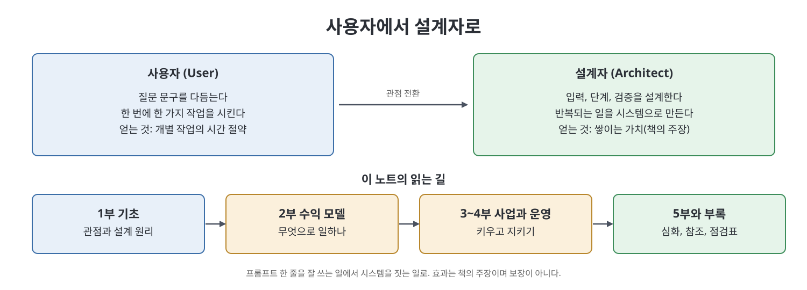

# 머리말 (Introduction) 설계자의 이점

머리말은 이 책이 누구를 위한 책인지, 그리고 책 전체를 어떤 태도로 읽어야 하는지를 짧게 밝히는 글이다. 핵심 메시지는 하나다. Claude를 잘 쓰는 사람과 Claude로 무언가를 짓는 사람은 다르며, 이 책은 후자를 위한 것이다. 질문 문장을 다듬는 일에서 한 걸음 더 나아가 시스템을 설계하는 쪽으로 관점을 옮기라고 권한다.

> **쉽게 말하면**
> 프롬프트 한 줄을 잘 쓰는 것은 요리를 잘하는 것이고, 시스템을 설계하는 것은 식당을 차리는 것이다. 이 책은 식당 차리는 법을 다룬다.

> **참고(노트 작성자)** 이 책의 수익, 가격, 사례, 소요 시간은 모두 저자의 주장이며 노트 작성자가 검증하지 않았다. 결과는 개인과 시장에 따라 크게 다르다. 책이 소개하는 도구와 모델 이름도 집필 시점 기준이다.

## 이 장의 흐름

1. 사용자에서 설계자로 바뀌는 순간
2. 이 책의 독자와 약속
3. 2판에서 달라진 점
4. 어려움에 대한 솔직한 태도
5. 프로젝트를 정해 놓고 읽는 법

## 1. 사용자에서 설계자로

저자는 Claude를 진지하게 쓰기 시작한 사람이 흔히 겪는 순간을 묘사한다. 처음에는 결과물에 감탄하지만, 어느 시점에 자신이 엉뚱한 곳에 힘을 쏟고 있었음을 깨닫는다. 프롬프트 문구를 다듬고 질문을 고치는 일에 매달렸는데, 진짜 승부는 프롬프트가 아니라 무언가를 만드는 일에 있었다는 것이다.

책은 이 전환이 AI로 조금씩 이득을 보는 사람과, 자는 동안에도 수입이 생기고 고객이 늘어도 노력이 비례해 늘지 않으며 오래 돌릴수록 가치가 쌓이는 시스템을 가진 사람을 가른다고 말한다. 이 말은 저자의 관점이며 보장이 아니라는 점에 유의하자.

## 2. 이 책의 독자와 약속

책은 독자가 이미 입문 단계를 지났다고 가정한다. Claude가 무엇인지 알고, 써 보았고, 감탄도 해 본 사람이다. 이제 이론이 아니라 틀(framework)을, 제안이 아니라 시스템을, 막연한 영감이 아니라 구체적인 사업 모델을 원하는 사람을 위한 책이다.

책이 내거는 약속은 네 가지로 정리된다.

| 약속 | 내용 |
|------|------|
| 시스템 구축 틀 | AI 기반 시스템을 짓는 완결된 프레임워크 |
| 사업 모델의 폭 | 지금 통한다고 저자가 보는 여러 수익 모델 |
| 검증된 프롬프트 구조 | 실무에 바로 쓰도록 짠 프롬프트 설계 |
| 로드맵 | 일정 수준의 수입 목표까지 가는 단계별 계획 |

여기서 강조되는 구분은 "AI가 무엇을 할 수 있는가"가 아니라 "AI를 엔진 삼아 무엇을 만들고, 값을 매기고, 키울 수 있는가"다.

## 3. 2판에서 달라진 점

저자는 2판이 1판보다 훨씬 깊어졌다고 소개한다. 고급 프롬프트 시스템 설계, AI 에이전시(agency) 구축, 자동화 플랫폼 연동, 반복 가능한 수입 파이프라인(pipeline) 구성이라는 새 장이 추가되었다. 또 모든 장에 사례, 바로 쓸 수 있는 프롬프트, 시각적 틀, 그리고 첫 반년 동안 사람들이 흔히 하는 실수를 짚는 오류 분석이 들어간다.

| 새로 더해진 주제 | 이 노트에서 만나는 곳 |
|------------------|----------------------|
| 고급 프롬프트 시스템 설계 | 1부 3장 |
| AI 에이전시 구축 | 3부 9장 |
| 자동화 플랫폼과 연동 | 2부 8장, 5부 19장 |
| 반복 가능한 수입 파이프라인 | 4부 13장 |

## 4. 어려움에 대한 솔직한 태도

머리말은 AI로 짓는 일이 강력하지만 쉽지는 않다고 분명히 한다. 시스템은 설계가 필요하고, 고객은 관리가 필요하며, 품질은 감독이 필요하다. 매력적으로 들리는 지름길은 대개 유료 고객 앞에서 곤란한 결과를 낳는다. 책은 이 문제를 피하지 않고 직접 다루겠다고 말한다.

수익을 다루는 책일수록 이런 태도가 중요하다. 이 노트도 같은 입장에서, 장마다 사례의 수치는 저자의 주장으로 표시한다.

## 5. 프로젝트를 정해 놓고 읽기

마지막 권유는 실천적이다. 막연한 포부가 아니라 실제로 만들고 싶은 구체적인 것을 하나 정해 두고, 각 장을 그 프로젝트를 시험하고 진전시키는 도구로 쓰라는 것이다. 틀은 일반적이지만 적용은 구체적이어야 하고, 가치는 그 구체성에서 나온다는 설명이다.

예를 들어 "소상공인 상점의 상품 설명을 대신 써 주는 서비스"를 프로젝트로 정했다면, 1장에서는 이 일이 어느 층의 레버리지인지 따져 보고, 3장에서는 그 서비스의 프롬프트 구조를 짜 보는 식으로 읽는다.

## 핵심 정리

- 책의 출발점은 프롬프트를 다듬는 사용자에서 시스템을 짓는 설계자로 관점을 옮기라는 것이다.
- 대상 독자는 입문을 지났고 틀, 시스템, 구체적 사업 모델을 원하는 사람이다.
- 2판은 고급 프롬프트 시스템, 에이전시, 자동화 연동, 수입 파이프라인 장을 더했다고 한다.
- 저자는 AI 사업이 쉽지 않다는 점을 숨기지 않으며 설계, 관리, 감독의 필요를 강조한다.
- 책을 읽을 때는 실제로 만들 프로젝트 하나를 정해 두고 각 장으로 시험하라는 것이 책의 권유다.

 
 
 

이전: [Claude AI Automation and Monetization](../Readme.md) | 다음: [1장 새로운 레버리지 인지 자본과 AI 승수](01%EC%9E%A5%20%EC%83%88%EB%A1%9C%EC%9A%B4%20%EB%A0%88%EB%B2%84%EB%A6%AC%EC%A7%80%20%EC%9D%B8%EC%A7%80%20%EC%9E%90%EB%B3%B8%EA%B3%BC%20AI%20%EC%8A%B9%EC%88%98.md)

 

[Claude AI Automation and Monetization](../)
