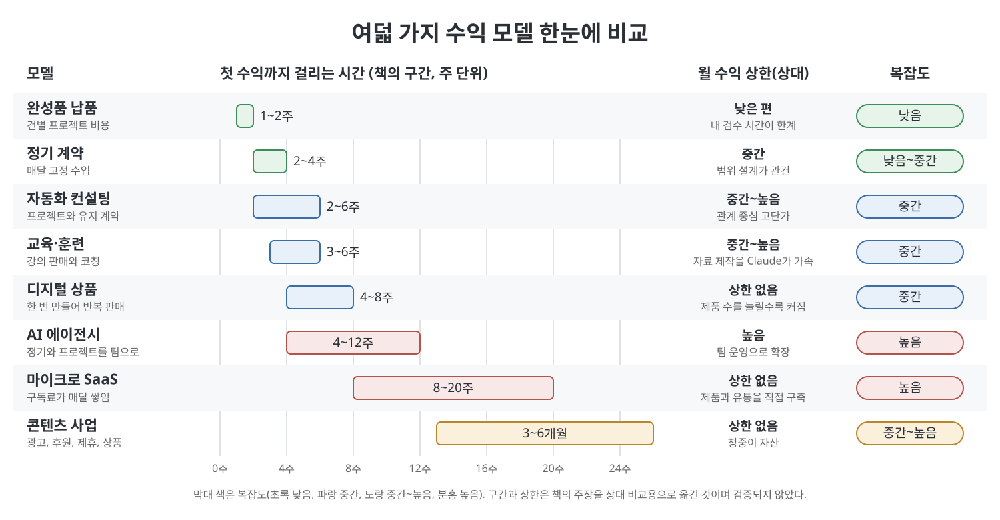
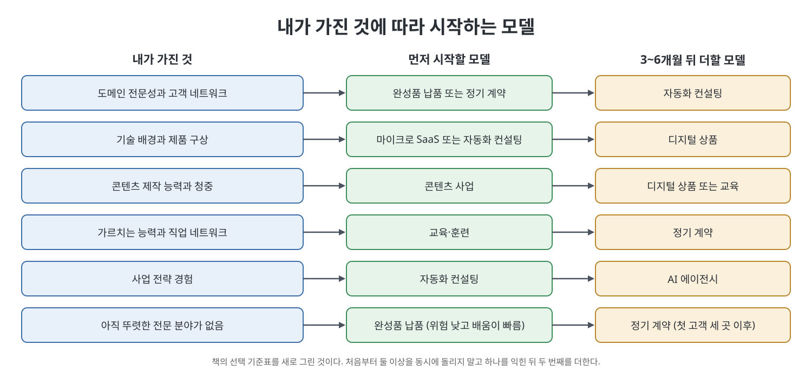

# 5장 AI 비즈니스 모델 전체 분석 (AI Business Models: The Complete Breakdown)

이 장은 Claude로 돈을 벌고 싶은 사람이 가장 먼저 부딪히는 질문, 곧 "어떤 방식으로 벌 것인가"를 정리하는 장이다. 책은 대부분의 사람이 가장 먼저 떠오른 프리랜싱을 곧바로 시작하는데, 틀린 선택은 아니지만 비효율적이라고 지적한다. AI를 쓰는 운영자에게는 최소 여덟 가지 수익 모델이 있고, 모델마다 필요한 자본, 수입이 늘어나는 모양, 상한, 일의 부담이 다르다. 그래서 하나를 정하기 전에 전체 지도를 먼저 보라는 것이 장의 요지다.

> **쉽게 말하면**
> 가게를 열기 전에 업종 여덟 가지를 한 장에 펼쳐 놓고, 내 돈과 시간과 인맥에 맞는 것을 고르라는 이야기다. 처음 고른 업종이 평생 업종은 아니다.

> **참고(노트 작성자)** 이 장의 수익 상한, 첫 수익까지 걸리는 시간, 가격대는 모두 책의 주장이며 노트가 검증하지 않았다. 수익과 시간은 책의 사례이고 결과는 개인과 시장에 따라 크게 다르다. 그래서 이 노트는 구체적인 금액을 거의 싣지 않고 구조 중심으로 정리했다.

## 이 장의 흐름

1. 여덟 가지 모델을 한눈에 비교하기
2. 서비스형 세 가지: 완성품 납품, 정기 계약, 자동화 컨설팅
3. 제품·규모·청중형 다섯 가지
4. 첫 모델을 고르는 다섯 가지 기준과 상황별 추천
5. 모델 선택에서 흔한 실수

## 1. 여덟 가지 모델을 한눈에

책이 소개하는 모델은 완성품 납품(Done-for-You Services), 정기 계약(Retainer Services), 자동화 컨설팅(Automation Consulting), 디지털 상품(Digital Products), AI 에이전시(AI Agency), 마이크로 SaaS(micro SaaS), 콘텐츠 사업(Content Business), 교육과 훈련(Training & Education)이다. 책은 모델마다 수익 유형, 첫 수익까지의 기간, 월 수익 상한, 복잡도를 표로 비교한다.

이 노트는 같은 내용을 다른 각도에서 정리한다. 수익이 들어오는 방식과, 더 키우려 할 때 걸리는 병목을 기준으로 보면 모델의 성격이 잘 드러난다.

| 모델 | 수익이 들어오는 방식 | 더 키울 때의 병목 |
|------|---------------------|------------------|
| 완성품 납품 | 건별 프로젝트 비용 | 내가 직접 검수하고 고객을 상대할 시간 |
| 정기 계약 | 매달 고정 비용 | 범위가 너무 좁거나 넓을 때의 관리 |
| 자동화 컨설팅 | 진단·구축 프로젝트에 유지 계약이 붙음 | 신뢰 관계와 고객별 맞춤 작업량 |
| 디지털 상품 | 만들어 두고 반복 판매 | 제품 기획과 판매 채널 |
| AI 에이전시 | 정기 계약과 프로젝트를 팀으로 처리 | 팀 운영과 품질 관리 |
| 마이크로 SaaS | 구독료가 매달 쌓임 | 제품 개발, 화면, 유통 |
| 콘텐츠 사업 | 광고, 후원, 제휴, 상품 판매 | 청중을 모으는 시간 |
| 교육·훈련 | 강의 판매와 코칭 | 강의 자료와 신뢰 구축 |



## 2. 서비스형 세 가지

**완성품 납품**은 가장 단순한 진입점이다. 보고서, 콘텐츠 묶음, 이메일 시퀀스, 분석 브리프처럼 구체적인 결과물을 고객에게 넘기고, 가격과 시스템은 내가 쥔다. 도메인 전문성이 있는 사람, 기존 프리랜서 서비스를 업그레이드하려는 사람, 큰 시스템을 만들기 전에 빨리 수입을 만들고 싶은 사람에게 맞는다. 책이 말하는 천장은 내 검수 능력과 고객 관리 능력이다. 천장을 올리는 방법은 가격 인상, 검수 과정에 보조 도구 넣기, 납품 절차를 철저히 체계화하기다. 책은 결과물별 가격대와 시간당 환산 수익도 표로 보여 주지만, 모두 책의 예이므로 이 노트는 생략한다.

**정기 계약**은 고객이 매달 고정 비용을 내고 정해진 범위의 결과물을 계속 받는 방식이다. 책은 혼자 일하는 AI 운영자가 반드시 익혀야 할 가장 중요한 모델로 꼽는다. 수입이 예측 가능하고, 시스템이 개선될수록 가치가 쌓이기 때문이다. 핵심은 범위 설계다. 너무 좁으면 고객이 가치를 못 느끼고, 너무 넓으면 체계화도 품질 유지도 안 된다. 이상적인 범위는 Claude 시스템이 정해진 분량을 안정적으로 만들어 내고 내 감독 시간이 감당할 만한 정도의 일이다.

책은 정기 계약 제안서를 Claude로 만드는 프롬프트를 소개한다. 구성 요소는 고객 유형, 서비스 종류, 세 단계 요금제(입문, 성장, 확장), 각 단계의 월 결과물, 처리 기한, 수정 횟수, 한 줄 핵심 이점이다. 노트가 새로 쓴 예시는 다음과 같다.

```
당신은 소규모 온라인 쇼핑몰을 돕는 컨설턴트다.
고객은 매달 상품 설명과 뉴스레터를 꾸준히 만들어야 한다.
세 단계 요금제 제안서를 써라. 각 단계마다
월 결과물 개수, 처리 기한, 수정 횟수, 한 줄 이점을 적어라.
고객 정보: [여기에 붙여넣기]
내 서비스: [여기에 붙여넣기]
```

**자동화 컨설팅**은 AI 서비스의 고급 단계다. 고객 업무에서 자동화할 지점을 찾고, Claude 기반 시스템을 설계하고, 구축하거나 구축을 감독하고, 팀이 쓰고 유지할 수 있게 교육한다. 단가가 높고 관계 중심이다. 보통 세 단계로 진행한다.

| 단계 | 하는 일 | 과금 구조 |
|------|--------|----------|
| 진단(discovery) | 업무 흐름을 그리고 가치와 실현 가능성 순으로 자동화 후보를 매김. 보통 몇 주 | 고정 금액 |
| 구축(build) | 시스템 설계와 구현 | 복잡도와 시스템 수에 따른 프로젝트 비용 |
| 인계·유지 | 팀 교육, 모니터링, 개선과 확장 | 월 유지 계약 |

## 3. 제품·규모·청중형 다섯 가지

**디지털 상품**은 서비스와 달리 한 번 만들어 여러 번 파는 모델이다. 책은 Claude가 제작 시간을 크게 줄여 같은 시간에 더 많은 제품을 더 빨리 내놓을 수 있다고 본다. 책이 드는 유형은 틈새 특화 프롬프트 묶음, 템플릿과 프레임워크, 2~4시간 분량의 미니 강좌, 종합 안내서, 시스템 청사진, 표준 업무 절차(SOP) 템플릿 묶음이다. 가격과 월 판매량 추정치는 책의 가정이므로 생략한다.

**AI 에이전시**는 팀이 고객 관계, 품질 검수, 계정 관리를 맡고 Claude 시스템이 생산을 맡는 구조다. 개인이 감당할 수 없는 규모로 고객을 받을 수 있어 수익 잠재력이 솔로 모델을 훨씬 넘는다고 책은 본다. 자세한 내용은 책의 뒷부분에서 따로 다루며, 이 노트에서는 3부 9장에 해당한다.

**마이크로 SaaS**는 좁은 용도에 맞춘 소프트웨어를 구독으로 파는 모델이다. Claude가 지능 층을, 내가 제품 포장, 화면, 유통을 맡는다. 책은 이 표에서 상한이 가장 높고 첫 수익까지 가장 오래 걸리는 모델이라고 평한다.

**콘텐츠 사업**은 Claude로 여러 채널에 콘텐츠를 대량 생산하고, 모은 청중을 광고, 후원, 제휴, 상품으로 수익화한다. 수입이 특정 고객과의 관계가 아니라 청중을 소유하는 데서 나온다는 점이 특징이다. 이 노트에서는 7장이 이 모델의 엔진을 다룬다.

**교육과 훈련**은 Claude를 잘 쓰는 법을 가르치는 사업이다. 책은 AI 도입이 늘수록 이 시장도 커진다고 보고, 코치, 강좌 제작자, 기업 강사, 워크숍 진행자 모두에게 기회가 있다고 한다. Claude가 교육 자료 제작을 가속해 주므로 AI 기반 생산에 특히 잘 맞는다는 것이 책의 설명이다.

## 4. 첫 모델 고르기

책이 꼽는 판단 기준은 다섯 가지다.

1. 내가 이미 가진 기술과 전문성
2. 첫 수익까지의 시간을 견딜 수 있는 위험 감수 정도
3. 재정적 여유(runway, 수입 없이 버틸 수 있는 기간)
4. 인맥과 고객 접근성
5. 장기적인 수입 목표

책은 상황별 추천을 표로 주는데, 노트는 이것을 그림으로 다시 그렸다. 가진 자산에 맞는 모델로 시작하고, 3~6개월 뒤 두 번째 모델을 더하는 흐름이다. 뚜렷한 전문 분야가 없으면 위험이 낮고 배움이 빠른 완성품 납품으로 시작해, 첫 고객 몇 명을 얻은 뒤 정기 계약으로 넘어가라는 것이 책의 조언이다.



여유 기간으로 먼저 거르면 선택이 쉬워진다.

| 내 상황 | 안전한 출발 | 이유(책의 논리) |
|---------|------------|----------------|
| 한 달 안에 수입이 필요함 | 서비스형 | 서비스는 수익이 빠르고 제품은 늦게 회수됨 |
| 몇 달은 버틸 수 있음 | 서비스형으로 시작해 제품을 병행 준비 | 두 모델을 동시에 처음부터 돌리면 힘이 분산됨 |
| 청중이나 전문 분야가 이미 있음 | 그 자산에 맞는 모델 | 가진 자산이 첫 수익까지의 시간을 줄임 |

## 5. 모델 선택의 흔한 실수

- 수익 잠재력이 가장 높다는 이유만으로 고르는 것. 이론상 상한이 높아도 첫 수익까지 반년이 걸리고 여유가 석 달이면 사업이 무너질 수 있다.
- 처음부터 세 모델을 동시에 돌리는 것. 책은 하나를 익힌 뒤 넷째 달쯤 두 번째를 붙이라고 한다.
- 모델마다 필요한 영업과 마케팅의 양을 과소평가하는 것. 모든 모델은 처음 반년 동안 적극적으로 팔아야 한다.
- 당장 한 달 안에 수입이 필요한데 제품형(SaaS, 강좌)을 고르는 것.

장 끝 실행 체크리스트는 주 모델과 이유를 한 문장으로 쓰고, 필요한 월 수입을 계산하고, 첫 고객 후보 세 곳을 정하고, 12개월 목표를 월간 고객 확보 목표로 역산하라는 것이다.

> 법·세금·계약과 관련된 부분(계약서 작성, 소득 신고, 사업자 등록 등)은 나라마다 다르므로 실제로 사업을 시작할 때는 전문가 확인이 필요하다.

## 핵심 정리

- 책은 AI 운영자의 수익 모델을 여덟 가지로 구분하고, 하나를 정하기 전에 전체를 보라고 권한다.
- 서비스형(납품, 정기 계약, 자동화 컨설팅)은 빨리 수익이 나고, 제품·청중형(디지털 상품, 마이크로 SaaS, 콘텐츠)은 늦지만 상한이 높다고 책은 설명한다.
- 정기 계약은 혼자 일하는 운영자에게 가장 중요한 모델이며 핵심은 범위 설계다.
- 첫 모델은 가진 기술, 인맥, 여유 기간, 위험 감수 정도로 고르고, 하나를 익힌 뒤 두 번째를 더한다.
- 모든 수익 수치와 기간은 책의 주장이며 검증되지 않았다. 내 상황에서 첫 수익까지 버틸 수 있는지가 먼저다.

<br>
<br>
<br>

이전: [4장 프로덕션에서 버티는 AI 워크플로 설계](../01.%201%EB%B6%80%20%EA%B8%B0%EC%B4%88%EC%99%80%20%EC%82%AC%EA%B3%A0%EB%B0%A9%EC%8B%9D/04%EC%9E%A5%20%ED%94%84%EB%A1%9C%EB%8D%95%EC%85%98%EC%97%90%EC%84%9C%20%EB%B2%84%ED%8B%B0%EB%8A%94%20AI%20%EC%9B%8C%ED%81%AC%ED%94%8C%EB%A1%9C%20%EC%84%A4%EA%B3%84.md) | 다음: [6장 Claude로 프리랜싱하기](06%EC%9E%A5%20Claude%EB%A1%9C%20%ED%94%84%EB%A6%AC%EB%9E%9C%EC%8B%B1%ED%95%98%EA%B8%B0.md)

<br>

[Claude AI Automation and Monetization](../)
