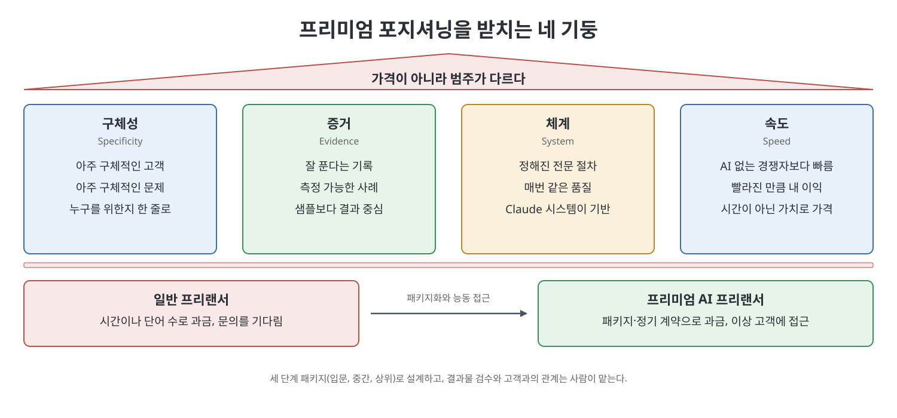

# 6장 Claude로 프리랜싱하기 (Freelancing with Claude: Building a Premium AI-Powered Practice)

이 장은 가장 많은 사람이 시작하는 길인 프리랜싱을 어떻게 "프리미엄 사업"으로 만드는가를 다룬다. 책은 프리랜싱이 진입장벽이 가장 낮고, 수익까지 가장 빠르고, 노력과 수입이 가장 직접 연결된다고 본다. 그래서 더 큰 무언가를 만들기 전의 임시 단계로 여기는 것이 오히려 실수라고 한다. 이 장은 5장의 모델 틀 위에서 서비스를 포장하고, 가격을 매기고, 고객을 꾸준히 확보하고, 추천이 이어지는 품질로 납품하는 실행법을 설명한다.

> **쉽게 말하면**
> 같은 일을 더 싸게 많이 하는 것이 아니라, 다른 종류의 사람이 되라는 이야기다. "글 써 드립니다"가 아니라 "이런 회사의 콘텐츠 체계를 만들어 드립니다"로 위치를 옮기는 것이다.

> **참고(노트 작성자)** 이 장의 시급, 월 수익, 가격, 시간은 책의 사례이며 노트가 검증하지 않았다. 수익과 시간은 책의 사례이고 결과는 개인과 시장에 따라 크게 다르다. 계약, 세금, 개인정보, 광고·표시 의무는 나라와 분야마다 달라 전문가 확인이 필요하다.

## 이 장의 흐름

1. 프리미엄 포지셔닝의 네 기둥
2. 서비스 패키지 설계
3. 고객을 체계적으로 확보하기
4. 사례: 시간제 컨설턴트의 전환
5. 납품 경험 설계와 흔한 실수

## 1. 프리미엄 포지셔닝

책은 프리미엄 가격을 "같은 서비스를 더 비싸게 파는 것"이 아니라 "다른 범주에 있는 것"이라고 정의한다. 큰 금액을 내는 고객은 싼 프리랜서와 같은 물건을 비싸게 사는 것이 아니라, 확실성, 깊이, 속도, 근본적으로 다른 품질을 산다는 설명이다. 내 일은 이 차이를 시장이 알아볼 수 있게 만드는 것이다. 이를 떠받치는 기둥이 네 개다.

| 기둥 | 시장에 보여 줄 것 | 약할 때 생기는 일 |
|------|-----------------|-----------------|
| 구체성(specificity) | 아주 구체적인 고객의 아주 구체적인 문제를 푼다 | "아무나 상대하는 사람"으로 보여 가격 협상력이 낮아짐 |
| 증거(evidence) | 잘 푼다는 기록과 측정 가능한 사례 | 포트폴리오 샘플만으로 비교됨 |
| 체계(system) | 구조화된 전문 절차 | 결과가 매번 달라 신뢰가 쌓이지 않음 |
| 속도(speed) | AI를 쓰지 않는 사람보다 빠른 납품 | 속도 우위가 가격에 반영되지 않음 |

책은 일반 프리랜서와 프리미엄 프리랜서를 여섯 가지 차원(설명 방식, 과금 방식, 고객 유형, 납품 시간, 품질 신호, 영업 방식)으로 대비한다. 요지는 이렇다. 일반 프리랜서는 시간이나 단어 수로 팔고 들어오는 문의에 응답하지만, 프리미엄 프리랜서는 정의된 결과물의 패키지나 정기 계약으로 팔고, 특정 이상 고객을 향해 능동적으로 접근한다. 책의 예로 "기업을 위해 글을 씁니다"는 일반 쪽, 대량 발행이 필요하지만 팀을 늘리고 싶지 않은 B2B SaaS 기업의 콘텐츠 체계를 만듭니다는 프리미엄 쪽 소개문이다.



## 2. 서비스 패키지 설계

책은 패키지 설계를 가장 효과가 큰 사업 결정 중 하나로 꼽는다. 잘 만든 패키지는 가치를 분명히 전하고, 내가 늘 넘길 수 있는 기대를 설정하고, 영업 대화를 단순하게 하고, 그 결과물에 최적화된 시스템을 만들게 하고, 시간이 아니라 가치로 가격을 매기게 해 준다.

권장 구조는 세 단계다. 입문 단계는 접근하기 쉽고 내 품질을 보여 준다. 중간 단계는 대부분의 고객이 선택하며 내 가장 강한 Claude 시스템이 일하는 곳이다. 상위 단계는 더 넓은 범위, 더 빠른 납품, 더 깊은 전략이 필요한 고객을 위한 것이다.

책은 이를 위한 프롬프트도 준다. 담아야 할 요소는 내 전문 분야와 이상 고객, 주요 결과물, AI가 맡는 부분, 패키지별 이름·구체적 결과물·납품 기간·가격 범위·윗단계로 올릴 이유·이상 고객 장면, 그리고 내가 쓸 수 있는 시간과 포지셔닝 한두 문장이다. 새 예시는 이렇다.

```
나는 중소 병원 마케팅을 돕는 프리랜서다.
주요 결과물은 월간 블로그 콘텐츠이고 초안은 AI가 쓴다.
세 단계 패키지를 만들어라. 각 단계마다 이름(두세 단어),
구체적 결과물, 납품 기간, 윗단계로 올릴 만한 이유,
어울리는 고객 상황을 적어라.
프로젝트당 가능한 시간: [시간]
```

## 3. 고객을 체계적으로 확보하기

책은 고객 확보를 서비스 사업에서 가장 중요한 기술이라고 보며, 꾸준히 버는 사람은 추천과 문의를 기다리는 사람이 아니라 반복 가능한 기회 생성 절차를 가진 사람이라고 한다. 채널은 성격에 따라 세 갈래로 묶어 볼 수 있다.

| 성격 | 채널 | 책이 말하는 특징 |
|------|------|----------------|
| 빠른 채널 | 직접 접근(콜드 아웃리치), 프리랜서 플랫폼, 추천 네트워크 | 몇 주 안에 첫 결과가 나오고, 추천은 질이 매우 높지만 규모에는 한계 |
| 쌓이는 채널 | 링크드인 콘텐츠, 콘텐츠와 검색 최적화(SEO) | 몇 달이 걸리지만 시간이 지날수록 누적되어 확장성이 큼 |
| 관계 채널 | 강연, 워크숍 | 시간이 걸리고 준비가 필요하지만 리드의 질이 매우 높음 |

직접 접근은 잘하면 첫 수익까지 가장 빠른 길이고, 못하면 시간 낭비다. 차이는 구체성과 관련성에서 난다. 잘 되는 메시지에는 세 특징이 있다. 받는 사람에게 맞춘 내용일 것(이름만 바꾼 템플릿이 아님), 그 사람의 사업에 대한 관련 관찰이 들어 있어 실제로 살펴봤음을 보여 줄 것, 판매 제안이 아니라 한 가지의 작고 가벼운 요청을 할 것.

책의 아웃리치 프롬프트는 제안 서비스, 받는 사람 정보, 내가 본 상황 관찰을 넣고, 관찰로 시작하고, 서비스를 상대 상황에 한 문장으로 연결하고, 작은 요청 하나를 하고, 120단어 이하로 사람이 쓴 듯하게 쓰라고 지시하는 구성이다. 노트의 예시는 다음과 같다.

```
당신은 B2B 영업 문장에 능한 작가다.
받는 사람: [이름, 회사, 직책]
내가 아는 것: [붙여넣기]
내가 본 점: [그 회사의 필요에 대한 관찰]
관찰로 문장을 시작하고, 내 서비스를 그 상황에 한 문장으로 잇고,
15분 통화나 질문 하나 같은 작은 요청만 하라. 120단어 이하.
```

## 4. 사례: 시간제 컨설턴트의 전환

책은 마케팅 전략 컨설턴트 Jordan의 사례를 소개한다. 시간당 과금으로 여러 소규모 고객을 상대하며 주 40시간가량 일했고, 수입은 안정적이었지만 상한이 있었다. 그는 약 3주 동안 두 가지 Claude 시스템(브랜드 전략 개발, 경쟁 포지셔닝 감사)을 중심으로 사업을 다시 짰다. 그리고 가격을 크게 올린 세 가지 상품으로 재포장했다. 브랜드 기초 패키지, 경쟁 포지셔닝 감사, 월 정기 전략 계약이다. 책에 따르면 이 구조에서 정기 고객 두 곳과 프로젝트 고객 두세 곳이면 월 목표 수입에 도달하고, 주당 근무는 줄며, 6개월 뒤 월 수익이 크게 늘었다고 한다. 구체적 금액은 책의 예이므로 생략한다.

노트가 보기에 이 사례의 핵심은 금액이 아니라 변화의 구조다.

| 항목 | 전환 전 | 전환 후 |
|------|--------|--------|
| 가격 방식 | 시간당 | 패키지와 월 정기 계약 |
| 일의 기반 | 내 시간 | 시스템 |
| 스트레스 원인 | 물량 | 시스템 품질 |
| 성장 모양 | 평평함 | 누적됨 |

## 5. 납품 경험 설계와 흔한 실수

책은 고객을 얻는 것보다 유지하고 추천을 받는 것이 진짜 사업이라고 본다. 결과물만이 아니라 고객 경험을 설계하라는 것이다. 습관 네 가지를 든다. 절차를 미리 설명해 신뢰를 주고, 가능하면 기한보다 일찍 내고, 결과물에 한 장짜리 설명을 붙여 무엇을 왜 했는지 알리고, 막연한 "필요하면 말씀하세요" 대신 구체적인 질문 하나로 피드백을 받는다.

책이 꼽는 실수는 네 가지다.

- **AI 사용을 부정적으로 비치게 공개하는 것.** 책은 "AI를 쓴다"가 아니라 "시스템 기반 서비스를 제공한다"고 표현하고 역량 향상으로 설명하라고 조언한다. 노트 작성자는 여기에 덧붙인다. 이는 표현 방식의 조언이지, 고객에게 AI 사용을 숨기거나 오해하게 하라는 뜻으로 읽으면 안 된다. 계약서의 고지 조항, 고객사의 AI 사용 정책, 광고·표시 규정은 전문가 확인이 필요하고, 윤리 기준은 5부 22장에서 다룬다.
- AI 도입 후에도 시간당 과금을 유지하는 것. 효율 향상이 내 이익이므로 가치 기반이나 패키지 가격으로 바꿔야 한다.
- 품질 검수에 투자하지 않는 것. AI 초안은 출발점이고 고객은 완성된 일에 돈을 낸다. 검수 단계에서 전문성이 드러난다.
- 고객 관계를 소홀히 하는 것. AI가 생산을 맡아도 관계는 전적으로 사람의 일이므로 고객 사업을 깊이 알아야 한다.

장 끝 체크리스트는 프리미엄 포지셔닝 두 문장 작성, 구체적 결과물과 가격이 있는 패키지 세 개 설계, 핵심 결과물용 Claude 시스템 구축, 이상 고객 스무 곳 목록과 체계적 아웃리치 시작, 결과물이 아닌 납품 과정 전체 설계다.

## 핵심 정리

- 책은 프리랜싱을 임시 단계가 아니라 잘 설계하면 고소득 사업이 되는 본업으로 본다.
- 프리미엄은 같은 일을 비싸게 파는 것이 아니라 구체성, 증거, 체계, 속도로 다른 범주에 서는 것이다.
- 서비스는 입문, 중간, 상위 세 단계 패키지로 설계하고 시간이 아니라 가치로 가격을 매긴다.
- 고객 확보는 빠른 채널과 쌓이는 채널을 섞은 반복 가능한 절차로 하고, 아웃리치 메시지는 구체적이고 가볍게 쓴다.
- AI 초안의 검수, 고객 경험 설계, 고객과의 인간적 관계가 품질과 추천을 만든다. AI 사용 고지는 계약과 규정에 맞춰야 한다.

<br>
<br>
<br>

이전: [5장 AI 비즈니스 모델 전체 분석](05%EC%9E%A5%20AI%20%EB%B9%84%EC%A6%88%EB%8B%88%EC%8A%A4%20%EB%AA%A8%EB%8D%B8%20%EC%A0%84%EC%B2%B4%20%EB%B6%84%EC%84%9D.md) | 다음: [7장 콘텐츠 엔진](07%EC%9E%A5%20%EC%BD%98%ED%85%90%EC%B8%A0%20%EC%97%94%EC%A7%84.md)

<br>

[Claude AI Automation and Monetization](../)
