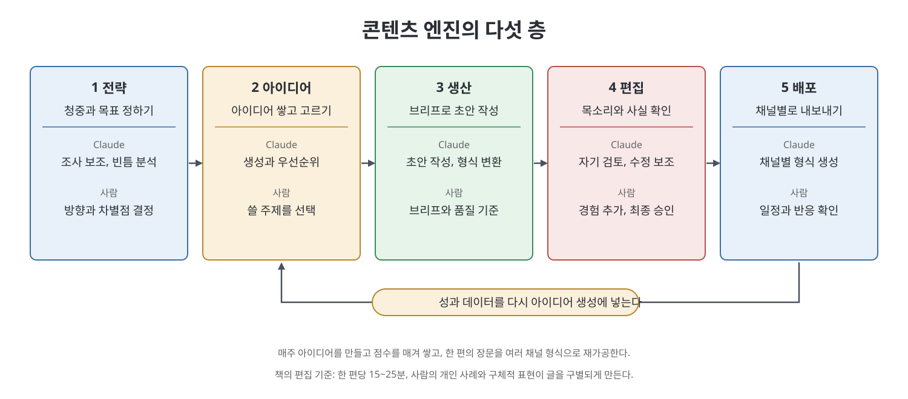

# 7장 콘텐츠 엔진 (Content Engines: Building Sustainable AI-Powered Content Systems)

이 장은 AI 시대에 콘텐츠로 돈을 벌려면 무엇을 바꿔야 하는지를 다룬다. 책의 진단은 이렇다. AI가 와도 판단과 전략이 덜 필요해진 것이 아니다. 누구나 더 많이 만들 수 있어 물량 면에서는 경쟁이 심해졌고, 독자는 어느 때보다 많은 글을 접하므로 질 면에서는 요구가 높아졌다. 이긴 사람은 가장 많이 만든 사람이 아니라, 배포 채널이 필요로 하는 분량만큼 일정한 품질로 청중에 맞는 콘텐츠를 만드는 체계를 가진 사람이다. 이 장은 그 체계를 다섯 층으로 설명한다.

> **쉽게 말하면**
> 글을 한 편씩 쓰는 것이 아니라 공장 라인을 만드는 이야기다. 아이디어를 쌓아 두는 창고, 초안을 뽑는 기계, 사람의 손질 단계, 여러 채널로 나가는 출구가 이어져 있다.

> **참고(노트 작성자)** 이 장의 구독자 수, 수익, 제작 시간은 책의 한 사례이며 노트가 검증하지 않았다. 수익과 시간은 책의 사례이고 결과는 개인과 시장에 따라 크게 다르다. 광고·후원 표시, 저작권, 개인정보는 나라마다 달라 전문가 확인이 필요하다.

## 이 장의 흐름

1. 콘텐츠 엔진의 다섯 층 구조
2. 1층 전략과 2층 아이디어 플라이휠
3. 3층 생산 시스템과 브리프
4. 4층 편집 과정
5. 5층 다채널 배포와 재가공
6. 사례: 뉴스레터 한 편에서 여러 수입원으로

## 1. 다섯 층 구조

책은 콘텐츠 엔진을 다섯 층으로 나누고, 층마다 Claude의 역할을 정한다. 아래 표는 층 사이의 사람과 Claude의 분업이라는 관점으로 다시 정리했다.

| 층 | 목적 | Claude가 하는 일 | 사람이 쥘 것 |
|----|------|-----------------|-------------|
| 1 전략 | 청중, 주제, 포지셔닝, 목표 정하기 | 조사 보조, 빈틈 분석 | 방향과 차별점의 결정 |
| 2 아이디어 | 아이디어를 계속 만들고 고르기 | 아이디어 생성, 우선순위 분석 | 무엇을 쓸지 선택 |
| 3 생산 | 대량의 초안 작성 | 주 작성자, 형식 변환 | 브리프와 품질 기준 |
| 4 편집 | 목소리 입히기, 사실 확인, 마무리 | 자기 검토, 수정 보조 | 경험, 판단, 최종 승인 |
| 5 배포 | 채널별로 바꿔 내보내기 | 채널별 형식 생성 | 발행 일정과 반응 확인 |



## 2. 1층 전략과 2층 아이디어 플라이휠

콘텐츠 전략 문서는 엔진에서 가장 중요한 입력이다. 이것이 없으면 모든 글이 즉흥적 창작 결정이 되고, 있으면 모든 글이 계획에 대한 실행이 된다. 책의 전략 프롬프트가 요구하는 것은 사업 또는 창작자 소개, 주 청중, 목표(트래픽, 리드, 매출, 권위 중 무엇인지), 발행 가능 분량, 현재 상태다. 산출물은 독자 페르소나, 콘텐츠 기둥 다섯 개와 이유, 기둥별 주제 열 개, 채널별 발행 빈도, 차별화 전략, 첫 90일 동안 볼 지표 세 가지다.

2층의 핵심 비유는 "작가의 벽은 창의성 문제가 아니라 재고 문제"라는 것이다. 쌓아 둔 목록이 없으니 쓸 때마다 빈 상태에서 시작한다는 뜻이다. 책이 제시하는 아이디어 플라이휠(Idea Flywheel, 돌릴수록 힘이 붙는 바퀴)은 매주 되풀이하는 다섯 단계다.

1. 매주 월요일, 콘텐츠 기둥에 걸쳐 주제 서른 개를 생성한다.
2. 청중 관련성, 차별화 가능성, 내가 더할 고유한 통찰을 기준으로 1~3점을 매긴다.
3. 3점짜리는 모두 백로그(쌓아 둔 목록)에 넣는다.
4. 매월 말, 백로그 중 발행했다면 가장 성과가 좋았을 주제와 이유를 살핀다.
5. 성과 데이터를 생성 프롬프트에 다시 넣어 다듬는다.

책의 플라이휠 프롬프트는 기둥별로 같은 수의 아이디어를 요구하고, 논쟁적 관점, 방법론, 사례, 데이터, 의견처럼 유형을 다양하게 섞으며, 다른 수십 곳이 똑같이 다루는 평범한 주제는 피하라고 지시한다. 간단한 예시를 직접 쓰면 다음과 같다.

```
당신은 [분야] 뉴스레터의 콘텐츠 전략가다.
청중: [설명]  기둥: [다섯 개]
이번 주 아이디어 30개를 기둥별 6개씩 내라.
각각 가제목, 소속 기둥, 한 줄 차별 각도, 추천 형식을 적고
논쟁적 관점과 사례형을 섞어라. 흔한 주제는 빼라.
```

## 3. 3층 생산 시스템

생산 시스템은 엔진의 핵심이다. 백로그의 아이디어를 받아 "완전히 다시 쓸" 필요 없이 편집 손질만 하면 되는 초안을 만든다. 책은 세 가지가 필요하다고 한다. 강한 브리프(brief, 글의 작업 지시서) 템플릿, 잘 조정된 생산 프롬프트, 명확한 품질 최저선이다. 브리프에 넣을 요소는 일곱 가지다.

| 브리프 요소 | 적을 내용 | 초안에 미치는 영향 |
|------------|----------|------------------|
| 주제와 각도 | 다룰 주제와 나만의 시각 | 관련성과 차별성 |
| 목표 키워드 | 검색 최적화를 한다면 주 키워드와 보조 키워드 | 검색 노출과 의미 초점 |
| 독자 맥락 | 누가 읽고 무엇을 이미 아는가 | 깊이, 어휘, 전제 지식 |
| 핵심 주장 | 읽고 나서 믿게 할 단 하나 | 글의 중심선 |
| 핵심 포인트 | 반드시 다룰 서너 개 | 평범한 일반론 방지 |
| 어조 | 말투 설명과 브랜드 목소리 지침 | 일반적 AI 문체 방지 |
| 형식 | 구조, 소제목, 길이, 특수 요소 | 재편집량 최소화 |

## 4. 4층 편집 과정

편집층에서 내 목소리, 전문성, 판단이 들어간다. 책은 이것을 품질을 챙기려면 선택이 아닌 단계로 본다. AI 초안은 좋은 출발점이지 완성품이 아니고, 편집이 평범한 글을 눈에 띄는 글로 바꾼다. 구조화된 편집은 편당 15~25분이며 순서는 다음과 같다.

1. 한 번 빠르게 읽어 구조와 주장을 파악한다.
2. 나만 아는 개인적 사례, 이야기, 관찰을 한두 개 넣는다.
3. 도입을 강화한다. 대부분의 AI 도입부는 평범하므로 첫 문단을 구체적이고 끌리는 것으로 바꾼다.
4. 형용사를 점검한다. 중요한, 훌륭한 같은 막연한 말은 구체적인 말로 바꾸거나 지운다.
5. 결론을 날카롭게 한다. 요약 대신 통찰, 도전, 구체적 행동 촉구로 끝낸다.
6. 마지막으로 흐름과 어색한 표현을 한 번 읽는다.

노트 작성자는 여기에 한 줄을 더한다. 사실 확인은 4층에서 사람이 해야 하며, 통계와 인용은 출처로 직접 대조해야 한다. 이 부분은 책의 층 정의(사실 확인)와 일치한다.

## 5. 5층 다채널 배포

책은 재가공 체계가 있으면 콘텐츠 한 편이 다섯에서 일곱 개의 "배포 생명"을 가진다고 말한다. 주 콘텐츠(보통 장문 기사나 뉴스레터)가 여러 채널용 형식의 원료가 된다. 재가공의 흐름은 아래처럼 정리된다.

| 원본에서 | 만들 수 있는 형식 | 채널 |
|----------|-----------------|------|
| 장문 기사 | 짧게 줄인 뉴스레터 | 이메일 |
| 장문 기사 | 연속 게시글(스레드) | X(트위터) |
| 장문 기사 | 중간 길이 칼럼 | 링크드인 |
| 장문 기사 | 짧은 영상 대본 | 유튜브, 인스타그램 |
| 장문 기사 | 카드뉴스 문구 | 링크드인, 인스타그램 |
| 장문 기사 | 팟캐스트 말할 거리 | 팟캐스트 |

책은 형식마다 Claude를 쓰면 5~12분 정도가 걸린다고 소개한다(책의 수치).

## 6. 사례: 뉴스레터 한 편에서 여러 수입원으로

책은 독립 컨설턴트를 위한 뉴스레터를 운영하던 Sam의 사례를 든다. 2년 동안 구독자 3천여 명을 모았지만 한 호 제작에 6~8시간이 걸려 격주 발행이 한계였고, 주간으로 바꾸려다 두 번 실패했다. 그녀는 다섯 층 모델로 엔진을 다시 짰다. 전략 문서로 네 개의 기둥과 "주관이 뚜렷하고, 데이터에 근거하고, 평범하지 않다"는 목소리를 정했다. 아이디어 시스템이 주 30개를 내면 그중 두 개를 고르고, 생산 시스템이 초안을 약 25분에 만들고, 편집에 40분, 배포 변환에 15분이 들었다. 합계는 한 호 80분, 그래서 주간 발행이 가능해졌다고 한다. 책에 따르면 1년 뒤 구독자는 약 세 배가 되었고, 수입은 뉴스레터 후원, 디지털 템플릿 묶음, 월 그룹 코칭의 세 갈래에서 나와 월 수천 달러 규모가 되었다(책의 예이며 금액은 생략한다).

노트가 읽는 교훈은 두 가지다. 첫째, 시간을 줄인 것은 도구 하나가 아니라 다섯 층의 연결이었다. 둘째, 수입이 한 곳에서가 아니라 청중에서 여러 갈래로 나왔고, 이는 5장이 설명한 청중 소유형 수입의 모양과 같다.

장 끝 체크리스트는 전략 문서 작성, 아이디어 플라이휠 시간 확보, 일곱 요소 브리프 템플릿 제작, 과거 아이디어 세 개로 생산 프롬프트 시험, 주요 두 채널의 재가공 템플릿 제작, 현실적인 발행 빈도를 정해 90일 지키기다.

## 핵심 정리

- 책은 AI 시대의 콘텐츠 승부를 물량이 아니라 일정한 품질을 내는 체계로 본다.
- 엔진은 전략, 아이디어, 생산, 편집, 배포의 다섯 층이고, 층마다 Claude의 역할과 사람의 몫이 나뉜다.
- 작가의 벽은 재고 문제이므로 매주 아이디어를 만들고 점수를 매겨 백로그를 쌓고, 성과 데이터를 다시 넣는다.
- 좋은 초안은 일곱 요소 브리프에서 나오고, 편집층에서 사람의 경험과 구체성이 글을 구별되게 만든다.
- 한 편의 장문 콘텐츠를 여러 채널 형식으로 재가공하면 같은 노력으로 도달 범위가 넓어진다.

<br>
<br>
<br>

이전: [6장 Claude로 프리랜싱하기](06%EC%9E%A5%20Claude%EB%A1%9C%20%ED%94%84%EB%A6%AC%EB%9E%9C%EC%8B%B1%ED%95%98%EA%B8%B0.md) | 다음: [8장 Claude와 자동화 도구 연결](08%EC%9E%A5%20Claude%EC%99%80%20%EC%9E%90%EB%8F%99%ED%99%94%20%EB%8F%84%EA%B5%AC%20%EC%97%B0%EA%B2%B0.md)

<br>

[Claude AI Automation and Monetization](../)
