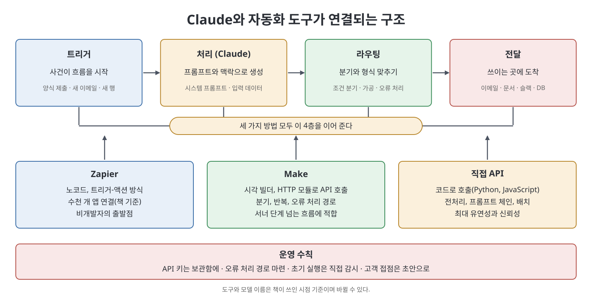
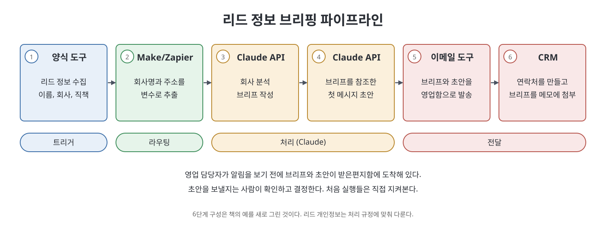

# 8장 Claude와 자동화 도구 연결 (Claude + Automation Tools: Building Integrated Systems)

이 장은 Claude를 혼자 쓰는 도구에서 다른 도구와 이어진 시스템으로 바꾸는 방법을 다룬다. 책은 Claude 혼자도 강력하지만 다른 도구와 연결되면 변혁적이라고 한다. 외부 사건을 신호로 받고, 결과를 다음 앱으로 넘기고, 자동화된 워크플로 안에서 돌게 되면 "똑똑한 도구를 쓰는 사람"에서 "자율적으로 움직이는 사업 시스템을 운영하는 사람"으로 넘어간다는 것이다. 이 장은 Zapier, Make(옛 Integromat), 직접 API 접근이라는 세 가지 연결 방법과 운영에서 믿을 수 있게 만드는 고려 사항을 설명한다.

> **쉽게 말하면**
> Claude는 요리사이고, 자동화 도구는 주문서가 들어오는 창구와 음식을 나르는 배달 라인이다. 주문이 오면 저절로 요리하고 저절로 배달되게 만드는 것이 이 장이다.

> **참고(노트 작성자)** 이 장에 나오는 도구 이름, 연동 기능, 모델 이름, 요금과 지원 범위는 책이 쓰인 시점 기준이며 바뀔 수 있다. 시간과 수익 관련 서술은 책의 주장이며 결과는 개인과 상황에 따라 다르다. 고객·리드 정보를 외부 도구에 보낼 때는 개인정보 처리 규정을 따라야 하므로 전문가 확인이 필요하다.

## 이 장의 흐름

1. 연결 시스템의 4층 구조
2. 연결 방법 1: Zapier
3. 연결 방법 2: Make
4. 연결 방법 3: 직접 API
5. 사례: 리드 정보 브리핑 파이프라인
6. 연결에서 흔한 실수

## 1. 4층 통합 구조

책은 모든 자동화 시스템이 네 층으로 나뉜다고 본다. 이 구분은 어떤 도구를 고르든 공통이므로 시스템을 설계할 때 가장 먼저 그려 볼 틀이다.

| 층 | 하는 일 | 예 |
|----|--------|----|
| 트리거(trigger) | 워크플로를 시작시키는 사건 | 양식 제출, 새 이메일, 일정 사건, 시트에 새 행 |
| 처리 | Claude가 시스템 프롬프트와 주입된 맥락으로 핵심 결과를 만듦 | Claude API와 프롬프트 |
| 라우팅(routing) | 조건에 따라 결과의 갈 곳을 정하고, 형식을 맞추고, 오류를 다룸 | 조건 분기, 데이터 가공 |
| 전달 | 결과가 쓰일 곳에 도착시킴 | 이메일 발송, 문서 생성, 슬랙 메시지, 데이터베이스 행 |



## 2. 연결 방법 1: Zapier

Zapier는 가장 접근하기 쉬운 노코드(코드 없이 만드는) 자동화 플랫폼으로, 개발자가 아닌 대부분의 사람에게 알맞은 출발점이라고 책은 본다. 트리거-액션 방식으로 6천 개 넘는 앱을 잇고, Claude는 Zapier의 AI 액션으로 기본 연동된다(책이 쓰인 시점 기준).

첫 워크플로(Zap)를 만드는 순서는 다섯 단계다. 먼저 새 Zap을 만들고 트리거를 정한다(예: Typeform에 새 응답). 다음으로 Claude 액션을 추가해 모델을 고르고 프롬프트를 쓰며, 트리거에서 온 데이터를 변수로 끼워 넣는다. 그다음 Claude 출력을 도착지로 보내는 액션을 더한다(예: 구글 문서 생성, 지메일 발송, 시트에 행 추가). 이어서 실제 입력으로 시험하고 결과 품질을 확인한다. 마지막으로 켠 뒤 처음 열 번의 실행은 직접 지켜본 다음 무인 운영에 맡긴다.

책은 가치 높은 Zapier와 Claude 워크플로 여섯 가지를 소개한다. 이 노트는 "트리거, Claude의 일, 도착지"를 이어 읽는 방식으로 정리한다.

| 워크플로 | 흐름 |
|---------|------|
| 리드 정보 브리핑 | 고객관리(CRM)에 새 연락처가 생기면 → 회사를 조사해 요약 → CRM 메모나 슬랙으로 알림 |
| 신규 고객 환영 | 프로젝트 관리 도구에 고객이 추가되면 → 맞춤 온보딩 이메일 작성 → 지메일로 즉시 발송 |
| 지원 티켓 초안 | 새 문의가 생기면 → 내용에 맞는 첫 답변 초안 → 헬프데스크에 초안으로 저장 |
| 콘텐츠 브리프 생성 | 시트에서 키워드가 승인되면 → 그 키워드용 브리프 작성 → 지정 폴더에 문서 생성 |
| 회의 후속 | 일정이 끝나면 → 회의 메모로 요약 작성 → 참석자에게 이메일 |
| 리뷰 답변 초안 | 새 리뷰가 달리면 → 알맞은 답변 초안 → 리뷰 관리 도구에 초안으로 저장 |

여기서 눈여겨볼 점은 지원 티켓과 리뷰 답변이 "발송"이 아니라 "초안"으로 끝난다는 것이다. 고객과 직접 닿는 글은 사람이 확인하는 단계를 두는 설계라고 노트는 읽는다.

## 3. 연결 방법 2: Make

Make는 Zapier보다 훨씬 유연하며, 조건 논리, 데이터 변환, 반복, 오류 처리가 있는 복합 다단계 워크플로에 강하다. 책은 단계가 서너 개를 넘으면 대개 Make가 낫다고 본다. 시각적 워크플로 빌더에서 각 모듈이 한 단계를 나타내고, Claude는 Anthropic API를 직접 부르는 HTTP 모듈로 쓴다.

Zapier 대비 Make의 장점은 네 가지로 소개된다.

- Claude 출력을 다음 단계로 넘기기 전에 모양을 바꾸는 데이터 변환 기능
- 목록을 돌면서 항목마다 따로 Claude 프롬프트를 적용하는 반복(array iteration)
- Claude가 예상 밖의 출력을 냈을 때 갈 길을 정하는 오류 처리 경로
- 배치 처리에 쓰는 더 세밀한 실행 일정 설정

HTTP 모듈 설정에 필요한 것은 API 주소, POST 방식, 헤더 세 개(API 키, API 버전, 콘텐츠 형식), JSON 본문(모델 이름, 최대 토큰 수, 시스템 프롬프트, 사용자 메시지)이다. 응답에서는 본문 텍스트가 든 칸을 골라 다음 모듈에 넘긴다. 책은 API 키를 Make의 보관함(Vault)에 넣으라고 거듭 강조한다. 모델 이름은 책이 쓰인 시점의 것이므로 지금 사용 가능한 이름으로 바꿔야 한다.

## 4. 연결 방법 3: 직접 API

유연성, 신뢰성, 비용 효율이 가장 중요하면 코드로 직접 API를 부르는 방법이 맞는다고 책은 말한다. Python이나 JavaScript(Node.js) 같은 언어의 기초가 필요하지만, 노코드 도구로는 불가능한 일이 가능해진다. 복잡한 입력 전처리, 조건 논리가 있는 다단계 프롬프트 체인, 대규모 배치 처리, 맞춤 출력 파싱과 라우팅, API가 있는 모든 데이터원과의 연결이다.

책의 Python 패턴은 시스템 프롬프트와 사용자 입력을 받아 Claude의 답 텍스트를 돌려주는 재사용 함수 하나를 만들고, 앞 단계의 출력을 다음 단계의 입력으로 넣어 3단계 파이프라인을 잇는 형태다. 함수 주변에는 오류 처리, 로그, 재시도를 덧붙이라는 설명이 붙는다. 노트가 새로 쓴 개념 예시는 다음과 같다.

```python
def ask(system, text, retries=3):
    for _ in range(retries):
        try:
            return call_claude(model=MODEL_NAME, system=system, user=text)
        except TemporaryError:
            wait_a_bit()
    raise RuntimeError("재시도 실패")

draft = ask(STEP1_PROMPT, raw)
checked = ask(STEP2_PROMPT, draft)
```

여기서 `call_claude`, `MODEL_NAME`, `TemporaryError`는 설명을 위한 자리 표시이며, 실제 코드는 사용하는 SDK 문서를 따라야 한다.

## 5. 사례: 리드 정보 브리핑 파이프라인

책은 개념을 구체화하기 위해 완성된 시스템 하나를 걷는다. 새 리드가 내 서비스에 관심이 있다고 양식을 제출하면, 시스템이 자동으로 그 회사를 조사하고, 관련 문제를 짚고, 맞춤 첫 접촉 메시지를 만들어, 내가 알림을 보기도 전에 영업 받은편지함에 브리프와 초안을 넣어 두는 것이다.



| 단계 | 도구 | 하는 일 |
|------|------|--------|
| 1 | 양식 도구(Typeform 등) | 이름, 회사, 직책, 맥락을 구조화된 기록으로 수집 |
| 2 | Make 또는 Zapier | 기록에서 회사명과 웹사이트를 변수로 추출 |
| 3 | Claude API | 가진 정보로 회사 분석 브리프 작성 |
| 4 | Claude API | 브리프를 참조한 맞춤 첫 접촉 초안 작성 |
| 5 | 이메일 도구 | 브리프와 초안을 영업 받은편지함으로 발송 |
| 6 | CRM(HubSpot, Pipedrive 등) | 연락처를 만들고 브리프를 메모에 첨부 |

이 구조는 앞 절의 4층에 그대로 대응한다. 1번은 트리거, 2번은 라우팅의 준비, 3~4번은 처리, 5~6번은 전달이다. 4장에서 다룬 프로덕션 워크플로 설계 원칙, 곧 단계 분리와 실패 대비가 여기서도 적용된다.

## 6. 연결에서 흔한 실수

- **API 키를 프롬프트 칸이나 눈에 보이는 설정에 넣는 것.** 키 노출은 심각한 보안 문제다. 보관함이나 환경 변수를 써야 한다.
- **오류 처리 없이 만드는 것.** Claude가 예상 밖 출력을 내면 뒤쪽 시스템이 깨진다. 실패를 항상 계획한다.
- **처음 서른 번의 실행을 감시하지 않는 것.** 자동화는 설정 뒤 무인이지만, 현실의 변이를 처리하는지 확인하기 전에는 믿으면 안 된다. 책은 Zapier 안내에서는 열 번, 실수 목록에서는 서른 번을 말한다.
- **첫 버전을 지나치게 복잡하게 만드는 것.** 가치를 내는 가장 단순한 연결을 만들고 철저히 시험한 뒤 복잡도를 더한다.

장 끝 체크리스트는 기술 편안함과 워크플로 복잡도로 플랫폼 고르기, 부분 또는 전체 자동화가 가능한 워크플로 하나 찾기, 대표 입력 다섯 개로 시험한 뒤 활성화, 처음 서른 번 실행 모니터링 설정, 나와 다른 사람이 유지할 수 있게 연결 구조 문서화다.

## 핵심 정리

- 연결 시스템은 트리거, 처리(Claude), 라우팅, 전달의 4층으로 설계한다.
- Zapier는 비개발자의 출발점, Make는 조건과 반복이 있는 복합 흐름, 직접 API는 최대 유연성과 대규모 처리에 맞는다고 책은 본다.
- 고객과 직접 닿는 결과는 발송이 아니라 초안으로 끝내 사람이 확인하게 하는 설계가 안전하다.
- API 키는 보관함에 두고, 오류 처리를 만들고, 초기 실행을 직접 감시한다.
- 가장 단순한 첫 버전으로 시작해 시험한 뒤 키운다. 도구와 모델 이름은 책 시점 기준이니 최신 문서로 확인한다.

<br>
<br>
<br>

이전: [7장 콘텐츠 엔진](07%EC%9E%A5%20%EC%BD%98%ED%85%90%EC%B8%A0%20%EC%97%94%EC%A7%84.md) | 다음: [9장 AI 에이전시](../03.%203%EB%B6%80%20%EC%82%AC%EC%97%85%20%ED%82%A4%EC%9A%B0%EA%B8%B0/09%EC%9E%A5%20AI%20%EC%97%90%EC%9D%B4%EC%A0%84%EC%8B%9C.md)

<br>

[Claude AI Automation and Monetization](../)
