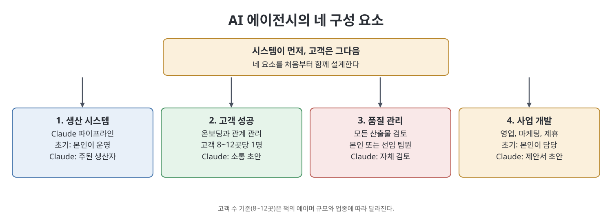
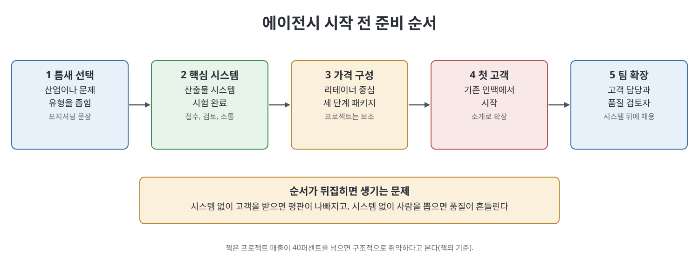

# 9장 AI 에이전시 (Building AI Agencies: From Solo Operator to Scalable Business)

이 장은 혼자 일하던 프리랜서가 에이전시(agency, 여러 고객에게 서비스를 납품하는 사업체)로 넘어가는 길을 다룬다. 전통적인 에이전시는 사람을 뽑고 가르쳐서 처리량을 늘리지만, 책이 말하는 AI 에이전시는 Claude 기반 시스템이 생산량을 맡고 사람은 고객 관리, 품질 감독, 영업에 집중한다. 책은 이 구조를 적은 자본으로 시작할 수 있는 서비스 사업 가운데 상한선이 가장 높은 형태라고 소개하며, 포지셔닝부터 운영 체계와 성장 전략까지 차례로 설명한다.

> **쉽게 말하면**
> 에이전시는 "내가 더 많이 일하는 것"이 아니라 "일하는 시스템과 그것을 지켜보는 소수의 사람"을 파는 사업이다. 시스템이 먼저 만들어져 있어야 고객을 받을 수 있다.

> **참고(노트 작성자)** 이 장의 월 수익, 고객 수, 소요 기간, 인력 규모는 책이 소개하는 사례와 주장이며 노트가 검증하지 않았다. 결과는 개인의 역량과 시장에 따라 크게 다르다. 수익을 보장하는 내용이 아니다.

## 이 장의 흐름

1. 에이전시를 이루는 네 가지 구성 요소
2. 1단계: 틈새시장 고르기
3. 2단계: 핵심 시스템 갖추기
4. 3단계: 가격 책정과 패키지 구성
5. 4단계: 팀 구조와 위임
6. 사례와 흔한 실수

## 1. 에이전시의 네 가지 구성 요소

책은 어떤 전문 분야의 AI 에이전시든 네 요소로 돌아간다고 본다. 성장하면서 뒤늦게 발견하지 말고 처음부터 의도적으로 설계하라는 조언이다.

| 구성 요소 | 하는 일 | 초기 담당 | Claude의 몫 |
|-----------|--------|----------|-------------|
| 생산 시스템 | 고객 산출물을 만드는 Claude 파이프라인 | 본인, 이후 AI와 가벼운 감독 | 주된 생산자 |
| 고객 성공 | 온보딩, 소통, 관계 관리 | 본인, 이후 전담 인력 | 소통 초안 보조 |
| 품질 관리 | 모든 산출물의 검토와 승인 | 본인 또는 선임 팀원 | 자체 검토와 수정안 |
| 사업 개발 | 영업, 마케팅, 제휴 | 본인, 이후 전담 | 아웃리치와 제안서 초안 |

책은 고객 성공 담당 한 명이 고객 여덟 곳에서 열두 곳 정도를 맡을 수 있다고 가정한다(책의 예).

## 2. 틈새시장 고르기

책은 빠르게 크는 AI 에이전시는 만능형이 아니라 특정 산업이나 특정 문제 유형에 집중한 곳이라고 말한다. 전문화하면 더 깊은 Claude 시스템을 만들 수 있고, 포지셔닝이 선명해지며, 대체하기 어려운 전문성 덕분에 더 높은 단가를 받을 수 있다는 논리다.

책이 소개하는 분야는 여섯 가지다. 각각 핵심 서비스와 주 고객층이 짝지어져 있다.

| 틈새 | 핵심 서비스 | 주 고객 |
|------|------------|--------|
| 콘텐츠 인텔리전스 | AI 기반 콘텐츠 전략과 제작 | 성장 단계 SaaS 기업 |
| 리서치·인텔리전스 | 시장과 경쟁 동향 브리프 | 사모펀드, 전략 컨설팅사 |
| AI 자동화 | 업무 워크플로 구축 | 중견 서비스 기업 |
| 이커머스 카피 | 상품 설명, 이메일 시퀀스, 광고 문구 | 자사몰 브랜드, 마켓 셀러 |
| 채용 인텔리전스 | 채용 공고, 후보자 요약, 아웃리치 | 채용 대행사, 인사팀 |
| 법률 문서 | 계약 요약, 리서치 브리프 | 로펌, 기업 법무팀 |

책은 분야마다 월 리테이너(retainer, 매달 정액을 받는 계약) 가격대도 제시하지만, 이 노트는 구체 금액을 옮기지 않는다. 책의 가격대는 대체로 분야 간 서너 배 차이가 나는 폭으로 제시되며, 전문성이 높고 실수 비용이 큰 분야일수록 높다. 법률이나 규제 관련 문서를 다루는 분야는 책임 문제가 따르므로 전문가 확인이 필요하다.

## 3. 핵심 시스템 갖추기

책은 첫 고객과 계약하기 전에 약속한 품질과 물량을 낼 수 있는 시스템이 있어야 한다고 강조한다. 준비 전에 고객부터 받으면 에이전시가 빠르게 나쁜 평판을 얻는다는 것이다. 책이 말하는 "최소 실행 가능 시스템"은 다섯 가지다.

1. 완전히 만들고 시험한 핵심 산출물 시스템 하나
2. 시스템이 돌아가는 데 필요한 정보를 모두 받아 내는 고객 접수 절차
3. 누가 봐도 같은 기준으로 평가할 수 있는 품질 검토 체크리스트
4. 시작, 납품, 수정, 월간 보고 같은 상황별 소통 템플릿
5. 팀 전체가 진행 상태를 볼 수 있는 프로젝트 추적 체계

이 다섯 가지는 이름 그대로 "시스템이 먼저, 고객이 나중"이라는 순서를 보여 준다. 접수 절차가 부실하면 프롬프트 시스템이 아무리 좋아도 엉뚱한 입력으로 돌아가고, 체크리스트가 없으면 품질이 그날 검토자의 기분에 좌우된다.

## 4. 가격 책정과 패키지

책은 에이전시 가격을 프로젝트 건별이 아니라 리테이너 중심으로 짜라고 한다. 리테이너가 있어야 매출을 예측할 수 있고 팀과 시스템에 투자할 수 있기 때문이다. 프로젝트 매출은 보조 수입으로 본다. 책의 기준으로는 매출의 40퍼센트 넘게가 프로젝트성이면 구조적으로 취약하다.

책은 제안서를 쓰는 프롬프트도 제공한다. 원문을 옮기지 않고 구성만 정리하면 다음과 같다.

- 역할 부여: 에이전시 사업 개발 컨설턴트
- 입력: 자기 틈새, 고객 설명, 고객이 말한 요구, 고객이 말하지 않았지만 관찰되는 진짜 필요
- 제안서의 여섯 부분: 요약, 작업 범위(월 산출물의 수량과 형식), 진행 방식, 투자(세 단계 가격과 차이), 우리를 고를 이유(구체적 근거 두 가지), 다음 행동(기한이 있는 하나의 행동)

직접 써 본다면 이런 식이다.

```
역할: 마케팅 에이전시 영업 컨설턴트
고객: 직원 40명 규모의 B2B 소프트웨어 회사, 블로그가 끊긴 상태
요청 사항: 월 4편의 글
숨은 필요: 글이 영업팀의 상담으로 이어지는 흐름이 없음
요청: 월간 리테이너 제안서를 위 여섯 부분으로 작성하라. 가격은 세 단계로 나누고 단계별 차이를 분명히 하라.
```

## 5. 팀 구조와 위임

AI 에이전시의 팀은 창작을 하는 사람을 뽑는 곳이 아니다. 책은 AI 시스템을 관리하고, 고객 관계를 다루고, 품질을 보증하는 사람을 뽑는다고 말한다. 월 매출 규모에 따라 팀이 커지는 모습은 다음 표로 요약할 수 있다.

| 규모 단계(책의 구분) | 팀 모양 | 본인의 역할 |
|--------------------|--------|-------------|
| 초기 | 혼자와 AI 시스템 | 영업, 납품, 품질 전부 |
| 성장기 | 파트타임 고객 담당 추가 | 전략, 품질, 영업 |
| 확장기 | 고객 담당과 품질 검토자 | 전략, 영업, 주요 고객 |
| 조직화 | 담당 여럿, 검토자 여럿, 영업 | 전략과 제휴, CEO 역할 |
| 대규모 | 부서장을 둔 전체 팀 | 비전과 핵심 관계 |

책은 고객 상대 시간이 규모가 커질수록 주당 열다섯에서 스무 시간 수준으로 시작해 네 시간에서 여덟 시간까지 줄어든다고 소개한다. 이 표는 책이 구간별 금액과 시간을 제시한 것을 구조만 남겨 다시 정리한 것이다.

## 6. 사례와 흔한 실수

사례의 주인공은 사이버 보안 기업 콘텐츠를 4년간 쓰던 프리랜서다. 책에 따르면 그는 기존 고객 한 곳을 첫 리테이너 고객으로 삼았고, 콘텐츠 전략, 장문 기사 제작, 소셜 변환의 세 시스템을 보안 용어와 독자 수준에 맞게 다듬었다. 책은 8개월 만에 고객 8곳, 월 매출이 5만 달러대에 이르렀고 새 고객 여덟 중 셋이 소개로 왔다고 주장한다. 성장의 핵심으로 책이 꼽는 것은 소개이고, 소개가 나온 이유는 도메인 정확도에 맞춰 시스템을 조정했기 때문이라고 설명한다. 이미 분야 지식과 고객 기반이 있던 사람의 사례라는 점을 읽을 때 감안해야 한다.

책이 꼽는 흔한 실수는 다섯 가지다.

- 모든 산업을 상대하려는 것: 틈새 전문가에게 포지셔닝 싸움에서 진다.
- 시스템이 준비되기 전에 사람부터 뽑는 것
- 가격 대화를 피하려고 가치보다 싸게 파는 것
- 고객 성공을 소홀히 하는 것: 에이전시의 상품은 산출물과 관계의 합이다.
- 품질 하한선을 사람이 아닌 절차로 강제하지 않는 것





## 핵심 정리

- AI 에이전시는 생산 시스템, 고객 성공, 품질 관리, 사업 개발의 네 요소를 처음부터 함께 설계해야 한다.
- 책은 만능형보다 특정 산업이나 문제 유형에 집중한 틈새 에이전시가 유리하다고 본다.
- 첫 고객 전에 핵심 산출물 시스템, 접수 절차, 품질 체크리스트, 소통 템플릿, 추적 체계를 갖추라는 것이 책의 순서다.
- 프로젝트 건별보다 리테이너 중심으로 가격을 구성해야 매출이 예측 가능하고, 책은 프로젝트 비중이 40퍼센트를 넘으면 취약하다고 본다.
- 팀은 창작자가 아니라 시스템 관리, 고객 관계, 품질 보증을 맡는 사람으로 짠다.
- 수익과 성장 속도는 책의 사례이며 개인과 시장에 따라 크게 다르다.

<br>
<br>
<br>

이전: [8장 Claude와 자동화 도구 연결](../02.%202%EB%B6%80%20%EC%88%98%EC%9D%B5%20%EB%AA%A8%EB%8D%B8/08%EC%9E%A5%20Claude%EC%99%80%20%EC%9E%90%EB%8F%99%ED%99%94%20%EB%8F%84%EA%B5%AC%20%EC%97%B0%EA%B2%B0.md) | 다음: [10장 디지털 상품과 수동 소득](10%EC%9E%A5%20%EB%94%94%EC%A7%80%ED%84%B8%20%EC%83%81%ED%92%88%EA%B3%BC%20%EC%88%98%EB%8F%99%20%EC%86%8C%EB%93%9D.md)

<br>

[Claude AI Automation and Monetization](../)
