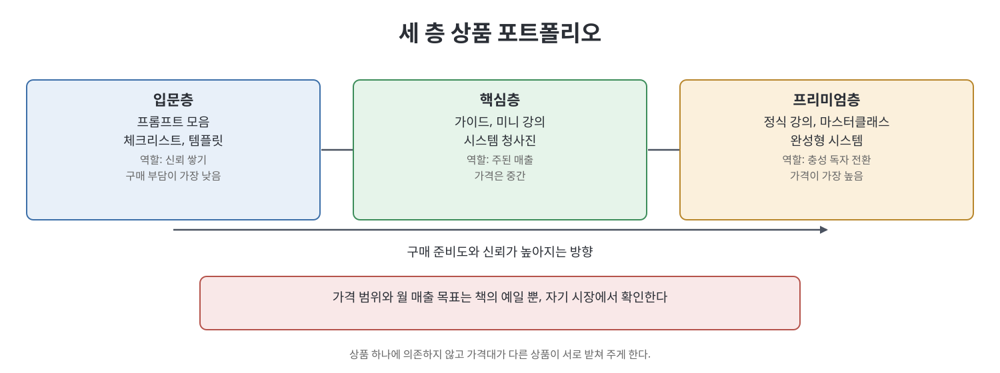
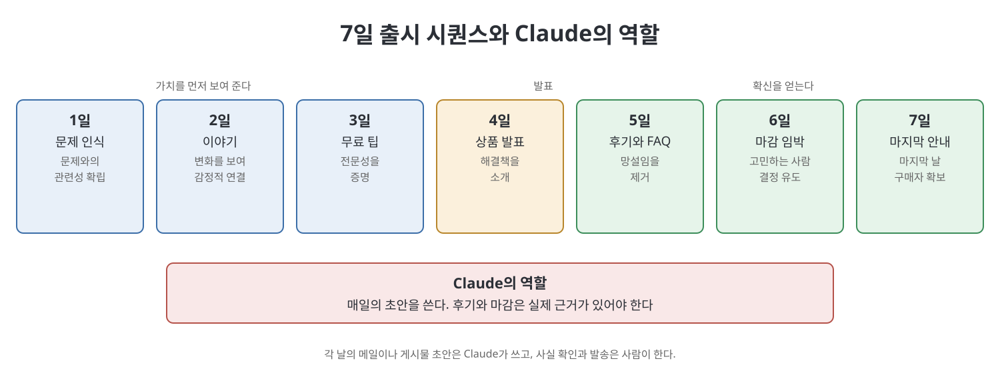

# 10장 디지털 상품과 수동 소득 (Digital Products and Passive Income Systems)

이 장은 서비스 수입과 상품 수입이 구조적으로 어떻게 다른지에서 출발한다. 서비스는 내가 지금 일해야 돈이 들어오지만, 상품은 과거에 들인 노력이 한 번 만들어진 뒤 오래 매출을 낼 수 있다는 것이 책의 설명이다. 책은 Claude가 상품 제작 시간을 몇 주에서 며칠로 줄여 준다고 보고, 가격대가 다른 여러 상품을 묶은 포트폴리오, 대표 상품 유형 세 가지, 출시 일정, 판매 페이지 작성, 사례를 차례로 다룬다.

> **쉽게 말하면**
> 상품 하나에 모든 것을 거는 대신 싼 상품, 중간 상품, 비싼 상품을 층으로 쌓아 같은 독자에게 단계적으로 판다. 그리고 만들기 전에 살 사람이 있는지 먼저 확인한다.

> **참고(노트 작성자)** 이 장의 가격, 월 매출 목표, 판매 실적은 책의 사례와 주장이며 노트가 검증하지 않았다. 수동 소득이라 불러도 홍보와 유지보수는 계속 필요하다. 수익과 시간은 개인과 시장에 따라 크게 다르다.

## 이 장의 흐름

1. 세 층 상품 포트폴리오
2. 잘 팔리는 상품 유형 세 가지
3. 7일 출시 시퀀스
4. 판매 페이지 만들기
5. 사례와 흔한 실수

## 1. 세 층 상품 포트폴리오

책은 상품 하나만 두면 약하고, 구매 준비도가 다른 독자를 겨냥해 가격대별로 서로 보완하는 상품을 두면 지속 가능한 매출 엔진이 된다고 말한다.

| 층 | 가격대 | 상품 유형 | 역할 |
|----|--------|----------|------|
| 입문 | 가장 낮음 | 프롬프트 모음, 체크리스트, 템플릿 | 신뢰를 쌓고 구매 부담을 낮춘다 |
| 핵심 | 중간 | 가이드, 미니 강의, 시스템 청사진 | 주된 매출을 만든다 |
| 프리미엄 | 가장 높음 | 정식 강의, 마스터클래스, 완성형 시스템 | 충성도 높은 독자의 고액 전환 |

책은 층마다 가격 범위와 월 매출 목표도 제시한다. 책의 예로 입문 상품은 수십 달러 이하, 핵심은 100~300달러 안팎, 프리미엄은 수백에서 2천 달러 가까이로 제시된다. 이 숫자는 참고만 하고, 시장 조사로 자기 분야에 맞게 정해야 한다.

## 2. 잘 팔리는 상품 유형 세 가지

### 프롬프트 모음(prompt pack)

책은 구매 직후 바로 써 보고 결과를 볼 수 있어서 문제에서 해결까지의 거리가 가장 짧다고 설명한다. 핵심은 극단적인 구체성이다. "마케팅용 프롬프트"는 경쟁자가 수천이고 값이 낮게 형성되지만, 특정 직업의 특정 업무에 맞춘 모음은 경쟁이 거의 없고 열성적인 구매자가 높은 값을 낸다는 것이다.

책이 제안하는 제작 순서는 두 단계다.

1. 틈새 조사: 대상 전문가의 주요 업무, 시간을 잡아먹는 문제, 더 빨리 하고 싶은 일을 넣고 아이디어 50개를 뽑게 한다. 각 아이디어는 제목, 한 줄 설명, 해결하는 문제로 정리하고, 시간 절감과 발생 빈도로 우선순위를 매기게 한다.
2. 개별 프롬프트 제작: 대상, 수행할 일, 사용자가 제공할 입력, 기대하는 출력 형식, 품질 기준을 채워 넣어 하나씩 완성한다.

직접 써 본 예는 다음과 같다.

```
대상: 개인 재무 설계사
업무: 고객에게 매달 보낼 뉴스레터 초안 작성
사용자가 넣을 것: 이번 달 시장 이슈, 고객 유형, 말투
출력 형식: 제목 3개와 본문 400자
품질 기준: 투자 권유처럼 읽히지 않고 쉬운 말로 설명할 것
```

### 시스템 청사진(system blueprint)

책에 따르면 특정 사업 성과를 AI로 달성하는 과정을 문서화한 것으로, 워크플로 설계, 프롬프트, 도구, 템플릿, 도입 안내를 포함한다. 프롬프트 모음보다 완결성이 높아 가격도 높다. 구매자는 문제가 중요하다는 것은 알지만 어떻게 체계적으로 접근할지 모르는 사람이고, 프롬프트가 아니라 믿고 따를 수 있는 구조를 산다.

### 미니 강의

책은 두세 시간에서 네 시간 분량이 AI 분야에서 가장 적당하다고 본다. 한 번에 몰아서 들을 수 있고 충동 구매 수준의 자기계발 비용으로 맞출 수 있기 때문이다. 커리큘럼, 강의 대본, 실습 문제, 보조 자료, 판매 페이지 문구를 Claude가 만들고, 사람은 전문 지식과 사례와 가르치는 판단을 제공한다.

## 3. 7일 출시 시퀀스

책은 좋은 상품도 출시 방법이 나쁘면 성과가 실망스럽다고 말하며, 같은 상품이 첫 달에 몇백 달러를 벌 수도 몇천 달러를 벌 수도 있다고 주장한다. 책이 제시하는 7일 순서를 새로 묶으면 다음과 같다.

| 날 | 보내는 내용 | 목적 |
|----|-----------|------|
| 1일 | 문제를 짚는 메일이나 게시물 | 문제와의 관련성 확립 |
| 2일 | 변화를 보여 주는 이야기 | 감정적 연결 |
| 3일 | 무료 팁이나 틀 | 전문성 증명 |
| 4일 | 상품 발표와 구체적 이점 | 해결책 소개 |
| 5일 | 후기 모음과 자주 묻는 질문 | 망설임 제거 |
| 6일 | 마감 임박 알림 | 고민하던 사람의 결정 유도 |
| 7일 | 마지막 안내 | 마지막 날 구매자 확보 |

Claude는 매일의 초안을 쓰는 역할을 맡는다. 다만 후기와 마감 기한은 실제 근거가 있어야 하며, 없는 후기나 허위 희소성을 만들면 안 된다. 광고와 소비자 보호 규정은 나라마다 다르므로 전문가 확인이 필요하다.

## 4. 판매 페이지 만들기

책은 판매 페이지 문구를 쓰는 프롬프트를 제공한다. 입력은 상품 이름과 유형, 구체적인 구매자, 해결하는 고통, 핵심 이점, 가격, 포함 내용이다. 출력은 순서가 정해져 있다.

1. 결과를 담은 구체적인 제목
2. 약속을 넓히는 부제
3. 문제 섹션: 해결책을 말하기 전에 문제를 충분히 드러냄
4. 해결책 소개: 상품이 그 문제의 구체적 답이라고 소개
5. 구성 목록: 항목마다 이점을 붙임
6. 누구를 위한 상품인지
7. 달라지는 모습: 이전과 이후
8. 가격과 하나의 행동 유도 문구

원문 분량 지정은 그대로 옮기지 않았지만, 요지는 문제를 먼저 충분히 느끼게 한 뒤에 해결책을 내놓으라는 것이다.

## 5. 사례와 흔한 실수

사례의 주인공은 12년 경력의 부동산 중개인이다. 책에 따르면 그는 매물 설명 작성, 뻔하지 않은 후속 메시지, 지역 안내서 제작이라는 동료들의 고민을 이미 스스로 해결해 왔고, 이를 이틀 동안 "중개인용 AI 도구 모음"으로 묶었다. 프롬프트 50개, 이메일 시퀀스 템플릿, 지역 안내 틀, 이의 제기 응답 체계가 들어 있고 가격은 100달러 안팎이었다. 책은 부동산 커뮤니티 세 곳에 무료 샘플을 올려 의견을 받는 방식으로 잠재 고객을 모았고, 광고비 없이 3개월에 2만 달러대 매출이 났다고 주장한다. 이 수치는 책의 서술이며 검증되지 않았다. 그가 이미 12년 경력과 커뮤니티 접근성을 갖췄다는 점이 결과에 크게 작용했을 가능성도 고려해야 한다.

책이 꼽는 흔한 실수는 네 가지다.

- 검증 없이 만든다: 내용을 쓰기 전에 잠재 구매자 열 명과 대화하라는 것이 책의 조언이다.
- 제작 비용으로 가격을 정한다: 가격은 구매자의 문제가 가진 가치로 정한다.
- 일반적인 포지셔닝: 특정 직무와 특정 목표까지 좁혀야 눈에 띈다.
- 한 번 출시하고 멈춘다: 지속적인 홍보와 인지도 순환 구조가 필요하다.

## 정리 표와 그림

| 상품 유형 | 장점 | 주의할 점 |
|----------|------|----------|
| 프롬프트 모음 | 제작이 빠르고 효과를 바로 체감 | 범용 주제는 경쟁이 심해 값이 낮음 |
| 시스템 청사진 | 완결성이 높아 가격을 높게 받음 | 실제로 따라 하면 작동하는지 시험해야 함 |
| 미니 강의 | 중간 가격대의 충동 구매 구간 | 전문 지식과 사례는 사람이 제공해야 함 |





## 핵심 정리

- 책은 서비스 소득과 달리 상품 소득이 과거의 노력에서 나온다는 구조적 차이를 강조한다.
- 입문, 핵심, 프리미엄의 세 층 포트폴리오는 구매 준비도가 다른 독자를 단계적으로 전환시킨다.
- 프롬프트 모음은 구체성이 가격을 좌우하고, 청사진과 미니 강의는 완결성과 학습 시간으로 가치를 만든다.
- 출시는 문제 인식, 이야기, 무료 가치, 발표, 사회적 증거, 마감, 마지막 안내의 7일 흐름으로 설계한다.
- 만들기 전 검증, 구매자 가치 기반 가격, 구체적 포지셔닝, 지속적 홍보가 책이 꼽는 핵심 습관이다.
- 판매 수치와 가격은 책의 사례이며 후기와 마감 같은 마케팅 요소는 사실에 근거해야 한다.

<br>
<br>
<br>

이전: [9장 AI 에이전시](09%EC%9E%A5%20AI%20%EC%97%90%EC%9D%B4%EC%A0%84%EC%8B%9C.md) | 다음: [11장 마이크로 SaaS](11%EC%9E%A5%20%EB%A7%88%EC%9D%B4%ED%81%AC%EB%A1%9C%20SaaS.md)

<br>

[Claude AI Automation and Monetization](../)
