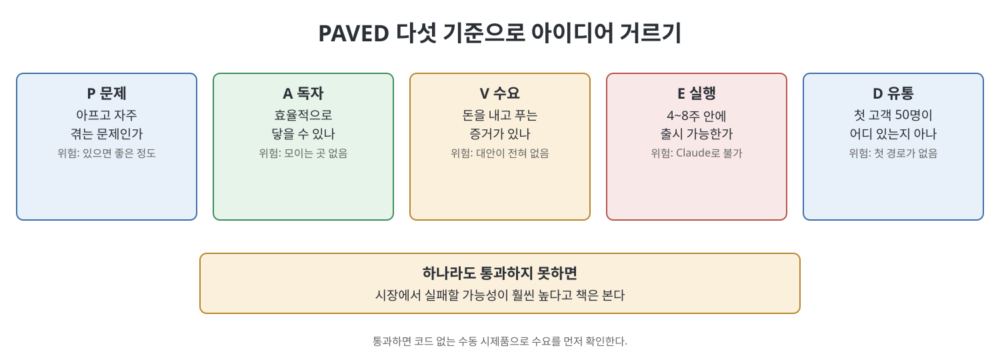
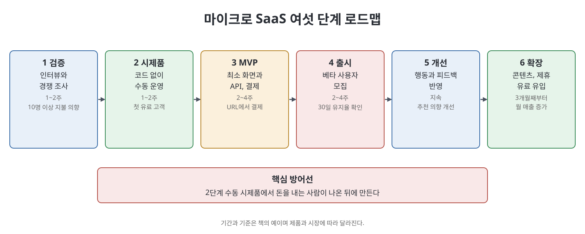

# 11장 마이크로 SaaS (Micro SaaS: Building AI-Powered Products with Claude at the Core)

이 장은 마이크로 SaaS(micro SaaS, 시장과 팀과 제품을 일부러 작게 유지하는 구독형 소프트웨어 사업)를 다룬다. 책의 정의로는 거대한 서비스를 만드는 것이 아니라 한 가지 구체적인 문제를 정해진 독자에게 잘 풀어 주고, 반복 구독 매출을 만들고, 한두 명에서 세 명이 운영하는 사업이다. 책은 Claude가 AI 기능을 만드는 난이도를 머신러닝 엔지니어링에서 좋은 프롬프트 설계 수준으로 낮추고, 비개발자도 "지능 계층"을 Claude에 맡기고 제품 포장에 집중할 수 있게 하며, 아이디어에서 출시까지 시간을 압축한다고 본다. 이어서 아이디어를 평가하는 틀, 후보 목록, 개발 로드맵, 노코드 구성, 사례를 설명한다.

> **쉽게 말하면**
> 만들기 전에 다섯 가지 질문으로 아이디어를 거르고, 코드 없이 손으로 먼저 돌려 본 뒤, 돈을 내는 사람이 나온 다음에 화면을 다듬는다.

> **참고(노트 작성자)** 이 장의 가격, 구독자 수, 이탈률, 기간은 책이 소개하는 사례와 목표이며 노트가 검증하지 않았다. 도구와 요금은 책이 쓰인 시점 기준이고 바뀔 수 있다. 수익은 보장되지 않으며 결과는 개인과 시장에 따라 크게 다르다. 개인정보를 다루는 제품은 법률과 보안 전문가 확인이 필요하다.

## 이 장의 흐름

1. PAVED 평가 틀
2. 후보 아이디어 스무 가지의 유형
3. 개발 로드맵
4. 노코드 기술 구성
5. 사례와 점검 과제

## 1. PAVED 평가 틀

책은 무엇이든 만들기 전에 다섯 기준으로 평가하라고 하며, 하나라도 통과하지 못하면 시장에서 실패할 가능성이 훨씬 높다고 본다. 머리글자를 따서 PAVED라 부른다.

| 글자 | 기준 | 볼 것 | 위험 신호 |
|------|------|------|----------|
| P | 문제의 구체성 | 아프고 자주 겪는 문제인가 | 있으면 좋은 정도에 그침 |
| A | 독자 접근성 | 효율적으로 도달할 수 있는가 | 모이는 커뮤니티가 없음 |
| V | 수요 검증 | 돈을 내고 해결한다는 증거가 있는가 | 어떤 가격대에도 대안이 없음 |
| E | 실행 가능성 | 4주에서 8주 안에 출시 가능한 버전을 만들 수 있는가 | 핵심 기능이 Claude로 안 됨 |
| D | 유통의 명확성 | 첫 고객 50명이 어디 있는지 아는가 | 뚜렷한 첫 유통 경로가 없음 |

대안이 하나도 없는 것을 위험 신호로 본다는 점이 흥미롭다. 경쟁이 없다는 것은 시장이 없다는 뜻일 수 있다는 관점이다.

## 2. 후보 아이디어 스무 가지

책은 PAVED로 평가했다는 후보 스무 개를 표로 제시하고, 모두 수요 신호가 확인되었고 독자에게 닿을 수 있으며 핵심 기능을 Claude가 안정적으로 맡을 수 있다고 주장한다. 이 노트는 목록을 옮기지 않고 공통 패턴으로 정리한다. 수요가 검증되었다는 말도 책의 주장이다.

| 패턴 | 공통 문제 | 후보의 예 |
|------|----------|----------|
| 반복 작성 업무 | 제안서, 뉴스레터, 보고서, 공고문 등 매번 써야 하는 문서 | 제안서 작성기, 월간 고객 보고서 작성기 |
| 검토와 요약 | 계약서나 서류 묶음을 빠르게 훑기 | 계약 검토 도우미, 실사 문서 요약 |
| 입찰과 신청 서류 | 형식은 정해져 있고 시간이 많이 듦 | 공공 입찰 작성 도구, 보조금 신청 지원 |
| 마케팅 변형 생성 | 광고, 사례, 후기 응답을 다양한 버전으로 만듦 | 광고 문구 실험, 후기 답변 도구 |
| 정보 종합 | 고객 의견이나 시장 정보를 모아 분류 | 피드백 분류기, 주간 시장 브리프 |

책의 가격대는 월 수십 달러에서 수백 달러까지 폭이 있고, 전문가 대상일수록 높다. 계약, 법률, 인사 정책, 보조금, 입찰 서류를 다루는 제품은 결과물이 틀렸을 때 책임이 따르므로 전문가 검토 단계를 제품에 넣어야 한다.

## 3. 개발 로드맵

책은 전통 소프트웨어 개발과 다르게, 핵심 과제가 기술이 아니라 프롬프트 설계, 사용자 경험, 유통이라고 본다. 여섯 단계는 아래와 같다.

| 단계 | 기간(책의 예) | 핵심 활동 | 통과 기준 |
|------|--------------|----------|----------|
| 1. 검증 | 1~2주 | 고객 인터뷰, 경쟁 조사, 수요 신호 | 10명 이상이 돈을 낼 의향 |
| 2. 시제품 | 1~2주 | Claude로 코드 없이 수동 버전 운영 | 첫 유료 고객(할인도 가능) |
| 3. MVP 구축 | 2~4주 | 최소 웹 화면, API 연동, 결제 | URL에서 결제까지 가능 |
| 4. 출시와 베타 | 2~4주 | 베타 사용자 모집, 피드백 | 30일 뒤 80퍼센트 이상 유지 |
| 5. 개선 | 지속 | 사용 행동과 피드백 반영 | 추천 의향 지표 개선 |
| 6. 확장 | 3개월째부터 | 콘텐츠 마케팅, 제휴, 유료 유입 | 월 반복 매출 꾸준한 증가 |

여기서 2단계가 중요하다. 폼 도구와 Claude만으로 사람이 손으로 결과를 만들어 파는 방식이므로, 기술에 투자하기 전에 사람들이 정말 값을 치르는지 확인할 수 있다. MVP(minimum viable product, 최소 기능 제품)는 가치를 검증하는 데 필요한 최소한의 버전이다.

## 4. 노코드 기술 구성

책은 개발자가 아니어도 Claude를 지능 계층으로 쓰고 노코드와 로우코드 도구를 조합하면 구독 결제까지 갖춘 제품을 몇 주 안에 낼 수 있다고 말한다. 구성은 여섯 범주로 나뉜다.

| 범주 | 책이 드는 도구 | 역할 |
|------|--------------|------|
| 화면 | Bubble, Webflow, Softr, Glide | 사용자 인터페이스 |
| AI 연동 | Make나 Zapier를 통한 Claude API | 핵심 AI 처리 |
| 결제 | Stripe(Lemon Squeezy 경유 또는 직접) | 구독 결제 |
| 인증과 사용자 | Bubble 내장, Memberstack | 계정과 접근 제어 |
| 데이터베이스 | Airtable, Xano 등 | 사용자 데이터와 이력 |
| 이메일 | ConvertKit, Mailchimp, Loops | 거래성 메일과 마케팅 메일 |

도구 이름과 요금은 책이 쓰인 시점 기준이다. API 호출 비용이 사용량에 따라 늘어나므로 구독 가격이 호출 비용을 충분히 넘는지 계산해야 한다. 개인정보와 결제 정보 처리는 서비스 약관과 관련 법을 확인해야 한다.

## 5. 사례와 점검 과제

사례의 주인공은 오랫동안 제안서를 써 온 컨설턴트다. 책에 따르면 그는 Bubble 화면에 Claude를 엔진으로 붙여, 사용자가 고객 상황, 서비스 범위, 가격, 차별점을 넣으면 2분 안에 제안서가 나오고 편집과 PDF 내보내기가 되는 제품을 혼자 6주 만에 만들었다. 링크드인 팔로워 2,800명에게 창립 회원 가격으로 선공개해 열흘 만에 52명이 구독했고, 90일 뒤 가격을 올렸다고 한다. 6개월 시점에 책이 제시하는 지표는 월 반복 매출 8천 달러대, 구독자 147명, 월 이탈률 4퍼센트대, 주당 8~10시간 투입이다. 모두 책의 서술이며 검증되지 않았다. 이 사례도 이미 청중과 분야 지식이 있던 사람의 결과다.

장 끝의 점검 과제를 정리하면 이렇다.

- 후보 두 개를 PAVED로 평가한다.
- 코드나 프롬프트를 쓰기 전에 고객 발굴 대화를 다섯 번 한다.
- 폼 도구와 Claude로 수동 시제품을 먼저 만든다.
- 화면을 다듬기 전에 첫 유료 고객 열 명을 찾는다.
- 3개월, 6개월, 12개월의 매출 목표에서 거꾸로 필요한 구독자 수를 계산한다.

## 핵심 정리

- 마이크로 SaaS는 작은 시장과 작은 팀을 의도한 구독 사업이며 Claude가 AI 기능의 진입 장벽을 낮춘다.
- PAVED는 문제, 독자 접근성, 수요 검증, 실행 가능성, 유통의 다섯 질문이고 하나라도 실패하면 위험하다.
- 책의 후보 아이디어는 반복 작성, 검토와 요약, 서류 작성, 마케팅 변형, 정보 종합 같은 패턴에 모여 있다.
- 로드맵은 검증, 수동 시제품, MVP, 베타 출시, 개선, 확장의 순서이며 코드 없는 시제품이 핵심 방어선이다.
- 노코드 조합으로 비개발자도 만들 수 있지만 API 비용, 개인정보, 결과 검토 책임은 직접 챙겨야 한다.
- 가격, 구독자 수, 매출은 책의 사례이며 개인과 시장에 따라 크게 다르다.

 
 
 

이전: [10장 디지털 상품과 수동 소득](10%EC%9E%A5%20%EB%94%94%EC%A7%80%ED%84%B8%20%EC%83%81%ED%92%88%EA%B3%BC%20%EC%88%98%EB%8F%99%20%EC%86%8C%EB%93%9D.md) | 다음: [12장 월 1만 달러로 키우기](12%EC%9E%A5%20%EC%9B%94%201%EB%A7%8C%20%EB%8B%AC%EB%9F%AC%EB%A1%9C%20%ED%82%A4%EC%9A%B0%EA%B8%B0.md)

 

[Claude AI Automation and Monetization](../)
