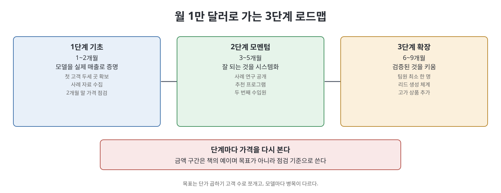
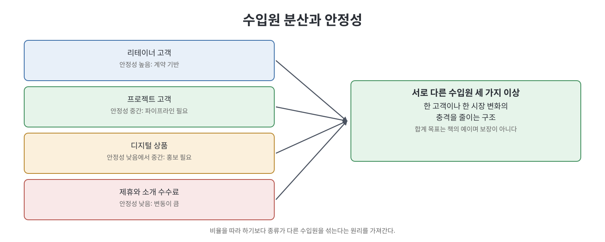

# 12장 월 1만 달러로 키우기 (Scaling to 10K Dollars Per Month with AI Systems)

이 장은 월 1만 달러라는 구체적인 목표를 어떻게 구조로 풀지 다룬다. 책은 한 달 반짝 올리는 것은 운과 타이밍의 문제지만, 매달 꾸준히 유지하는 것은 시스템과 경제성의 문제라고 구분한다. 그래서 사업 모델별로 목표를 나누어 보는 방법, 3단계 로드맵, 수입원 분산 구성, 사례, 점검용 프롬프트, 흔한 실수를 차례로 설명한다.

> **쉽게 말하면**
> 1만 달러는 "얼마를 벌겠다"가 아니라 "단가 곱하기 고객 수"로 쪼개는 산수다. 단계마다 할 일을 정하고, 수입원을 서로 다른 종류로 세 개 이상 둔다.

> **참고(노트 작성자)** 이 장의 금액, 단계별 목표, 기간은 책의 가정과 사례이며 노트가 검증하지 않았다. 목표 금액은 보장이 아니고 결과는 개인과 시장에 따라 크게 다르다. 세금, 계약, 개인정보 관련 사항은 전문가 확인이 필요하다.

## 이 장의 흐름

1. 월 1만 달러의 수익 구조
2. 3단계 로드맵
3. 수입원 분산 구성
4. 사례와 점검 프롬프트
5. 흔한 실수

## 1. 월 1만 달러의 수익 구조

책은 1만 달러에 이르는 길이 여러 가지이며 맞는 길은 사업 모델에 달렸다고 말한다. 모델마다 평균 거래 규모에 필요한 고객 수를 곱하는 계산을 보여 주고, 각각의 병목도 함께 짚는다. 이 노트는 평균 금액은 구조를 보이기 위한 책의 예로만 쓴다.

| 모델 | 곱셈의 모양(책의 예) | 병목 |
|------|-------------------|------|
| 건별 대행 서비스 | 건당 수천 달러 단가에 월 몇 건 | 생산 능력과 리드 수 |
| 리테이너 서비스 | 월 정액 고객 몇 곳 | 고객 확보와 유지 |
| 자동화 컨설팅 | 큰 프로젝트 월 두어 건 | 영업 주기가 긺 |
| 디지털 상품 | 100달러 안팎 상품을 월 100개 정도 | 유통과 청중 규모 |
| AI 에이전시 | 월 4천 달러 안팎 고객 두세 곳 | 팀과 시스템 확장 |
| 마이크로 SaaS | 월 80달러 안팎에 구독자 백 명대 | 제품 유지율과 신규 확보 |
| 교육과 코칭 | 건당 수백 달러에 월 20건 | 청중과 판매 전환 |

이 표에서 배울 점은 단가가 낮을수록 필요한 고객 수가 많아지고, 그래서 병목이 생산 능력에서 유통과 청중 규모로 이동한다는 것이다. 자기 모델의 병목이 무엇인지 먼저 알아야 어디에 시간을 쓸지 정할 수 있다.

## 2. 3단계 로드맵

책의 로드맵은 단계별로 다른 목표 구간을 둔다. 금액 구간은 책의 예이며, 핵심은 단계마다 해야 하는 일의 성격이 다르다는 점이다.

### 1단계 기초(1~2개월): 모델 증명

실제 매출로 모델이 통하는지 확인하는 시기다. 책이 권하는 일은 다음과 같다.

- 직접 연락과 인맥으로 첫 고객 두세 곳을 확보한다.
- 실제 산출물을 바탕으로 핵심 Claude 시스템을 다듬는다.
- 모든 고객 작업에서 사례 자료를 모은다.
- 고객 반응이 가장 뜨거운 서비스나 상품을 찾는다.
- 2개월 차 말에 입증된 가치를 근거로 가격을 20~30퍼센트 올린다.

### 2단계 모멘텀(3~5개월): 잘 되는 것을 시스템화

가장 좋은 제안, 가장 좋은 고객, 고객이 가장 중시하는 것이 보이는 시기다.

- 1단계 작업으로 사례 연구를 두세 편 공개한다.
- 주 1~2편의 고품질 전문성 콘텐츠를 만드는 체계를 만든다.
- 기존 고객의 소개를 보상하는 추천 프로그램을 설계한다.
- 주 모델을 보완하는 두 번째 수입원을 추가한다.
- 고객 확보 비용과 고객 생애 가치를 재기 시작한다.

### 3단계 확장(6~9개월): 검증된 것을 키우기

- 고객 소통과 기본 품질 검토를 맡을 팀원을 최소 한 명 둔다.
- 꾸준한 문의가 들어오는 리드 생성 체계를 만든다.
- 실적과 사례를 근거로 가격을 다시 올린다.
- 기존 최우수 고객이 전환할 고가 상품을 추가한다.
- 주 모델에 구조적 한계가 있는지 보고 모델 진화를 검토한다.

## 3. 수입원 분산 구성

책은 수입원이 하나뿐인 사업은 고객 한 명이 떠나거나 시장이 한 번 바뀌면 위기라고 본다. 오래 가는 1만 달러 사업은 구조적으로 서로 다른 수입원이 최소 세 가지는 있다고 주장한다.

| 수입원 유형 | 안정성(책의 평가) | 필요한 것 |
|------------|------------------|----------|
| 리테이너 고객 | 높음(계약 기반) | 유지와 관계 관리 |
| 프로젝트 고객 | 중간 | 지속적인 파이프라인 |
| 디지털 상품 | 낮음에서 중간 | 홍보와 청중 |
| 제휴와 소개 수수료 | 낮음 | 변동을 감수 |

책의 예시 구성은 리테이너가 매출의 가장 큰 몫을 맡고 나머지를 프로젝트, 상품, 제휴가 나눠 합계가 1만 달러를 넘는 모양이다. 비율을 따라 하기보다 종류가 다른 수입원을 섞는다는 원리를 가져가는 편이 낫다. 제휴 수입은 광고 표시 의무 등 규정이 있을 수 있어 전문가 확인이 필요하다.

## 4. 사례와 점검 프롬프트

사례의 주인공은 HR 컨설턴트다. 책에 따르면 그는 월 정액 리테이너 고객 두 곳으로 가용 시간이 곧 상품이 되어 천장에 닿았고, HR 정책 생성기, 직원 커뮤니케이션 초안 작성기, 성과 평가 요약기의 세 Claude 시스템으로 업무를 재편했다. 이전 납품 시간의 80퍼센트를 시스템이 맡고 20퍼센트는 사람의 전략적 조언으로 남았다. 6개월 뒤 리테이너 고객은 둘에서 넷으로 늘었고, 건별 정책 패키지 두 건과 템플릿 번들 판매가 더해져 월 매출이 1만 달러대 초반에 이르렀으며 주당 근무가 45시간에서 32시간으로 줄었다고 책은 주장한다. 이미 전문 분야와 기존 고객이 있던 사례이며 같은 결과를 기대하게 하는 근거는 아니다.

책의 "매출 감사와 성장 계획" 프롬프트는 구성만 정리한다.

- 입력: 월 매출, 수입원별 금액, 주당 근무 시간, 주력 상품, 고객 수, 목표 금액
- 요청 결과 다섯 가지: 30일 안에 할 수 있는 가장 큰 개선, 90일 안에 추가할 수입원 세 가지, 가격 격차(가치에 비해 덜 받는 부분), 용량 격차(Claude가 맡을 수 있는 시간 낭비), 6개월 계획
- 지시: 구체적으로, 숫자를 넣어, 뻔한 조언은 피할 것

직접 쓴 짧은 예시는 이렇다.

```
나는 1인 번역 대행 사업자다. 월 매출과 수입원별 금액, 주당 근무 시간을 아래에 적는다.
현재 가장 시간이 많이 드는 일 세 가지를 찾고, 그중 자동화할 수 있는 것과 없는 것을 나눠라.
다음 30일 동안 할 가장 효과 큰 변경 한 가지를 숫자와 함께 제안하라.
```

## 5. 흔한 실수

책이 꼽는 실수는 네 가지다.

- 시스템보다 고객을 먼저 늘린다: 처리 능력을 넘는 고객은 결과를 나쁘게 만들어 성장의 기반인 소개를 무너뜨린다.
- 가격을 성장 수단으로 보지 않는다: 1만 달러에 못 미치는 이유가 고객 부족이 아니라 낮은 가격일 때가 많다고 책은 말한다.
- 측정하지 않고 만든다: 수입원별 매출, 고객 확보 비용, 유지율을 모르면 판단할 수 없다.
- 완벽한 제안을 기다린다: 제안은 고객 피드백으로 좋아지니 더 일찍 팔기 시작한다.

장 끝 점검 과제는 모델 비교표에 현재와 목표를 대입하기, 지금 로드맵의 어느 단계인지 확인하기, 서로 다른 수입원 세 가지 계획, 실질 시간당 수입과 가격 격차 계산, 90일 목표와 주간 활동 계획 수립이다.





## 핵심 정리

- 책은 일회성 달성이 아니라 매달 유지되는 수준을 목표로 하며, 이는 운이 아니라 시스템과 경제성의 문제라고 본다.
- 목표는 평균 단가와 고객 수의 곱으로 쪼개고, 모델마다 병목이 다르다는 점을 먼저 확인한다.
- 로드맵은 모델 증명, 잘 되는 것의 시스템화, 검증된 것의 확장의 세 단계이며 단계마다 가격 조정이 들어간다.
- 구조적으로 다른 수입원을 세 가지 이상 두면 한 고객이나 한 시장 변화의 충격을 줄일 수 있다.
- 시스템보다 먼저 고객을 늘리거나 측정을 건너뛰는 것이 대표적 실수다.
- 모든 금액과 기간은 책의 사례와 가정이며 개인과 시장에 따라 크게 다르다.

<br>
<br>
<br>

이전: [11장 마이크로 SaaS](11%EC%9E%A5%20%EB%A7%88%EC%9D%B4%ED%81%AC%EB%A1%9C%20SaaS.md) | 다음: [13장 반복 가능한 수입 파이프라인](../04.%204%EB%B6%80%20%EC%9A%B4%EC%98%81%EA%B3%BC%20%EB%B3%B4%ED%98%B8/13%EC%9E%A5%20%EB%B0%98%EB%B3%B5%20%EA%B0%80%EB%8A%A5%ED%95%9C%20%EC%88%98%EC%9E%85%20%ED%8C%8C%EC%9D%B4%ED%94%84%EB%9D%BC%EC%9D%B8.md)

<br>

[Claude AI Automation and Monetization](../)
