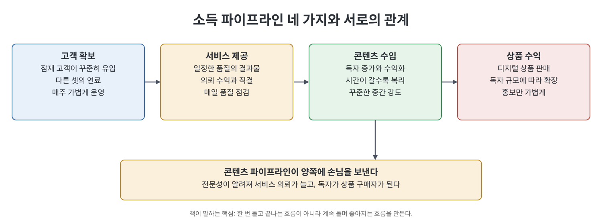
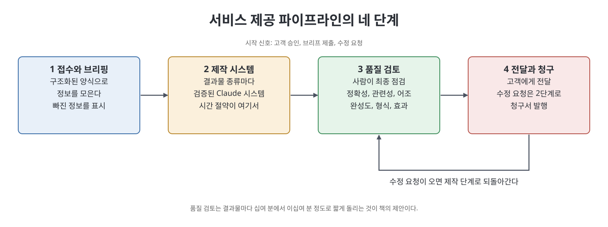

# 13장 반복 가능한 수입 파이프라인 (Building Repeatable Income Pipelines)

이 장은 한 번 잘 돌고 끝나는 일이 아니라 계속 돌면서 점점 좋아지는 수입 구조를 만드는 법을 다룬다. 책은 파이프라인(pipeline)을 "변동이 적고 사람 손이 덜 가면서 가치 있는 결과를 꾸준히 내보내는 시스템"으로 정의한다. 제조업에서는 제품을, 영업에서는 기회를, AI 사업에서는 수입을 만들어 내는 장치라는 것이다. 책은 AI 사업에 필요한 파이프라인을 네 가지로 나누고, 각각이 어떤 단계로 이루어지며 Claude가 어디에 끼어드는지를 차례로 보여 준다.

> **쉽게 말하면**
> 손님을 데려오는 길, 일을 해내는 길, 독자를 모으는 길, 상품을 파는 길을 따로 닦아 두고 서로 이어 붙이는 일이다. 길이 닦여 있으면 내가 쉬는 날에도 물이 흐른다.

> **참고(노트 작성자)** 이 장의 수익, 소요 시간, 주당 투입 시간은 모두 책의 사례와 주장이며 노트가 검증하지 않았다. 결과는 개인과 시장에 따라 크게 다르다. 사례의 제목에 적힌 월 수익과 본문 항목의 합계가 서로 맞지 않는 부분이 있어 이 노트는 해당 수치를 옮기지 않았다.

## 이 장의 흐름

1. 네 가지 수입 파이프라인
2. 고객 확보 파이프라인
3. 서비스 제공 파이프라인
4. 콘텐츠 수입 파이프라인과 상품 수익 파이프라인
5. 한 사람이 네 가지를 쌓은 사례

## 1. 네 가지 수입 파이프라인

책이 제시하는 네 파이프라인은 만드는 것, 준비 기간, 이후 노력이 모두 다르다. 아래는 책의 구분을 노트의 틀로 다시 정리한 것이다.

| 파이프라인 | 하는 일 | 책이 말하는 준비와 유지 | 수입과의 관계 |
|-----------|---------|----------------------|-------------|
| 고객 확보 | 자격 있는 잠재 고객을 꾸준히 만든다 | 수 주 준비, 주당 몇 시간 | 나머지 셋의 연료 |
| 서비스 제공 | 품질이 일정한 결과물을 대량으로 낸다 | 서비스당 1~3주, 매일 품질 점검 | 고객 일에서 바로 나오는 수익 |
| 콘텐츠 수입 | 독자를 늘리고 수익화한다 | 한 달 이상 준비, 주당 몇 시간 | 시간이 갈수록 복리로 커진다 |
| 상품 수익 | 디지털 상품을 판다 | 상품당 한두 달, 가벼운 홍보 | 독자 규모에 따라 커진다 |

책은 서비스 사업에서 가장 중요한 것을 첫 번째 파이프라인으로 꼽는다. 손님이 안정적으로 들어오지 않으면 다른 모든 결정이 매출 불확실성에 묶인다는 이유다.



## 2. 고객 확보 파이프라인

책은 이 파이프라인을 인지(내가 있다는 걸 알게 됨), 고려(내 문제를 풀어 줄지 따져 봄), 전환(고객이 됨) 세 단계로 나눈다. 그리고 표에서 인지, 고려, 직접 연락(outreach), 육성(nurture), 전환 다섯 활동에 Claude의 역할을 붙인다.

| 단계 | 사람이 하는 활동 | Claude가 맡는 일 | 빈도 |
|------|-----------------|-----------------|------|
| 인지 | 글 발행, LinkedIn 활동 | 주간 게시글과 기사 초안 | 매주 |
| 고려 | 사례 연구, 사회적 증명 | 고객 성과를 사례 글로 초안 | 매월 |
| 직접 연락 | 목표 고객에게 개별 접촉 | 맞춤 메시지 초안 | 주 몇 회 |
| 육성 | 잠재 고객용 이메일 소식지 | 소식지 초안 | 격주 |
| 전환 | 제안서 작성 | 맞춤 제안서 초안 | 필요할 때 |

책은 여기에 주간 콘텐츠용 프롬프트 시스템을 하나 싣는다. 요일마다 목적이 다른 LinkedIn 글을 쓰게 하는 구성으로, 월요일은 그 주에 얻은 통찰, 수요일은 실행 가능한 팁, 금요일은 짧은 사례다. 원문 프롬프트는 옮기지 않고 같은 구성을 쓰는 예시를 새로 적어 둔다.

```
[대상 독자]를 위한 LinkedIn 글을 쓴다.
오늘 소재: [이번 주에 겪은 일 한 가지]
형식: 놀라운 한 문장으로 시작, 짧은 문단 둘, 질문으로 마무리
분량: 200단어 안쪽
어조: 전문적이지만 쉽게
```

## 3. 서비스 제공 파이프라인

서비스 제공 파이프라인은 계약이 체결된 뒤 납품과 청구까지를 최대한 일정하게, 사람의 조율은 최소로 이어 주는 운영 체계다. 고객 승인, 브리프 제출, 수정 요청 같은 사건이 Claude 시스템을 깨우고, 그 결과가 고객에게 전달되는 구조다. 책은 세 부품으로 나눈다.

**접수와 브리핑.** 모든 결과물은 정보에서 시작하므로 접수 양식을 구조화해 Claude가 바로 쓸 수 있게 받아야 한다. 책의 예시 프롬프트는 접수 양식 응답을 받아 제작 브리프로 바꾸게 하며, 브리프에 프로젝트 요약, 독자, 어조, 핵심 메시지, 피할 내용, 출력 형식, 성공 기준, 빠진 정보 표시를 넣도록 한다. 마지막의 "빠진 정보 표시"가 고객과의 불필요한 왕복을 줄이는 장치다.

**제작 시스템.** 브리프를 받아 초안을 만드는 Claude 파이프라인이다. 시간 절약의 대부분이 여기서 나오므로 결과물 종류마다 시험이 끝난 전용 시스템을 두라는 것이 책의 조언이다.

**품질과 납품.** 사람의 판단이 마지막 가치를 더하는 층이다. 책은 결과물당 십오 분에서 이십오 분 정도의 구조화된 검토를 권한다.

| 검토 항목 | 확인할 질문 | 자주 나오는 문제 |
|----------|------------|-----------------|
| 정확성 | 사실과 수치가 맞고 근거가 있나 | 지어낸 통계, 잘못된 출처 |
| 관련성 | 고객이 요청한 것에 답하나 | 브리프를 비켜 간 일반론 |
| 어조 | 고객 브랜드의 목소리인가 | 지나치게 딱딱하거나 AI 티가 나는 문장 |
| 완성도 | 필요한 항목과 분량이 다 있나 | 짧은 절, 빠진 구성 요소 |
| 형식 | 지정한 형식과 맞나 | 구조 불일치 |
| 효과 | 목적에 실제로 통할까 | 맞긴 한데 전략이 약함 |



## 4. 콘텐츠 수입과 상품 수익 파이프라인

콘텐츠 수입 파이프라인은 청중을 키우고 여러 경로로 수입화하는 발행 체계다. 책은 오늘 쌓은 청중이 몇 해 뒤에도 수입을 낳을 수 있어 가장 복리가 큰 파이프라인이라고 본다. 자세한 작동 방식은 7장과 16장에서 다루고, 이 장의 요점은 통합이다. 콘텐츠가 전문성을 알려 서비스 쪽 잠재 고객을 만들고, 동시에 상품을 살 청중을 키우도록 연결하라는 것이다.

상품 수익 파이프라인은 발견, 리드 확보, 육성, 전환, 유지로 이어진다. 서비스 수입과 달리 거래마다 내가 직접 나서지 않아도 흐름이 계속 돌아간다는 점이 특징이다.

| 단계 | 방법 | Claude의 역할 | 확인할 지표 |
|------|------|--------------|-----------|
| 발견 | 검색 최적화 글, SNS, 제휴 | 채널별 글 초안 | 방문, 도달 |
| 리드 확보 | 무료 자료와 이메일 교환 | 무료 자료 내용 생성 | 가입률, 목록 증가 |
| 육성 | 신뢰를 쌓는 이메일 연재 | 연재 초안 | 열람률, 클릭률 |
| 전환 | 출시 또는 상시 판매 페이지 | 판매 문안 초안 | 전환율, 구독자당 매출 |
| 유지 | 구매 후 경험과 온보딩 | 환영 메일 초안 | 재구매율, 추천 의향 |

## 5. 한 사람이 네 가지를 쌓은 사례

책은 Make와 Zapier 연동을 몇 년간 만들던 자동화 컨설턴트 "David"를 예로 든다. 그는 실력은 있었지만 일감 흐름에 따라 수입이 널뛰는 상태였다. 책은 그가 여섯 달에 걸쳐 네 파이프라인을 차례로 만들었다고 소개한다. 주간 LinkedIn 글과 월간 사례 연구로 고객을 모으고, 여섯 단계 자동화 점검 절차를 문서화해 Claude가 문서, 제안서, 인수인계 자료를 맡게 했으며, 주간 소식지로 독자를 모으고, 강의 한 개와 템플릿 묶음 한 개를 상품으로 냈다는 이야기다.

이 사례에서 얻을 만한 구조는 숫자보다 수입원의 분산이다. 유지 보수 계약, 구축 프로젝트, 강의, 템플릿, 소식지 후원이 한 사람의 수입에 섞여 들어갔다는 점이다. 앞의 참고 박스에서 밝혔듯 사례의 금액은 책의 주장이고, 같은 구성이 다른 사람에게 같은 결과를 보장하지 않는다.

> **전문가 확인 필요** 고객 정보를 파이프라인에 넣는 접수 양식과 AI 처리 과정은 계약과 개인정보 규정의 영향을 받는다. 14장의 위험 관리와 함께 읽고, 필요하면 전문가에게 확인한다.

## 핵심 정리

- 파이프라인은 한 번 돌고 끝나는 일이 아니라 계속 돌며 개선되는 수입 구조이며, 고객 확보, 서비스 제공, 콘텐츠 수입, 상품 수익 네 가지로 나뉜다.
- 고객 확보 파이프라인이 먼저다. 손님이 안정적으로 들어와야 나머지 결정이 흔들리지 않는다는 것이 책의 논리다.
- 서비스 제공은 접수와 브리핑, 제작 시스템, 품질 검토 세 부품으로 만들고, 품질 검토만은 사람이 맡는다.
- 콘텐츠 파이프라인은 서비스와 상품 양쪽에 손님을 보내는 허브이므로 작게라도 시작해 꾸준히 이어 간다.
- 사례의 수익은 책의 주장이며 개인과 시장에 따라 크게 다르다. 구조를 배우고 수치는 보증으로 읽지 않는다.

<br>
<br>
<br>

이전: [12장 월 1만 달러로 키우기](../03.%203%EB%B6%80%20%EC%82%AC%EC%97%85%20%ED%82%A4%EC%9A%B0%EA%B8%B0/12%EC%9E%A5%20%EC%9B%94%201%EB%A7%8C%20%EB%8B%AC%EB%9F%AC%EB%A1%9C%20%ED%82%A4%EC%9A%B0%EA%B8%B0.md) | 다음: [14장 AI 사업을 지키고 키우고 미래에 대비하기](14%EC%9E%A5%20AI%20%EC%82%AC%EC%97%85%EC%9D%84%20%EC%A7%80%ED%82%A4%EA%B3%A0%20%ED%82%A4%EC%9A%B0%EA%B3%A0%20%EB%AF%B8%EB%9E%98%EC%97%90%20%EB%8C%80%EB%B9%84%ED%95%98%EA%B8%B0.md)

<br>

[Claude AI Automation and Monetization](../)
