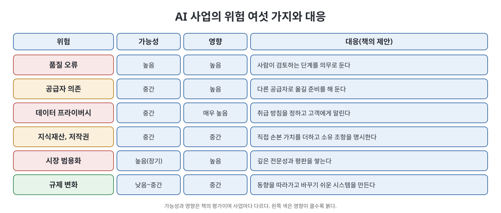
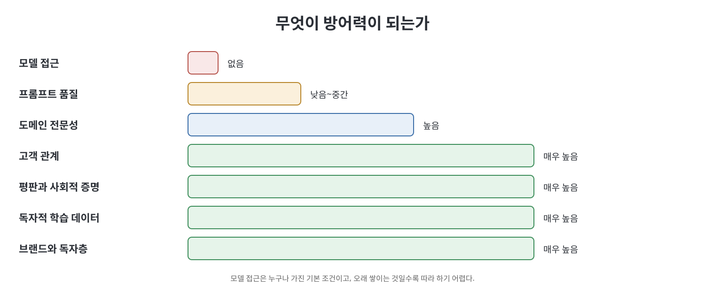

# 14장 AI 사업을 지키고 키우고 미래에 대비하기 (Protecting, Scaling, and Future-Proofing Your AI Business)

이 장은 AI 위에 세운 사업이 지금 돈을 버는 것을 넘어 오래 버티려면 무엇을 관리해야 하는지를 다룬다. 책은 AI 사업에는 예전 사업에 없던 위험이 있다고 말한다. 기술이 빠르게 바뀌고, 외부 공급자에 기대며, 법과 제도가 기술을 아직 따라잡지 못했다는 것이다. 그래서 위험 지도, 규모가 커져도 무너지지 않는 품질 관리, 따라 하기 어려운 경쟁 우위, 확장 속도 조절, 그리고 AI가 더 좋아질 미래에 대한 대비를 차례로 정리한다.

> **쉽게 말하면**
> 같은 도구는 누구나 쓰므로 도구가 내 강점이 될 수 없다. 오래 남는 것은 실수를 막는 관리 체계와 시간이 쌓아 주는 전문성, 관계, 평판이다.

> **참고(노트 작성자)** 위험의 가능성과 영향 평가는 책의 판단이며 노트가 검증하지 않았다. 법, 계약, 개인정보, 저작권, 규제 관련 서술은 노트 작성자의 법률 조언이 아니다. 해당 사안은 반드시 전문가에게 확인해야 한다. 공급자 정책과 요금은 책이 쓰인 시점 기준이다.

## 이 장의 흐름

1. 위험 지도
2. 규모가 커져도 유지되는 품질 관리
3. 방어할 수 있는 경쟁 우위
4. 품질을 깨지 않고 키우기
5. Claude 기반 사업의 미래

## 1. 위험 지도

책은 위험을 여섯 범주로 나누고, 가능성과 영향, 대응을 한 표로 묶는다. 아래는 같은 내용을 노트의 틀로 다시 정리한 것이다.

| 위험 | 책의 평가 | 구체적인 모습 | 책이 제안하는 대응 |
|------|----------|--------------|-------------------|
| 품질 | 가능성과 영향 모두 높음 | 고객 결과물의 AI 오류 | 사람 검토 단계를 의무화 |
| 공급자 의존 | 가능성 중간, 영향 높음 | API 가격 인상이나 접근 조건 변경 | 다른 공급자로 옮길 준비 |
| 데이터 프라이버시 | 가능성 중간, 영향 매우 높음 | 고객 정보가 API를 거쳐 처리됨 | 취급 방침과 고객 고지 |
| 지식재산, 저작권 | 중간 | AI 결과물의 소유 문제 | 직접 손본 가치 추가, 소유 조항 명시 |
| 시장 범용화 | 장기적으로 높음 | AI 서비스가 비슷해져 차별이 사라짐 | 깊은 전문성과 평판 |
| 규제 변화 | 낮음에서 중간 | 새 AI 규제가 운영에 영향 | 동향 추적과 바꾸기 쉬운 시스템 |

여섯 가지를 한 문장으로 줄이면, 가장 자주 일어나는 것은 품질 사고이고 가장 큰 피해는 데이터 문제이며 가장 오래 가는 압박은 범용화다. 대응은 대부분 비용이 크지 않은 습관과 문서로 시작할 수 있다.



> **전문가 확인 필요** 고객 데이터를 AI 서비스에 넣어도 되는지, 결과물의 저작권이 누구에게 귀속되는지, 규제를 어떻게 지켜야 하는지는 나라와 계약에 따라 다르다. 변호사나 개인정보 전문가에게 확인한다.

## 2. 규모가 커져도 유지되는 품질 관리

일이 늘면 모든 결과물을 내가 직접 검토할 수 없다. 책은 그래서 누가 해도 같은 판정이 나오는 품질 기준 문서, 곧 Quality Assurance Standard(QAS)를 결과물 종류마다 만들라고 한다. QAS에는 최소 품질 요건, 구체적인 검토 단계, 기준에 못 미칠 때의 상향 절차가 들어간다.

책의 예시 프롬프트는 이 문서를 Claude에게 만들게 한다. 입력으로 결과물 종류, 고객의 기대, 현재 자주 나오는 실패 유형을 주고, 출력으로 다섯 가지 합격 기준(각각 합격과 불합격의 정의), 우선순위 순서의 검토 절차, 구간별로 살펴볼 문제, 선임 검토나 재작업이 필요한 임계선, 검토 완료 서명 양식을 요구한다. 핵심 조건은 기준이 충분히 구체적이어서 두 검토자가 같은 글을 보고 같은 판정을 내릴 수 있어야 한다는 것이다. 같은 구성의 짧은 예시는 다음과 같다.

```
결과물 종류: 고객 소식지 초안
기준 다섯 개를 합격/불합격 정의와 함께 만든다.
검토 순서는 사실 확인, 브리프 부합, 어조 순으로 한다.
선임 검토가 필요한 임계선을 정한다.
검토 완료 서명 양식을 붙인다.
```

## 3. 방어할 수 있는 경쟁 우위

책의 단언은 분명하다. Claude에 접근하는 것은 경쟁 우위가 아니라 범용품이다. 같은 API를 구독하는 누구와도 같다는 이유다. 따라 하기 어려운 우위는 단순한 구독으로 복제할 수 없는 곳에서 나온다. 책이 매긴 방어력은 아래와 같다.

| 우위의 종류 | 방어력(책의 평가) | 만드는 법 |
|------------|-----------------|----------|
| 모델 접근 | 없음 | 차별점이 아니라 기본 조건 |
| 프롬프트 품질 | 낮음에서 중간 | 경쟁자도 비슷한 수준에 도달 가능 |
| 도메인 전문성 | 높음 | 고객 경험과 함께 쌓임 |
| 고객 관계 | 매우 높음 | 납품 품질로 오래 쌓음 |
| 평판과 사회적 증명 | 매우 높음 | 문서화된 성과와 콘텐츠 |
| 독자적 학습 데이터 | 매우 높음 | 물량과 체계적 수집 |
| 브랜드와 독자층 | 매우 높음 | 복리로 성장 |

패턴은 단순하다. 빌려 쓰는 것일수록 약하고, 시간을 들여 쌓은 것일수록 강하다. 예를 들어 사이버 보안을 깊이 아는 사람이 Claude를 쓰면 보안 지식 자체는 남이 쉽게 베끼지 못한다.



## 4. 품질을 깨지 않고 키우기

책은 유망한 AI 사업을 가장 많이 무너뜨리는 원인으로 품질 체계가 따라오지 못할 만큼 빠른 확장을 꼽는다. 고객을 얻고, 납품을 늘리고, 교육이 감당 못 할 속도로 사람을 뽑으면 품질이 미끄러지고 소개가 끊기며 매출이 멈춘다는 흐름이다.

처방은 체계적인 확장이다. 추가 용량이 필요한 고객을 받기 전에 품질 인프라가 그 물량을 감당하는지 확인하고, 아니라면 그때까지 기다리거나 일의 범위를 현재 체계가 소화할 만큼 줄이라는 것이다. 책의 실행 점검 목록은 여기에 확장 준비 점검표를 만들어 용량을 늘리는 계약을 받기 전에 훑어보라고 덧붙인다.

## 5. Claude 기반 사업의 미래

책은 AI 능력이 계속 좋아질 것이므로 오늘 정교한 프롬프트가 필요한 일이 내일은 쉬워지고, 지금 프리미엄처럼 보이는 서비스 일부는 범용화될 것이라고 본다. 이를 비관이 아니라 전략적 지능이라고 부른다. 오래 살아남는 사업은 지금의 AI 능력을 이용해 더 단단한 것을 만든 곳이다. 깊은 고객 관계, 뚜렷한 브랜드와 콘텐츠, 특정 분야에 맞춘 자체 시스템, 기술이 바뀌어도 사람이 찾아오게 하는 평판이다.

장의 가장 중요한 문장은 당신이 만드는 것은 Claude 사업이 아니라 현재 Claude를 가장 강력한 도구로 쓰는 사업이라는 취지다. 이 구분이 장기 가치를 어디에 쌓을지 결정한다.

## 핵심 정리

- AI 사업에는 품질, 공급자 의존, 데이터 프라이버시, 지식재산, 시장 범용화, 규제 변화라는 여섯 위험이 있고, 대응은 검토 단계와 방침 문서와 이식 가능성에서 시작한다.
- 규모가 커지면 나 혼자 검토할 수 없으므로, 누가 해도 같은 판정이 나오는 품질 기준 문서를 결과물마다 만든다.
- 모델 접근은 모두가 가진 기본 조건이다. 전문성, 관계, 평판, 데이터, 브랜드처럼 시간을 들여 쌓은 것만 방어력이 된다.
- 품질 인프라가 감당하지 못하는 일은 받지 않거나 범위를 줄이며, 속도가 품질을 앞지르지 않게 한다.
- AI가 좋아질수록 일부 서비스는 범용화되므로, 현재 AI는 더 오래 가는 자산을 쌓기 위한 도구로 쓴다.

<br>
<br>
<br>

이전: [13장 반복 가능한 수입 파이프라인](13%EC%9E%A5%20%EB%B0%98%EB%B3%B5%20%EA%B0%80%EB%8A%A5%ED%95%9C%20%EC%88%98%EC%9E%85%20%ED%8C%8C%EC%9D%B4%ED%94%84%EB%9D%BC%EC%9D%B8.md) | 다음: [15장 프롬프트 엔지니어링 사업](15%EC%9E%A5%20%ED%94%84%EB%A1%AC%ED%94%84%ED%8A%B8%20%EC%97%94%EC%A7%80%EB%8B%88%EC%96%B4%EB%A7%81%20%EC%82%AC%EC%97%85.md)

<br>

[Claude AI Automation and Monetization](../)
