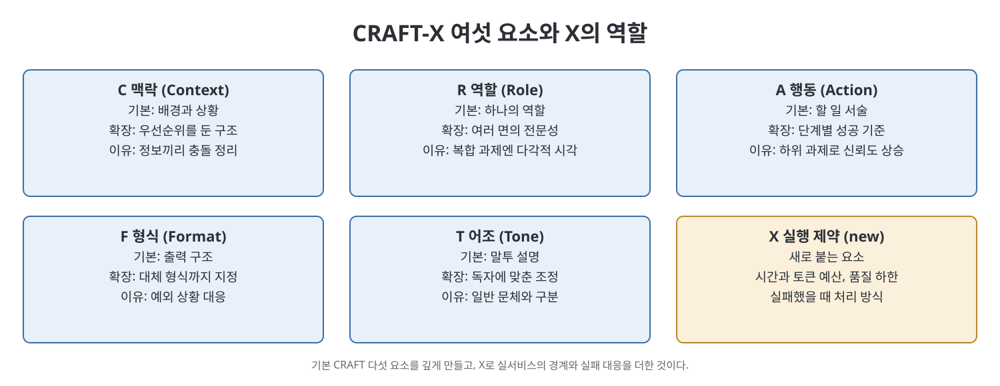
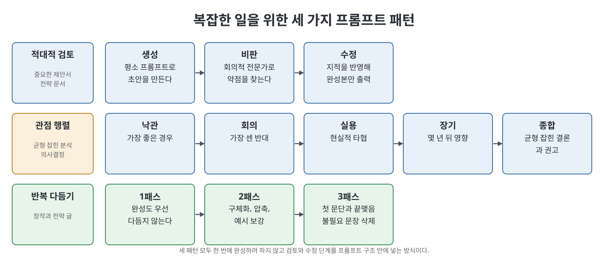

# 15장 프롬프트 엔지니어링 사업 (The Business of Prompt Engineering)

이 장은 프롬프트 엔지니어링(prompt engineering, AI에게 일을 정확히 시키는 입력을 설계하는 기술)을 직업과 사업으로 연결한다. 책은 이 일이 비공식적인 "질문 잘하기"에서 출발해 조직이 채용하고 자문을 구하며 운영 기반에 넣는 전문 분야로 자랐다고 본다. 그래서 장은 두 부분으로 나뉜다. 앞쪽은 3장의 CRAFT를 확장한 상급 틀과 복잡한 일을 위한 세 가지 패턴이고, 뒤쪽은 이 실력으로 컨설팅 사업을 세우는 방법과 사례다.

> **쉽게 말하면**
> 프롬프트를 쓰는 사람은 많지만, 특정 업계를 깊이 알면서 그 업계 일을 안정적으로 해내는 시스템을 설계하는 사람은 드물다. 장의 주장은 이 조합이 비싼 값을 받는다는 것이다.

> **참고(노트 작성자)** 서비스별 요금대와 사례의 연 매출, 근무 시간은 책의 주장이며 노트가 검증하지 않았다. 이 노트는 요금을 구조와 상대적 크기로만 정리했다. 수익과 시간은 책의 사례이며 결과는 개인과 시장에 따라 크게 다르다. 책이 소개하는 모델과 도구는 책이 쓰인 시점 기준이다.

## 이 장의 흐름

1. CRAFT-X 상급 프롬프트 틀
2. 복잡한 일을 위한 세 가지 패턴
3. 프롬프트 엔지니어링 사업 만들기
4. 서비스 종류와 요금 구조
5. 금융 분야 전문가 사례

## 1. CRAFT-X 상급 프롬프트 틀

3장에서 소개한 CRAFT는 맥락(Context), 역할(Role), 행동(Action), 형식(Format), 어조(Tone)의 다섯 요소였다. 책은 여기에 실서비스에 필요한 차원 하나를 더해 CRAFT-X라 부른다. 노트는 이를 아래처럼 다시 정리한다.

| 요소 | 기본 CRAFT | CRAFT-X에서 달라지는 점 | 필요한 이유 |
|------|-----------|-----------------------|------------|
| C 맥락 | 배경과 상황 | 우선순위를 매긴 구조화된 맥락 | 정보원끼리 충돌할 때 정리 기준이 생김 |
| R 역할 | 역할 하나 | 여러 면을 아우르는 전문성 지정 | 복합 과제엔 다각적 시각이 필요 |
| A 행동 | 할 일 서술 | 단계로 쪼개고 단계마다 성공 기준 | 하위 과제를 검증하면 신뢰도가 올라감 |
| F 형식 | 출력 구조 | 기본 형식이 안 맞을 때의 대체 형식 | 예외 상황 처리 |
| T 어조 | 말투 서술 | 독자에 맞춘 조정 지시 | 일반 문체와 달리 독자별로 보정 |
| X 실행 제약 | 없음 | 시간과 토큰 예산, 품질 하한, 실패 시 처리 | 실서비스는 경계와 실패 대응이 필요 |

X가 핵심이다. 연습용 프롬프트는 잘 안 되어도 다시 해 보면 되지만, 고객에게 납품되는 시스템은 얼마나 길게, 어느 품질 아래로는 내지 말고, 못 하겠으면 어떻게 알릴지를 미리 정해 둬야 한다.



## 2. 복잡한 일을 위한 세 가지 패턴

책은 어려운 일에 쓰는 프롬프트 패턴 세 가지를 소개한다. 책의 프롬프트 본문은 옮기지 않고 구성과 쓰는 순서만 풀어 쓴다.

**적대적 검토(Adversarial Review).** 제안서, 전략 문서처럼 날카로운 눈에 노출될 글에 쓴다. 먼저 글을 생성시키고, 같은 대화에서 그 글을 회의적인 전문가의 눈으로 공격하게 한 다음, 지적을 반영한 수정본만 출력하게 한다. 책이 꼽는 점검 항목은 근거가 약해 보이는 주장, 구체적이지 않고 일반적인 대목, 논리나 구조의 약점, 기대를 부풀리는 표현이다.

**관점 행렬(Perspective Matrix).** 한 주제를 낙관론자, 회의론자, 실용주의자, 장기 사고자 네 시선에서 따로 분석시키고, 마지막에 긴장 관계를 인정하는 균형 잡힌 결론과 권고를 내게 한다. 균형 잡힌 분석이나 의사결정에 맞는다.

**반복 다듬기 루프(Iterative Refinement Loop).** 첫 초안은 시작점일 뿐이라는 전제로, 수정 단계를 프롬프트 안에 아예 넣는다. 1패스는 완성도를 우선해 초안을 만들고, 2패스는 막연한 형용사를 구체화하거나 지우고 문단 첫 문장을 강하게 하며 예시를 보강하고 긴 문장을 줄인다. 3패스는 첫 문단과 마지막 문단의 역할을 확인하고 새 정보가 없는 문장을 지운 뒤 최종본만 출력한다.

같은 구성의 새 예시는 이렇다.

```
1단계: [제안서 유형] 초안을 완성도 우선으로 쓴다.
2단계: 신입 심사위원의 눈으로 근거가 약한 주장 셋과
       일반론으로 흐른 대목 둘을 찾는다.
3단계: 지적을 모두 반영한 수정본만 출력한다.
```



## 3. 프롬프트 엔지니어링 사업 만들기

책은 사업의 형태가 여러 가지라고 말하면서도, 현재 시장에서 가장 값이 높은 위치는 아무 글이나 써 주는 일반 프롬프트 작가가 아니라 특정 전문 분야용 AI 시스템을 설계하는 전문가라고 본다. 분야 지식과 프롬프트 기술이 함께 있을 때 프리미엄 요금을 받는다는 설명이다.

## 4. 서비스 종류와 요금 구조

책의 서비스 표는 일의 크기에 따라 여섯 가지를 구분한다. 노트는 금액 대신 성격과 상대적 규모만 남긴다.

| 서비스 | 내용 | 기간의 성격 | 요금의 상대적 규모 |
|--------|------|------------|------------------|
| 프롬프트 감사 | 기존 프롬프트를 검토해 개선점을 보고서로 제시 | 며칠 | 가장 작음 |
| 시스템 설계 | 특정 용도의 전체 프롬프트 구조를 설계 | 1~2주 | 중간에서 큼 |
| 프롬프트 팩 제작 | 한 분야 전용 프롬프트 모음 | 수 주 | 중간 |
| AI 시스템 최적화 | 이미 쓰는 Claude 연동의 성능 개선 | 수 주 | 큼 |
| 교육 워크숍 | 조직 팀에게 프롬프트 작성법 교육 | 반나절에서 이틀 | 중간 |
| 상시 최적화 계약 | 매달 프롬프트 성능을 점검하고 개선 | 월 단위 | 월 고정액 |

작게 시작해 신뢰를 얻는 입구는 감사이고, 정기 수입으로 안정시키는 장치는 상시 계약이라는 구조를 읽을 수 있다. 감사에서 시스템 설계로, 설계에서 상시 계약으로 이어 가는 순서가 자연스럽다.

> **전문가 확인 필요** 고객사의 내부 문서와 데이터를 프롬프트 설계와 시험에 쓸 때는 비밀유지 계약과 개인정보 규정을 확인해야 한다. 금융, 의료처럼 규제가 있는 분야는 특히 전문가의 확인이 필요하다.

## 5. 금융 분야 전문가 사례

책은 금융 소프트웨어의 화면을 8년 동안 설계해 온 UX 디자이너 "Maria"를 소개한다. 그는 Claude가 쓸 만해지자 자신이 잘 아는 업계에서 AI 문서 생성과 고객 커뮤니케이션 자동화의 가능성을 보았고, 넉 달 동안 금융 서비스 업무용 프롬프트 설계에 집중했다고 한다. 대상은 규제 공시 초안, 고객 포트폴리오 해설, 투자 제안서, 자문가와 고객 사이의 소통이었다. 그는 시스템을 문서화하고 사례를 만든 뒤 스스로를 "금융 서비스 AI 프롬프트 전문가"로 소개했으며, 책은 열두 달째 감사, 설계, 상시 계약으로 이루어진 수입 구조와 주 30시간대 근무를 그렸다고 전한다. 금액은 책의 주장이므로 이 노트는 싣지 않는다.

이 사례의 교훈은 성공 금액이 아니라 순서다. 이미 아는 업계를 고르고, 그 업계의 구체적인 업무를 시스템으로 만들고, 기록과 사례로 증명한 다음, 좁은 이름으로 자신을 소개했다는 것이다.

## 핵심 정리

- CRAFT-X는 기본 CRAFT 다섯 요소를 깊게 만들고, 시간과 품질 하한, 실패 처리를 정하는 실행 제약 X를 더한 틀이다.
- 적대적 검토, 관점 행렬, 반복 다듬기 루프는 모두 한 번에 완성하려 하지 않고 검토와 수정 단계를 프롬프트에 넣는 패턴이다.
- 값이 높은 위치는 일반 프롬프트 작가가 아니라 특정 전문 분야용 시스템을 설계하는 전문가라는 것이 책의 시각이다.
- 서비스는 감사로 시작해 설계, 최적화, 교육을 거쳐 상시 계약으로 안정시키는 사다리로 구성할 수 있다.
- 사례의 수익과 근무 시간은 책의 주장이다. 열 개의 프롬프트를 용도와 버전과 성능 메모와 함께 문서화하는 일이 첫걸음이다.

<br>
<br>
<br>

이전: [14장 AI 사업을 지키고 키우고 미래에 대비하기](14%EC%9E%A5%20AI%20%EC%82%AC%EC%97%85%EC%9D%84%20%EC%A7%80%ED%82%A4%EA%B3%A0%20%ED%82%A4%EC%9A%B0%EA%B3%A0%20%EB%AF%B8%EB%9E%98%EC%97%90%20%EB%8C%80%EB%B9%84%ED%95%98%EA%B8%B0.md) | 다음: [16장 AI 콘텐츠 사업](16%EC%9E%A5%20AI%20%EC%BD%98%ED%85%90%EC%B8%A0%20%EC%82%AC%EC%97%85.md)

<br>

[Claude AI Automation and Monetization](../)
