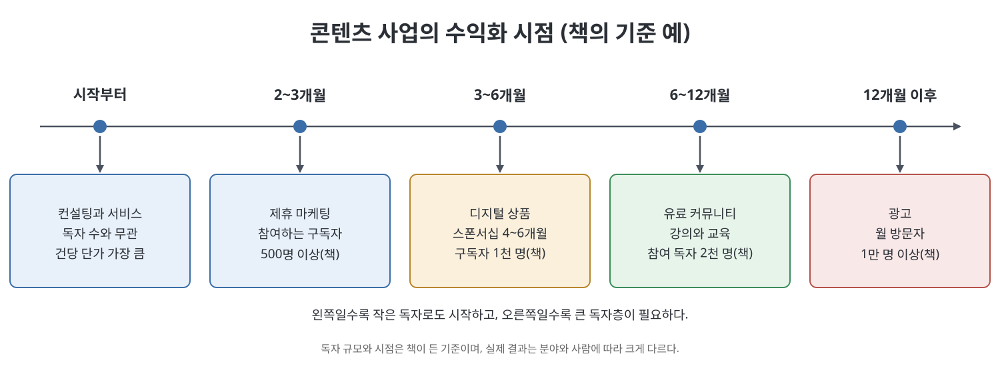

# 16장 AI 콘텐츠 사업 (AI-Powered Content Business: Building Audience-Driven Revenue)

이 장은 청중을 쌓아 그 관계에서 여러 수입을 내는 콘텐츠 사업을 다룬다. 책은 콘텐츠 사업이 서비스 사업과 근본적으로 다르다고 말한다. 서비스는 결과물마다 값을 받지만, 콘텐츠는 꾸준히 가치를 주는 사람을 청중이 따라오고 그 관계가 시간이 지날수록 여러 수입으로 이어진다. 경제성도, 성장 곡선도, 필요한 기술도 다르다는 것이다. 책은 Claude가 고품질 콘텐츠의 제작비를 크게 낮춰, 예전엔 편집팀이 필요했던 일을 혼자서도 할 수 있게 만든다고 본다.

> **쉽게 말하면**
> 청중이 생기면 그 청중에게 팔 수 있는 것이 여러 가지로 늘어난다. Claude는 글을 만드는 시간을 줄여 줄 뿐, 청중과의 진짜 관계는 대신 만들어 주지 못한다.

> **참고(노트 작성자)** 수익 범위, 구독자 기준, 시점, 제작 시간은 모두 책의 주장이며 노트가 검증하지 않았다. 수익과 시간은 책의 예이고 결과는 개인과 시장에 따라 크게 다르다. 플랫폼 정책과 알고리즘은 자주 바뀐다. 제휴 마케팅과 후원은 광고 표시 규정 등 법적 의무가 있을 수 있어 전문가 확인이 필요하다.

## 이 장의 흐름

1. 콘텐츠 사업의 수익화 단계
2. 발행 플랫폼 고르기
3. 소식지(뉴스레터) 사업 깊이 보기
4. 청중을 체계적으로 키우기

## 1. 콘텐츠 사업의 수익화 단계

책은 일곱 가지 수익 경로를 활성화 시점과 필요한 청중 규모와 함께 늘어놓는다. 핵심은 모든 경로를 처음부터 열지 않고 청중이 자라는 순서대로 하나씩 연다는 것이다. 노트는 이를 시점순으로 다시 정리하고, 금액은 구조 설명에 꼭 필요하지 않아 뺐다.

| 시점 | 경로 | 필요한 청중(책의 기준 예) | 성격 |
|------|------|------------------------|------|
| 처음부터 | 콘텐츠를 통한 컨설팅과 서비스 | 규모 무관 | 건당 가장 큼 |
| 2~3개월 | 제휴 마케팅 | 참여도 높은 구독자 수백 명 | 남의 상품을 소개하고 수수료 |
| 3~6개월 | 디지털 상품 | 참여도 높은 구독자 수백 명 | 내 상품, 수동 소득의 시작 |
| 4~6개월 | 소식지, 팟캐스트 후원 | 구독자 약 1천 명 이상 | 광고주가 청중에 비용 지불 |
| 6~12개월 | 유료 커뮤니티, 멤버십 | 참여도 높은 구독자 약 2천 명 | 월 구독형 |
| 6~12개월 | 강의와 교육 | 참여도 높은 구독자 약 2천 명 | 큰 단가의 상품 |
| 12개월 이후 | 디스플레이, 자동 광고 | 월 방문자 약 1만 명 이상 | 규모가 커야 의미 있음 |

가장 눈에 띄는 대목은 첫 줄이다. 책은 청중이 아주 작을 때도 콘텐츠를 명함처럼 써서 컨설팅과 서비스를 파는 것이 가장 빠른 수익 경로라고 본다. 그리고 앞 장들의 서비스 사업과 이 사업이 이어지는 접점이 바로 여기다.



## 2. 발행 플랫폼 고르기

플랫폼은 청중에게 닿는 방식, 형식, 수익화 방법, 플랫폼 변화에 대한 회복력까지 모두 좌우한다. 책은 모두에게 맞는 정답은 없고 분야, 콘텐츠 스타일, 수익 목표에 따라 달라진다고 말한다. 다음은 노트가 여섯 플랫폼의 성격을 다시 묶은 표다.

| 플랫폼 | 잘 맞는 목적 | 수익화 방법 | Claude의 주된 쓰임 |
|--------|-------------|------------|------------------|
| 이메일 소식지 | 가장 깊은 독자 관계 | 후원, 상품, 서비스 | 한 호 전체 초안 |
| LinkedIn | B2B 청중, 직접 고객 확보 | 서비스 의뢰 | 게시글과 기사 초안 |
| YouTube | 오래 가는 영상 | 광고, 후원, 상품 | 대본 작성 |
| 팟캐스트 | 긴 대화로 전문가 이미지 구축 | 후원, 상품, 서비스 | 쇼 노트와 회차 개요 |
| 블로그, 검색 최적화 | 검색으로 들어오는 꾸준한 방문 | 제휴, 광고, 상품 | 글 전체 초안 |
| Twitter/X | 빠른 생각 리더십 | 직접 청중, 상품 | 스레드 초안 |

플랫폼마다 성장 동력이 다르다. 소식지는 추천과 SNS와 검색, LinkedIn은 알고리즘, YouTube는 검색과 추천, 팟캐스트는 디렉터리와 게스트 출연이라고 책은 정리한다. 이 책의 구조에서 소식지는 특별한 자리에 놓인다.

## 3. 소식지 사업 깊이 보기

책은 이메일 소식지를 구독자 한 명당 수익이 가장 높은 콘텐츠 자산이라고 본다. 알고리즘 변화에 휘둘리는 SNS 팔로워보다 직접 쌓은 구독자 목록이 훨씬 가치 있다는 이유다. 책이 꼽는 좋은 소식지의 요소는 다음 다섯 가지다.

- 매 호가 채워 주는 구체적이고 절실한 독자의 필요
- 다른 곳에서 얻기 어려운 고유한 편집 목소리
- 독자가 믿고 기다릴 수 있는 일정한 발행 일정
- 새 구독자를 꾸준히 데려오는 성장 장치
- 독자가 가치로 느끼는 것에 맞춘 수익화

책의 프롬프트는 두 층으로 나뉜다. 한 번 정해 두는 시스템 프롬프트에는 소식지 이름과 독자, 독특한 각도, 목소리를 나타내는 형용사, 고정 섹션, 분량, 피할 것을 담고, 매주 채우는 사용자 프롬프트에는 이번 주 주제, 내가 말하고 싶은 고유한 관찰, 독자가 가져갈 한 가지, 근거나 예시, 이번 주 행동 요청을 넣는다. 고정된 틀과 매주 바뀌는 재료를 분리해 두면 호마다 같은 목소리가 유지된다는 구조다. 노트가 새로 쓴 짧은 예시는 다음과 같다.

```
[시스템] 이 소식지는 [독자]를 위한 것이다.
목소리: 솔직함, 실용적, 가끔 유머.
고정 섹션: 이번 주 한 가지, 실험 결과, 다음 주 예고.
금지: 막연한 동기부여 문구.
[이번 주] 주제: [ ] / 내 관찰: [ ] / 독자가 가져갈 것: [ ]
```

## 4. 청중을 체계적으로 키우기

책은 청중 성장이 우연이 아니라 꾸준한 발행, 전략적 배포, 관계 형성의 결과라고 말한다. Claude는 이 활동들을 가속하지만 편집 판단과 진짜 연결까지 대신하지는 못한다. 표에서 눈에 띄는 점은 한 활동의 Claude 역할이 아예 없다는 것이다.

| 성장 활동 | 빈도 | Claude의 역할 | 사람의 몫 |
|----------|------|--------------|---------|
| 대표 콘텐츠 발행 | 주간이나 격주 | 한 호나 한 편의 초안 | 관점과 편집 |
| 소셜 미디어 | 주 서너 번 | 대표 콘텐츠를 변형한 글 | 최종 확인 |
| 게스트 기고 | 월간 | 제안 메일과 기고문 초안 | 관계 맺기 |
| 커뮤니티 참여 | 매일 | 없음, 진정성이 필요 | 직접 소통 |
| 교차 홍보 | 월간 | 교환 문안과 제안 메시지 | 파트너 선정 |
| 검색 최적화 콘텐츠 | 격주 | 최적화된 글 초안 | 사실 확인 |

책은 Claude를 쓴 제작 시간을 대표 콘텐츠 한 편에 한 시간 안팎, 소셜 변형에 이삼십 분 정도로 잡는다. 한편 커뮤니티 참여는 진짜 상호작용이어야 하므로 AI에게 맡기지 말라고 한다. 청중이 신뢰를 주는 대상은 문장이 아니라 사람이기 때문이다.

실행 순서의 조언도 눈여겨볼 만하다. 하나의 주 플랫폼을 정해 여섯 달 동안 발행 일정을 지키고, 청중 규모에 맞춰 1, 3, 6개월째에 켤 수익 경로를 미리 정하고, 처음 90일의 성장 달력을 짜며, 첫 세 호를 발행하기 전에 미리 써 보고 시스템이 요구 품질에 닿는지 확인하라는 것이다.

## 핵심 정리

- 콘텐츠 사업은 서비스처럼 결과물마다 받는 구조가 아니라 청중과의 관계에서 여러 수입이 나오는 구조이며, Claude는 제작비를 크게 낮춘다.
- 수익 경로는 청중이 자라는 순서대로 연다. 컨설팅은 처음부터 가능하고, 광고는 큰 방문자 규모가 필요하다는 것이 책의 기준이다.
- 플랫폼은 분야, 스타일, 수익 목표에 맞춰 고르며, 책은 소식지를 직접 소유한 청중이라는 이유로 가장 높이 평가한다.
- 소식지는 고정 틀(시스템 프롬프트)과 매주 바뀌는 재료(사용자 프롬프트)를 분리하면 목소리를 일정하게 유지하기 쉽다.
- 커뮤니티 참여처럼 진정성이 필요한 일은 AI에 맡기지 않는다. 수치는 책의 예이며 결과는 사람마다 크게 다르다.

<br>
<br>
<br>

이전: [15장 프롬프트 엔지니어링 사업](15%EC%9E%A5%20%ED%94%84%EB%A1%AC%ED%94%84%ED%8A%B8%20%EC%97%94%EC%A7%80%EB%8B%88%EC%96%B4%EB%A7%81%20%EC%82%AC%EC%97%85.md) | 다음: [17장 운영 확장 시스템이 무리한 노력보다 낫다](17%EC%9E%A5%20%EC%9A%B4%EC%98%81%20%ED%99%95%EC%9E%A5%20%EC%8B%9C%EC%8A%A4%ED%85%9C%EC%9D%B4%20%EB%AC%B4%EB%A6%AC%ED%95%9C%20%EB%85%B8%EB%A0%A5%EB%B3%B4%EB%8B%A4%20%EB%82%AB%EB%8B%A4.md)

<br>

[Claude AI Automation and Monetization](../)
