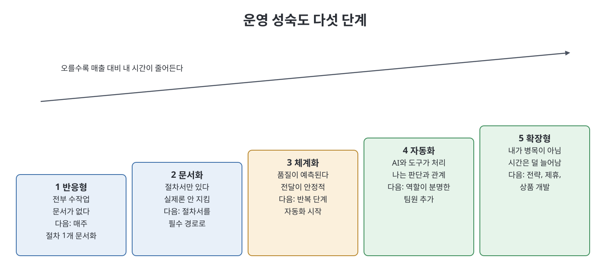
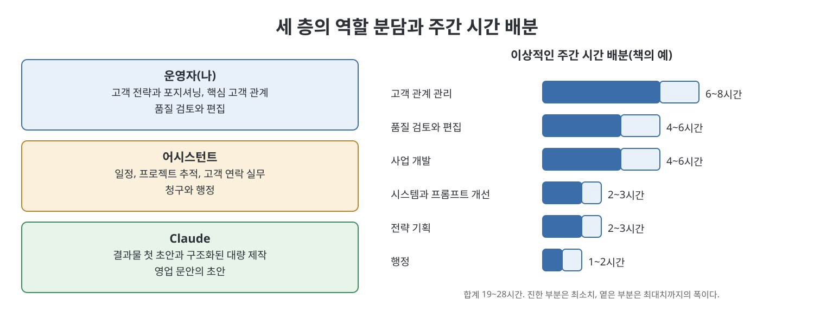

# 17장 운영 확장, 시스템이 무리한 노력보다 낫다 (Scaling Your Operations: Systems Over Hustle)

이 장은 초기 AI 사업가가 빠지기 쉬운 함정에서 시작한다. 시스템을 만들고, 고객을 얻고, 소개가 들어오고, 매출이 늘어난다. 그런데 성장을 체계화하기 전에 어느새 예전보다 오래 일하고, 자동화했어야 할 일을 손으로 하고, 지친 탓에 품질이 떨어진다는 것이다. 장은 이 함정을 예방하거나 이미 빠졌다면 빠져나오는 법, 곧 내 노동이 늘지 않아도 사업이 자라게 하는 운영 기반을 다룬다. 장의 순서는 운영 성숙도 모델, 절차서, 위임과 팀, 시간 배분, 지표다.

> **쉽게 말하면**
> 더 열심히 일하는 것은 확장이 아니다. 내가 빠져도 돌아가는 절차와 역할 분담을 만드는 것이 확장이다.

> **참고(노트 작성자)** 주당 시간, 월 매출 구간, 지표의 건강 범위는 모두 책의 주장이며 노트가 검증하지 않았다. 수익과 시간은 책의 예이며 결과는 개인과 시장에 따라 크게 다르다. 인력 채용, 계약직과 근로자 구분, 급여 관련 사안은 지역 법령에 따라 다르므로 전문가 확인이 필요하다.

## 이 장의 흐름

1. 운영 성숙도 다섯 단계
2. Claude로 절차서(SOP) 만들기
3. 위임과 팀 구성
4. 시간 관리
5. 확장 결정을 이끄는 지표

## 1. 운영 성숙도 다섯 단계

책은 운영 수준을 다섯 단계로 나눈다. 각 단계에는 내가 지금 이 단계에 있다는 신호와 다음에 해야 할 일이 짝지어 있다. 아래는 노트가 다시 정리한 표다.

| 단계 | 상태 | 내가 이 단계라는 신호 | 다음에 할 일 |
|------|------|--------------------|-------------|
| 1 반응형 | 모든 것이 수작업이고 즉흥적 | 프로젝트마다 완전히 새롭고 문서가 없다 | 매주 절차 하나를 문서화 |
| 2 문서화 | 절차가 종이 위에 있다 | 절차서는 있는데 꾸준히 지키지 않는다 | 절차서를 선택이 아닌 필수 경로로 |
| 3 체계화 | 일관된 절차가 납품을 이끈다 | 납품이 믿을 만하고 품질이 예측된다 | 가장 반복적인 단계부터 자동화 |
| 4 자동화 | AI와 도구가 일상 업무를 처리 | 시간 대부분을 판단과 관계에 쓴다 | 역할과 문서가 분명한 팀원 추가 |
| 5 확장형 | 내가 병목이 아니어도 성장 | 매출이 늘어도 내 시간은 덜 늘어난다 | 전략, 제휴, 상품 개발에 집중 |

가장 흔한 실패는 2단계에서 나타난다. 절차서를 만들어 놓고 지키지 않으면 3단계로 넘어가지 못한다. 책이 "선택이 아닌 필수 경로"라고 강조하는 이유다. 자동화는 이미 일관되게 반복되는 절차 위에서만 의미가 있다.



## 2. Claude로 절차서(SOP) 만들기

SOP(Standard Operating Procedure, 표준 운영 절차서)는 확장 가능한 운영의 뼈대다. 책은 반복되는 모든 과정에 SOP가 있어야 하며, 내가 하는 일을 말로 풀어 설명하면 Claude가 SOP 양식으로 정리해 주므로 만드는 속도가 훨씬 빨라진다고 한다.

책의 프롬프트는 입력과 출력으로 나뉜다. 입력에는 과정 이름, 빈도, 시작 계기, 대략의 단계, 쓰는 도구, 관련된 역할, 자주 생기는 실수, 잘 끝났을 때의 모습을 넣는다. 출력에는 제목과 담당자, 한 문장 목적, 쓰는 시기, 시작 전 필요한 입력, 번호가 붙은 구체적 단계, 핵심 지점의 품질 점검, 흔한 오류와 피하는 법, 완료의 정의를 요구한다. 새로 쓴 짧은 예시는 아래와 같다.

```
과정 이름: 신규 고객 접수
계기: 계약서 서명 완료
내가 하는 일: [대략 적는다]
자주 틀리는 것: 연락처 누락
위 내용을 목적, 시작 전 준비물, 번호 단계,
품질 확인 지점, 완료 기준이 있는 SOP로 정리한다.
```

## 3. 위임과 팀 구성

책이 말하는 솔로 AI 사업가의 첫 채용은 대개 시간제 어시스턴트다. Claude가 AI 제작을 맡고, 어시스턴트가 일정, 프로젝트 추적, 고객 연락 실무, 간단한 조사를 맡으며, 나는 전략, 품질 검토, 핵심 고객 관계를 맡는 세 층 구조다. 책은 이 구조가 월 매출이 일정 규모에 이르기까지 놀라울 만큼 잘 맞고 많은 사업이 2년 넘게 이 상태로 운영된다고 주장한다. 두 번째 핵심 인력은 한참 뒤에 들인다는 설명이다.

| 업무 | 담당 | 이유 |
|------|------|------|
| 고객 전략과 포지셔닝 | 나 | 내 전문성과 고객 관계가 필요 |
| 결과물 첫 초안 | Claude | 구조화된 생성을 대량으로 처리 |
| 품질 검토와 편집 | 나 또는 선임 검토자 | 오류를 가려내는 판단과 전문성 필요 |
| 고객 연락 실무 | 어시스턴트 | 일정화할 수 있고 전문성이 필요 없음 |
| 프로젝트 추적과 조율 | 어시스턴트와 도구 | 행정이며 문서화된 절차로 처리 |
| 사업 개발 연락 | 나와 Claude 초안 | 관계는 내 몫, 초안은 Claude 몫 |
| 청구와 행정 | 어시스턴트와 회계 도구 | 순수 행정 |



## 4. 시간 관리

AI가 제작을 맡으면 시간 구조도 달라져야 한다. 제작 모드의 시간은 줄이고 전략, 품질 감독, 관계에 더 써야 한다. 책은 흔한 실수로 Claude가 이미 맡은 일을 습관 때문에 계속 직접 하는 것을 꼽는다. 이 변화는 의식적으로 해야 일어난다.

책이 제시하는 이상적인 주간 배분은 고객 관계 관리가 가장 크고, 그 뒤로 품질 검토, 사업 개발, 시스템과 프롬프트 개선, 전략 기획, 행정 순이다. 합계는 주당 이십 시간 안팎에서 이십 시간대 후반까지로, 오래 지속 가능하면서 성과가 높은 일주일이라는 설명이다. 수치는 책의 예이므로 내 사업에 맞춰 조정해야 하며, 중요한 것은 비율과 방향이다. 제작보다 고객과 품질과 개선에 시간이 많이 쓰이는지 점검하는 틀로 쓰면 된다.

## 5. 확장 결정을 이끄는 지표

측정하지 않으면 지혜롭게 키울 수 없다. 책은 서비스나 상품 사업의 중요한 결정을 이끄는 소수의 지표를 대시보드로 제안한다.

| 지표 | 보는 것 | 어긋날 때의 조치(책의 제안) |
|------|--------|--------------------------|
| 월 매출 | 한 달 청구 총액의 추이 | 파이프라인이나 가격 문제를 찾는다 |
| 고객 유지율 | 정기 계약 고객의 월별 갱신 비율 | 품질 감사와 고객 면담 |
| 평균 프로젝트 가치 | 계약 한 건당 매출 | 패키지를 재구성하거나 가격 인상 |
| 납품 소요일 | 브리프에서 납품까지의 일수 | 작업 흐름 최적화 |
| 제안 대비 계약 전환율 | 제안이 계약으로 이어지는 비율 | 대상 선정이나 제안서 품질 개선 |
| 추천 의향 점수(NPS) | 남에게 추천하겠다는 고객 비율 | 품질 문제나 기대 불일치 점검 |

책은 지표별 건강 범위로 분기 대비 성장률, 유지율, 전환율, NPS의 구체적 수치를 제시하지만 노트는 옮기지 않았다. 업종과 규모마다 다르므로 처음에는 내 사업의 과거 값과 비교하는 것이 안전하다. 책은 대시보드를 이번 주 안에 만들어 추적을 시작하라고 권한다. 완벽한 도구보다 일단 기록하는 습관이 먼저라는 뜻이다.

## 핵심 정리

- 성장하면서 오래 일하고, 자동화할 일을 손으로 하고, 품질이 떨어지는 함정을 막는 것이 이 장의 목적이다.
- 운영은 반응형, 문서화, 체계화, 자동화, 확장형의 다섯 단계이며, 절차서를 필수 경로로 만드는 것이 가장 흔한 고비다.
- Claude에게 내 일을 말로 설명하면 SOP 양식으로 정리해 주므로, 반복되는 과정마다 절차서를 만든다.
- 첫 채용은 행정과 조율을 맡는 어시스턴트이고, 나는 전략과 품질 검토와 핵심 관계에 집중하는 세 층 구조가 책의 제안이다.
- 시간 배분과 지표는 내 사업에 맞춰 조정하는 점검 틀이며, 수치는 책의 예일 뿐 결과를 보장하지 않는다.

<br>
<br>
<br>

이전: [16장 AI 콘텐츠 사업](16%EC%9E%A5%20AI%20%EC%BD%98%ED%85%90%EC%B8%A0%20%EC%82%AC%EC%97%85.md) | 다음: [18장 90일 실행 로드맵](18%EC%9E%A5%2090%EC%9D%BC%20%EC%8B%A4%ED%96%89%20%EB%A1%9C%EB%93%9C%EB%A7%B5.md)

<br>

[Claude AI Automation and Monetization](../)
