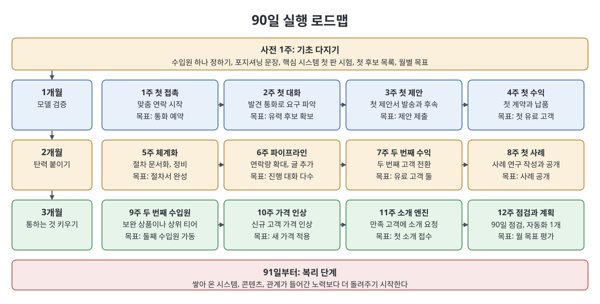

# 18장 90일 실행 로드맵 (Your 90-Day Execution Roadmap)

이 장은 지금까지의 내용을 실행 계획으로 묶는다. 책은 AI로 수입원을 만드는 데 알맞은 실행 기간이 90일이라고 본다. 의미 있는 것을 만들고 시장에서 시험하고 실제 피드백을 얻기에 충분히 길고, 끝이 항상 보여서 긴박감을 유지하고 대부분의 새 시도를 죽이는 표류를 막기에 충분히 짧다는 것이다. 장은 사전 1주, 3개월 동안의 주 단위 계획, 90일 점검, 그 이후의 복리 단계 순서로 진행한다. 책은 구체적인 내용보다 틀이 더 중요하며 내 사업 모델에 맞게 고쳐 쓰라고 말한다.

> **쉽게 말하면**
> 한 주에 하나씩, 연락하고, 대화하고, 제안하고, 첫 돈을 받고, 절차를 만들고, 사례를 쌓고, 가격을 올리는 순서로 나아가는 12주짜리 달력이다.

> **참고(노트 작성자)** 계획 속 연락 건수, 통화 건수, 월 매출 목표는 책의 예이며 노트가 검증하지 않았다. 수익과 시간은 책의 사례이며 결과는 개인과 시장에 따라 크게 다르다. 이 계획은 성과를 약속하지 않으며, 계약, 세금, 개인정보에 관한 사항은 전문가 확인이 필요하다.

## 이 장의 흐름

1. 사전 1주: 기초 다지기
2. 1개월: 모델 검증
3. 2개월: 탄력 붙이기
4. 3개월: 통하는 것 키우기
5. 90일 점검 틀과 그 이후



## 1. 사전 1주: 기초 다지기

90일 시계가 시작되기 전에 한 주를 따로 잡아 진행 속도를 좌우할 토대를 만든다. 책이 꼽는 다섯 가지는 다음과 같다.

1. 주 수입원 하나를 정하고 한 쪽짜리 사업 근거를 쓴다.
2. 누구를 위해 무엇을 하며 왜 중요한지를 담은 포지셔닝 문장을 쓴다.
3. 핵심 Claude 시스템의 첫 판을 만들고 대표적인 입력 몇 개로 시험한다.
4. 처음 접촉할 목표 고객 열 곳을 연락처와 함께 정한다.
5. 1, 2, 3개월째의 매출 목표를 정한다.

책이 말하는 순서의 의미는 시작 전에 대상과 문장과 시스템이 있어야 첫 주가 허공으로 날아가지 않는다는 것이다.

## 2. 1개월: 모델 검증

첫 달의 목표는 내 모델이 시장에서 통하는지를 가장 빨리 확인하는 것이다. 책은 이를 접촉, 대화, 제안, 수익의 네 걸음으로 나눈다.

| 주 | 초점 | 하는 일 | 마일스톤 |
|----|------|--------|---------|
| 1주 | 첫 접촉 | 맞춤 연락 메시지를 보내고 첫 콘텐츠를 발행, 발견 통화를 잡는다 | 통화 예약 |
| 2주 | 첫 대화 | 통화로 고객의 요구를 깊이 이해하고 제안을 다듬는다 | 유력 후보 확보 |
| 3주 | 첫 제안 | 첫 제안서를 보내고 후속 연락, 두 번째 사례용 프롬프트 준비 | 제안 제출 |
| 4주 | 첫 수익 | 첫 고객을 확정하고 첫 프로젝트를 훌륭하게 납품 | 첫 유료 고객 |

책이 제시한 구체적 연락 건수나 통화 건수는 책의 예이므로 노트는 방향만 옮겼다. 1주차에 가장 중요한 것은 완벽한 메시지가 아니라 실제로 보내는 일이다.

## 3. 2개월: 탄력 붙이기

둘째 달은 한 번 해낸 것을 반복 가능한 체계로 만들고 사례를 쌓는 시기다. 13장과 17장의 개념이 그대로 달력에 들어온다.

| 주 | 초점 | 하는 일 | 마일스톤 |
|----|------|--------|---------|
| 5주 | 납품 체계화 | 납품 절차를 문서화하고 프롬프트 묶음을 정비 | 주요 결과물의 SOP |
| 6주 | 파이프라인 확대 | 연락량을 늘리고 콘텐츠 둘째, 셋째 편 발행 | 진행 중인 대화 다수 |
| 7주 | 두 번째 수익 | 두 번째 고객을 전환하고 첫 고객에게서 사례 자료 수집 | 유료 고객 둘 |
| 8주 | 첫 사례 | 첫 사례 연구를 쓰고 공개, 소개 대화 시작 | 사례 공개 |

## 4. 3개월: 통하는 것 키우기

셋째 달은 이미 통하는 것을 키우는 달이다. 새로운 것을 벌이기보다 효과가 확인된 것 위에 쌓는다.

| 주 | 초점 | 하는 일 | 마일스톤 |
|----|------|--------|---------|
| 9주 | 두 번째 수입원 | 보완 상품을 내거나 서비스 등급을 하나 더 만든다 | 둘째 수입원 가동 |
| 10주 | 가격 인상 | 입증된 가치를 근거로 신규 고객 가격을 올린다, 기존 고객은 현 가격 유지 | 새 가격 적용 |
| 11주 | 소개 엔진 | 만족한 고객 모두에게 소개를 한 건씩 부탁하고 감사 체계를 만든다 | 첫 소개 접수 |
| 12주 | 점검과 계획 | 90일 점검을 하고 다음 90일 목표를 정하며 자동화할 시스템 하나를 고른다 | 월 매출 목표 평가 |

가격 인상의 방식에 주목할 만하다. 책은 기존 고객이 아니라 신규 고객부터 올리라고 하며, 근거는 이미 입증한 가치다. 소개 요청도 만족한 고객에게 부탁한다는 점에서 같은 논리다.

> **전문가 확인 필요** 고객과의 계약서, 환불과 책임 범위, 세금 신고, 고객 개인정보 보관 같은 사항은 나라와 업종에 따라 다르다. 첫 계약 전에 전문가에게 확인한다.

## 5. 90일 점검 틀과 그 이후

책은 다음 90일을 계획하기 전에 첫 90일이 무엇을 가르쳤는지 솔직하게 돌아보라고 한다. 점검은 어떤 계획 회의보다 값진데, 내 가정과 현실의 간격을 보여 주기 때문이다.

책의 점검 프롬프트는 입력과 요청으로 이루어진다. 입력은 실제 매출과 목표, 확보한 고객 수, 주력 서비스나 상품, 예상보다 잘된 것, 예상보다 어려웠던 것, 지금 가장 큰 제약이다. 요청은 모델이 통하는지 근본적 수정이 필요한지에 대한 솔직한 평가, 앞으로 30일의 결정 세 가지, 수익을 못 내면서 계속하고 있는 일 중 그만둘 한 가지, 미뤄 온 일 중 시작할 한 가지, 지금 아는 바에 따른 현실적인 수정 90일 계획이다. 핵심은 Claude를 격려만 하는 응원자가 아니라 냉정한 사업 전략 자문가 역할로 부르는 것이다. 새 예시는 아래와 같다.

```
역할: 냉정한 사업 자문가.
내 90일 결과: 매출 [ ] / 목표 [ ] / 고객 수 [ ]
예상보다 어려웠던 것: [ ]
위 결과로 모델을 평가하고, 그만둘 일 한 가지와
시작할 일 한 가지, 수정한 다음 90일 계획을 제안한다.
```

91일째부터는 복리 단계다. 책은 처음 90일에 만든 것이 그 이후를 결정한다고 본다. 만족한 고객의 소개에는 납품 품질 외 비용이 들지 않고, 첫 달에 낸 콘텐츠가 여섯 달째에도 잠재 고객을 데려오며, 둘째 주에 만든 프롬프트 시스템이 쉰 번째 주에도 같은 품질을 낸다는 설명이다. 복리는 처음 90일에는 별로 느껴지지 않지만 2년째에는 아주 실감이 난다고 한다. 책의 실행 점검 목록은 사전 주를 먼저 끝내고, 월별 표를 주 시작마다 보며, 주간 필수 활동을 정하고, 90일 점검 일정을 시작 전에 잡고, 진행을 공유할 책임 파트너를 한 명 찾으라고 권한다.

## 핵심 정리

- 90일은 시장에서 시험하고 피드백을 받기에 길고, 끝이 보여 긴장을 유지하기에 짧은 실행 기간이라는 것이 책의 주장이다.
- 시작 전 한 주에 수입원, 포지셔닝 문장, 핵심 시스템 첫 판, 목표 고객, 월별 목표를 준비한다.
- 1개월은 접촉에서 첫 수익까지, 2개월은 절차 문서화와 사례, 3개월은 두 번째 수입원과 가격 인상과 소개 엔진이다.
- 점검은 계획보다 값지다. 결과, 예상과의 차이, 그만둘 일과 시작할 일을 솔직하게 적고 다음 90일을 현실에 맞춰 고친다.
- 주차별 목표와 수치는 책의 예이며 결과는 개인과 시장에 따라 크게 다르다. 틀을 배우고 내 사업에 맞춰 조정한다.

<br>
<br>
<br>

이전: [17장 운영 확장 시스템이 무리한 노력보다 낫다](17%EC%9E%A5%20%EC%9A%B4%EC%98%81%20%ED%99%95%EC%9E%A5%20%EC%8B%9C%EC%8A%A4%ED%85%9C%EC%9D%B4%20%EB%AC%B4%EB%A6%AC%ED%95%9C%20%EB%85%B8%EB%A0%A5%EB%B3%B4%EB%8B%A4%20%EB%82%AB%EB%8B%A4.md) | 다음: [19장 고급 자동화(n8n, API 체인, 커스텀 연동)](../05.%205%EB%B6%80%20%EC%8B%AC%ED%99%94%EC%99%80%20%EB%A7%88%EB%AC%B4%EB%A6%AC/19%EC%9E%A5%20%EA%B3%A0%EA%B8%89%20%EC%9E%90%EB%8F%99%ED%99%94%28n8n%2C%20API%20%EC%B2%B4%EC%9D%B8%2C%20%EC%BB%A4%EC%8A%A4%ED%85%80%20%EC%97%B0%EB%8F%99%29.md)

<br>

[Claude AI Automation and Monetization](../)
