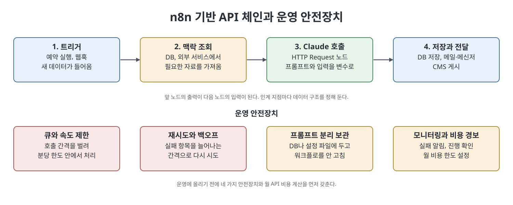
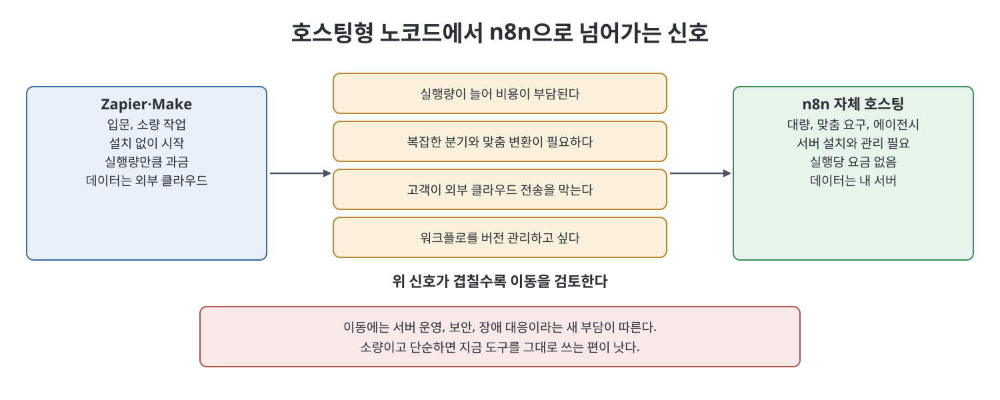

# 19장 고급 자동화: n8n, API 체인, 커스텀 연동 (Advanced Automation: n8n, API Chains, and Custom Integrations)

이 장은 Zapier나 Make 같은 호스팅형 노코드 도구로 시작한 자동화가 한계에 닿았을 때 다음 단계로 넘어가는 방법을 다룬다. 책은 복잡한 분기 로직, 대량 일괄 처리, 맞춤 데이터 변환, 비용에 민감한 운영 환경이 되면 노코드 플랫폼만으로는 효율이 떨어진다고 본다. 그래서 세 가지를 소개한다. 직접 서버에 설치해 쓰는 오픈소스 자동화 플랫폼 n8n, 여러 모델과 서비스를 줄줄이 잇는 API 체인(API chain) 설계, 그리고 운영 수준의 연동 패턴이다.

> **쉽게 말하면**
> 처음에는 조립식 장난감(Zapier, Make)으로 충분하지만, 물량이 늘고 요구가 까다로워지면 직접 설계한 공장 라인(n8n과 API 체인)이 더 싸고 더 잘 맞는다.

> **참고(노트 작성자)** 책이 제시하는 플랫폼 비용, 서버 요금, 모델 이름, 설치 시간은 책이 쓰인 시점의 값이며 검증하지 않았다. 실제 비용은 사용량과 요금제에 따라 크게 다르고, 사례의 시간 절감도 책의 주장이다. 고객 데이터를 외부로 보내는 문제는 법률과 계약에 걸려 있으므로 전문가 확인이 필요하다.

## 이 장의 흐름

1. n8n이 판을 바꾸는 이유
2. Claude를 n8n에 연결하는 방법
3. API 체인 설계 패턴
4. 일괄 처리 아키텍처
5. 사례: 문서를 대량으로 읽어 브리핑을 만드는 정보 회사
6. 고급 자동화의 흔한 실수

## 1. n8n이 판을 바꾸는 이유

n8n은 자기가 통제하는 서버에 직접 설치해 쓰는 오픈소스 워크플로(workflow) 자동화 플랫폼이다. 책은 Zapier와 Make가 실행 횟수에 따라 요금을 매기고 인프라가 닫혀 있는 반면, n8n은 한 번 설치하면 실행당 요금이 없다고 설명한다. 그래서 AI 호출이 많은 사업에서는 1년 단위로 비용 차이가 커질 수 있다는 것이다.

비용 말고도 책이 꼽는 장점이 세 가지 있다. 첫째, 워크플로 안에서 JavaScript를 마음대로 실행해 어떤 변환이든 할 수 있다. 둘째, 자동화 로직이 내보내기 가능한 JSON 파일이어서 버전 관리와 배포를 코드처럼 할 수 있다. 셋째, 데이터가 내 서버 안에만 머문다. 고객이 제3자 클라우드로 정보를 보내지 못하게 막는 경우에 중요하다.

| 비교 항목 | Zapier | Make | n8n(자체 호스팅) |
|-----------|--------|------|------------------|
| 과금 방식 | 실행량 비례 | 실행량 비례 | 서버 비용만 |
| 기술 문턱 | 없음 | 낮음 | 중간(서버 설치 필요) |
| 맞춤 코드 | 제한적 | 보통 | 완전한 JavaScript |
| 데이터 위치 | 외부 클라우드 | 외부 클라우드 | 내 서버 |
| Claude 연결 | 전용 앱 | HTTP 모듈 | HTTP 모듈 또는 커뮤니티 노드 |
| 어울리는 사람 | 입문, 소량 | 중간 복잡도 | 대량, 맞춤 요구, 에이전시 |

## 2. Claude를 n8n에 연결하기

책은 운영용 n8n을 위해 서버 한 대, 웹 화면용 도메인, 그리고 몇 시간의 설치 작업이 필요하다고 말한다(책은 월 10~20달러대 가상 서버로 대부분 충분하다고 한다). 설치 방법은 n8n 공식 문서를 따르라고 한다. 설치 후 Claude 연결은 HTTP Request 노드로 한다.

책이 ready-to-use 프롬프트로 싣는 설정은 요소만 정리하면 이렇다. 메서드는 POST, 주소는 Anthropic Messages API 엔드포인트다. 헤더에 API 키(자격증명 저장소에서 가져옴), API 버전, 콘텐츠 유형을 넣는다. 본문에는 모델 이름, 최대 토큰 수, 시스템 프롬프트, 사용자 메시지를 앞 노드의 값으로 채운다. 응답에서는 첫 번째 content 블록의 텍스트를 꺼내 다음 노드가 쓸 변수로 저장하고, 오류가 나면 알림 노드로 보내면서 실패한 입력을 기록한다.

핵심은 세 가지 습관이다. 키는 노드에 직접 적지 않고 자격증명에 보관한다. 시스템 프롬프트와 사용자 입력은 고정 문자열이 아니라 변수로 주입한다. 실패 경로를 처음부터 만든다.

## 3. API 체인 설계 패턴

API 체인은 한 호출의 출력이 다음 호출의 입력이 되는 연쇄다. 서로 다른 모델이나 서비스를 이어서 단일 모델이 못 하는 일을 해낸다. 가장 흔한 형태는 세 노드다. 맥락을 가져오는 호출, Claude가 그 맥락으로 분석하거나 생성하는 호출, 결과를 목적지로 보내는 호출이다. 각 인계 지점의 데이터 구조를 신중히 정해야 한다.

| 패턴 | 흐름 | 쓰임새 |
|------|------|--------|
| 조회-처리-저장 | DB 조회 → Claude 분석 → DB 저장 | 자동 조사 브리핑 |
| 트리거-생성-발송 | 웹훅 → 초안 작성 → 메일·메신저 | 자동 알림 |
| 수집-종합-게시 | 웹 수집 → 요약·재작성 → CMS 게시 | 경쟁 정보 피드 |
| 분류-분기-처리 | 입력 분류 → 범주별 처리 → 여러 목적지 | 문의 티켓 분류 |
| 일괄-매핑-집계 | 목록 → 항목별 처리 → 합치기 | 대량 콘텐츠 생성 |

새 예시로 분류-분기 패턴을 적어 본다. 고객 문의가 들어오면 Claude가 "결제, 배송, 기타" 중 하나로 분류해 JSON으로 답하게 하고, n8n의 분기 노드가 이 값을 읽어 각 범주별 응답 프롬프트와 담당 채널로 보낸다. 분류 결과가 예상 밖이면 사람 검토함으로 보낸다.

## 4. 일괄 처리 아키텍처

수백, 수천 건을 처리하려면 사람이 지켜보지 않아도 속도 제한, 오류, 진행 상황을 스스로 관리하는 구조가 필요하다. 책은 네 가지 구성 요소를 든다. 대기 항목을 담는 큐, Claude의 분당 호출 한도에 맞춰 호출 간격을 벌리는 속도 제한기, 실패 항목을 점점 늘어나는 간격으로 다시 시도하는 오류 처리기(지수 백오프, exponential backoff), 전체를 다시 돌리지 않고 상태를 볼 수 있는 진행 추적기다.

책의 Python 예제는 항목 목록을 돌며 호출하고, 성공과 실패를 항목별로 기록하고, 호출 사이에 쉬며, 열 건마다 진행을 출력하는 단순한 틀이다. 노트에서는 코드를 옮기지 않는다. 다만 이 단순형은 재시도가 없다는 점을 알아 두자. 운영용이라면 앞의 네 요소를 모두 갖춰야 한다.

## 5. 사례: 대량 문서를 읽는 정보 회사

책은 규제 공시, 실적 발표 녹취, 뉴스를 사람이 읽어 일일 브리핑을 만들던 소규모 금융 정보 회사를 소개한다. 이 회사는 n8n 파이프라인(pipeline)을 세 단계로 만들었다고 한다. 예약 실행으로 새 문서를 수집하고, 문서마다 Claude가 핵심 신호와 위험을 구조화된 JSON으로 뽑고, 마지막에 그 결과를 모아 브리핑 생성 프롬프트로 일일 보고서를 쓴다. 책은 분석가의 반복 작업이 크게 줄고 처리 문서 수가 늘었으며 분석가들이 고객 전략과 연구 방향 같은 일로 옮겨 갔다고 주장한다. 구체적 시간과 건수는 책의 주장으로만 남겨 둔다.

## 6. 고급 자동화의 흔한 실수

| 실수 | 왜 문제인가 | 처방 |
|------|-------------|------|
| 재시도 로직 없음 | 네트워크 장애가 조용한 실패로 번진다 | 재시도와 오류 경로를 기본 탑재 |
| 프롬프트를 워크플로에 고정 | 바꿀 때마다 워크플로를 고쳐야 한다 | 데이터베이스나 설정 파일에 분리 |
| 모니터링·알림 없음 | 고객 문제가 터져야 알게 된다 | 실패 알림과 상태 대시보드 |
| 대량 API 비용 과소평가 | 규모가 커지면 예산이 흔들린다 | 출시 전 월 비용 계산, 경고 한도 설정 |

## 핵심 정리

- 책은 호스팅형 노코드가 복잡도, 물량, 비용, 데이터 위치의 한계에 닿을 때 n8n 같은 자체 호스팅 도구를 고려하라고 본다.
- n8n의 장점은 실행당 요금 없음, 완전한 JavaScript 실행, JSON 형태의 버전 관리, 내 서버 안의 데이터 처리다.
- API 체인은 앞 호출의 출력이 다음 입력이 되는 연쇄이며, 인계 지점의 데이터 구조 설계가 품질을 좌우한다.
- 대량 처리에는 큐, 속도 제한, 재시도(백오프), 진행 추적이 필요하다.
- 프롬프트 분리, 모니터링, 비용 사전 계산이 운영 사고를 막는다.

 
 
 

이전: [18장 90일 실행 로드맵](../04.%204%EB%B6%80%20%EC%9A%B4%EC%98%81%EA%B3%BC%20%EB%B3%B4%ED%98%B8/18%EC%9E%A5%2090%EC%9D%BC%20%EC%8B%A4%ED%96%89%20%EB%A1%9C%EB%93%9C%EB%A7%B5.md) | 다음: [20장 교육과 강의](20%EC%9E%A5%20%EA%B5%90%EC%9C%A1%EA%B3%BC%20%EA%B0%95%EC%9D%98.md)

 

[Claude AI Automation and Monetization](../)
