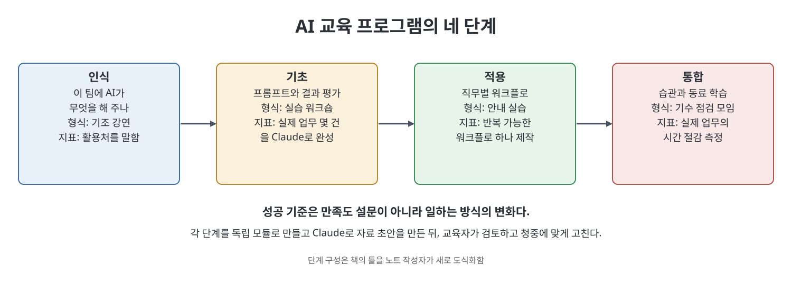

# 20장 교육과 강의: 조직과 전문가에게 AI 가르치기 (Training and Education: Teaching AI to Organizations and Professionals)

이 장은 Claude를 실제로 써 본 경험을 "교육 상품"으로 바꾸는 방법을 다룬다. 책은 많은 조직이 "AI를 써야 한다"는 경영진의 말과 현장의 실제 활용 사이에 큰 간격을 안고 있다고 본다. 직원들은 혼란스럽거나 거부감이 있거나, 의욕은 있어도 방향이 없다. 그 간격을 체계적인 학습 프로그램으로 메우는 사람이 대가를 받는다는 논리다. 그래서 시장 구분, 프로그램 설계의 네 단계, 워크숍 제작 방식, 가격과 상품 구성, 한 교육자의 사례를 차례로 정리한다.

> **쉽게 말하면**
> AI 교육의 목표는 "Claude가 무엇인지 설명"하는 것이 아니라 "내일부터 다르게 일하게" 만드는 것이다. 정보를 전하는 일은 수단일 뿐이다.

> **참고(노트 작성자)** 책의 가격대, 매출, 기간, 시간 절감은 책의 사례와 주장이며 노트가 검증하지 않았다. 교육 수요와 단가는 지역, 산업, 본인의 경력에 따라 크게 다르고 수익을 보장하지 않는다. 계약, 세금, 사업자 등록은 전문가 확인이 필요하다.

## 이 장의 흐름

1. AI 교육 시장의 구분
2. 교육 프로그램 설계의 네 단계
3. Claude로 워크숍 모듈 만들기
4. 가격과 상품 구성
5. 사례: 실무자에서 전문 교육자로
6. 실행 점검

## 1. AI 교육 시장의 구분

책은 구매자와 필요가 다른 다섯 시장을 나눈다. 구매자가 누구냐에 따라 영업 기간과 단가의 규모가 달라진다는 점이 핵심이다.

| 시장 | 구매자 | 원하는 것 | 영업 기간(책의 설명) |
|------|--------|-----------|--------------------|
| 대기업 조직 | 교육 담당 임원, 인사 책임자 | 전사 AI 도입 프로그램 | 수 주에서 수개월, 가장 길다 |
| 중소기업 | 대표, 운영 책임자 | 팀 단위 업무 자동화 교육 | 짧은 편 |
| 전문가 협회 | 행사·교육 담당자 | 회원 보수교육 워크숍 | 중간 |
| 개인 전문직 | 본인이 결제 | 기술 향상 강좌, 기수제 과정 | 며칠에서 몇 주 |
| 프리랜서·창업가 커뮤니티 | 커뮤니티 운영자 | 회원용 워크숍·강좌 | 가장 짧은 편 |

책은 단가도 이 순서대로 큰 폭으로 달라진다고 소개하지만, 구체 금액은 이 노트에서 줄인다. 기억할 구조는 조직이 클수록 단가와 영업 기간이 함께 커지고, 개인 대상은 단가가 작은 대신 빠르다는 것이다.

## 2. 교육 프로그램 설계의 네 단계

책은 기술이 실제로 몸에 붙는 순서를 본떠 네 단계로 설계하라고 한다. 인식(awareness)은 이 팀에게 AI가 구체적으로 무엇을 해 줄 수 있는지 알고 마음가짐을 바꾸는 단계다. 기초(foundation)는 프롬프트 작성, 결과 평가, 기본 워크플로를 실습하는 단계다. 적용(application)은 직무별 워크플로와 템플릿을 만들어 보는 단계다. 통합(integration)은 몇 주에 걸친 점검 모임과 동료 학습으로 습관을 만드는 단계다.

| 단계 | 길이 | 형식 | 성공을 재는 방법 |
|------|------|------|-----------------|
| 인식 | 짧은 강연 | 기조 강연·입문 워크숍 | 참가자가 자기 직무의 활용처를 말할 수 있다 |
| 기초 | 반나절 안팎 | 실습 워크숍 | 실제 업무 몇 건을 Claude로 완성한다 |
| 적용 | 반나절에서 하루 | 직무별 실습 | 반복 가능한 워크플로 하나를 만든다 |
| 통합 | 수 주 | 기수 점검·실습 모임 | 실제 업무에서 시간 절감이 측정된다 |

마지막 열이 중요하다. 만족도 설문이 아니라 행동 변화를 성공 기준으로 둔다는 점이 이 틀의 특징이다.

## 3. Claude로 워크숍 모듈 만들기

책은 교육 자료를 만들 때 Claude를 제작 엔진으로 쓰면 개발 시간이 크게 줄어든다고 말한다. 요령은 커리큘럼을 독립된 모듈로 쪼개 각각 만든 뒤 조립하는 것이다.

책의 모듈 개발 프롬프트는 역할을 "행동 변화를 목표로 하는 교수설계자"로 두고, 청중의 직무와 AI 경험, 주제, 시간, 진행 방식(대면, 온라인, 자율학습)을 입력으로 받는다. 출력으로는 학습 목표, 시간표가 있는 개요, 문제를 느끼게 하는 도입 활동, 직장 비유를 담은 개념 설명, 단계별 실습, 참가자 자신의 업무에 적용하는 시간, 토론 질문, 가져갈 템플릿을 요구한다. 노트는 본문을 옮기지 않고 구성 요소만 적었다. 새 예시는 이렇다.

```
역할: 업무 자동화 교육 설계자
청중: 중소 물류사 고객응대 팀, AI 경험 거의 없음
주제: 문의 답변 초안 만들기
시간: 90분, 온라인
요청: 목표 3개, 시간표, 도입 활동, 실습, 토론 질문, 가져갈 템플릿
```

## 4. 가격과 상품 구성

책은 교육이 컨설팅과 가격 감각이 다르다고 말한다. 기업은 일당 단위로 교육비를 내는 데 익숙하고, 그 금액이 시간당 컨설팅 요율보다 높은 편인데, 준비, 자료 개발, 사후 지원이 함께 들어 있기 때문이다.

| 상품 형태 | 포함 내용 | 주 고객 |
|-----------|-----------|---------|
| 기조 강연·입문 세션 | 짧은 발표, 질의응답, 후속 자료 | 행사, 전사 모임 |
| 반나절 워크숍 | 실습 중심 세션, 자료, 녹화 | 10~30명 규모 팀 |
| 종일 워크숍 | 여러 모듈, 자료, 사후 지원 | 더 큰 팀 |
| 다회차 프로그램 | 수 주 커리큘럼, 기수 학습 | 조직 단위 도입 |
| 온라인 기수 과정 | 영상과 라이브, 커뮤니티 | 개인 전문직 |
| 기업 라이선스 | 강좌 전체를 전 직원에게 개방 | 조직, 인사팀 |

## 5. 사례: 실무자에서 전문 교육자로

책이 소개하는 인물 Wei는 3년간 전자상거래 기업용 Claude 시스템을 만든 실무자로, 교육 경력은 없었다. 그는 "전자상거래 팀을 위한 AI 워크플로 설계"라는 하루짜리 대표 워크숍 하나를 만들었다. 영업 방식은 전자상거래 컨퍼런스에서 짧은 발표를 하고, 발표마다 생긴 상담 중 일부를 워크숍 계약으로 바꾸는 것이었다. 몇 달 뒤에는 만족한 고객의 소개로 문의가 들어왔다고 한다. 책은 첫해에 워크숍과 다회차 프로그램으로 큰 수입을 올렸고 실제 강의 일수는 적었으며 준비와 행정 시간이 별도로 들었다고 서술한다. 금액 자체는 책의 주장이므로 옮기지 않는다.

이 사례의 교훈은 세 가지로 읽을 수 있다. 특정 업종과 특정 직군으로 좁혔다. 상품을 하나로 시작했다. 영업을 발표로 해결했고 소개로 이어졌다.



## 6. 실행 점검

책의 체크리스트를 구조로 줄이면 다섯 가지다. 내가 가장 잘 다룰 수 있는 청중과 기술 격차를 고른다. 네 단계 틀로 대표 워크숍을 설계한다. 모듈 프롬프트로 자료를 만든다. 청중이 모이는 행사나 커뮤니티 세 곳을 찾아 접근 전략을 세운다. 가격은 시간당이 아니라 교육 시장의 일당 감각으로 정한다.

## 핵심 정리

- 책은 AI 교육의 목표가 정보 전달이 아니라 행동 변화라고 본다.
- 구매자(대기업, 중소기업, 협회, 개인, 커뮤니티)에 따라 영업 기간과 단가 규모가 달라진다.
- 프로그램은 인식, 기초, 적용, 통합의 네 단계로 설계하고 성공 기준을 실제 업무 변화에 둔다.
- Claude로 모듈 단위 자료를 만들되, 직접 검토하고 청중에 맞춰 고치는 일은 교육자의 몫이다.
- 대표 워크숍 하나와 좁은 청중, 발표 중심의 영업이 사례의 출발점이었다. 수익은 책의 사례일 뿐 보장이 아니다.

<br>
<br>
<br>

이전: [19장 고급 자동화(n8n, API 체인, 커스텀 연동)](19%EC%9E%A5%20%EA%B3%A0%EA%B8%89%20%EC%9E%90%EB%8F%99%ED%99%94%28n8n%2C%20API%20%EC%B2%B4%EC%9D%B8%2C%20%EC%BB%A4%EC%8A%A4%ED%85%80%20%EC%97%B0%EB%8F%99%29.md) | 다음: [21장 틈새시장 심층 분석](21%EC%9E%A5%20%ED%8B%88%EC%83%88%EC%8B%9C%EC%9E%A5%20%EC%8B%AC%EC%B8%B5%20%EB%B6%84%EC%84%9D.md)

<br>

[Claude AI Automation and Monetization](../)
