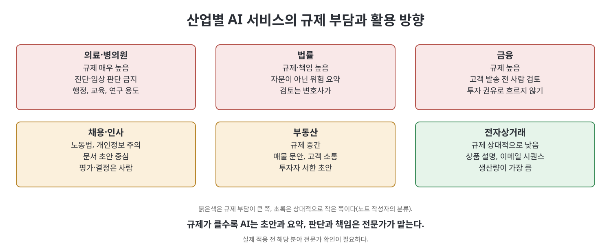

# 21장 틈새시장 심층 분석: 산업별 고부가가치 활용 (Niche Market Deep Dives: High-Value Applications by Industry)

이 장의 주장은 간단하다. 범용 AI 서비스는 가격으로 경쟁하고, 틈새 AI 서비스는 전문성으로 경쟁한다. "AI 자동화를 만든다"와 "상업용 부동산 투자 회사를 위한 AI 시스템을 만든다"는 같은 기술이라도 상품의 성격이 다르다는 것이다. 책은 여섯 개 산업(법률, 의료, 부동산, 금융, 전자상거래, 채용·인사)을 골라 각각 활용처, 프롬프트 시스템, 사업 기회, 진입에 필요한 도메인 지식을 짚는다. 노트는 산업마다 "무엇을 만들 수 있고, 무엇을 조심해야 하는가"를 중심으로 정리한다.

> **쉽게 말하면**
> 기술은 모두 비슷해지므로, 한 업종의 언어와 불안과 규칙을 아는 사람이 같은 도구로 더 비싸게 팔린다.

> **참고(노트 작성자)** 책이 인용하는 시간당 요율, 월 수익 잠재력, 시간 절감 비율은 책의 주장이며 검증하지 않았다. 아래에서는 숫자를 대부분 뺐다. 법률, 의료, 금융, 인사 영역은 규제와 책임이 따르므로 이 노트의 어떤 내용도 법률, 의료, 투자 조언이 아니며 실제 적용 전 해당 분야 전문가 확인이 필요하다. 수익은 보장되지 않는다.

## 이 장의 흐름

1. 법률 서비스
2. 의료와 병의원 운영
3. 부동산
4. 금융 서비스
5. 전자상거래와 D2C 브랜드
6. 채용과 인사
7. 진입 순서

## 1. 법률 서비스

책은 시니어 법률가의 시간이 비싸서, 반복적이고 구조화된 업무의 시간을 조금만 줄여도 시간당 가치가 크다고 본다. 활용처는 계약서 검토와 조항 추출, 판례·법령 조사 요약, 인수 실사 문서 처리, 의뢰인 안내문 초안, 규제 변화 모니터링이다.

책의 계약 위험 검토 프롬프트는 구성 요소만 정리하면 이렇다. 역할은 상업 계약 경력자이며 "법률 자문이 아니라 상업적 위험 검토"라는 선을 긋는다. 지급 조건, 책임 한도와 예외, 지식재산 귀속, 해지 조건, 자동 갱신, 비표준 조항, 빠진 보호 조항을 항목별로 보고, 항목마다 위험도(높음, 보통, 낮음)와 한 문장 요약을 낸다. 끝에 계약 본문을 붙여 넣는다.

책이 정리한 서비스 유형과 과금 구조는 아래처럼 볼 수 있다.

| 서비스 | 고객 | 과금 구조 |
|--------|------|-----------|
| 계약 검토 자동화 | 중형 로펌, 기업 법무 | 월 정액 리테이너 |
| 실사 시스템 | 인수합병 전문 로펌 | 프로젝트 단위 |
| 규제 다이제스트 | 컴플라이언스 팀 | 월 구독형 |
| 의뢰인 안내문 초안 | 개인·소형 로펌 | 저가 SaaS 구독 |

## 2. 의료와 병의원 운영

책은 의료를 가치가 높지만 규제가 가장 엄한 영역으로 본다. 미국 환자정보 보호법인 HIPAA가 환자 정보 취급을 규율하므로, 보호 대상 건강 정보를 처리하는 시스템은 규정에 맞는 인프라에서만 운영해야 한다. 책은 Claude를 진단이나 임상 판단에 쓰지 말고 행정, 교육, 연구 용도로 한정하라고 분명히 말한다. 한국에서는 개인정보와 의료 관련 법이 별도로 적용되므로 전문가 확인이 필요하다.

책이 꼽는 활용처는 의사 보수교육용 논문 요약, 병의원 행정용 환자 안내 템플릿, 정책·절차·직원 공지 문서 초안, 임상의가 준 정보에 기반한 보험 사전 승인 서한 초안, 병의원 마케팅 콘텐츠다. 환자 교육 콘텐츠 프롬프트는 읽기 수준을 쉬운 단계로 두고 따뜻한 어조를 요구하며, 진단이나 특정 치료 권고를 금지하고 항상 의료진 상담으로 안내하게 한다. 입력으로 주제, 환자층, 형식, 임상팀이 정한 핵심 메시지, 환자가 가장 불안해하는 점을 받고, 출력에 쉬운 설명, 앞으로의 경과, 병원에 연락할 시점, 의사에게 물을 질문, 안심 문장을 넣게 한다.

## 3. 부동산

부동산은 매물 설명, 고객 소통, 시장 보고서, 투자 분석, 홍보물처럼 글이 많이 나오고 관계 중심인 산업이다. 책은 더 꾸준하고 전문적으로 소통하는 사람이 경쟁에서 앞선다고 본다.

| 직군 | 주된 필요 | Claude의 쓰임 |
|------|-----------|---------------|
| 주거 중개인 | 매물 소개, 고객 후속 연락 | 매물 문안, 이메일 시퀀스 초안 |
| 상업용 중개인 | 투자 분석 요약 | 재무 서술, 거래 메모 초안 |
| 임대 관리자 | 세입자 소통, 정비 절차 | 갱신 안내문, 요청 응대문 |
| 부동산 투자자 | 거래 분석, 투자자 보고 | 투자 논거 초안, 투자자 서한 |
| 팀·중개법인 | 중개인 교육, 홍보 콘텐츠 | 교육 자료, 소셜·이메일 콘텐츠 |

## 4. 금융 서비스

금융은 고객 대상 문서, 리서치 보고서, 컴플라이언스 문서가 많다. 책은 규제 때문에 AI 결과를 고객에게 보내기 전 반드시 사람이 검토해야 하지만, 질 좋은 초안으로 조사와 작성 시간을 줄이는 가치는 변함없다고 본다. 책은 조언이 아닌 활용처를 나열한다. 자문가가 준 수치를 바탕으로 한 분기 성과 해설, 시장 소식 뉴스레터, 재무 설계 요약 서한, 정책·공시 문구 초안, 개념 설명 콘텐츠다. 투자 권유나 수익 약속으로 흐르지 않게 경계해야 하며, 금융 규제는 전문가 확인이 필요하다.

## 5. 전자상거래와 D2C 브랜드

상품이 수백 개면 설명도 수천 개가 필요하고, 다채널 캠페인은 광고 변형과 이메일 시퀀스를 동시에 요구한다. 책은 이 산업을 콘텐츠 생산량이 가장 큰 환경으로 본다. 책의 이메일 시퀀스 프롬프트는 구매 후 다섯 통의 메일을 설계한다. 주문 확인, 배송 안내와 사용 팁, 도착 후 확인과 커뮤니티, 후기 요청과 추천 보상, 재구매나 교차 판매 순서이며 입력은 브랜드, 상품, 구매자 페르소나, 브랜드 어조, 교차 판매 상품이다. 각 메일에 제목, 미리보기, 짧은 본문을 요구한다.

## 6. 채용과 인사

채용 공고, 면접 질문, 입사 제안서, 평가 요약, 사내 정책, 입사 안내서 같은 구조화된 문서가 많고 일정한 틀을 따른다. 책은 이런 문서에서 Claude가 작성 시간을 크게 줄인다고 주장한다.

| 업무 | Claude 활용 후 달라지는 점 |
|------|----------------------------|
| 채용 공고 작성 | 초안은 빠르고 검토에 집중 |
| 면접 질문 설계 | 직무별 질문 세트를 빠르게 구성 |
| 제안서 작성 | 틀에 맞춰 초안 생성, 조건 확인은 사람 |
| 평가 요약 | 입력 메모를 정리, 평가 판단은 관리자 |
| 정책·입사 문서 | 긴 문서를 단계별로 초안화 |

책은 이 표에서 업무별 절감 비율을 제시하지만 노트는 옮기지 않는다. 평가와 채용 결정은 사람의 판단이어야 하고, 노동법과 개인정보 규정은 전문가 확인이 필요하다.

## 7. 진입 순서

책의 체크리스트를 순서로 정리하면 다음과 같다. 내 지식과 인맥에 가장 가까운 산업을 고른다. 그 산업의 구체적 후보 회사나 전문가 몇 곳을 정한다. 가장 가치 큰 활용처 하나에 맞춘 도메인 전용 시스템을 만든다. 업계 협회나 커뮤니티에 참여한다. 첫 상담 전에 산업 특화 사례나 샘플 산출물을 준비한다.

## 핵심 정리

- 책은 범용 서비스가 가격으로 경쟁하고, 산업 전문성을 갖춘 서비스가 더 높은 단가를 받는다고 주장한다.
- 여섯 산업(법률, 의료, 부동산, 금융, 전자상거래, 채용·인사)은 문서 작성량과 지불 의사가 크다는 공통점이 있다.
- 법률, 의료, 금융, 인사는 규제와 책임이 크므로 AI는 초안과 요약에 쓰고, 판단과 자문은 사람 전문가가 맡는다.
- 프롬프트는 역할, 한계선(자문이 아님), 항목별 출력 형식, 위험도 표시처럼 틀을 정하는 것이 핵심이다.
- 진입은 산업 선택, 후보 고객 조사, 전용 시스템 제작, 커뮤니티 참여, 샘플 산출물 순서다.

 
 
 

이전: [20장 교육과 강의](20%EC%9E%A5%20%EA%B5%90%EC%9C%A1%EA%B3%BC%20%EA%B0%95%EC%9D%98.md) | 다음: [22장 윤리·투명성·전문가 기준](22%EC%9E%A5%20%EC%9C%A4%EB%A6%AC%C2%B7%ED%88%AC%EB%AA%85%EC%84%B1%C2%B7%EC%A0%84%EB%AC%B8%EA%B0%80%20%EA%B8%B0%EC%A4%80.md)

 

[Claude AI Automation and Monetization](../)
