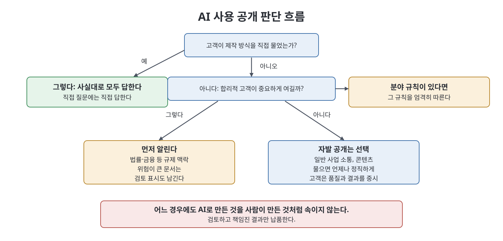

# 22장 윤리, 투명성, 그리고 AI 업무의 전문가 기준 (Ethics, Transparency, and the Professional Standards of AI Work)

이 장은 윤리를 규정 준수용 형식 절차가 아니라 사업의 신뢰, 평판, 지속 가능성을 좌우하는 전문가의 의무로 다룬다. 책은 AI 기반 전문 서비스가 아직 새로운 분야라서 기준이 지금 만들어지고 있고, 오늘 투명성과 품질과 고객 소통에서 어떤 선택을 하느냐가 업계의 규범이 된다고 본다. 그래서 AI 사용을 얼마나 밝힐지의 판단 틀, 품질이라는 윤리, 흔한 윤리적 함정과 예방책, 평판을 쌓는 방법을 순서대로 다룬다.

> **쉽게 말하면**
> 초안은 AI가 쓰더라도 전문성, 판단, 책임은 사람이 진다. 책임까지 AI에게 넘기면 안 된다.

> **참고(노트 작성자)** 이 장은 법과 규범에 걸치는 내용이다. 책의 서술을 정리했을 뿐 법률 조언이 아니다. 계약서의 AI 사용 조항, 개인정보와 비밀유지, 업계 고유 규칙은 나라와 직종마다 다르므로 전문가 확인이 필요하다. 한국의 개인정보 보호 관련 규정도 따로 살펴야 한다.

## 이 장의 흐름

1. 투명성 판단 틀
2. 윤리로서의 품질
3. 흔한 윤리적 함정과 예방
4. AI 서비스에서 평판 쌓기

## 1. 투명성 판단 틀

AI 사용을 얼마나 밝혀야 하느냐는 자주 논쟁이 되는 질문이다. 책은 답이 상황에 따라 다르다고 말하면서, 세 가지를 따져 보라고 한다. 고객이 합리적으로 무엇을 기대하는가, AI 사용이 고객 이익에 중요한가, 해당 직업 분야의 규범이 무엇인가.

책이 제안하는 실질성 테스트(materiality test)는 이렇다. 그 상황의 합리적인 고객이라면 이 결과물에 AI가 관여했다는 사실을 중요하게 여길까? 그렇다면 밝히는 것이 맞다. 정말 아니라면, 곧 고객이 제작 방식보다 결과와 품질을 중시한다면 자발적 공개는 선택이지만, 질문을 받으면 언제나 정직해야 한다.

| 상황 | 권장 방식 | 이유 |
|------|-----------|------|
| 고객이 제작 과정을 직접 묻는다 | 사실대로 모두 답한다 | 직접 질문에는 직접 답해야 한다 |
| 규제 맥락이 있는 법률·금융 업무 | 먼저 알린다 | 규제 때문에 AI 사용이 중요 정보가 될 수 있다 |
| 위험이 큰 문서(의료 요약, 법률 서면) | 먼저 알리고 검토 표시를 남긴다 | 고객이 제작 방식을 알 이익이 있다 |
| 일반 사업 소통과 콘텐츠 | 자발 공개는 선택, 물으면 정직하게 | 고객은 대개 품질과 결과를 중시한다 |
| "사람이 썼다"는 점이 가치인 창작물 | 사실과 다르게 말하지 않는다 | 제작 방식을 속이면 기만이다 |
| 학술·언론처럼 진정성 기준이 명시된 분야 | 분야 규칙을 엄격히 따른다 | 일반 원칙보다 분야의 명시 규칙이 앞선다 |

한 줄로 줄이면, 이 표의 모든 행에서 "물으면 정직하게"가 최저선이다.

## 2. 윤리로서의 품질

책은 품질에도 윤리적 차원이 있다고 말한다. 고객이 돈을 내는 것은 내가 전문성, 판단, 정성을 쏟을 것이라는 신뢰 때문이다. 내가 검토하고 검증하고 책임지지 않은 AI 결과를 그대로 내보내는 것은, 고객이 알아채지 못하더라도 그 신뢰를 어기는 일이라는 것이다.

따라서 검토 절차, 전문성을 더하는 편집, 사실 확인은 간접비가 아니라 내가 파는 전문 서비스의 실체다. 이 장의 요지가 되는 문장은 앞의 쉽게 말하면 블록과 같다. 초안은 AI가, 전문성과 판단과 책임은 사람이 맡는다.

## 3. 흔한 윤리적 함정과 예방

책은 AI 서비스의 윤리 실패가 대개 극적이거나 고의가 아니라, 서두르고 효율을 앞세우고 파급 효과를 생각하지 못해서 생긴다고 본다.

| 함정 | 어떻게 생기나 | 예방 |
|------|---------------|------|
| AI 결과를 전부 사람이 만든 것처럼 표현 | 질문을 받고도 얼버무림 | 기본은 정직, AI를 비밀이 아닌 전문 도구로 소개 |
| 검토 없이 AI 결과를 고객에게 전달 | 물량 압박, 시간 부족 | 모든 납품 흐름에 필수 검토 단계 |
| 고객 기밀을 프롬프트에 부주의하게 입력 | 시스템을 만들며 데이터 흐름을 따져 보지 않음 | 고객 정보를 다루기 전 데이터 취급 점검 |
| AI 능력을 과장해 수주 | 열의가 정직한 평가를 앞지름 | 약속은 낮게, 신뢰는 현실적 약속 위에 |
| 오해를 부르는 콘텐츠 | AI 주장에 대한 사실 확인 부족 | 통계, 인용, 사실 주장은 직접 검증 |
| AI 결과의 편향을 놓침 | 체계적 쏠림을 검사하지 않음 | 인구, 지역 등에서 쏠림이 있는지 정기 점검 |

## 4. AI 서비스에서 평판 쌓기

책은 전문 서비스에서 평판이 가장 값진 자산이며 오래 걸려 쌓이고 사고 한 번에 무너진다고 말한다. 새 기술이라 고객이 무엇을 믿어야 할지 모르는 지금, 이 시장에 들어왔다가 지름길의 대가를 치르고 떠날 많은 사업자와 나를 가르는 것이 품질, 정직, 전문적 판단에 대한 평판이다.

실천은 단순하지만 꾸준해야 한다. 약속한 것을 낸다. 능력과 한계에 정직하다. 내보내기 전에 직접 검토한다. 오류는 빨리 인정하고 넉넉하게 바로잡는다. 고객 정보는 내 정보처럼 다룬다. 책은 이런 습관이 수 년 쌓이면 마케팅으로 살 수 없는 신뢰, 곧 고객이 말을 나누기 전부터 나를 믿게 만드는 추천의 힘으로 돌아온다고 본다.

## 5. 실행 점검

책의 체크리스트를 정리하면 네 가지다. AI 사용 공개 방침을 써서 계약서와 제안서에 넣는다. 고객 정보를 처리하는 모든 시스템의 데이터 취급을 점검한다. 최근 납품물 열 건을 돌아보고 내 기준에 맞았는지 솔직하게 평가한다. 고객의 기대와 내 능력이 어긋난 곳이 있으면 먼저 바로잡는다.

## 핵심 정리

- 책은 AI 사용 공개를 실질성 테스트로 판단하라고 한다. 고객이 중요하게 여길 사실이면 알리고, 직접 물으면 항상 정직하게 답한다.
- 사람이 쓴 것이 가치인 일이나 진정성 기준이 있는 분야에서는 제작 방식을 속이지 않고 분야 규칙을 우선한다.
- 검토하고 검증하고 책임지지 않은 AI 결과의 납품은 신뢰 위반이며, 검토는 간접비가 아니라 서비스의 본질이다.
- 함정은 대부분 서두름에서 나오며, 필수 검토 단계, 데이터 취급 점검, 사실 확인, 편향 점검으로 막는다.
- 평판은 정직, 품질, 오류 인정으로 수 년에 걸쳐 쌓인다. 법과 규정은 전문가 확인이 필요하다.

 
 
 

이전: [21장 틈새시장 심층 분석](21%EC%9E%A5%20%ED%8B%88%EC%83%88%EC%8B%9C%EC%9E%A5%20%EC%8B%AC%EC%B8%B5%20%EB%B6%84%EC%84%9D.md) | 다음: [23장 실전 프롬프트 라이브러리](23%EC%9E%A5%20%EC%8B%A4%EC%A0%84%20%ED%94%84%EB%A1%AC%ED%94%84%ED%8A%B8%20%EB%9D%BC%EC%9D%B4%EB%B8%8C%EB%9F%AC%EB%A6%AC.md)

 

[Claude AI Automation and Monetization](../)
