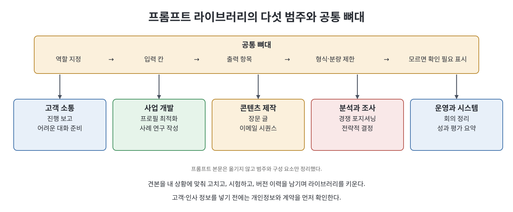

# 23장 실전 프롬프트 라이브러리 (The Complete Production Prompt Library)

이 장은 책이 업무 기능별로 모아 둔 열 개의 프롬프트 모음이다. 책은 이 프롬프트들이 앞서 소개한 CRAFT-X 틀로 설계되었고 실제 입력에 시험했다고 말하지만, 완성품이 아니라 출발점이므로 자기 상황과 어조와 품질 기준에 맞게 고쳐 쓰고 개선 내용을 기록해 라이브러리를 키우라고 한다. 이 노트는 프롬프트 본문을 옮기지 않는다. 대신 범주, 용도, 구성 요소, 쓰는 순서를 정리하고, 마지막에 직접 만든 짧은 예시를 하나 둔다.

> **쉽게 말하면**
> 좋은 프롬프트는 "누구로서, 무엇을 위해, 어떤 재료로, 어떤 모양으로" 답하라는 설계도다. 열 개의 예는 이 설계도를 업무별로 채운 견본이다.

> **참고(노트 작성자)** 프롬프트 본문은 저작물이므로 옮기지 않았고 구성만 요약했다. 직접 쓸 때는 본인의 문장으로 새로 짜는 편이 좋다. 책의 모델과 도구 기준은 집필 시점의 것이다. 고객 이름, 인사 평가, 기밀 정보를 넣을 때는 개인정보와 계약 조건을 먼저 확인하고 필요하면 전문가 확인을 받는다.

## 이 장의 흐름

1. 라이브러리 사용법
2. 고객 소통 프롬프트
3. 사업 개발 프롬프트
4. 콘텐츠 제작 프롬프트
5. 분석과 조사 프롬프트
6. 운영과 시스템 프롬프트
7. 라이브러리를 키우는 법

## 1. 라이브러리 사용법

책은 이 장을 참조용 도구 상자로 본다. 필요할 때 꺼내 쓰고, 쓰면서 개선하고, 개선 내용을 기록한다. 열 개 프롬프트는 대부분 같은 뼈대를 따른다. 역할 지정(시스템 부분), 대괄호로 표시한 입력 칸, 요구하는 출력 항목, 형식과 분량 제한이다. 이 뼈대를 알면 자기 분야용 프롬프트를 새로 만드는 것도 쉬워진다.

## 2. 고객 소통 프롬프트

| 프롬프트 | 용도 | 입력 칸 | 출력 구성 |
|----------|------|---------|-----------|
| 1. 프로젝트 진행 보고 | 고객에게 보내는 정기 상태 보고 | 고객, 프로젝트, 기간, 진행, 계획 대비 상태, 문제와 해결안, 다음 계획, 고객이 할 일 | 제목과 짧은 문단 몇 개, 문제는 해결책과 함께, 분량 상한 |
| 2. 어려운 대화 준비 | 고객이나 동료와의 껄끄러운 대화 연습 | 상대, 상황, 원하는 결과, 상대의 관점, 가장 걱정되는 점 | 비난 없는 첫 발언, 핵심 요점과 표현, 예상 반론과 대응, 마무리 제안, 하지 말아야 할 말 |

쓰는 순서는 이렇다. 진행 보고는 숨기고 싶은 문제도 해결안과 함께 정직하게 적게 하는 것이 요령이고, 어려운 대화 준비는 상대의 관점과 내 걱정을 먼저 적어야 답이 구체적으로 나온다.

## 3. 사업 개발 프롬프트

| 프롬프트 | 용도 | 핵심 입력 | 출력 구성 |
|----------|------|-----------|-----------|
| 3. LinkedIn 프로필 최적화 | 제목과 소개 글을 고객 유치용으로 다듬기 | 현재 역할, 원하는 고객, 제공하는 성과, 대표 성과, 나만의 방법 | 성과 중심 제목 후보 여러 개, 소개 글(해결하는 문제로 시작, 방법, 성과 증거, 누가 연락하면 좋은지) |
| 4. 사례 연구 작성 | 납품 결과를 홍보용 사례로 바꾸기 | 고객 유형, 이전 상황, 내가 한 일, 구체적 결과, 고객 인용 | 제목과 네 부분(도전, 접근, 결과, 시사점), 같은 문제를 가진 잠재 고객을 독자로 |

두 프롬프트 모두 "구체적 결과"를 입력하라고 요구한다. 근거 없는 수치를 꾸며 넣지 않고 실제 성과만 쓴다는 점은 22장의 윤리와 이어진다. 고객 이름은 허락이 있을 때만 쓴다.

## 4. 콘텐츠 제작 프롬프트

| 프롬프트 | 용도 | 핵심 입력 | 출력 구성 |
|----------|------|-----------|-----------|
| 5. 장문 글 | 전문성을 보여 주는 긴 글 | 주제, 핵심 주장, 독자, 독특한 관점, 근거 2~4개, 독자가 취할 행동 | 구체적 장면이나 사실로 시작, 소제목이 있는 본문, 적용 절, 행동을 닫는 결론, 줄글 위주 |
| 6. 이메일 시퀀스 | 잠재 고객을 서서히 구매로 이끄는 다섯 통 | 대상, 궁극적 제안, 망설이는 이유, 줄 수 있는 가치 | 환영과 첫 가치, 실용 가르침, 반론 해소, 사례, 부드러운 행동 요청. 각 통에 제목, 미리보기, 본문, 행동 하나 |

장문 글 프롬프트의 포인트는 "내가 증명하려는 한 가지 주장"을 먼저 적게 하는 것이다. 이메일 시퀀스는 날짜 간격과 통마다의 역할을 정해 두어 밀어붙이지 않고 신뢰를 쌓게 한다.

## 5. 분석과 조사 프롬프트

| 프롬프트 | 용도 | 단계 구성 |
|----------|------|-----------|
| 7. 경쟁 포지셔닝 분석 | 시장에서 내 위치와 차별화 기회 찾기 | 경쟁자 지도, 빈틈 찾기, 대상의 강점과 취약점, 가장 방어 가능한 포지션 하나를 근거와 함께 추천 |
| 8. 전략적 결정 분석 | 둘 이상의 선택지 비교 | 최선·최악 경우, 각 선택이 의존하는 가정, 선택을 믿으려면 필요한 전제, 되돌릴 수 있는지, 경험 많은 조언자의 시각. 끝에 추천과 확신 정도 |

둘 다 "조사한 정보를 붙여 넣는" 칸이 있다. 모델이 시장 사실을 지어낼 수 있으므로, 내가 가진 자료를 넣어 그 안에서 분석하게 하고, 수치와 경쟁사 가격은 직접 확인한다.

## 6. 운영과 시스템 프롬프트

| 프롬프트 | 용도 | 출력 구성 |
|----------|------|-----------|
| 9. 회의 정리와 실행 항목 | 거친 메모를 구조화된 정리로 | 요약, 결정 사항, 담당자와 기한이 있는 실행 표, 미해결 질문, 후속 메일 초안. 노트에 없는 정보는 지어내지 말고 확인 필요로 표시 |
| 10. 성과 평가 요약 | 관리자가 균형 잡힌 평가를 쓰도록 돕기 | 성과 요약, 강점, 개발 영역, 다음 기간 목표. 구체적 사례 중심, 모호한 형용사 금지 |

9번의 "없으면 확인 필요로 표시" 규칙은 환각을 막는 좋은 장치로 읽힌다. 10번은 인사 정보를 다루므로 직원 개인정보와 사내 규정을 확인해야 하고, 최종 평가는 관리자가 직접 책임진다.

## 7. 라이브러리를 키우는 법

책의 점검 항목은 다섯 가지다. 열 개 프롬프트를 내 사업 맥락을 채워 저장한다. 실제 사례에 시험한 뒤에야 고객 업무에 쓴다. 개선할 때마다 버전 이력을 적는다. 내 틈새를 위한 프롬프트를 CRAFT-X로 다섯 개 더 만든다. 독점 맥락을 뺀 좋은 프롬프트를 네트워크에 공유해 프롬프트 엔지니어로서의 신뢰를 쌓는다.

직접 만든 짧은 예시 한 가지를 보이면 이렇다. 위 뼈대에 맞춘 "고객 문의 답장 초안" 프롬프트다.

```
역할: 친절하지만 간결한 고객지원 담당자
입력: [문의 내용], [고객 이름], [우리가 해결할 수 있는 범위]
출력: 사과 한 문장, 해결 방법 두 단계, 추가 질문 하나
제한: 120자 이내 세 문단, 약속할 수 없는 일은 쓰지 않는다
모르면: 지어내지 말고 [담당자 확인 필요]라고 표시한다
```



## 핵심 정리

- 라이브러리는 업무 기능별로 정리한 출발점이며, 내 맥락에 맞춰 고치고 이력을 기록하며 키워 가는 도구 상자다.
- 열 개 프롬프트는 역할, 입력 칸, 출력 항목, 형식 제한이라는 같은 뼈대를 공유한다.
- 범주는 고객 소통, 사업 개발, 콘텐츠 제작, 분석·조사, 운영·시스템의 다섯 가지다.
- "모르면 지어내지 말고 확인 필요로 표시"처럼 환각을 막는 규칙을 프롬프트에 넣는 것이 좋은 습관이다.
- 고객·인사 정보가 들어가는 프롬프트는 개인정보와 계약을 먼저 점검하고, 결과는 사람이 검토한 뒤 쓴다.

<br>
<br>
<br>

이전: [22장 윤리·투명성·전문가 기준](22%EC%9E%A5%20%EC%9C%A4%EB%A6%AC%C2%B7%ED%88%AC%EB%AA%85%EC%84%B1%C2%B7%EC%A0%84%EB%AC%B8%EA%B0%80%20%EA%B8%B0%EC%A4%80.md) | 다음: [24장 긴 게임 복리 가치 쌓기](24%EC%9E%A5%20%EA%B8%B4%20%EA%B2%8C%EC%9E%84%20%EB%B3%B5%EB%A6%AC%20%EA%B0%80%EC%B9%98%20%EC%8C%93%EA%B8%B0.md)

<br>

[Claude AI Automation and Monetization](../)
