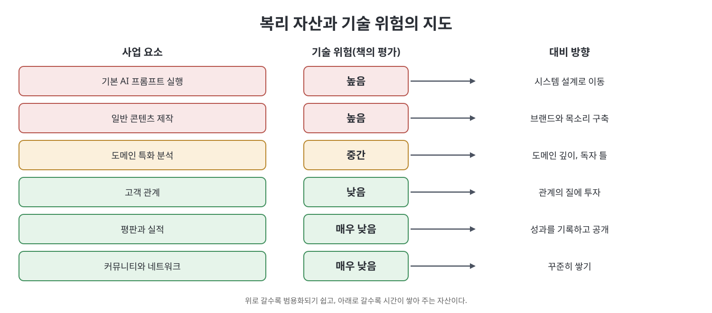

# 24장 긴 게임: AI 사업에서 복리 가치 쌓기 (The Long Game: Building Compounding Value in an AI-Powered Business)

마지막 본문 장은 방향을 바꿔 시간을 길게 본다. 책은 AI 사업의 성공에 일시적인 형태와 지속하는 형태가 있다고 구분한다. 일시적인 형태는 차익 거래(arbitrage)에 기대는 것이다. 대부분의 사람이 아직 못 쓰는 도구로 대부분의 사람이 아직 못 내는 가치를 내는 것인데, 지금은 실재하지만 도구가 보편화되고 경쟁이 늘면 이 프리미엄은 줄어든다. 지속하는 형태는 시간이 지날수록 값이 오르는 복리 자산 위에 선다. 이 장은 그 자산이 무엇인지, 어떻게 키우는지, 기술이 발전해도 살아남으려면 무엇을 해야 하는지를 다룬다.

> **쉽게 말하면**
> 남들보다 먼저 도구를 쓰는 것은 유통기한이 있는 이점이다. 평판, 관계, 전문성, 콘텐츠처럼 쌓일수록 불어나는 것에 투자해야 오래간다.

> **참고(노트 작성자)** 책이 제시하는 기간(예: 6개월, 18개월, 몇 년)은 일반적 경향에 대한 책의 견해일 뿐 보장된 일정이 아니다. 성과의 속도는 업종, 노력, 시장 상황에 따라 크게 다르다. 기술 위험 평가도 책의 판단이며 노트가 검증하지 않았다.

## 이 장의 흐름

1. 다섯 가지 복리 자산
2. 도메인 전문성에 투자하기
3. 콘텐츠 복리 전략
4. 네트워크 효과 만들기
5. 기술 변화에 대비하기
6. 실천가의 다짐과 마지막 실수들

## 1. 다섯 가지 복리 자산

책은 시간 지평별로 자산이 어떻게 불어나는지를 틀로 제시한다. 아래는 책의 표를 노트 작성자가 다시 구성한 것이다.

| 자산 | 복리가 생기는 방식 | 초기에 할 일 | 몇 년 뒤의 모습 |
|------|--------------------|--------------|-----------------|
| 도메인 전문성 | 고객 경험마다 패턴 인식이 깊어짐 | 깊이 공부하고 고객 일 수행 | 더 높은 가격 결정력과 품질 |
| 고객 관계 | 성공적 납품마다 신뢰가 쌓임 | 탁월한 납품과 진심 | 추천 순환, 가격 방어력 |
| 콘텐츠 보관함 | 검색과 소셜에서 시간이 갈수록 퍼짐 | 꾸준한 발행 체계 | 노력 없이도 들어오는 잠재 고객 |
| 평판과 사회적 증거 | 새 성과마다 사례가 쌓임 | 모든 성과를 기록하고 후기 요청 | 첫 대화 전에 이미 선택받음 |
| 시스템의 정교함 | 개선할수록 이후 모든 결과가 좋아짐 | 핵심 시스템을 만들고 반복 개선 | 경쟁자가 쉽게 따라 못 하는 우위 |

## 2. 도메인 전문성에 투자하기

AI 도구는 일반 지식에 거의 같은 접근권을 준다. 차별화는 판단과 함께 쓰이는 구체적이고 힘들게 얻은 전문성이다. 규제, 용어, 고객 관계의 역학, 청중의 불안을 아는 금융 전문가는 같은 프롬프트 기술을 가진 일반인보다 훨씬 좋은 AI 활용 결과를 낸다고 책은 말한다.

책이 권하는 투자 방법은 선택한 산업의 출판물을 읽고, 컨퍼런스에 가고, 실무자와 관계를 맺고, 지식의 경계에 있는 고객 일을 맡고, 도메인을 더 이해해야만 답할 수 있는 질문을 던지는 것이다. 21장의 산업 심층 분석과 맞닿는다.

## 3. 콘텐츠 복리 전략

책은 좋은 콘텐츠를 마케팅 비용이 아니라 자본 투자로 본다. 유용하고 잘 퍼진 글은 몇 년 뒤에도 잠재 고객을 데려오고, 내가 신경 쓰지 않아도 계속 작동하는 발견 장치라는 것이다. 책이 말하는 세 단계는 다음과 같다.

| 단계 | 시기(책의 설명) | 하는 일과 변화 |
|------|-----------------|----------------|
| 씨 뿌리기 | 초기 약 반년 | 꾸준히 발행하고 보관함을 쌓고 무엇이 반응하는지 발견 |
| 복리 시작 | 반년에서 1년 반 사이 | 예전 글이 트래픽과 문의를 만들기 시작 |
| 자립 | 1년 반 이후 | 보관함이 발견을 이끌고 새 글은 이미 있는 독자에게 도달 |

## 4. 네트워크 효과 만들기

네트워크 효과란 새 관계가 생길 때마다 기존 관계의 가치가 함께 커지는 것이다. AI 실무자에게는 소개, 협업 기회, 지식 공유로 나타난다. 책이 권하는 방법은 이상적 고객이 모이는 커뮤니티를 만들거나 참여하기, 같은 고객을 상대하는 인접 전문가와 협업하기, 내게 맞지 않는 고객은 다른 사람에게 소개하기, 지식을 콘텐츠로 공개해 연결자이자 기여자로 자리 잡기다.

## 5. 기술 변화에 대비하기

AI 능력은 계속 좋아질 것이므로, 오늘 어렵고 비싼 일도 2년 뒤에는 쉬워질 수 있다. 책은 이를 비관이 아니라 전략으로 다루라고 한다. 정기적으로 AI 도구의 능력이 내일 두 배가 되면 내 사업의 어떤 부분이 위험해지고 어떤 부분이 강해질까를 묻고, 위험해지는 부분(AI에 대한 접근을 팔고 있는 부분)에서 벗어나 강해지는 부분(핵심 자산)에 에너지를 쏟으라는 것이다.

| 사업 요소 | 기술 위험(책의 평가) | 대비 방법 |
|-----------|----------------------|-----------|
| 기본적인 AI 프롬프트 실행 | 높음, 범용화됨 | 시스템 설계와 도메인 전문성으로 이동 |
| 일반 콘텐츠 제작 | 높음 | 복제하기 어려운 브랜드, 독자, 목소리 구축 |
| 도메인 특화 분석 | 중간 | 도메인 깊이와 독자적 프레임워크 |
| 고객 관계 | 낮음 | 관계의 질에 꾸준히 투자 |
| 평판과 실적 | 매우 낮음 | 성과를 엄밀히 기록하고 공개 증거 구축 |
| 커뮤니티와 네트워크 | 매우 낮음 | 꾸준히 쌓아 수 년에 걸쳐 복리 |

## 6. 실천가의 다짐과 마지막 실수들

책은 체크리스트보다 깊은 다짐을 말한다. 꾸준히 나타나고, 일을 하는 데서 그치지 않고 개선하고, 고객의 사업을 내 사업처럼 정성스럽게 대하고, 단기 매출 극대화가 아니라 몇 년에 걸쳐 자랑스러운 것을 만든다는 결심이다. 도구와 기술은 바뀌어도 전문성, 꾸준한 품질, 진심 어린 배려를 가진 사람은 수요가 있을 것이라고 본다.

마지막 흔한 실수 다섯 가지는 이렇다.

| 실수 | 책이 짚는 이유 |
|------|----------------|
| AI 일을 단기 기회로만 봄 | 몇 년 뒤 성과는 오늘 짓는 사업에서 나옴 |
| 매출만 최적화하고 전문성 개발을 소홀히 함 | 전문성 없는 매출은 천장에 닿고, 매출 없는 전문성은 재정이 취약 |
| 바빠서 자기 성장을 미룸 | 가장 나은 실무자는 배우고 개선하는 데도 시간을 씀 |
| 방법론과 성과를 기록하지 않음 | 실적 기록이 가장 값진 자산 |
| 복리가 보이기까지 걸리는 시간을 과소평가 | 첫해는 오르막, 이후에 순풍이 된다고 책은 말함 |

실행 점검은 다섯 자산별 1년 투자 계획 쓰기, 기술에 가장 취약한 부분 두세 가지 찾기, 올해 도메인 전문성 계획, 2년 지속 가능한 콘텐츠 주기와 체계, 오늘의 결정을 이끌 구체적인 5년 비전이다.

## 핵심 정리

- 책은 차익 거래에 의존한 사업은 일시적이고, 복리 자산에 투자한 사업이 지속한다고 본다.
- 다섯 복리 자산은 도메인 전문성, 고객 관계, 콘텐츠 보관함, 평판과 사회적 증거, 시스템의 정교함이다.
- 콘텐츠는 씨 뿌리기, 복리 시작, 자립의 세 단계를 거치며, 시간표는 책의 일반적 견해일 뿐이다.
- 기술이 좋아져도 위험이 낮은 것은 관계, 평판, 커뮤니티처럼 사람과 시간에 달린 자산이다.
- 장기 관점의 실수는 단기 기회로만 보기, 매출만 보기, 기록하지 않기, 복리의 시간을 과소평가하기다.

 
 
 

이전: [23장 실전 프롬프트 라이브러리](23%EC%9E%A5%20%EC%8B%A4%EC%A0%84%20%ED%94%84%EB%A1%AC%ED%94%84%ED%8A%B8%20%EB%9D%BC%EC%9D%B4%EB%B8%8C%EB%9F%AC%EB%A6%AC.md) | 다음: [맺음말](%EB%A7%BA%EC%9D%8C%EB%A7%90.md)

 

[Claude AI Automation and Monetization](../)
